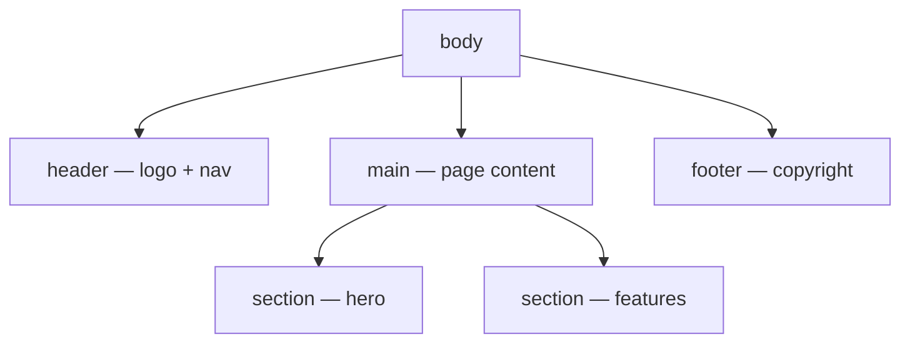

# Module: HTML Fundamentals for Full Stack Developers

**Duration:** See [Session Calendar](../FULL_STACK_PYTHON/00_Course_Guide/11_Session_Calendar_100.md) (1h 15m live sessions).

**Shared topic** (Python FS + Java FS).

**Previous (Python FS):** [Database Programming Bridge](../FULL_STACK_PYTHON/03_Advanced_Python/06_Database_Programming_Bridge.md)
**Next:** [CSS and Responsive](02_CSS_and_Responsive.md)

---

## Learning Outcomes

By the end of this module, learners will be able to:

- Explain HTML's role in the browser–server–database stack
- Build valid page structure with `<!DOCTYPE>`, `<html>`, `<head>`, `<body>`
- Use semantic tags: `header`, `nav`, `main`, `section`, `article`, `footer`
- Create links, images, lists, and accessible tables
- Build forms with GET and POST methods and common input types
- Apply basic accessibility: labels, alt text, heading hierarchy
- Prepare HTML that Django templates and React will later consume

---

## Classroom Ticket

Open the lab kit **before** long notes. Read the ticket → code in `starter/` or fix `broken/`.

- **[Accessible profile + contact form](labs/21_html_profile_form/)**

Finish the ticket in class; compare with the official solution only when your trainer says so.

**HTML** describes the **structure and meaning** of a web page — not Python, not CSS. The browser renders HTML; **CSS** styles it (next module); **JavaScript** makes it interactive.

Full-stack flow: `Browser (HTML/CSS/JS) → Django/Python → MySQL`

When you open a login page, the server sends **HTML**. **Django** will generate HTML from templates; **React** builds HTML-like JSX — concepts start here.

Elements: `<tagname attribute="value">Content</tagname>`  
Example: `<a href="/home">Home</a>`

---

## Important Concepts

### 1. Minimal valid document

```html
<!DOCTYPE html>
<html lang="en">
<head>
  <meta charset="UTF-8">
  <meta name="viewport" content="width=device-width, initial-scale=1.0">
  <title>CampusCart — Home</title>
</head>
<body>
  <h1>Welcome to CampusCart</h1>
  <p>Order food from your campus canteen.</p>
</body>
</html>
```

- `<!DOCTYPE html>` — HTML5 mode
- `lang="en"` — accessibility and SEO
- `<meta charset="UTF-8">` — supports ₹, Hindi, emoji
- `<meta viewport>` — required for mobile

**Note:**
- Missing `<!DOCTYPE html>` — always put it as the first line so the browser stays in HTML5 mode.

**Try these (2 programs):**

**Program 1 — Hello CampusCart page**

```html
<!DOCTYPE html>
<html lang="en">
<head>
  <meta charset="UTF-8">
  <meta name="viewport" content="width=device-width, initial-scale=1.0">
  <title>CampusCart — Priya</title>
</head>
<body>
  <h1>CampusCart</h1>
  <p>Order dosa and chai from your Hyderabad campus canteen.</p>
</body>
</html>
```

**Program 2 — Meta checklist page**

```html
<!DOCTYPE html>
<html lang="en">
<head>
  <meta charset="UTF-8">
  <meta name="viewport" content="width=device-width, initial-scale=1.0">
  <title>My Specs Note</title>
</head>
<body>
  <h1>Why charset + viewport?</h1>
  <ul>
    <li>UTF-8 shows ₹ and Indian names correctly</li>
    <li>Viewport makes the page usable on phones</li>
  </ul>
</body>
</html>
```

### 2. Semantic page layout

```html
<body>
  <header>
    <h1>Datavizon Training Portal</h1>
    <nav aria-label="Main navigation">
      <a href="index.html">Home</a>
      <a href="courses.html">Courses</a>
      <a href="contact.html">Contact</a>
    </nav>
  </header>
  <main>
    <section aria-labelledby="courses-heading">
      <h2 id="courses-heading">Featured Courses</h2>
      <article>
        <h3>Python Full Stack</h3>
        <p>16-week job-ready program.</p>
      </article>
    </section>
  </main>
  <footer><p>&copy; 2026 KSR Datavizon</p></footer>
</body>
```

**Visual — page landmarks (screen readers + humans both thank you):**



Prefer these tags over a pile of anonymous `<div>`s when the meaning is clear.

**Note:**
- `<div>` everywhere — prefer semantic tags (`header`, `nav`, `main`, `section`, `footer`) when the meaning is clear.

**Try these (2 programs):**

**Program 1 — Portfolio landmarks**

```html
<!DOCTYPE html>
<html lang="en">
<head>
  <meta charset="UTF-8">
  <meta name="viewport" content="width=device-width, initial-scale=1.0">
  <title>Ravi — Portfolio</title>
</head>
<body>
  <header>
    <h1>Ravi Kumar</h1>
    <nav aria-label="Main">
      <a href="#about">About</a>
      <a href="#projects">Projects</a>
    </nav>
  </header>
  <main>
    <section id="about"><h2>About</h2><p>Python full stack learner, Bengaluru.</p></section>
    <section id="projects"><h2>Projects</h2><article><h3>Expense Tracker</h3></article></section>
  </main>
  <footer><p>&copy; 2026 Ravi</p></footer>
</body>
</html>
```

**Program 2 — Course landing shell**

```html
<!DOCTYPE html>
<html lang="en">
<head>
  <meta charset="UTF-8">
  <title>KSR Python Full Stack</title>
</head>
<body>
  <header><h1>KSR Datavizon</h1></header>
  <main>
    <section aria-labelledby="feat">
      <h2 id="feat">Featured</h2>
      <article><h3>Python Full Stack</h3><p>16-week job-ready program.</p></article>
    </section>
  </main>
  <footer><p>Hyderabad · Online + Offline</p></footer>
</body>
</html>
```

### 3. Links and images

```html
<a href="https://www.python.org" target="_blank" rel="noopener noreferrer">Python Site</a>
<a href="./about.html">About Us</a>
<a href="mailto:support@campus.in">Email Support</a>

```

| Path type | Example | Use |
|-----------|---------|-----|
| Relative | `images/logo.png` | Same project |
| Absolute | `https://cdn.example.com/logo.png` | CDN |
| Root-relative | `/assets/logo.png` | Django static |

**Note:**
- Missing `alt` — use descriptive alt text (or `alt=""` only for decorative images).
- Broken relative paths — check folder structure (`images/`, `./about.html`) before blaming the tag.

**Try these (2 programs):**

**Program 1 — Nav + mailto**

```html
<!DOCTYPE html>
<html lang="en">
<head><meta charset="UTF-8"><title>Links Lab</title></head>
<body>
  <nav>
    <a href="./index.html">Home</a> |
    <a href="https://www.python.org" target="_blank" rel="noopener noreferrer">Python.org</a> |
    <a href="mailto:support@campus.in">Email Support</a>
  </nav>
</body>
</html>
```

**Program 2 — Image with alt**

```html
<!DOCTYPE html>
<html lang="en">
<head><meta charset="UTF-8"><title>Product Image</title></head>
<body>
  <h1>Notebook — ₹45</h1>
  
  <p>If the image is missing, the alt text still explains it.</p>
</body>
</html>
```

### 4. Lists and tables

```html
<ul><li>Python</li><li>MySQL</li><li>Django</li></ul>

<table>
  <caption>Monthly Fee — Python Batch</caption>
  <thead>
    <tr><th scope="col">Plan</th><th scope="col">Amount (₹)</th></tr>
  </thead>
  <tbody>
    <tr><th scope="row">Standard</th><td>25000</td></tr>
    <tr><th scope="row">Premium</th><td>35000</td></tr>
  </tbody>
</table>
```

Use tables for **tabular data**, not page layout.

**Note:**
- Tables for layout — use CSS Flexbox later; keep tables for real tabular data only.

**Try these (2 programs):**

**Program 1 — Skills list**

```html
<!DOCTYPE html>
<html lang="en">
<head><meta charset="UTF-8"><title>Skills</title></head>
<body>
  <h1>Tech stack</h1>
  <ul>
    <li>Python</li>
    <li>MySQL</li>
    <li>Django</li>
    <li>React</li>
  </ul>
</body>
</html>
```

**Program 2 — Fee table (INR)**

```html
<!DOCTYPE html>
<html lang="en">
<head><meta charset="UTF-8"><title>Fees</title></head>
<body>
  <table>
    <caption>Monthly Fee — Python Batch</caption>
    <thead>
      <tr><th scope="col">Plan</th><th scope="col">Amount (₹)</th></tr>
    </thead>
    <tbody>
      <tr><th scope="row">Standard</th><td>25000</td></tr>
      <tr><th scope="row">Premium</th><td>35000</td></tr>
    </tbody>
  </table>
</body>
</html>
```

### 5. Forms — GET vs POST

```html
<!-- GET — data in URL (search) -->
<form action="/search" method="get">
  <label for="q">Search:</label>
  <input type="search" id="q" name="q" required>
  <button type="submit">Search</button>
</form>

<!-- POST — data in body (registration) -->
<form action="/register" method="post">
  <label for="fullname">Full name</label>
  <input type="text" id="fullname" name="fullname" required minlength="2">

  <label for="email">Email</label>
  <input type="email" id="email" name="email" required>

  <label for="password">Password</label>
  <input type="password" id="password" name="password" required minlength="8">

  <label for="course">Course</label>
  <select id="course" name="course">
    <option value="">-- Select --</option>
    <option value="python-fs">Python Full Stack</option>
  </select>

  <fieldset>
    <legend>Mode</legend>
    <label><input type="radio" name="mode" value="online" checked> Online</label>
    <label><input type="radio" name="mode" value="offline"> Offline</label>
  </fieldset>

  <label><input type="checkbox" name="terms" required> I agree to terms</label>
  <button type="submit">Register</button>
</form>
```

| Method | Data location | Use | Sensitive? |
|--------|---------------|-----|------------|
| **GET** | URL query | Search, filters | No passwords |
| **POST** | Request body | Login, orders | Yes |

Django adds `` to POST forms later.

**Note:**
- Input without `name` — the server receives nothing for that field.
- Password via GET — use POST so credentials are not stuck in the URL.

**Try these (2 programs):**

**Program 1 — Canteen search (GET)**

```html
<!DOCTYPE html>
<html lang="en">
<head><meta charset="UTF-8"><title>Search Menu</title></head>
<body>
  <form action="/search" method="get">
    <label for="q">Search menu</label>
    <input type="search" id="q" name="q" placeholder="dosa, chai…" required>
    <button type="submit">Search</button>
  </form>
</body>
</html>
```

**Program 2 — Mini registration (POST)**

```html
<!DOCTYPE html>
<html lang="en">
<head><meta charset="UTF-8"><title>Register</title></head>
<body>
  <form action="/register" method="post">
    <label for="name">Full name</label>
    <input id="name" name="name" required minlength="2">
    <label for="email">Email</label>
    <input type="email" id="email" name="email" required>
    <label for="city">City</label>
    <select id="city" name="city">
      <option value="hyd">Hyderabad</option>
      <option value="blr">Bengaluru</option>
    </select>
    <button type="submit">Register</button>
  </form>
</body>
</html>
```

### 6. Accessibility basics

- One `<h1>` per page; don't skip heading levels
- Every input has `<label for="id">` matching input `id`
- Meaningful `alt` on images; decorative: `alt=""`
- Use `<button>` for actions, not styled `<div>`
- Tab through form with keyboard

**Note:**
- Multiple `<h1>` tags — use one `h1`; sections use `h2` (and below).

**Try these (2 programs):**

**Program 1 — Labeled inputs only**

```html
<!DOCTYPE html>
<html lang="en">
<head><meta charset="UTF-8"><title>A11y Form</title></head>
<body>
  <h1>Contact</h1>
  <form>
    <label for="phone">Phone (India)</label>
    <input id="phone" name="phone" type="tel" placeholder="10-digit mobile" required>
    <button type="submit">Send</button>
  </form>
</body>
</html>
```

**Program 2 — Heading hierarchy check**

```html
<!DOCTYPE html>
<html lang="en">
<head><meta charset="UTF-8"><title>Headings</title></head>
<body>
  <h1>CampusCart</h1>
  <h2>Today's menu</h2>
  <h3>South Indian</h3>
  <p>Idli, dosa, vada — prices in ₹.</p>
  <!-- Do not jump from h1 to h3 -->
</body>
</html>
```

## Step-by-Step Lab

1. Create `frontend_lab/` with `index.html`, `about.html`, `contact.html`, `images/`
2. Build semantic portfolio: header, nav, main (2 sections), footer; link all pages
3. Add profile image + bio; skills as `<ul>`; education as `<table>`
4. Build POST registration form with `required` on key fields
5. Lighthouse accessibility audit — fix missing labels/alt
6. View Page Source — compare file vs rendered output

---

## Practice Exercises

### Basic

1. Page with h1, two h2 sections, three paragraphs.
   **Model answer:**
   ```html
   <h1>My Learning Journal</h1>
   <h2>Week 1</h2>
   <p>Installed tools and wrote Hello World.</p>
   <h2>Week 2</h2>
   <p>Practised semantic HTML.</p>
   <p>Built a small profile page.</p>
   ```

2. Nav with 4 relative links; ordered list of 5 goals.
   **Model answer:**
   ```html
   <nav>
     <a href="index.html">Home</a>
     <a href="about.html">About</a>
     <a href="projects.html">Projects</a>
     <a href="contact.html">Contact</a>
   </nav>
   <ol>
     <li>HTML</li><li>CSS</li><li>JavaScript</li><li>React</li><li>Django</li>
   </ol>
   ```

3. Image with alt; contact form (name, email, textarea).
   **Model answer:**
   ```html
   
   <form action="#" method="post">
     <label>Name <input name="name" required></label>
     <label>Email <input type="email" name="email" required></label>
     <label>Message <textarea name="message"></textarea></label>
     <button type="submit">Send</button>
   </form>
   ```

### Intermediate

1. Full portfolio: semantic layout + skills + project table.
   **Model answer:**
   Use `<header>`, `<main>`, `<section>` for About/Skills/Projects, `<footer>`. Skills as `<ul>`; projects as a `<table>` with columns Project / Stack / Link. Keep one `h1` for the person/brand name.

2. Product catalog table (5 products: name/price/stock).
   **Model answer:**
   ```html
   <table>
     <thead><tr><th>Name</th><th>Price</th><th>Stock</th></tr></thead>
     <tbody>
       <tr><td>Samosa</td><td>20</td><td>50</td></tr>
       <tr><td>Tea</td><td>15</td><td>100</td></tr>
       <!-- three more rows -->
     </tbody>
   </table>
   ```

3. Login form POST with action `#`; FAQ with `<details>`/`<summary>`.
   **Model answer:**
   ```html
   <form action="#" method="post">
     <input type="text" name="username" required>
     <input type="password" name="password" required>
     <button type="submit">Login</button>
   </form>
   <details>
     <summary>What is HTML?</summary>
     <p>Markup language for web page structure.</p>
   </details>
   ```

4. Add `lang`, viewport meta, title on every page.
   **Model answer:**
   ```html
   <!DOCTYPE html>
   <html lang="en">
   <head>
     <meta charset="UTF-8">
     <meta name="viewport" content="width=device-width, initial-scale=1.0">
     <title>Page Title</title>
   </head>
   ```

### Interview-style

1. `<div>` vs `<section>`?
   **Model answer:**
   `<div>` is a generic container with no meaning. `<section>` marks a thematic grouping of content and should usually have a heading — prefer it when the block is a distinct topic.

2. GET vs POST for job application?
   **Model answer:**
   Use POST: applications create server-side data and may include sensitive fields that should not appear in URLs or browser history.

3. Good vs bad `alt` example?
   **Model answer:**
   Good: `alt="CampusCart home page showing samosa and tea cards"`. Bad: `alt="image"` or empty when the image conveys meaning.

4. Purpose of `<meta charset="UTF-8">`?
   **Model answer:**
   It tells the browser how to decode bytes into characters so Indian languages, ₹, and emoji render correctly instead of mojibake.

5. How will Django reuse this HTML?
   **Model answer:**
   Static structure becomes Django templates with ``, `{{ variables }}`, and `` loops. Forms get `` and template tags for URLs/static files.

## Mini-Project: Portfolio or Course Landing Page

**Lab kit (build here):** [labs/21_html_profile_form/](labs/21_html_profile_form/)

**Option A — Portfolio site:** Home (intro, photo), Projects table, Contact form  
**Option B — Course landing:** Hero, curriculum table, Register form

### What to build

Semantic structure; all images have alt; all inputs labeled; internal nav works; no CSS required yet.

### Stretch

- Add a fee table with ₹ amounts and `scope` on `th`.
- Add `fieldset` + `legend` for Online/Offline mode on the register form.
- Link three pages: Home, Projects/Courses, Contact.

### Done when

- [ ] Lab kit profile + contact form ticket completed
- [ ] One `<h1>`, semantic `header`/`main`/`footer`
- [ ] Every input has a matching `<label for>`
- [ ] Every meaningful image has `alt` text

---

## Revision Map — Memorize / Understand / Practise / Build

| Topic | Memorize | Understand | Practise | Build |
|-------|----------|------------|----------|-------|
| HTML role | Markup not programming | Structure vs style vs behavior | View page source | First `.html` file |
| Document skeleton | doctype, html, head, body | Metadata vs visible | Template copy | Reusable starter |
| Semantic tags | header, nav, main, footer | SEO/a11y meaning | Replace div soup | Portfolio layout |
| Links & paths | `<a href>`, relative/absolute | Same-site vs external | Link drills | Nav bar |
| Images | `` | alt for accessibility | Broken image debug | Product card |
| Tables | thead, tbody, th, td | Tabular data | 3 layouts | Fee schedule |
| Forms | method get/post | Client → server | Registration form | Login form |
| Accessibility | label for, alt, h1–h6 | Screen readers | Lighthouse peek | A11y checklist |

## Interview & Discussion Q&A

### Discuss in class

1. Is HTML a programming language? Why or why not?
2. Why shouldn't login forms use GET?
3. How do semantic tags help screen reader users?
4. HTML like a Word document outline?
5. What will React change about how we write HTML?

*No memorized script — push for plain-English answers, then continue to interview Qs below.*

### Interview answers

**Q1. What is HTML?**  
**A:** HyperText Markup Language — standard for structuring web content in browsers.

**Q2. Semantic HTML — examples?**  
**A:** header, nav, main, article — meaning for SEO/accessibility vs div-only markup.

**Q3. Block vs inline elements?**  
**A:** Block (div, p, h1) new line; inline (a, span) flows in line — CSS module expands.

**Q4. HTML vs CSS vs JavaScript?**  
**A:** Structure, presentation, behavior/interactivity.

**Q5. HTML and Django templates?**  
**A:** Django renders HTML with `{{ variable }}` and loops — same tags, server-generated.

---

