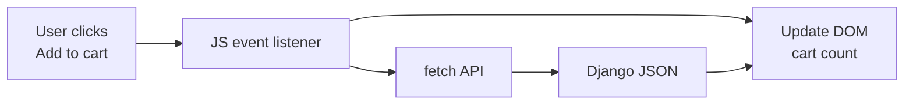

# Module: JavaScript, DOM, and Forms

**Shared topic** (Python FS + Java FS).

**Previous:** [CSS and Responsive](02_CSS_and_Responsive.md)
**Next (Python FS):** [Django Introduction](../FULL_STACK_PYTHON/07_Django/01_Django_Introduction_and_Setup.md)  
**Next (Java FS):** Spring / backend module (when that program is added)

---

## Learning Outcomes

By the end of this module, learners will be able to:

- Declare variables with `let` and `const`; explain why to avoid `var`
- Write functions (declaration and arrow) for event handlers
- Select and update DOM elements with `querySelector` / `querySelectorAll`
- Attach event listeners for click, input, and submit
- Validate HTML forms in JavaScript before submission
- Use `fetch()` to call a JSON API and display results (overview)
- Connect frontend JS patterns to upcoming Django views and React components

---

## Classroom Ticket

Open the lab kit **before** long notes. Read the ticket → code in `starter/` or fix `broken/`.

- **[Validate contact form in the page](labs/23_js_form_validation/)**

Finish the ticket in class; compare with the official solution only when your trainer says so.

**JavaScript** makes pages **interactive**. HTML = skeleton; CSS = skin; JS = muscles — clicks, validation, fetching data from Django API without full reload.

CampusCart "Add to cart" flow:

1. Event listener hears click
2. JS updates **DOM** (browser's live HTML tree)
3. JS may **`fetch('/api/products')`** for JSON from Django
4. JS renders updated content

**Visual — click to screen update:**



| Runs in | Languages | Example |
|---------|-----------|---------|
| Browser | HTML, CSS, JS | Form validation |
| Server | Python/Django | DB, auth, business rules |

**Client validation** = instant UX. **Server validation** = mandatory for security — never trust JS alone.

**Later:** Django returns HTML + JSON APIs; **React** uses same JS syntax + fetch in components.

---

## Important Concepts

### 1. Script setup

```html
<script src="js/app.js" defer></script>
```

```javascript
"use strict";
console.log("CampusCart JS loaded");
```

**Note:**
- Script without `defer` / wrong placement — put the script at the end of `body` or use `defer` so the DOM exists first.

**Try these (2 programs):**

**Program 1 — Deferred script log**

```html
<!DOCTYPE html>
<html lang="en">
<head>
  <meta charset="UTF-8">
  <title>JS Setup</title>
  <script src="js/app.js" defer></script>
</head>
<body>
  <h1>CampusCart</h1>
</body>
</html>
```

```javascript
// js/app.js
"use strict";
console.log("CampusCart JS loaded");
```

**Program 2 — Strict mode smoke test**

```javascript
"use strict";
const city = "Hyderabad";
console.log("Serving canteen orders in", city);
```

### 2. Variables: let and const

```javascript
const APP_NAME = "CampusCart";
let cartCount = 0;
cartCount = cartCount + 1;
// APP_NAME = "Other";  // Error

// Avoid var — function scope, hoisting bugs
```

| Keyword | Reassign? | Use |
|---------|-----------|-----|
| `const` | No | Default choice |
| `let` | Yes | Counters, loops |

**Note:**
- Using `var` — prefer `const`/`let` to avoid function-scope and hoisting bugs.
- `=` instead of `===` — use strict equality when comparing values.

**Try these (2 programs):**

**Program 1 — Cart counter**

```javascript
"use strict";
const APP_NAME = "CampusCart";
let cartCount = 0;
cartCount += 1;
cartCount += 1;
console.log(APP_NAME, "items:", cartCount);
```

**Program 2 — INR totals**

```javascript
"use strict";
const GST_RATE = 0.05;
let subtotal = 90; // veg thali ₹
let total = subtotal + subtotal * GST_RATE;
console.log("Total ₹" + total.toFixed(2));
```

### 3. Functions

```javascript
function formatPrice(amountInPaise) {
  return "₹" + (amountInPaise / 100).toFixed(2);
}

const isValidEmail = (email) => email.includes("@") && email.includes(".");
const double = (n) => n * 2;
```

**Try these (2 programs):**

**Program 1 — formatPrice**

```javascript
"use strict";
function formatPrice(amountInPaise) {
  return "₹" + (amountInPaise / 100).toFixed(2);
}
console.log(formatPrice(9000)); // ₹90.00
console.log(formatPrice(2500)); // ₹25.00
```

**Program 2 — Email check arrow**

```javascript
"use strict";
const isValidEmail = (email) => email.includes("@") && email.includes(".");
console.log(isValidEmail("priya@campus.in")); // true
console.log(isValidEmail("bad-email")); // false
```

### 4. DOM selection and updates

```html
<h1 id="greeting">Hello</h1>
<button id="btn-hello">Say Hello</button>
```

```javascript
const greetingEl = document.querySelector("#greeting");
const btn = document.querySelector("#btn-hello");

greetingEl.textContent = "Welcome to Python Full Stack";
greetingEl.classList.add("active");
greetingEl.classList.toggle("highlight");

document.querySelectorAll(".product-card").forEach((card) => {
  card.style.borderColor = "#2563eb";
});
```

Prefer `classList` over inline `style`.

**Note:**
- Element null — verify the selector and `console.log` the element before calling methods on it.
- `innerHTML` with user input — XSS risk; prefer `textContent` for untrusted strings.

**Try these (2 programs):**

**Program 1 — Change greeting**

```html
<h1 id="greeting">Hello</h1>
<script>
  "use strict";
  const greetingEl = document.querySelector("#greeting");
  greetingEl.textContent = "Welcome to CampusCart — Hyderabad";
  greetingEl.classList.add("active");
</script>
```

**Program 2 — Style product cards**

```javascript
"use strict";
document.querySelectorAll(".product-card").forEach((card) => {
  card.classList.add("highlight");
});
```

### 5. Events

```javascript
btn.addEventListener("click", () => {
  greetingEl.textContent = "Clicked at " + new Date().toLocaleTimeString();
});

const emailInput = document.querySelector("#email");
const emailHint = document.querySelector("#email-hint");

emailInput.addEventListener("input", () => {
  emailHint.textContent = isValidEmail(emailInput.value)
    ? "Email looks good" : "Enter valid email";
  emailHint.className = isValidEmail(emailInput.value) ? "hint ok" : "hint error";
});
```

**Try these (2 programs):**

**Program 1 — Click updates text**

```html
<h1 id="greeting">Hello</h1>
<button id="btn-hello">Say Hello</button>
<script>
  "use strict";
  const greetingEl = document.querySelector("#greeting");
  document.querySelector("#btn-hello").addEventListener("click", () => {
    greetingEl.textContent = "Namaste — clicked at " + new Date().toLocaleTimeString();
  });
</script>
```

**Program 2 — Live email hint**

```javascript
"use strict";
const isValidEmail = (email) => email.includes("@") && email.includes(".");
const emailInput = document.querySelector("#email");
const emailHint = document.querySelector("#email-hint");
emailInput.addEventListener("input", () => {
  emailHint.textContent = isValidEmail(emailInput.value)
    ? "Email looks good" : "Enter valid email";
});
```

### 6. Form validation

```html
<form id="register-form" novalidate>
  <label for="fullname">Full name</label>
  <input type="text" id="fullname" required>
  <span class="error" id="fullname-error"></span>

  <label for="email">Email</label>
  <input type="email" id="email" required>
  <span class="error" id="email-error"></span>

  <label for="password">Password</label>
  <input type="password" id="password" minlength="8" required>
  <span class="error" id="password-error"></span>

  <button type="submit">Register</button>
</form>
```

```javascript
const form = document.querySelector("#register-form");

function showError(id, msg) {
  document.querySelector(id).textContent = msg;
}

form.addEventListener("submit", (event) => {
  event.preventDefault();
  document.querySelectorAll(".error").forEach((el) => (el.textContent = ""));

  const fullname = document.querySelector("#fullname").value.trim();
  const email = document.querySelector("#email").value.trim();
  const password = document.querySelector("#password").value;
  let valid = true;

  if (fullname.length < 2) {
    showError("#fullname-error", "Name must be 2+ characters");
    valid = false;
  }
  if (!isValidEmail(email)) {
    showError("#email-error", "Invalid email");
    valid = false;
  }
  if (password.length < 8) {
    showError("#password-error", "Password 8+ characters");
    valid = false;
  }

  if (valid) {
    console.log("Form OK — would POST to Django:", { fullname, email });
    alert("Valid! Server validation comes in Django.");
  }
});
```

**Note:**
- No `preventDefault` on submit — the page reloads and your JS state is lost.
- Client validation only — duplicate the same rules later in Django; never trust the browser alone.

**Try these (2 programs):**

**Program 1 — preventDefault gate**

```javascript
"use strict";
document.querySelector("#register-form").addEventListener("submit", (event) => {
  event.preventDefault();
  const name = document.querySelector("#fullname").value.trim();
  if (name.length < 2) {
    alert("Name must be 2+ characters");
    return;
  }
  console.log("Would POST to Django:", name);
});
```

**Program 2 — Password length check**

```javascript
"use strict";
function passwordOk(pw) {
  return pw.length >= 8;
}
console.log(passwordOk("secret12")); // true
console.log(passwordOk("short")); // false
```

### 7. fetch() — JSON API overview

```javascript
async function loadProducts() {
  const listEl = document.querySelector("#product-list");
  listEl.textContent = "Loading...";

  try {
    const response = await fetch("https://jsonplaceholder.typicode.com/users");
    if (!response.ok) throw new Error("Status: " + response.status);

    const users = await response.json();
    listEl.innerHTML = "";
    users.slice(0, 5).forEach((user) => {
      const li = document.createElement("li");
      li.textContent = user.name + " — " + user.email;
      listEl.appendChild(li);
    });
  } catch (err) {
    listEl.textContent = "Failed: " + err.message;
  }
}

document.querySelector("#load-btn").addEventListener("click", loadProducts);
```

**Pattern:** fetch → check ok → json() → update DOM.

**POST (conceptual — Django CSRF later):**

```javascript
async function createOrder(data) {
  const response = await fetch("/api/orders/", {
    method: "POST",
    headers: { "Content-Type": "application/json" },
    body: JSON.stringify(data),
  });
  return response.json();
}
```

**React preview:** Same fetch inside `useEffect(() => { loadProducts(); }, []);`

**Note:**
- Missing `await` on `json()` — follow the async/await pattern: `const data = await response.json()`.

**Try these (2 programs):**

**Program 1 — Load users into a list**

```javascript
"use strict";
async function loadUsers() {
  const listEl = document.querySelector("#product-list");
  listEl.textContent = "Loading...";
  try {
    const response = await fetch("https://jsonplaceholder.typicode.com/users");
    if (!response.ok) throw new Error("Status: " + response.status);
    const users = await response.json();
    listEl.innerHTML = "";
    users.slice(0, 5).forEach((user) => {
      const li = document.createElement("li");
      li.textContent = user.name + " — " + user.email;
      listEl.appendChild(li);
    });
  } catch (err) {
    listEl.textContent = "Failed: " + err.message;
  }
}
document.querySelector("#load-btn").addEventListener("click", loadUsers);
```

**Program 2 — Conceptual POST body**

```javascript
"use strict";
async function previewOrderPayload() {
  const data = { item: "Masala Dosa", priceInr: 60, city: "Hyderabad" };
  console.log("Would POST JSON:", JSON.stringify(data));
  // Later: fetch("/api/orders/", { method: "POST", body: JSON.stringify(data) })
}
previewOrderPayload();
```

## Step-by-Step Lab

1. Console: variables, `formatPrice()`, log output
2. Button changes `#greeting` text on click
3. Toggle `dark-mode` class on `<body>`
4. Registration form with preventDefault + inline errors
5. fetch button loads JSON into `<ul id="product-list">`
6. Add cart counter with `let cartCount` on product cards

---

## Practice Exercises

### Basic

1. `const` course name + `let` module number; log both.
   **Model answer:**
   ```javascript
   const courseName = "Python Full Stack";
   let moduleNumber = 3;
   console.log(courseName, moduleNumber);
   ```

2. `celsiusToFahrenheit(c)` function.
   **Model answer:**
   ```javascript
   function celsiusToFahrenheit(c) {
     return c * 9 / 5 + 32;
   }
   console.log(celsiusToFahrenheit(37));
   ```

3. Button increments `#count` span.
   **Model answer:**
   ```javascript
   let count = 0;
   document.querySelector("#inc").addEventListener("click", () => {
     count += 1;
     document.querySelector("#count").textContent = count;
   });
   ```

4. Loop `.item` paragraphs — change color.
   **Model answer:**
   ```javascript
   document.querySelectorAll(".item").forEach((el) => {
     el.style.color = "#0b6e4f";
   });
   ```

### Intermediate

1. Password strength on input (length + digit).
   **Model answer:**
   ```javascript
   const input = document.querySelector("#password");
   const hint = document.querySelector("#strength");
   input.addEventListener("input", () => {
     const v = input.value;
     const ok = v.length >= 8 && /\d/.test(v);
     hint.textContent = ok ? "Strong enough" : "Need 8+ chars and a digit";
   });
   ```

2. FAQ toggle with classList.
   **Model answer:**
   ```javascript
   document.querySelectorAll(".faq-q").forEach((btn) => {
     btn.addEventListener("click", () => {
       btn.parentElement.classList.toggle("open");
     });
   });
   ```

3. fetch `/posts/1` from jsonplaceholder — show title.
   **Model answer:**
   ```javascript
   fetch("https://jsonplaceholder.typicode.com/posts/1")
     .then((r) => r.json())
     .then((data) => {
       document.querySelector("#title").textContent = data.title;
     })
     .catch((err) => console.error(err));
   ```

4. Disable submit until terms checkbox checked.
   **Model answer:**
   ```javascript
   const box = document.querySelector("#terms");
   const btn = document.querySelector("#submit");
   btn.disabled = true;
   box.addEventListener("change", () => {
     btn.disabled = !box.checked;
   });
   ```

### Interview-style

1. `textContent` vs `innerHTML`?
   **Model answer:**
   `textContent` sets/gets plain text safely. `innerHTML` parses HTML and can introduce XSS if you inject untrusted strings — prefer `textContent` unless you intentionally render markup you control.

2. Why server validation if JS validates?
   **Model answer:**
   Users can disable JS or forge requests with curl/Postman. Server validation is the real security boundary; client checks only improve UX.

3. fetch steps to display JSON?
   **Model answer:**
   `fetch(url)` → check `response.ok` → `response.json()` → update the DOM with the data → handle errors in `catch` or with try/catch around `await`.

4. Event bubbling — one sentence?
   **Model answer:**
   After a handler runs on the target element, the same event propagates upward through ancestors unless stopped with `stopPropagation`.

5. How React replaces manual DOM updates?
   **Model answer:**
   You declare UI from state/props; React diffs and updates the DOM for you. Instead of `querySelector` + `textContent`, you set state and re-render components.

## Mini-Project: Interactive Registration + API Preview

**Lab kit (build here):** [labs/23_js_form_validation/](labs/23_js_form_validation/)

### What to build

1. Registration form with JS validation (name, email, password)
2. Live character count on bio textarea
3. fetch panel loading JSON list (jsonplaceholder)
4. Cart counter OR dark-mode toggle

**Files:** `index.html`, `css/styles.css`, `js/app.js`

### Stretch

- Disable submit until terms checkbox is checked.
- Show password strength (length + has digit) on `input`.
- Replace placeholder API with a note pointing to your future Django `/api/` route.

### Done when

- [ ] Lab kit contact form validation ticket completed
- [ ] Invalid submit does not reload the page; errors show inline
- [ ] Valid submit logs payload to console
- [ ] At least one `fetch` demo loads JSON into the DOM

---

## Revision Map — Memorize / Understand / Practise / Build

| Topic | Memorize | Understand | Practise | Build |
|-------|----------|------------|----------|-------|
| JS role | Behavior layer | HTML/CSS/JS split | console.log | Interactive page |
| let / const | Block scope | const binding | Swap var → const | Clean variables |
| Functions | params, return | Reuse logic | Tiny functions | Validators |
| DOM query | querySelector(All) | Tree of nodes | Select elements | Dynamic text |
| DOM update | textContent, classList | Reflow lite | Toggle visibility | Cart counter |
| Events | addEventListener | Event object | click, submit | Button actions |
| Form validation | preventDefault | Client vs server | Email/password | Registration |
| fetch API | async/await overview | JSON response | Public API | Product list |
| Full-stack bridge | Django JSON API | React useEffect | response.json() | API preview |

## Interview & Discussion Q&A

Shared with students after concepts and the mini-project. Use for review and interview prep — questions and model answers are included.

1. Can JS connect to MySQL directly from browser? Why not?
2. How debug wrong fetch URL?
3. addEventListener like Python event-driven thinking?
4. Full page reload vs fetch — when each?
5. What changes when logic moves to React?

**Q1. What is the DOM?**  
**A:** Browser's tree representation of HTML; JS reads/modifies elements dynamically.

**Q2. let vs const vs var?**  
**A:** let/const block-scoped; const no reassignment; var legacy — prefer const then let.

**Q3. Event delegation?**  
**A:** One listener on parent; event.target handles dynamic children — useful for lists.

**Q4. fetch vs XMLHttpRequest?**  
**A:** fetch is modern Promise-based HTTP API; standard for REST from React/Django frontends.

**Q5. Connect to Django and React?**  
**A:** Django serves HTML + JSON APIs; JS fetch calls them; React is JS UI library with same patterns.

---

