# 1. CSS — CSS Fundamentals

**Index:** [CSS and Responsive](../02_CSS_and_Responsive.md)  
**Previous:** [CSS and Responsive](../02_CSS_and_Responsive.md)  
**Next:** [Colors, Text and the Box Model](Module_02_Colors_Text_and_Box_Model.md)

The page in these examples is Acme HR. The visible heading is the one `<h1>`. The regions are a header, a nav, a main, one section, and a footer. Rules live in `styles.css`.

## 1. Introduction to CSS

CSS stands for Cascading Style Sheets. A style sheet is a list of rules. Each rule selects part of the HTML and sets how it looks. The HTML still names the heading and the paragraph. CSS sets the colour and the type.

### Example

```css
/* styles.css */
h1 {
  color: #1a365d;
}
```

```html
<!DOCTYPE html>
<html lang="en">
<head>
  <meta charset="UTF-8">
  <meta name="viewport" content="width=device-width, initial-scale=1.0">
  <title>Acme HR</title>
  <link rel="stylesheet" href="styles.css">
</head>
<body>
  <header>
    <h1>Acme HR</h1>
  </header>
  <main>
    <section>
      <h2>Hyderabad office</h2>
      <p>Employee records for HITEC City.</p>
    </section>
  </main>
  <footer>
    <p>Acme HR, Hyderabad</p>
  </footer>
</body>
</html>
```

**This will produce the following result:**


## 2. Role of CSS in Web Development

HTML is the structure. CSS is the presentation. The same directory page can be restyled by editing `styles.css` and leaving the tags in place. A phone and a laptop read the same HTML. Later modules change the layout with media queries.

### Example

```css
/* styles.css */
body {
  color: #1b2430;
  background-color: #f4f6f8;
}
```

```html
<!DOCTYPE html>
<html lang="en">
<head>
  <meta charset="UTF-8">
  <meta name="viewport" content="width=device-width, initial-scale=1.0">
  <title>Acme HR</title>
  <link rel="stylesheet" href="styles.css">
</head>
<body>
  <header>
    <h1>Acme HR</h1>
  </header>
  <main>
    <section>
      <h2>Hyderabad office</h2>
      <p>The HTML is unchanged. The colours come from CSS.</p>
    </section>
  </main>
  <footer>
    <p>Acme HR, Hyderabad</p>
  </footer>
</body>
</html>
```

**This will produce the following result:**

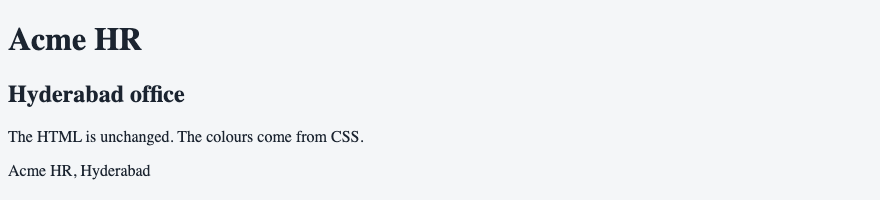

## 3. Inline, Internal & External CSS

A declaration can sit on one tag, in a `<style>` element, or in a separate file. External CSS is the method for Acme HR. Django serves the file from `static/`. Spring Boot serves it from `src/main/resources/static/`.

The style attribute appears once here. This paragraph is navy because of `style="color: #1a365d"`. That declaration moves into a class. The example uses the class.

| Method | Where it lives |
|--------|----------------|
| Inline | `style` on one tag |
| Internal | `<style>` in the head |
| External | `styles.css`, linked from the head |

### Example

```css
/* styles.css */
.office {
  color: #1a365d;
}
```

```html
<!DOCTYPE html>
<html lang="en">
<head>
  <meta charset="UTF-8">
  <meta name="viewport" content="width=device-width, initial-scale=1.0">
  <title>Acme HR</title>
  <link rel="stylesheet" href="styles.css">
</head>
<body>
  <header>
    <h1>Acme HR</h1>
  </header>
  <main>
    <section>
      <h2>Hyderabad office</h2>
      <p class="office">Employee records for HITEC City.</p>
    </section>
  </main>
  <footer>
    <p>Acme HR, Hyderabad</p>
  </footer>
</body>
</html>
```

**This will produce the following result:**


## 4. CSS Syntax & Comments

A rule has a selector, then declarations inside braces. Each declaration is a property, a colon, a value, and a semicolon. A comment starts with `/*` and ends with `*/`. Comments are notes for the author. The browser ignores them.

### Example

```css
/* Brand colour for the Acme HR heading */
h1 {
  color: #1a365d;
  font-family: system-ui, sans-serif;
}
```

```html
<!DOCTYPE html>
<html lang="en">
<head>
  <meta charset="UTF-8">
  <meta name="viewport" content="width=device-width, initial-scale=1.0">
  <title>Acme HR</title>
  <link rel="stylesheet" href="styles.css">
</head>
<body>
  <header>
    <h1>Acme HR</h1>
  </header>
  <main>
    <section>
      <h2>Hyderabad office</h2>
      <p>The comment in styles.css is not shown.</p>
    </section>
  </main>
  <footer>
    <p>Acme HR, Hyderabad</p>
  </footer>
</body>
</html>
```

**This will produce the following result:**

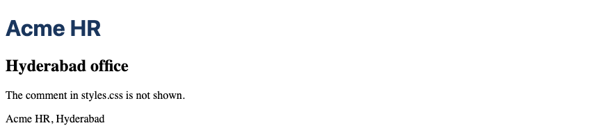

## 5. CSS Selectors

A selector names the elements a rule applies to. It can be an element name, a class, an id, or a combination. The declaration block sets the properties. Prefer a class over an id for styling.

| Selector | Matches |
|----------|---------|
| `p` | Every paragraph |
| `.office` | Every element with `class="office"` |
| `#payroll` | The one element with `id="payroll"` |
| `*` | Every element |

### Example

```css
/* styles.css */
.office {
  color: #1a365d;
}
```

```html
<!DOCTYPE html>
<html lang="en">
<head>
  <meta charset="UTF-8">
  <meta name="viewport" content="width=device-width, initial-scale=1.0">
  <title>Acme HR</title>
  <link rel="stylesheet" href="styles.css">
</head>
<body>
  <header>
    <h1>Acme HR</h1>
  </header>
  <main>
    <section>
      <h2>Hyderabad office</h2>
      <p class="office">This paragraph matches .office.</p>
    </section>
  </main>
  <footer>
    <p>Acme HR, Hyderabad</p>
  </footer>
</body>
</html>
```

**This will produce the following result:**

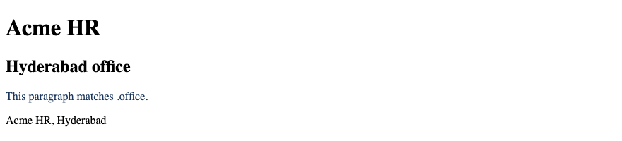

## 6. Element, Class & ID Selectors

An element selector matches every tag of that name. A class selector starts with a dot and can be reused. An id selector starts with a hash and matches one element. Prefer a class over an id for styling. Keep the id for a fragment link, such as `#payroll`.

### Example

```css
/* styles.css */
p {
  color: #1b2430;
}

.office {
  color: #1a365d;
}
```

```html
<!DOCTYPE html>
<html lang="en">
<head>
  <meta charset="UTF-8">
  <meta name="viewport" content="width=device-width, initial-scale=1.0">
  <title>Acme HR</title>
  <link rel="stylesheet" href="styles.css">
</head>
<body>
  <header>
    <h1>Acme HR</h1>
  </header>
  <main>
    <section>
      <h2>Hyderabad office</h2>
      <p class="office">Styled with a class.</p>
      <p id="payroll">Next payroll is 30 September 2026. The id is for a link, not for the colour.</p>
    </section>
  </main>
  <footer>
    <p>Acme HR, Hyderabad</p>
  </footer>
</body>
</html>
```

**This will produce the following result:**


## 7. Universal & Grouping Selectors

`*` matches every element. A grouping selector applies one rule to several selectors. The names are separated by commas. Group headings that share a colour. The universal selector is the right place for `box-sizing`, in the box model module.

### Example

```css
/* styles.css */
h1, h2 {
  color: #1a365d;
  font-family: system-ui, sans-serif;
}
```

```html
<!DOCTYPE html>
<html lang="en">
<head>
  <meta charset="UTF-8">
  <meta name="viewport" content="width=device-width, initial-scale=1.0">
  <title>Acme HR</title>
  <link rel="stylesheet" href="styles.css">
</head>
<body>
  <header>
    <h1>Acme HR</h1>
  </header>
  <main>
    <section>
      <h2>Hyderabad office</h2>
      <p>The two headings share one rule.</p>
    </section>
  </main>
  <footer>
    <p>Acme HR, Hyderabad</p>
  </footer>
</body>
</html>
```

**This will produce the following result:**

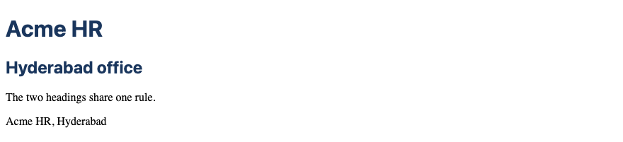

## 8. Attribute Selectors

An attribute selector matches an element that has an attribute, or an attribute with a given value. `a[href]` matches every link that has an address. Square brackets hold the test. Use this when the class is not the fact you care about, such as the type of a control.

### Example

```css
/* styles.css */
a[href] {
  color: #1a365d;
}
```

```html
<!DOCTYPE html>
<html lang="en">
<head>
  <meta charset="UTF-8">
  <meta name="viewport" content="width=device-width, initial-scale=1.0">
  <title>Acme HR</title>
  <link rel="stylesheet" href="styles.css">
</head>
<body>
  <header>
    <h1>Acme HR</h1>
    <nav>
      <a href="directory.html">Directory</a>
      <a href="leave.html">Leave</a>
    </nav>
  </header>
  <main>
    <section>
      <h2>Hyderabad office</h2>
      <p>The links match a[href].</p>
    </section>
  </main>
  <footer>
    <p>Acme HR, Hyderabad</p>
  </footer>
</body>
</html>
```

**This will produce the following result:**

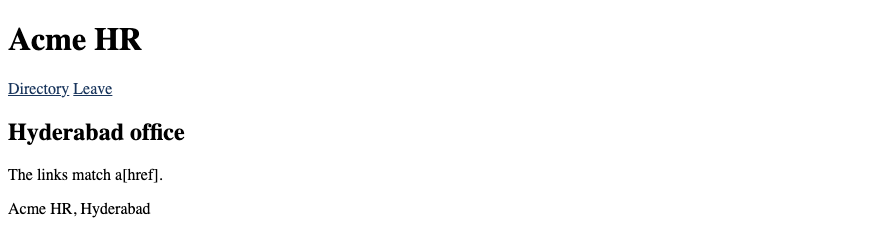

## 9. Descendant, Child & Sibling Selectors

A descendant selector, written with a space, matches an element inside another, at any depth. A child selector `>` matches only a direct child. `h2 + p` matches a paragraph that follows a heading immediately. `h2 ~ p` matches paragraphs that follow the heading at the same level.

| Selector | Matches |
|----------|---------|
| `nav a` | A link inside nav |
| `header > h1` | An h1 that is a child of header |
| `h2 + p` | The paragraph right after an h2 |
| `h2 ~ p` | Paragraphs after an h2, same parent |

### Example

```css
/* styles.css */
nav a {
  color: #1a365d;
}

h2 + p {
  color: #0f6b4c;
}
```

```html
<!DOCTYPE html>
<html lang="en">
<head>
  <meta charset="UTF-8">
  <meta name="viewport" content="width=device-width, initial-scale=1.0">
  <title>Acme HR</title>
  <link rel="stylesheet" href="styles.css">
</head>
<body>
  <header>
    <h1>Acme HR</h1>
    <nav>
      <a href="directory.html">Directory</a>
      <a href="leave.html">Leave</a>
    </nav>
  </header>
  <main>
    <section>
      <h2>Hyderabad office</h2>
      <p>This paragraph follows the heading.</p>
      <p>This one follows it as well.</p>
    </section>
  </main>
  <footer>
    <p>Acme HR, Hyderabad</p>
  </footer>
</body>
</html>
```

**This will produce the following result:**

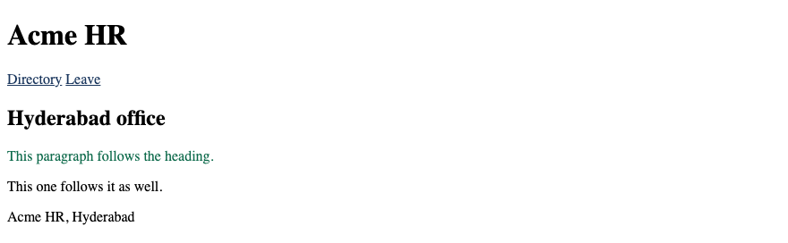

## 10. Pseudo-Classes

A pseudo-class selects an element in a particular state or position. It starts with one colon. `:first-child` matches an element that is the first child of its parent. In the section below, the heading is the first child, so the first paragraph is `:first-of-type`, not `:first-child`. `:hover`, `:focus`, and `:focus-visible` match a control the reader is using. The UI styling module writes those rules. Ship `:focus-visible` on controls a person can tab to.

### Example

```css
/* styles.css */
section p:first-of-type {
  color: #1a365d;
}
```

```html
<!DOCTYPE html>
<html lang="en">
<head>
  <meta charset="UTF-8">
  <meta name="viewport" content="width=device-width, initial-scale=1.0">
  <title>Acme HR</title>
  <link rel="stylesheet" href="styles.css">
</head>
<body>
  <header>
    <h1>Acme HR</h1>
  </header>
  <main>
    <section>
      <h2>Hyderabad office</h2>
      <p>First paragraph in the section.</p>
      <p>Second paragraph in the section.</p>
    </section>
  </main>
  <footer>
    <p>Acme HR, Hyderabad</p>
  </footer>
</body>
</html>
```

**This will produce the following result:**

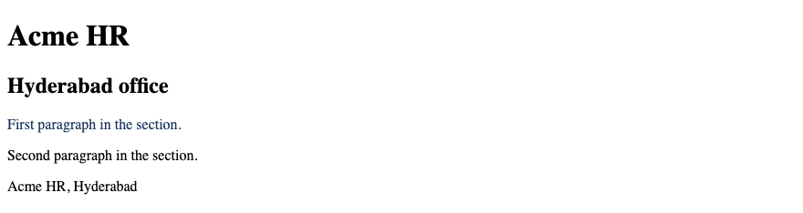

## 11. Pseudo-Elements

A pseudo-element styles a part of an element, or inserts a piece of content. It starts with two colons. `::first-line` styles the first line of a paragraph. `::before` and `::after` insert content. The inserted text is not a substitute for real text in the HTML. A name the employee must read belongs in the document.

### Example

```css
/* styles.css */
.office::first-line {
  font-weight: 700;
}
```

```html
<!DOCTYPE html>
<html lang="en">
<head>
  <meta charset="UTF-8">
  <meta name="viewport" content="width=device-width, initial-scale=1.0">
  <title>Acme HR</title>
  <link rel="stylesheet" href="styles.css">
</head>
<body>
  <header>
    <h1>Acme HR</h1>
  </header>
  <main>
    <section>
      <h2>Hyderabad office</h2>
      <p class="office">HITEC City holds the staff records. Payroll runs on the last working day.</p>
    </section>
  </main>
  <footer>
    <p>Acme HR, Hyderabad</p>
  </footer>
</body>
</html>
```

**This will produce the following result:**


## 12. CSS Cascade

The cascade decides which rule wins when two rules set the same property. Compare origin and importance first (user-agent, user, author; then `!important` layers). Inside the author origin, `@layer` order comes next, then specificity, then source order. An inline `style=""` attribute beats a class or element rule unless an `!important` declaration outranks it. A later CSS rule wins only when specificity is equal. These two rules have the same specificity. The second colour is the one the browser uses.

### Example

```css
/* styles.css */
p {
  color: #1a365d;
}

p {
  color: #0f6b4c;
}
```

```html
<!DOCTYPE html>
<html lang="en">
<head>
  <meta charset="UTF-8">
  <meta name="viewport" content="width=device-width, initial-scale=1.0">
  <title>Acme HR</title>
  <link rel="stylesheet" href="styles.css">
</head>
<body>
  <header>
    <h1>Acme HR</h1>
  </header>
  <main>
    <section>
      <h2>Hyderabad office</h2>
      <p>This paragraph is green. The later rule has the same specificity.</p>
    </section>
  </main>
  <footer>
    <p>Acme HR, Hyderabad</p>
  </footer>
</body>
</html>
```

**This will produce the following result:**

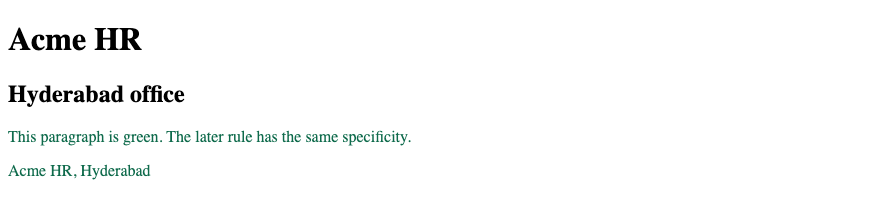

## 13. CSS Specificity

Specificity is a weight. An id beats a class. A class beats an element. A later element rule does not beat an earlier class rule. Prefer a class over an id for styling, so a later class can still override it. In this page the class is earlier and the element rule is later. The office paragraph stays green.

| Selector | Weight, in plain terms |
|----------|------------------------|
| `p` | One element |
| `.office` | One class |
| `#payroll` | One id |

### Example

```css
/* styles.css */
.office {
  color: #0f6b4c;
}

p {
  color: #1a365d;
}
```

```html
<!DOCTYPE html>
<html lang="en">
<head>
  <meta charset="UTF-8">
  <meta name="viewport" content="width=device-width, initial-scale=1.0">
  <title>Acme HR</title>
  <link rel="stylesheet" href="styles.css">
</head>
<body>
  <header>
    <h1>Acme HR</h1>
  </header>
  <main>
    <section>
      <h2>Hyderabad office</h2>
      <p class="office">This paragraph keeps the class colour.</p>
      <p>This paragraph uses the element rule.</p>
    </section>
  </main>
  <footer>
    <p>Acme HR, Hyderabad</p>
  </footer>
</body>
</html>
```

**This will produce the following result:**

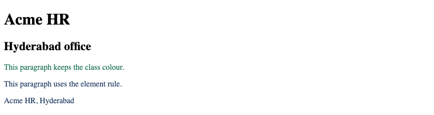

## 14. Inheritance

Some properties pass from a parent to its children. Color and font inherit. Margin, padding, and border do not. Set the font and the text colour on `body`, and the paragraphs use them. Set a margin on `body`, and the paragraphs keep their own margin.

### Example

```css
/* styles.css */
body {
  color: #1b2430;
  font-family: system-ui, sans-serif;
  margin: 2rem;
  padding: 1rem;
  border: 4px solid #1a365d;
}
```

```html
<!DOCTYPE html>
<html lang="en">
<head>
  <meta charset="UTF-8">
  <meta name="viewport" content="width=device-width, initial-scale=1.0">
  <title>Acme HR</title>
  <link rel="stylesheet" href="styles.css">
</head>
<body>
  <header>
    <h1>Acme HR</h1>
  </header>
  <main>
    <section>
      <h2>Hyderabad office</h2>
      <p>This text inherits the colour and the font. It does not inherit the border.</p>
    </section>
  </main>
  <footer>
    <p>Acme HR, Hyderabad</p>
  </footer>
</body>
</html>
```

**This will produce the following result:**

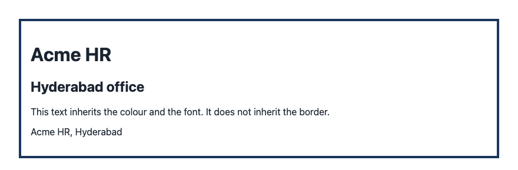

## 15. `!important` — When to Avoid It

`!important` raises a declaration above normal rules. A class cannot override it. Avoid `!important`. Write a class with enough specificity instead. The office class below does not change the colour, because the element rule is marked important.

### Example

```css
/* styles.css */
p {
  color: #1a365d !important;
}

.office {
  color: #0f6b4c;
}
```

```html
<!DOCTYPE html>
<html lang="en">
<head>
  <meta charset="UTF-8">
  <meta name="viewport" content="width=device-width, initial-scale=1.0">
  <title>Acme HR</title>
  <link rel="stylesheet" href="styles.css">
</head>
<body>
  <header>
    <h1>Acme HR</h1>
  </header>
  <main>
    <section>
      <h2>Hyderabad office</h2>
      <p class="office">The class loses. Avoid !important.</p>
    </section>
  </main>
  <footer>
    <p>Acme HR, Hyderabad</p>
  </footer>
</body>
</html>
```

**This will produce the following result:**

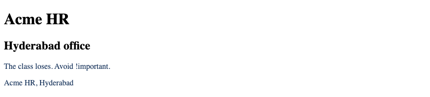

## 16. CSS Values & Units

A value is the setting after the colon. Some values are keywords, such as `bold`. Some are colours. Some are lengths. A length is a number plus a unit. `0` may omit the unit. The next section names the units used on Acme HR.

### Example

```css
/* styles.css */
h1 {
  color: #1a365d;
  font-weight: 700;
  font-size: 2rem;
}
```

```html
<!DOCTYPE html>
<html lang="en">
<head>
  <meta charset="UTF-8">
  <meta name="viewport" content="width=device-width, initial-scale=1.0">
  <title>Acme HR</title>
  <link rel="stylesheet" href="styles.css">
</head>
<body>
  <header>
    <h1>Acme HR</h1>
  </header>
  <main>
    <section>
      <h2>Hyderabad office</h2>
      <p>The heading size is 2rem.</p>
    </section>
  </main>
  <footer>
    <p>Acme HR, Hyderabad</p>
  </footer>
</body>
</html>
```

**This will produce the following result:**

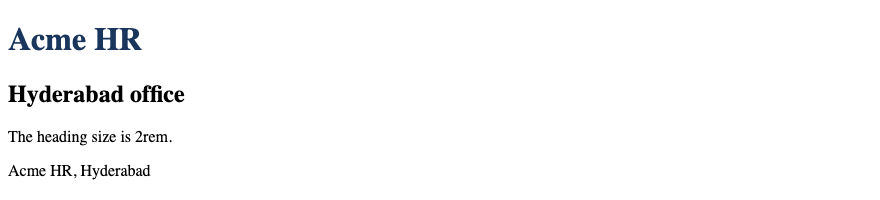

## 17. `px`, `%`, `em`, `rem`, `vw`, `vh`

`px` is a CSS reference pixel, not a raw device pixel on a high-density screen. `%` is a share of the parent. For `font-size`, `em` is relative to the parent's font size, so nested `em` sizes compound (`1.2em` inside `1.2em` is larger than `1.2em` alone). For properties like `padding`, `em` uses the element's own font size. `rem` is a multiple of the root font size and does not compound that way. `vw` is a percentage of the viewport width. `vh` is a percentage of the viewport height. Use `rem` for type so a reader who enlarges the root font enlarges the page.

| Unit | Measured against |
|------|------------------|
| `px` | A CSS reference pixel |
| `%` | The parent, for widths |
| `em` | Parent font size for `font-size`; own font size for most other properties |
| `rem` | The root font size |
| `vw` | The viewport width |
| `vh` | The viewport height |

### Example

```css
/* styles.css */
html {
  font-size: 100%;
}

.panel {
  width: 100%;
  max-width: 40rem;
  font-size: 1rem;
  padding: 1em;
}

.banner {
  min-height: 30vh;
}
```

```html
<!DOCTYPE html>
<html lang="en">
<head>
  <meta charset="UTF-8">
  <meta name="viewport" content="width=device-width, initial-scale=1.0">
  <title>Acme HR</title>
  <link rel="stylesheet" href="styles.css">
</head>
<body>
  <header class="banner">
    <h1>Acme HR</h1>
  </header>
  <main>
    <section class="panel">
      <h2>Hyderabad office</h2>
      <p>The panel is at most 40rem wide. The header is at least 30vh tall.</p>
    </section>
  </main>
  <footer>
    <p>Acme HR, Hyderabad</p>
  </footer>
</body>
</html>
```

**This will produce the following result:**

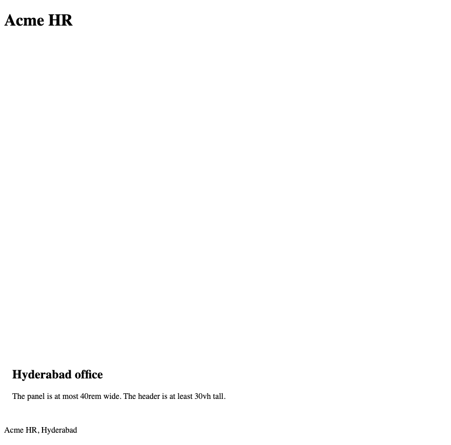
