# 2. CSS — Colors, Text & Box Model

**Index:** [CSS and Responsive](../02_CSS_and_Responsive.md)  
**Previous:** [CSS Fundamentals](Module_01_CSS_Fundamentals.md)  
**Next:** [CSS Layout](Module_03_CSS_Layout.md)

Rules stay in `styles.css`. The page is still Acme HR: one `h1`, a header, a nav, a main, one section, and a footer.

## 18. CSS Colors

`color` sets the text colour. `background-color` sets the surface behind it. Acme HR uses navy `#1a365d` for headings, ink `#1b2430` for text, and `#f4f6f8` for the page. Muted text must clear 4.5:1 on the page background. `#3d4654` on `#f4f6f8` clears that bar.

### Example

```css
/* styles.css */
body {
  color: #1b2430;
  background-color: #f4f6f8;
}

h1 {
  color: #1a365d;
}

.muted {
  color: #3d4654;
}
```

```html
<!DOCTYPE html>
<html lang="en">
<head>
  <meta charset="UTF-8">
  <meta name="viewport" content="width=device-width, initial-scale=1.0">
  <title>Acme HR</title>
  <link rel="stylesheet" href="styles.css">
</head>
<body>
  <header>
    <h1>Acme HR</h1>
  </header>
  <main>
    <section>
      <h2>Hyderabad office</h2>
      <p>Staff records for HITEC City.</p>
      <p class="muted">Payroll date: 30 September 2026.</p>
    </section>
  </main>
  <footer>
    <p>Acme HR, Hyderabad</p>
  </footer>
</body>
</html>
```

**This will produce the following result:**

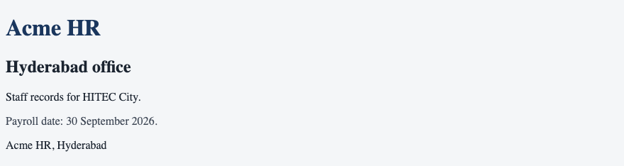

## 19. HEX, RGB & HSL

A colour can be written as hex, RGB, or HSL. Hex is two digits each for red, green, and blue. `rgb()` takes the same three channels from 0 to 255. `hsl()` takes hue, saturation, and lightness. These three declarations are the same navy.

| Form | Acme HR navy |
|------|----------------|
| Hex | `#1a365d` |
| RGB | `rgb(26, 54, 93)` |
| HSL | `hsl(216, 56%, 23%)` |

### Example

```css
/* styles.css */
h1 {
  color: #1a365d;
}

h2 {
  color: rgb(26, 54, 93);
}

.office {
  color: hsl(216, 56%, 23%);
}
```

```html
<!DOCTYPE html>
<html lang="en">
<head>
  <meta charset="UTF-8">
  <meta name="viewport" content="width=device-width, initial-scale=1.0">
  <title>Acme HR</title>
  <link rel="stylesheet" href="styles.css">
</head>
<body>
  <header>
    <h1>Acme HR</h1>
  </header>
  <main>
    <section>
      <h2>Hyderabad office</h2>
      <p class="office">Engineering, HR, and Finance.</p>
    </section>
  </main>
  <footer>
    <p>Acme HR, Hyderabad</p>
  </footer>
</body>
</html>
```

**This will produce the following result:**


## 20. Backgrounds

`background-color` fills the box. `background-image` paints a picture behind the content. `background-repeat` controls tiling. `background-position` places the image. `background-size` sets its size. A solid colour is enough for the Acme HR page. An image is an extra layer, not a replacement for the text.

### Example

```css
/* styles.css */
body {
  background-color: #f4f6f8;
}

header {
  background-color: #1a365d;
  color: #ffffff;
}
```

```html
<!DOCTYPE html>
<html lang="en">
<head>
  <meta charset="UTF-8">
  <meta name="viewport" content="width=device-width, initial-scale=1.0">
  <title>Acme HR</title>
  <link rel="stylesheet" href="styles.css">
</head>
<body>
  <header>
    <h1>Acme HR</h1>
    <nav>
      <a href="directory.html">Directory</a>
      <a href="leave.html">Leave</a>
    </nav>
  </header>
  <main>
    <section>
      <h2>Hyderabad office</h2>
      <p>The header has a navy background.</p>
    </section>
  </main>
  <footer>
    <p>Acme HR, Hyderabad</p>
  </footer>
</body>
</html>
```

**This will produce the following result:**

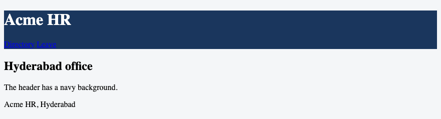

## 21. Gradients

A gradient is a background image the browser paints. `linear-gradient` blends colours along a line. The first argument is the direction. The rest are colour stops. Use a gradient as a band behind the header. The heading text stays real text.

### Example

```css
/* styles.css */
header {
  background-image: linear-gradient(#1a365d, #0f6b4c);
  color: #ffffff;
  padding: 1rem;
}
```

```html
<!DOCTYPE html>
<html lang="en">
<head>
  <meta charset="UTF-8">
  <meta name="viewport" content="width=device-width, initial-scale=1.0">
  <title>Acme HR</title>
  <link rel="stylesheet" href="styles.css">
</head>
<body>
  <header>
    <h1>Acme HR</h1>
  </header>
  <main>
    <section>
      <h2>Hyderabad office</h2>
      <p>The header blends navy into green.</p>
    </section>
  </main>
  <footer>
    <p>Acme HR, Hyderabad</p>
  </footer>
</body>
</html>
```

**This will produce the following result:**

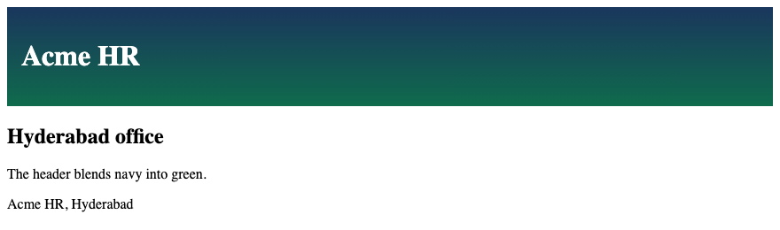

## 22. Typography

Typography is the choice of type, size, and spacing. Set a readable font on `body`. Headings and paragraphs inherit it. Color and font inherit. A line length around 60 to 75 characters stays comfortable. `max-width: 40rem` on the section keeps the office paragraph from stretching across a wide monitor.

### Example

```css
/* styles.css */
body {
  font-family: system-ui, sans-serif;
  line-height: 1.5;
  color: #1b2430;
}

section {
  max-width: 40rem;
}
```

```html
<!DOCTYPE html>
<html lang="en">
<head>
  <meta charset="UTF-8">
  <meta name="viewport" content="width=device-width, initial-scale=1.0">
  <title>Acme HR</title>
  <link rel="stylesheet" href="styles.css">
</head>
<body>
  <header>
    <h1>Acme HR</h1>
  </header>
  <main>
    <section>
      <h2>Hyderabad office</h2>
      <p>Staff records, leave, and payslips for the HITEC City office.</p>
    </section>
  </main>
  <footer>
    <p>Acme HR, Hyderabad</p>
  </footer>
</body>
</html>
```

**This will produce the following result:**

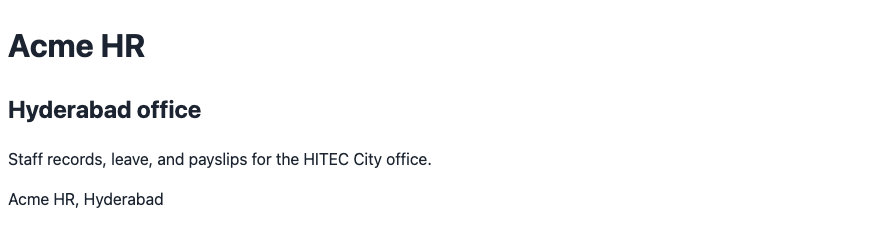

## 23. Font Family & Web Fonts

`font-family` lists fonts in order. The browser uses the first one it has. A web font is a file the page loads. `@font-face` names that file. If the file is missing, the next name in the list is used. Django serves the font from `static/`. Spring Boot serves it from `src/main/resources/static/`.

### Example

```css
/* styles.css */
@font-face {
  font-family: "Acme Sans";
  src: url("fonts/acme-sans.woff2") format("woff2");
}

body {
  font-family: "Acme Sans", system-ui, sans-serif;
}
```

```html
<!DOCTYPE html>
<html lang="en">
<head>
  <meta charset="UTF-8">
  <meta name="viewport" content="width=device-width, initial-scale=1.0">
  <title>Acme HR</title>
  <link rel="stylesheet" href="styles.css">
</head>
<body>
  <header>
    <h1>Acme HR</h1>
  </header>
  <main>
    <section>
      <h2>Hyderabad office</h2>
      <p>The page uses Acme Sans when the file is present.</p>
    </section>
  </main>
  <footer>
    <p>Acme HR, Hyderabad</p>
  </footer>
</body>
</html>
```

**This will produce the following result:**

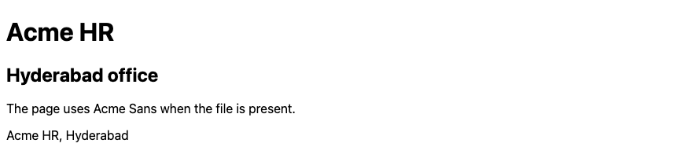

## 24. Font Size, Weight & Style

`font-size` sets the size. Use `rem` so it follows the root font. `font-weight` sets the thickness. `700` is bold. `400` is regular. `font-style: italic` slants the text. A payroll warning can be bold. A note can be italic. Importance in the HTML still belongs on `<strong>`.

### Example

```css
/* styles.css */
body {
  font-size: 1rem;
}

h1 {
  font-size: 2rem;
  font-weight: 700;
}

.note {
  font-style: italic;
  font-weight: 400;
}
```

```html
<!DOCTYPE html>
<html lang="en">
<head>
  <meta charset="UTF-8">
  <meta name="viewport" content="width=device-width, initial-scale=1.0">
  <title>Acme HR</title>
  <link rel="stylesheet" href="styles.css">
</head>
<body>
  <header>
    <h1>Acme HR</h1>
  </header>
  <main>
    <section>
      <h2>Hyderabad office</h2>
      <p class="note">September payroll closes on 30 September 2026.</p>
    </section>
  </main>
  <footer>
    <p>Acme HR, Hyderabad</p>
  </footer>
</body>
</html>
```

**This will produce the following result:**


## 25. Text Alignment & Decoration

`text-align` sets the alignment of the line: `left`, `right`, `center`, or `justify`. Body text stays left aligned. `text-decoration` draws a line: `underline`, `none`, or `line-through`. Links are underlined so they are not known by colour alone. A superseded allowance can use `line-through`. The HTML `<s>` still carries the meaning.

### Example

```css
/* styles.css */
h1 {
  text-align: left;
}

a {
  text-decoration: underline;
}

.old-allowance {
  text-decoration: line-through;
}
```

```html
<!DOCTYPE html>
<html lang="en">
<head>
  <meta charset="UTF-8">
  <meta name="viewport" content="width=device-width, initial-scale=1.0">
  <title>Acme HR</title>
  <link rel="stylesheet" href="styles.css">
</head>
<body>
  <header>
    <h1>Acme HR</h1>
    <nav>
      <a href="directory.html">Directory</a>
      <a href="leave.html">Leave</a>
    </nav>
  </header>
  <main>
    <section>
      <h2>Hyderabad office</h2>
      <p>Previous special allowance <span class="old-allowance">₹12,000</span>.</p>
    </section>
  </main>
  <footer>
    <p>Acme HR, Hyderabad</p>
  </footer>
</body>
</html>
```

**This will produce the following result:**

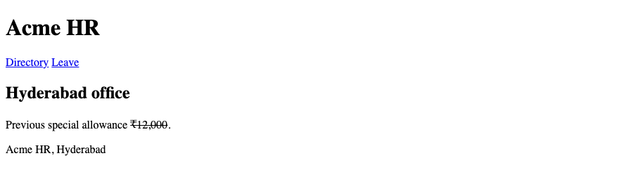

## 26. Line Height & Letter Spacing

`line-height` sets the space between lines. A unitless value such as `1.5` scales with the font size. `letter-spacing` adds space between characters. Body text uses `1.5`. A small heading can use a little letter spacing. Large letter spacing on a long paragraph makes it harder to read.

### Example

```css
/* styles.css */
body {
  line-height: 1.5;
}

h1 {
  letter-spacing: 0.02em;
}
```

```html
<!DOCTYPE html>
<html lang="en">
<head>
  <meta charset="UTF-8">
  <meta name="viewport" content="width=device-width, initial-scale=1.0">
  <title>Acme HR</title>
  <link rel="stylesheet" href="styles.css">
</head>
<body>
  <header>
    <h1>Acme HR</h1>
  </header>
  <main>
    <section>
      <h2>Hyderabad office</h2>
      <p>Staff records, leave requests, and payslips for the HITEC City office. The lines have room to breathe.</p>
    </section>
  </main>
  <footer>
    <p>Acme HR, Hyderabad</p>
  </footer>
</body>
</html>
```

**This will produce the following result:**

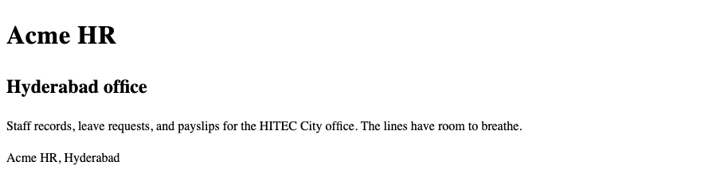

## 27. CSS Box Model

Every element is a box. From the inside: content, padding, border, then margin. Padding is space inside the border. Margin is space outside it. The width you set applies to the content box until `box-sizing` changes that. Margin, padding, and border do not inherit.

| Layer | What it is |
|-------|------------|
| Content | The text or the image |
| Padding | Space inside the border |
| Border | The line around the padding |
| Margin | Space outside the border |

### Example

```css
/* styles.css */
.panel {
  margin: 1rem;
  padding: 1rem;
  border: 2px solid #1a365d;
}
```

```html
<!DOCTYPE html>
<html lang="en">
<head>
  <meta charset="UTF-8">
  <meta name="viewport" content="width=device-width, initial-scale=1.0">
  <title>Acme HR</title>
  <link rel="stylesheet" href="styles.css">
</head>
<body>
  <header>
    <h1>Acme HR</h1>
  </header>
  <main>
    <section class="panel">
      <h2>Hyderabad office</h2>
      <p>Padding is inside the navy line. Margin is outside it.</p>
    </section>
  </main>
  <footer>
    <p>Acme HR, Hyderabad</p>
  </footer>
</body>
</html>
```

**This will produce the following result:**

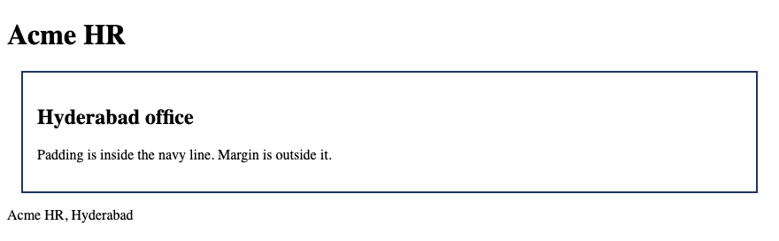

## 28. Width & Height

`width` and `height` set the size of the content box by default. A block stretches to the container when the width is `auto`. Height follows the content when it is `auto`. `max-width` stops a section from growing past a readable measure. Set a height only when the design needs a fixed band, such as the header.

### Example

```css
/* styles.css */
section {
  width: 100%;
  max-width: 40rem;
}

header {
  min-height: 4rem;
}
```

```html
<!DOCTYPE html>
<html lang="en">
<head>
  <meta charset="UTF-8">
  <meta name="viewport" content="width=device-width, initial-scale=1.0">
  <title>Acme HR</title>
  <link rel="stylesheet" href="styles.css">
</head>
<body>
  <header>
    <h1>Acme HR</h1>
  </header>
  <main>
    <section>
      <h2>Hyderabad office</h2>
      <p>The section stops at 40rem.</p>
    </section>
  </main>
  <footer>
    <p>Acme HR, Hyderabad</p>
  </footer>
</body>
</html>
```

**This will produce the following result:**

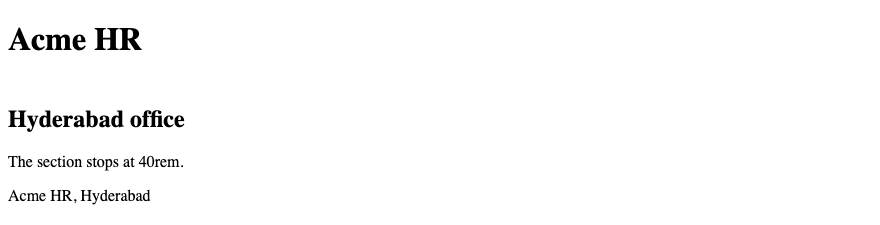

## 29. Margin & Padding

Margin separates a box from its neighbours. Padding separates the content from the border. Use `rem` for both on Acme HR. Vertical margins of two blocks can collapse: the gap becomes the larger margin, not the sum. Padding does not collapse.

### Example

```css
/* styles.css */
header, main, footer {
  padding: 1rem;
}

section {
  margin-top: 1rem;
  padding: 1rem;
}
```

```html
<!DOCTYPE html>
<html lang="en">
<head>
  <meta charset="UTF-8">
  <meta name="viewport" content="width=device-width, initial-scale=1.0">
  <title>Acme HR</title>
  <link rel="stylesheet" href="styles.css">
</head>
<body>
  <header>
    <h1>Acme HR</h1>
  </header>
  <main>
    <section>
      <h2>Hyderabad office</h2>
      <p>One rem of padding inside the section.</p>
    </section>
  </main>
  <footer>
    <p>Acme HR, Hyderabad</p>
  </footer>
</body>
</html>
```

**This will produce the following result:**

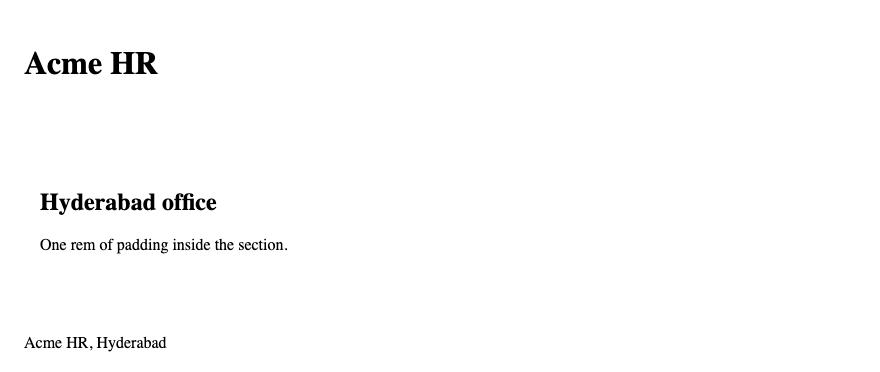

## 30. Border & Border Radius

`border` sets width, style, and colour together. `border-radius` rounds the corners. A payslip panel and a notice can use a 1 pixel solid border. A large radius makes a pill. A small radius, such as `0.25rem`, is enough for a panel.

### Example

```css
/* styles.css */
.panel {
  border: 1px solid #d0d7de;
  border-radius: 0.25rem;
  padding: 1rem;
}
```

```html
<!DOCTYPE html>
<html lang="en">
<head>
  <meta charset="UTF-8">
  <meta name="viewport" content="width=device-width, initial-scale=1.0">
  <title>Acme HR</title>
  <link rel="stylesheet" href="styles.css">
</head>
<body>
  <header>
    <h1>Acme HR</h1>
  </header>
  <main>
    <section class="panel">
      <h2>Hyderabad office</h2>
      <p>Rounded panel for the office note.</p>
    </section>
  </main>
  <footer>
    <p>Acme HR, Hyderabad</p>
  </footer>
</body>
</html>
```

**This will produce the following result:**


## 31. `box-sizing`

By default, `width` is the content only. Padding and border are added on top, so the box grows past the width you set. `border-box` includes padding and border in the width. Use `*` for `box-sizing: border-box`. One rule then covers every element.

### Example

```css
/* styles.css */
* {
  box-sizing: border-box;
}

.panel {
  width: 20rem;
  padding: 1rem;
  border: 4px solid #1a365d;
}
```

```html
<!DOCTYPE html>
<html lang="en">
<head>
  <meta charset="UTF-8">
  <meta name="viewport" content="width=device-width, initial-scale=1.0">
  <title>Acme HR</title>
  <link rel="stylesheet" href="styles.css">
</head>
<body>
  <header>
    <h1>Acme HR</h1>
  </header>
  <main>
    <section class="panel">
      <h2>Hyderabad office</h2>
      <p>The 20rem width includes the padding and the border.</p>
    </section>
  </main>
  <footer>
    <p>Acme HR, Hyderabad</p>
  </footer>
</body>
</html>
```

**This will produce the following result:**

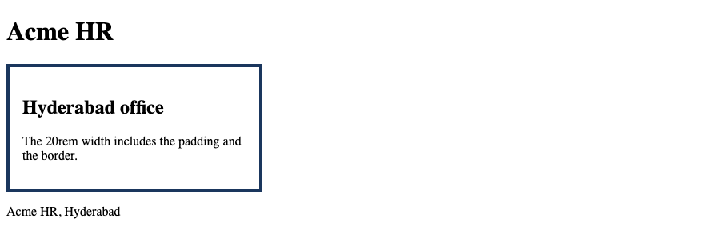

## 32. `box-shadow`

`box-shadow` draws a shadow outside the border. The values are horizontal offset, vertical offset, blur, and colour. A small shadow lifts a panel off the page background. The shadow is decoration. A solid border still marks the edge of the panel.

### Example

```css
/* styles.css */
.panel {
  background-color: #ffffff;
  padding: 1rem;
  box-shadow: 0 2px 8px rgba(27, 36, 48, 0.15);
}
```

```html
<!DOCTYPE html>
<html lang="en">
<head>
  <meta charset="UTF-8">
  <meta name="viewport" content="width=device-width, initial-scale=1.0">
  <title>Acme HR</title>
  <link rel="stylesheet" href="styles.css">
</head>
<body>
  <header>
    <h1>Acme HR</h1>
  </header>
  <main>
    <section class="panel">
      <h2>Hyderabad office</h2>
      <p>The panel sits above the page.</p>
    </section>
  </main>
  <footer>
    <p>Acme HR, Hyderabad</p>
  </footer>
</body>
</html>
```

**This will produce the following result:**

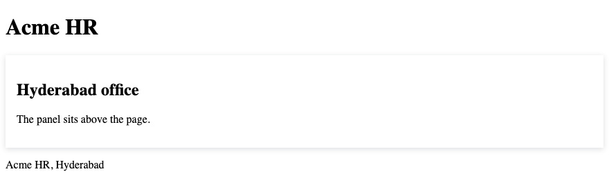

## 33. `overflow`

`overflow` decides what happens when content is larger than the box. `visible` lets it spill. `hidden` clips it. `auto` adds a scrollbar when it is needed. A fixed-height note on the office page uses `auto` so the rest of the paragraph can be scrolled. Do not clip text the employee must read unless the box scrolls.

| Value | Result |
|-------|--------|
| `visible` | Content spills out |
| `hidden` | Content is clipped |
| `auto` | A scrollbar appears when needed |

### Example

```css
/* styles.css */
.note {
  height: 3rem;
  overflow: auto;
  border: 1px solid #d0d7de;
  padding: 0.5rem;
}
```

```html
<!DOCTYPE html>
<html lang="en">
<head>
  <meta charset="UTF-8">
  <meta name="viewport" content="width=device-width, initial-scale=1.0">
  <title>Acme HR</title>
  <link rel="stylesheet" href="styles.css">
</head>
<body>
  <header>
    <h1>Acme HR</h1>
  </header>
  <main>
    <section>
      <h2>Hyderabad office</h2>
      <p class="note">September payroll includes basic pay, HRA, and special allowance. PF and professional tax are deducted. Net pay is credited on 30 September 2026.</p>
    </section>
  </main>
  <footer>
    <p>Acme HR, Hyderabad</p>
  </footer>
</body>
</html>
```

**This will produce the following result:**

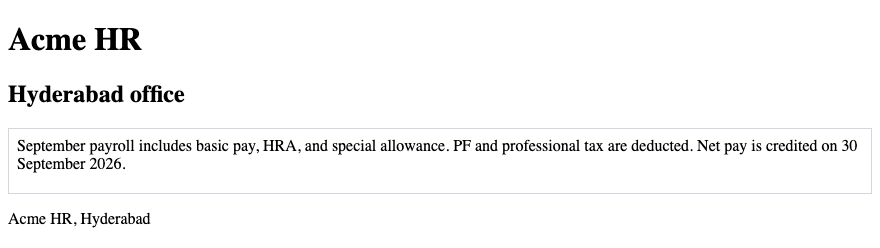
