# 3. CSS — CSS Layout

**Index:** [CSS and Responsive](../02_CSS_and_Responsive.md)  
**Previous:** [Colors, Text and the Box Model](Module_02_Colors_Text_and_Box_Model.md)  
**Next:** [Responsive and Modern CSS](Module_04_Responsive_and_Modern_CSS.md)

The header and the employee cards use Flexbox. The directory grid comes later in this module. Positioning is a sticky header and a status badge. It is not the page layout.

## 34. Normal Document Flow

In normal flow, block boxes stack down the page. Inline boxes sit in the line. The browser places each box after the previous one. Margins separate them. Acme HR starts in this flow. Flexbox and Grid change the flow of the boxes you choose. The rest of the page stays in normal flow.

### Example

```css
/* styles.css */
* {
  box-sizing: border-box;
}

body {
  margin: 0;
  font-family: system-ui, sans-serif;
  color: #1b2430;
}
```

```html
<!DOCTYPE html>
<html lang="en">
<head>
  <meta charset="UTF-8">
  <meta name="viewport" content="width=device-width, initial-scale=1.0">
  <title>Acme HR</title>
  <link rel="stylesheet" href="styles.css">
</head>
<body>
  <header>
    <h1>Acme HR</h1>
  </header>
  <main>
    <section>
      <h2>Hyderabad office</h2>
      <p>These blocks stack in normal flow.</p>
    </section>
  </main>
  <footer>
    <p>Acme HR, Hyderabad</p>
  </footer>
</body>
</html>
```

**This will produce the following result:**

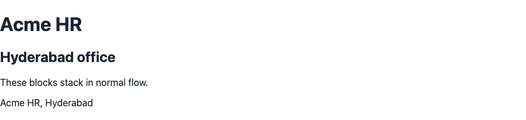

## 35. `display` — block, inline, inline-block, none

`display` sets the box type. `block` stacks. `inline` stays in the line and ignores width and height. `inline-block` stays in the line and accepts width and height. `none` removes the box. A link styled as a button uses `inline-flex`, in the button section. Block vs inline is the default. These keywords replace that default.

| Value | Box |
|-------|-----|
| `block` | New line, accepts width |
| `inline` | In the line |
| `inline-block` | In the line, accepts width and height |
| `none` | Not shown |

### Example

```css
/* styles.css */
.badge {
  display: inline-block;
  padding: 0.25rem 0.5rem;
  background-color: #e8eef6;
}

.draft {
  display: none;
}
```

```html
<!DOCTYPE html>
<html lang="en">
<head>
  <meta charset="UTF-8">
  <meta name="viewport" content="width=device-width, initial-scale=1.0">
  <title>Acme HR</title>
  <link rel="stylesheet" href="styles.css">
</head>
<body>
  <header>
    <h1>Acme HR</h1>
  </header>
  <main>
    <section>
      <h2>Directory</h2>
      <p>Ananya Rao <span class="badge">Active</span></p>
      <p class="draft">This draft line is not shown.</p>
    </section>
  </main>
  <footer>
    <p>Acme HR, Hyderabad</p>
  </footer>
</body>
</html>
```

**This will produce the following result:**

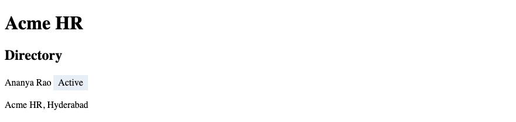

## 36. CSS Positioning

`position` takes an element out of the usual rules for its place. The page layout of Acme HR stays in normal flow, Flexbox, or Grid. Positioning here is only the sticky header and the status badge on a card. `top`, `right`, `bottom`, and `left` offset a positioned box.

### Example

```css
/* styles.css */
header {
  position: sticky;
  top: 0;
  background-color: #ffffff;
}

.employee-card {
  position: relative;
}

.status {
  position: absolute;
  top: 0.5rem;
  right: 0.5rem;
}
```

```html
<!DOCTYPE html>
<html lang="en">
<head>
  <meta charset="UTF-8">
  <meta name="viewport" content="width=device-width, initial-scale=1.0">
  <title>Acme HR</title>
  <link rel="stylesheet" href="styles.css">
</head>
<body>
  <header>
    <h1>Acme HR</h1>
  </header>
  <main>
    <section class="employee-card">
      <h2>Ananya Rao</h2>
      <p class="status">Active</p>
      <p>Engineering</p>
    </section>
  </main>
  <footer>
    <p>Acme HR, Hyderabad</p>
  </footer>
</body>
</html>
```

**This will produce the following result:**

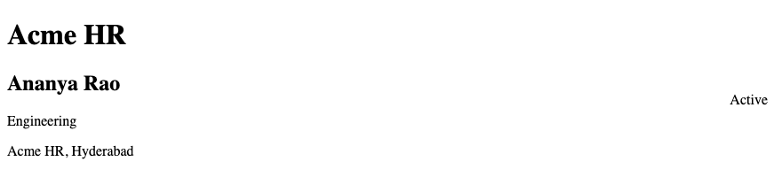

## 37. `relative`, `absolute`, `fixed`, `sticky`

`relative` keeps the box in flow and offsets it from that place. It is also the anchor for absolute children. `absolute` is placed against the nearest positioned ancestor. `fixed` is placed against the viewport. `sticky` stays in flow until a scroll threshold, then stays put. The header is `sticky`. The card is `relative`. The badge is `absolute`.

| Value | Used on Acme HR |
|-------|-----------------|
| `relative` | The employee card, so the badge has an anchor |
| `absolute` | The status badge |
| `sticky` | The header |
| `fixed` | Not used for this layout |

### Example

```css
/* styles.css */
header {
  position: sticky;
  top: 0;
  background-color: #1a365d;
  color: #ffffff;
}

.employee-card {
  position: relative;
  padding: 1rem;
  border: 1px solid #d0d7de;
}

.status {
  position: absolute;
  top: 0.5rem;
  right: 0.5rem;
}
```

```html
<!DOCTYPE html>
<html lang="en">
<head>
  <meta charset="UTF-8">
  <meta name="viewport" content="width=device-width, initial-scale=1.0">
  <title>Acme HR</title>
  <link rel="stylesheet" href="styles.css">
</head>
<body>
  <header>
    <h1>Acme HR</h1>
  </header>
  <main>
    <section class="employee-card">
      <h2>Ananya Rao</h2>
      <p class="status">Active</p>
      <p>Engineering · E-1042</p>
    </section>
  </main>
  <footer>
    <p>Acme HR, Hyderabad</p>
  </footer>
</body>
</html>
```

**This will produce the following result:**

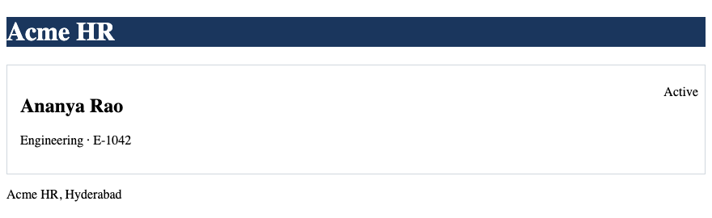

## 38. `z-index`

`z-index` sets the stack order of positioned boxes. A larger value is painted later, on top. It applies to positioned elements, and to flex and grid items. The sticky header uses a higher `z-index` than the badge so the header covers the badge when the page scrolls. A `z-index` on a static box has no effect.

### Example

```css
/* styles.css */
header {
  position: sticky;
  top: 0;
  z-index: 2;
  background-color: #ffffff;
}

.employee-card {
  position: relative;
}

.status {
  position: absolute;
  top: 0.5rem;
  right: 0.5rem;
  z-index: 1;
}
```

```html
<!DOCTYPE html>
<html lang="en">
<head>
  <meta charset="UTF-8">
  <meta name="viewport" content="width=device-width, initial-scale=1.0">
  <title>Acme HR</title>
  <link rel="stylesheet" href="styles.css">
</head>
<body>
  <header>
    <h1>Acme HR</h1>
  </header>
  <main>
    <section class="employee-card">
      <h2>Ananya Rao</h2>
      <p class="status">Active</p>
    </section>
  </main>
  <footer>
    <p>Acme HR, Hyderabad</p>
  </footer>
</body>
</html>
```

**This will produce the following result:**

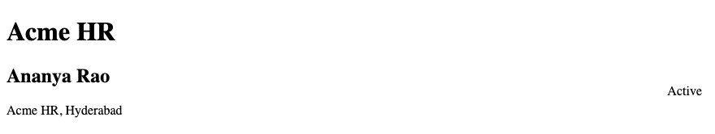

## 39. Introduction to Flexbox

Flexbox lays out a row or a column of items. The header is a flex container: the title and the nav sit on one line. The employee cards are flex items in a second container. The page itself is not one big flex trick. Only those two regions turn on `display: flex`.

### Example

```css
/* styles.css */
header {
  display: flex;
  align-items: center;
  gap: 1rem;
}
```

```html
<!DOCTYPE html>
<html lang="en">
<head>
  <meta charset="UTF-8">
  <meta name="viewport" content="width=device-width, initial-scale=1.0">
  <title>Acme HR</title>
  <link rel="stylesheet" href="styles.css">
</head>
<body>
  <header>
    <h1>Acme HR</h1>
    <nav>
      <a href="directory.html">Directory</a>
      <a href="leave.html">Leave</a>
    </nav>
  </header>
  <main>
    <section>
      <h2>Hyderabad office</h2>
      <p>The header is a flex row.</p>
    </section>
  </main>
  <footer>
    <p>Acme HR, Hyderabad</p>
  </footer>
</body>
</html>
```

**This will produce the following result:**

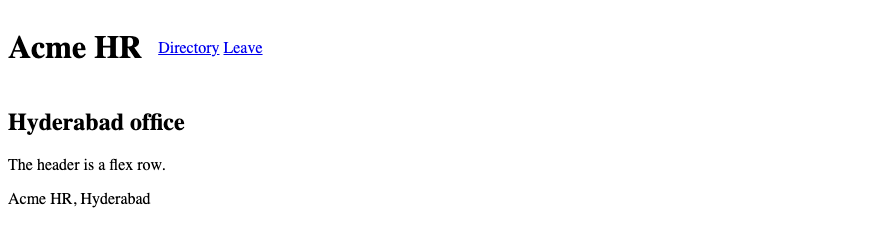

## 40. Flex Container & Flex Items

The element with `display: flex` is the container. Its direct children are the items. Grandchildren are not items. In the card list, the `ul` is the container and each `li` is an item. The heading inside a card is not a flex item of the list.

### Example

```css
/* styles.css */
.cards {
  display: flex;
  gap: 1rem;
}

.employee-card {
  border: 1px solid #d0d7de;
  padding: 1rem;
}
```

```html
<!DOCTYPE html>
<html lang="en">
<head>
  <meta charset="UTF-8">
  <meta name="viewport" content="width=device-width, initial-scale=1.0">
  <title>Acme HR — Directory</title>
  <link rel="stylesheet" href="styles.css">
</head>
<body>
  <header>
    <h1>Acme HR</h1>
  </header>
  <main>
    <h2>Directory</h2>
    <ul class="cards">
      <li class="employee-card">Ananya Rao<br>Engineering</li>
      <li class="employee-card">Karthik Menon<br>HR</li>
      <li class="employee-card">Meera Iyer<br>Finance</li>
    </ul>
  </main>
</body>
</html>
```

**This will produce the following result:**

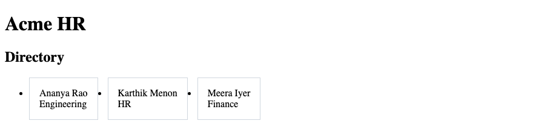

## 41. Main Axis & Cross Axis

The main axis is the direction the items run. In a row, the main axis is horizontal. The cross axis runs across it. `justify-content` aligns along the main axis. `align-items` aligns along the cross axis. A column swaps the axes: the main axis is vertical.

### Example

```css
/* styles.css */
header {
  display: flex;
  justify-content: space-between;
  align-items: center;
}
```

```html
<!DOCTYPE html>
<html lang="en">
<head>
  <meta charset="UTF-8">
  <meta name="viewport" content="width=device-width, initial-scale=1.0">
  <title>Acme HR</title>
  <link rel="stylesheet" href="styles.css">
</head>
<body>
  <header>
    <h1>Acme HR</h1>
    <nav>
      <a href="directory.html">Directory</a>
      <a href="leave.html">Leave</a>
    </nav>
  </header>
  <main>
    <p>The title and the nav sit at opposite ends of the row.</p>
  </main>
</body>
</html>
```

**This will produce the following result:**

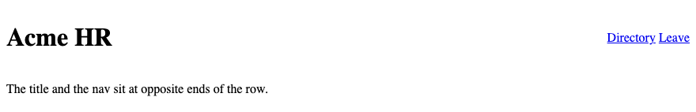

## 42. `flex-direction`

`flex-direction` sets the main axis. `row` is the default. `column` stacks the items. The header uses `row`. A narrow card can use `column` for the name and the department inside the card. `row-reverse` and `column-reverse` flip the start edge.

### Example

```css
/* styles.css */
.employee-card {
  display: flex;
  flex-direction: column;
  gap: 0.25rem;
}
```

```html
<!DOCTYPE html>
<html lang="en">
<head>
  <meta charset="UTF-8">
  <meta name="viewport" content="width=device-width, initial-scale=1.0">
  <title>Acme HR</title>
  <link rel="stylesheet" href="styles.css">
</head>
<body>
  <header>
    <h1>Acme HR</h1>
  </header>
  <main>
    <section class="employee-card">
      <h2>Ananya Rao</h2>
      <p>Engineering</p>
      <p>E-1042</p>
    </section>
  </main>
</body>
</html>
```

**This will produce the following result:**

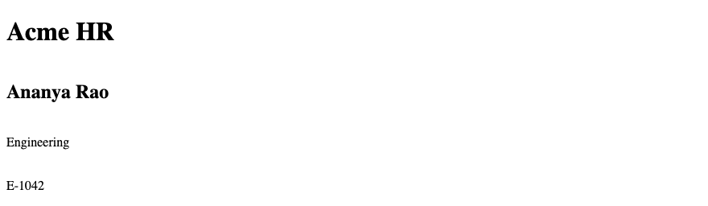

## 43. `justify-content`

`justify-content` places items along the main axis. `flex-start` packs them at the start. `space-between` puts the first item at the start and the last at the end. `center` packs them in the middle. The header uses `space-between` so the nav sits at the far side.

| Value | Result on a row |
|-------|-----------------|
| `flex-start` | Packed to the left |
| `flex-end` | Packed to the right |
| `center` | Packed in the middle |
| `space-between` | First and last against the edges |

### Example

```css
/* styles.css */
header {
  display: flex;
  justify-content: space-between;
  align-items: center;
}
```

```html
<!DOCTYPE html>
<html lang="en">
<head>
  <meta charset="UTF-8">
  <meta name="viewport" content="width=device-width, initial-scale=1.0">
  <title>Acme HR</title>
  <link rel="stylesheet" href="styles.css">
</head>
<body>
  <header>
    <h1>Acme HR</h1>
    <nav>
      <a href="directory.html">Directory</a>
      <a href="leave.html">Leave</a>
    </nav>
  </header>
  <main>
    <p>Directory and Leave sit at the end of the header.</p>
  </main>
</body>
</html>
```

**This will produce the following result:**

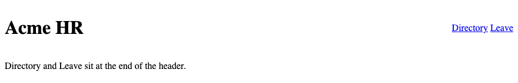

## 44. `align-items`

`align-items` places items along the cross axis. `center` lines up the heading and the nav on their middles. `stretch` is the default for a row: items stretch to the cross size. Use `center` in the header so the links line up with the title.

### Example

```css
/* styles.css */
header {
  display: flex;
  align-items: center;
  gap: 1rem;
}
```

```html
<!DOCTYPE html>
<html lang="en">
<head>
  <meta charset="UTF-8">
  <meta name="viewport" content="width=device-width, initial-scale=1.0">
  <title>Acme HR</title>
  <link rel="stylesheet" href="styles.css">
</head>
<body>
  <header>
    <h1>Acme HR</h1>
    <nav>
      <a href="directory.html">Directory</a>
      <a href="leave.html">Leave</a>
    </nav>
  </header>
  <main>
    <p>The links line up with the middle of the heading.</p>
  </main>
</body>
</html>
```

**This will produce the following result:**

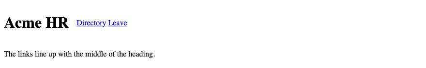

## 45. `flex-wrap`

`flex-wrap: wrap` lets an item move to the next line when the row is full. `nowrap` is the default and keeps one line, which can overflow a phone. Flex-wrap and a min-width breakpoint do different jobs. Wrap reacts to leftover space in the container. A min-width media query applies a new set of rules from a chosen viewport width upward.

### Example

```css
/* styles.css */
.cards {
  display: flex;
  flex-wrap: wrap;
  gap: 1rem;
}

.employee-card {
  flex: 1 1 260px;
}
```

```html
<!DOCTYPE html>
<html lang="en">
<head>
  <meta charset="UTF-8">
  <meta name="viewport" content="width=device-width, initial-scale=1.0">
  <title>Acme HR — Cards</title>
  <link rel="stylesheet" href="styles.css">
</head>
<body>
  <header>
    <h1>Acme HR</h1>
  </header>
  <main>
    <h2>Directory</h2>
    <ul class="cards">
      <li class="employee-card">Ananya Rao, Engineering</li>
      <li class="employee-card">Karthik Menon, HR</li>
      <li class="employee-card">Meera Iyer, Finance</li>
    </ul>
  </main>
</body>
</html>
```

**This will produce the following result:**

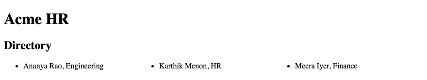

## 46. `gap`

`gap` sets the space between flex items. It does not add space outside the container. One value sets both directions. Two values set row gap, then column gap. Prefer `gap` to margins on the items. Margins on items also add space at the outer edges.

### Example

```css
/* styles.css */
.cards {
  display: flex;
  flex-wrap: wrap;
  gap: 1rem;
}
```

```html
<!DOCTYPE html>
<html lang="en">
<head>
  <meta charset="UTF-8">
  <meta name="viewport" content="width=device-width, initial-scale=1.0">
  <title>Acme HR — Gap</title>
  <link rel="stylesheet" href="styles.css">
</head>
<body>
  <header>
    <h1>Acme HR</h1>
  </header>
  <main>
    <ul class="cards">
      <li class="employee-card">Ananya Rao</li>
      <li class="employee-card">Karthik Menon</li>
      <li class="employee-card">Meera Iyer</li>
    </ul>
  </main>
</body>
</html>
```

**This will produce the following result:**

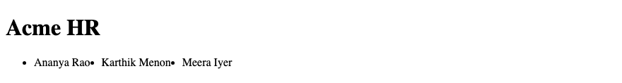

## 47. `flex-grow`, `flex-shrink`, `flex-basis`

`flex-grow` is how much free space an item takes. `flex-shrink` is how much it may shrink. `flex-basis` is the starting size. `flex: 1 1 260px` means grow, shrink, and basis. The three cards share extra space, may shrink on a narrow row, and start at 260 pixels. The shorthand is grow, shrink, then basis.

### Example

```css
/* styles.css */
.cards {
  display: flex;
  flex-wrap: wrap;
  gap: 1rem;
  list-style: none;
  padding: 0;
}

.employee-card {
  flex: 1 1 260px;
  border: 1px solid #d0d7de;
  padding: 1rem;
}
```

```html
<!DOCTYPE html>
<html lang="en">
<head>
  <meta charset="UTF-8">
  <meta name="viewport" content="width=device-width, initial-scale=1.0">
  <title>Acme HR — Flex shorthand</title>
  <link rel="stylesheet" href="styles.css">
</head>
<body>
  <header>
    <h1>Acme HR</h1>
  </header>
  <main>
    <ul class="cards">
      <li class="employee-card">Ananya Rao, Engineering</li>
      <li class="employee-card">Karthik Menon, HR</li>
      <li class="employee-card">Meera Iyer, Finance</li>
    </ul>
  </main>
</body>
</html>
```

**This will produce the following result:**

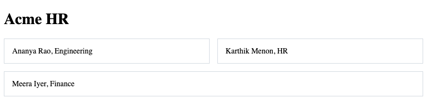

## 48. Practical Flexbox Layouts

The header is one flex row. The directory cards are a wrapping flex row. A link styled as a button uses `inline-flex` so the label and any icon sit on one line and the box can take padding. The form under the cards stays in normal flow.

### Example

```css
/* styles.css */
* {
  box-sizing: border-box;
}

header {
  display: flex;
  justify-content: space-between;
  align-items: center;
  gap: 1rem;
}

.cards {
  display: flex;
  flex-wrap: wrap;
  gap: 1rem;
  list-style: none;
  padding: 0;
}

.employee-card {
  flex: 1 1 260px;
  border: 1px solid #d0d7de;
  padding: 1rem;
}

a.button {
  display: inline-flex;
  align-items: center;
  padding: 0.5rem 1rem;
  background-color: #1a365d;
  color: #ffffff;
}
```

```html
<!DOCTYPE html>
<html lang="en">
<head>
  <meta charset="UTF-8">
  <meta name="viewport" content="width=device-width, initial-scale=1.0">
  <title>Acme HR — Layout</title>
  <link rel="stylesheet" href="styles.css">
</head>
<body>
  <header>
    <h1>Acme HR</h1>
    <nav>
      <a href="directory.html">Directory</a>
      <a href="leave.html">Leave</a>
    </nav>
  </header>
  <main>
    <h2>Directory</h2>
    <ul class="cards">
      <li class="employee-card"><h3>Ananya Rao</h3><p>Engineering</p></li>
      <li class="employee-card"><h3>Karthik Menon</h3><p>HR</p></li>
      <li class="employee-card"><h3>Meera Iyer</h3><p>Finance</p></li>
    </ul>
    <p><a class="button" href="leave.html">Request leave</a></p>
  </main>
</body>
</html>
```

**This will produce the following result:**

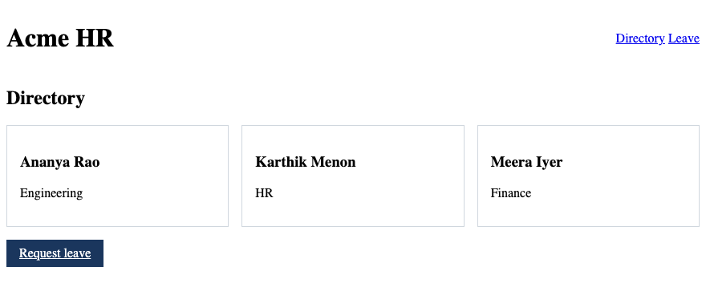

## 49. Introduction to CSS Grid

Grid lays out rows and columns together. The directory uses Grid when the cards must line up in both directions. Flexbox is one axis. The header stays on Flexbox. The card area can switch to Grid. Both can appear on the same page.

### Example

```css
/* styles.css */
.directory {
  display: grid;
  grid-template-columns: 1fr 1fr 1fr;
  gap: 1rem;
}
```

```html
<!DOCTYPE html>
<html lang="en">
<head>
  <meta charset="UTF-8">
  <meta name="viewport" content="width=device-width, initial-scale=1.0">
  <title>Acme HR — Grid</title>
  <link rel="stylesheet" href="styles.css">
</head>
<body>
  <header>
    <h1>Acme HR</h1>
  </header>
  <main>
    <h2>Directory</h2>
    <div class="directory">
      <article class="employee-card"><h3>Ananya Rao</h3><p>Engineering</p></article>
      <article class="employee-card"><h3>Karthik Menon</h3><p>HR</p></article>
      <article class="employee-card"><h3>Meera Iyer</h3><p>Finance</p></article>
    </div>
  </main>
</body>
</html>
```

**This will produce the following result:**


## 50. Rows & Columns

A grid has column tracks and row tracks. Columns run down. Rows run across. The directory uses three columns. The rows appear as cards fill the columns. You can define the rows, or let the content set the row size.

### Example

```css
/* styles.css */
.directory {
  display: grid;
  grid-template-columns: 1fr 1fr;
  grid-template-rows: auto auto;
  gap: 1rem;
}
```

```html
<!DOCTYPE html>
<html lang="en">
<head>
  <meta charset="UTF-8">
  <meta name="viewport" content="width=device-width, initial-scale=1.0">
  <title>Acme HR — Rows</title>
  <link rel="stylesheet" href="styles.css">
</head>
<body>
  <header>
    <h1>Acme HR</h1>
  </header>
  <main>
    <div class="directory">
      <article><h2>Ananya Rao</h2><p>Engineering</p></article>
      <article><h2>Karthik Menon</h2><p>HR</p></article>
      <article><h2>Meera Iyer</h2><p>Finance</p></article>
    </div>
  </main>
</body>
</html>
```

**This will produce the following result:**

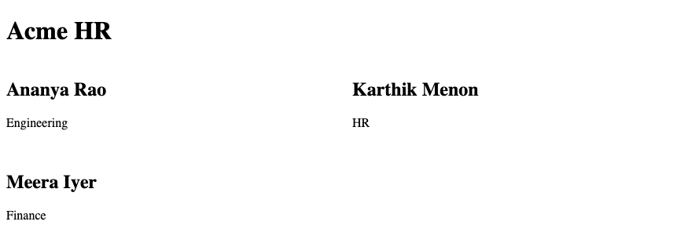

## 51. `grid-template-columns`

`grid-template-columns` defines the column tracks. `1fr 1fr 1fr` is three equal columns. A fixed track and a flexible track can sit together: `12rem 1fr`. The directory of three people uses three flexible columns on a wide page. A later module lets the count change with the viewport.

### Example

```css
/* styles.css */
.directory {
  display: grid;
  grid-template-columns: 1fr 1fr 1fr;
  gap: 1rem;
}
```

```html
<!DOCTYPE html>
<html lang="en">
<head>
  <meta charset="UTF-8">
  <meta name="viewport" content="width=device-width, initial-scale=1.0">
  <title>Acme HR — Columns</title>
  <link rel="stylesheet" href="styles.css">
</head>
<body>
  <header>
    <h1>Acme HR</h1>
  </header>
  <main>
    <div class="directory">
      <article><h2>Ananya Rao</h2></article>
      <article><h2>Karthik Menon</h2></article>
      <article><h2>Meera Iyer</h2></article>
    </div>
  </main>
</body>
</html>
```

**This will produce the following result:**

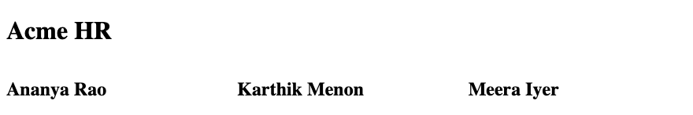

## 52. `grid-template-rows`

`grid-template-rows` defines the row tracks. `auto` sizes a row to its content. A fixed row sets a band, such as a payslip total line. Most directory rows should stay `auto` so a long department name is not clipped.

### Example

```css
/* styles.css */
.payslip {
  display: grid;
  grid-template-columns: 1fr auto;
  grid-template-rows: auto auto auto;
  gap: 0.5rem;
}
```

```html
<!DOCTYPE html>
<html lang="en">
<head>
  <meta charset="UTF-8">
  <meta name="viewport" content="width=device-width, initial-scale=1.0">
  <title>Acme HR — Rows template</title>
  <link rel="stylesheet" href="styles.css">
</head>
<body>
  <header>
    <h1>Acme HR</h1>
  </header>
  <main>
    <h2>Payslip lines</h2>
    <div class="payslip">
      <p>Basic</p><p>₹50,000</p>
      <p>HRA</p><p>₹20,000</p>
      <p>Net pay</p><p>₹78,800</p>
    </div>
  </main>
</body>
</html>
```

**This will produce the following result:**

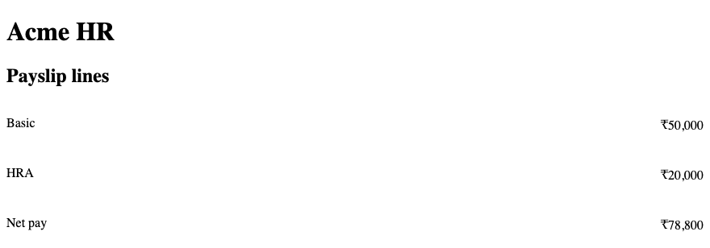

## 53. `gap`

Grid `gap` is the space between rows and columns. It does not add space outside the grid. `gap: 1rem` sets both. `gap: 1rem 2rem` sets row, then column. The directory uses one value so the cards have an even gutter.

### Example

```css
/* styles.css */
.directory {
  display: grid;
  grid-template-columns: 1fr 1fr 1fr;
  gap: 1rem;
}
```

```html
<!DOCTYPE html>
<html lang="en">
<head>
  <meta charset="UTF-8">
  <meta name="viewport" content="width=device-width, initial-scale=1.0">
  <title>Acme HR — Grid gap</title>
  <link rel="stylesheet" href="styles.css">
</head>
<body>
  <header>
    <h1>Acme HR</h1>
  </header>
  <main>
    <div class="directory">
      <article>Ananya Rao</article>
      <article>Karthik Menon</article>
      <article>Meera Iyer</article>
    </div>
  </main>
</body>
</html>
```

**This will produce the following result:**

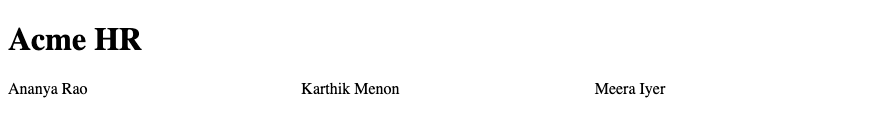

## 54. `fr`, `repeat()` & `minmax()`

`fr` is a share of the free space in the grid. `repeat(3, 1fr)` is three equal columns. `minmax(16rem, 1fr)` is a track at least 16rem and at most one share. `repeat(auto-fit, minmax(16rem, 1fr))` fits as many cards as the row allows. That is the directory.

### Example

```css
/* styles.css */
.directory {
  display: grid;
  grid-template-columns: repeat(auto-fit, minmax(16rem, 1fr));
  gap: 1rem;
}
```

```html
<!DOCTYPE html>
<html lang="en">
<head>
  <meta charset="UTF-8">
  <meta name="viewport" content="width=device-width, initial-scale=1.0">
  <title>Acme HR — Directory grid</title>
  <link rel="stylesheet" href="styles.css">
</head>
<body>
  <header>
    <h1>Acme HR</h1>
  </header>
  <main>
    <h2>Directory</h2>
    <div class="directory">
      <article><h3>Ananya Rao</h3><p>Engineering</p></article>
      <article><h3>Karthik Menon</h3><p>HR</p></article>
      <article><h3>Meera Iyer</h3><p>Finance</p></article>
    </div>
  </main>
</body>
</html>
```

**This will produce the following result:**


## 55. Grid Placement

`grid-column` and `grid-row` place an item on the tracks. Line numbers start at 1. `1 / -1` spans every column. The directory heading can span the full width while the cards occupy single cells. Placement is how a payslip total can sit under both the label column and the amount column.

### Example

```css
/* styles.css */
.directory {
  display: grid;
  grid-template-columns: 1fr 1fr 1fr;
  gap: 1rem;
}

.directory h2 {
  grid-column: 1 / -1;
}
```

```html
<!DOCTYPE html>
<html lang="en">
<head>
  <meta charset="UTF-8">
  <meta name="viewport" content="width=device-width, initial-scale=1.0">
  <title>Acme HR — Placement</title>
  <link rel="stylesheet" href="styles.css">
</head>
<body>
  <header>
    <h1>Acme HR</h1>
  </header>
  <main class="directory">
    <h2>Directory</h2>
    <article>Ananya Rao</article>
    <article>Karthik Menon</article>
    <article>Meera Iyer</article>
  </main>
</body>
</html>
```

**This will produce the following result:**

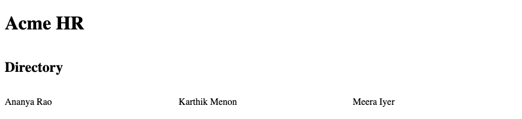

## 56. Grid Template Areas

`grid-template-areas` names regions and lays them out with a map of strings. Each string is a row. The labs do not use template areas. The directory uses `grid-template-columns` and `gap` instead. The map below is the idea, kept short.

### Example

```css
/* styles.css */
.page {
  display: grid;
  grid-template-areas:
    "header header"
    "main aside"
    "footer footer";
  grid-template-columns: 2fr 1fr;
  gap: 1rem;
}

header { grid-area: header; }
main { grid-area: main; }
aside { grid-area: aside; }
footer { grid-area: footer; }
```

```html
<!DOCTYPE html>
<html lang="en">
<head>
  <meta charset="UTF-8">
  <meta name="viewport" content="width=device-width, initial-scale=1.0">
  <title>Acme HR — Areas</title>
  <link rel="stylesheet" href="styles.css">
</head>
<body class="page">
  <header><h1>Acme HR</h1></header>
  <main><p>Directory</p></main>
  <aside><p>Next payroll: 30 September 2026</p></aside>
  <footer><p>Hyderabad</p></footer>
</body>
</html>
```

**This will produce the following result:**

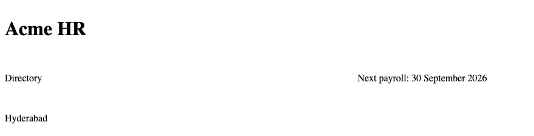

## 57. Flexbox vs Grid

Flexbox lays out one direction: a header row, or a wrapping run of cards. Grid lays out rows and columns at the same time: the directory. Use Flexbox for the header. Use Grid for the directory. A card's own name and department can be a column flex. The choice follows the axes you need.

| Layout | Use on Acme HR |
|--------|----------------|
| Normal flow | Paragraphs and the form |
| Flexbox | Header, and a row of cards |
| Grid | Directory columns |
| Positioning | Sticky header, status badge |

### Example

```css
/* styles.css */
header {
  display: flex;
  justify-content: space-between;
  align-items: center;
}

.directory {
  display: grid;
  grid-template-columns: repeat(auto-fit, minmax(16rem, 1fr));
  gap: 1rem;
}
```

```html
<!DOCTYPE html>
<html lang="en">
<head>
  <meta charset="UTF-8">
  <meta name="viewport" content="width=device-width, initial-scale=1.0">
  <title>Acme HR — Flex and grid</title>
  <link rel="stylesheet" href="styles.css">
</head>
<body>
  <header>
    <h1>Acme HR</h1>
    <nav>
      <a href="directory.html">Directory</a>
      <a href="leave.html">Leave</a>
    </nav>
  </header>
  <main class="directory">
    <article><h2>Ananya Rao</h2><p>Engineering</p></article>
    <article><h2>Karthik Menon</h2><p>HR</p></article>
    <article><h2>Meera Iyer</h2><p>Finance</p></article>
  </main>
</body>
</html>
```

**This will produce the following result:**

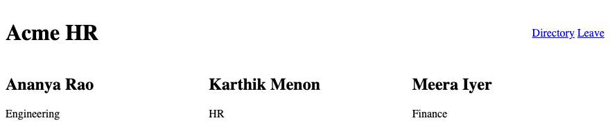
