# 4. CSS — Responsive & Modern CSS

**Index:** [CSS and Responsive](../02_CSS_and_Responsive.md)  
**Previous:** [CSS Layout](Module_03_CSS_Layout.md)  
**Next:** [UI Styling and Interactions](Module_05_UI_Styling_and_Interactions.md)

Media queries in this module use `min-width`. The narrow layout is the base. Wider rules are added from a chosen width upward. Container queries, nesting, and template areas stay out of the labs.

## 58. Introduction to Responsive Web Design

A responsive page is readable on a phone and on a laptop without a separate site. The same HTML is used. CSS changes columns, type size, and spacing as the viewport grows. The viewport meta tag from the HTML module lets the phone use its own width. Acme HR is one directory, not a desktop directory and a phone directory.

### Example

```css
/* styles.css */
body {
  margin: 0;
  font-family: system-ui, sans-serif;
  color: #1b2430;
  background-color: #f4f6f8;
}
```

```html
<!DOCTYPE html>
<html lang="en">
<head>
  <meta charset="UTF-8">
  <meta name="viewport" content="width=device-width, initial-scale=1.0">
  <title>Acme HR</title>
  <link rel="stylesheet" href="styles.css">
</head>
<body>
  <header>
    <h1>Acme HR</h1>
  </header>
  <main>
    <h2>Directory</h2>
    <p>The same page is used on a phone and on a laptop.</p>
  </main>
</body>
</html>
```

**This will produce the following result:**

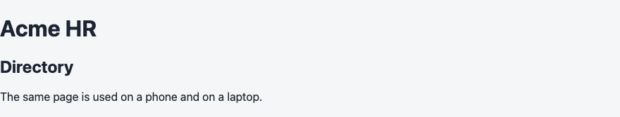

## 59. Mobile-First Design

Mobile-first means the base CSS is the narrow layout. A `min-width` query adds rules when the viewport is at least that wide. You are not shrinking a desktop page. You are adding columns when there is room. The directory stacks on a phone. It becomes a row when the viewport reaches `40rem`.

### Example

```css
/* styles.css */
.cards {
  display: flex;
  flex-direction: column;
  gap: 1rem;
}

@media (min-width: 40rem) {
  .cards {
    flex-direction: row;
    flex-wrap: wrap;
  }
}
```

```html
<!DOCTYPE html>
<html lang="en">
<head>
  <meta charset="UTF-8">
  <meta name="viewport" content="width=device-width, initial-scale=1.0">
  <title>Acme HR — Mobile first</title>
  <link rel="stylesheet" href="styles.css">
</head>
<body>
  <header>
    <h1>Acme HR</h1>
  </header>
  <main>
    <ul class="cards">
      <li class="employee-card">Ananya Rao, Engineering</li>
      <li class="employee-card">Karthik Menon, HR</li>
      <li class="employee-card">Meera Iyer, Finance</li>
    </ul>
  </main>
</body>
</html>
```

**This will produce the following result:**

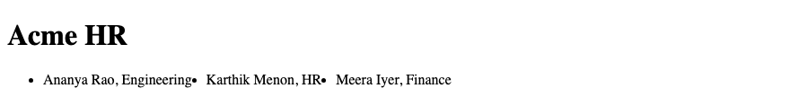

## 60. Media Queries

A media query applies rules when a condition is true. `@media (min-width: 40rem)` is true when the viewport is 40rem or wider. Flex-wrap and a min-width breakpoint do different jobs. `flex-wrap` moves an item to the next line when the row is full. The breakpoint switches the layout on purpose, from a column to a row, at a width you choose. `flex-basis` follows the main axis. `flex: 1 1 260px` belongs in the row query. On a column that 260px would be the height of each card.

### Example

```css
/* styles.css */
.cards {
  display: flex;
  flex-direction: column;
  gap: 1rem;
}

@media (min-width: 40rem) {
  .cards {
    flex-direction: row;
    flex-wrap: wrap;
  }

  .employee-card {
    flex: 1 1 260px;
  }
}
```

```html
<!DOCTYPE html>
<html lang="en">
<head>
  <meta charset="UTF-8">
  <meta name="viewport" content="width=device-width, initial-scale=1.0">
  <title>Acme HR — Breakpoint</title>
  <link rel="stylesheet" href="styles.css">
</head>
<body>
  <header>
    <h1>Acme HR</h1>
  </header>
  <main>
    <ul class="cards">
      <li class="employee-card">Ananya Rao</li>
      <li class="employee-card">Karthik Menon</li>
      <li class="employee-card">Meera Iyer</li>
    </ul>
  </main>
</body>
</html>
```

**This will produce the following result:**

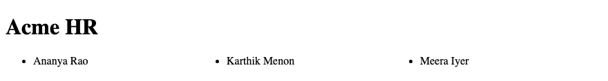

## 61. Breakpoints

A breakpoint is the width where the layout changes. Choose it from the content, not from a phone brand. Around `40rem` there is room for more than one card, so that is the breakpoint. From that width the cards use `flex: 1 1 260px` on the row. A second step at `64rem` can widen the page margin. Two or three steps are enough for Acme HR.

### Example

```css
/* styles.css */
main {
  padding: 1rem;
}

@media (min-width: 40rem) {
  main {
    padding: 1.5rem;
  }
}

@media (min-width: 64rem) {
  main {
    max-width: 64rem;
    margin-inline: auto;
  }
}
```

```html
<!DOCTYPE html>
<html lang="en">
<head>
  <meta charset="UTF-8">
  <meta name="viewport" content="width=device-width, initial-scale=1.0">
  <title>Acme HR — Breakpoints</title>
  <link rel="stylesheet" href="styles.css">
</head>
<body>
  <header>
    <h1>Acme HR</h1>
  </header>
  <main>
    <h2>Directory</h2>
    <p>The content width steps up at 40rem and 64rem.</p>
  </main>
</body>
</html>
```

**This will produce the following result:**

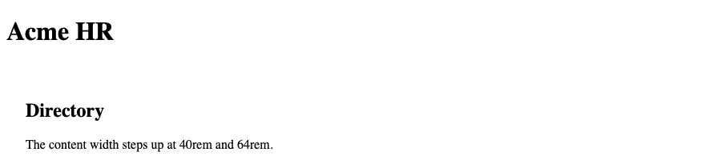

## 62. Responsive Units

`rem` follows the root font. `%` and `fr` follow the container. `vw` follows the viewport. A card basis of `16rem` grows if the reader enlarges the root font. A width of `100%` fills the parent. Avoid locking the layout to `px` only. A border of `1px` is a fair use of pixels.

### Example

```css
/* styles.css */
.employee-card {
  width: 100%;
  max-width: 20rem;
  padding: 1rem;
}
```

```html
<!DOCTYPE html>
<html lang="en">
<head>
  <meta charset="UTF-8">
  <meta name="viewport" content="width=device-width, initial-scale=1.0">
  <title>Acme HR — Units</title>
  <link rel="stylesheet" href="styles.css">
</head>
<body>
  <header>
    <h1>Acme HR</h1>
  </header>
  <main>
    <article class="employee-card">
      <h2>Ananya Rao</h2>
      <p>Engineering</p>
    </article>
  </main>
</body>
</html>
```

**This will produce the following result:**

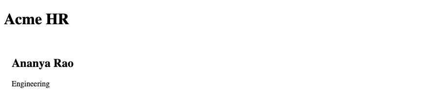

## 63. Responsive Images

An image wider than its column overflows the page. `max-width: 100%` and `height: auto` scale the staff photo down and keep the ratio. The HTML `width` and `height` still reserve the box. The picture element from the HTML module can swap a wider crop at `min-width: 40rem`.

### Example

```css
/* styles.css */
img {
  max-width: 100%;
  height: auto;
}
```

```html
<!DOCTYPE html>
<html lang="en">
<head>
  <meta charset="UTF-8">
  <meta name="viewport" content="width=device-width, initial-scale=1.0">
  <title>Acme HR — Photo</title>
  <link rel="stylesheet" href="styles.css">
</head>
<body>
  <header>
    <h1>Acme HR</h1>
  </header>
  <main>
    
  </main>
</body>
</html>
```

**This will produce the following result:**

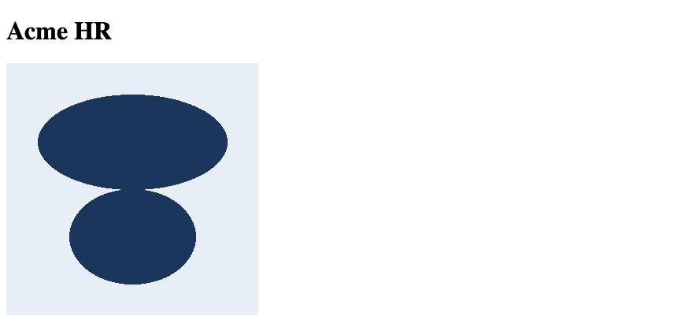

## 64. Responsive Typography

`clamp()` sets a font size that grows with the viewport and stops at a minimum and a maximum. The heading can be `clamp(1.75rem, 1rem + 2vw, 2.5rem)`. Body text can stay at `1rem`. Line length still needs `max-width` on the paragraph. A huge heading on a phone is not responsive type.

### Example

```css
/* styles.css */
h1 {
  font-size: clamp(1.75rem, 1rem + 2vw, 2.5rem);
}

p {
  max-width: 40rem;
  line-height: 1.5;
}
```

```html
<!DOCTYPE html>
<html lang="en">
<head>
  <meta charset="UTF-8">
  <meta name="viewport" content="width=device-width, initial-scale=1.0">
  <title>Acme HR — Type</title>
  <link rel="stylesheet" href="styles.css">
</head>
<body>
  <header>
    <h1>Acme HR</h1>
  </header>
  <main>
    <p>Staff records for the Hyderabad office.</p>
  </main>
</body>
</html>
```

**This will produce the following result:**

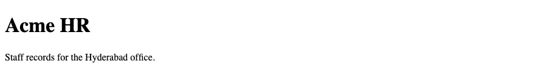

## 65. Responsive Navigation & Cards

On a narrow screen the nav can wrap under the title. From `40rem`, the header is a row with space between the title and the links. Cards stack in a column, then wrap in a row. `flex-wrap` handles a card that does not fit. The `min-width` query changes the header and the card row at the breakpoint. Those are different jobs.

### Example

```css
/* styles.css */
header {
  display: flex;
  flex-direction: column;
  gap: 0.5rem;
  padding: 1rem;
}

.cards {
  display: flex;
  flex-direction: column;
  gap: 1rem;
  list-style: none;
  padding: 0;
}

@media (min-width: 40rem) {
  header {
    flex-direction: row;
    justify-content: space-between;
    align-items: center;
  }

  .cards {
    flex-direction: row;
    flex-wrap: wrap;
  }

  .employee-card {
    flex: 1 1 260px;
  }
}
```

```html
<!DOCTYPE html>
<html lang="en">
<head>
  <meta charset="UTF-8">
  <meta name="viewport" content="width=device-width, initial-scale=1.0">
  <title>Acme HR — Nav and cards</title>
  <link rel="stylesheet" href="styles.css">
</head>
<body>
  <header>
    <h1>Acme HR</h1>
    <nav>
      <a href="directory.html">Directory</a>
      <a href="leave.html">Leave</a>
    </nav>
  </header>
  <main>
    <ul class="cards">
      <li class="employee-card">Ananya Rao, Engineering</li>
      <li class="employee-card">Karthik Menon, HR</li>
      <li class="employee-card">Meera Iyer, Finance</li>
    </ul>
  </main>
</body>
</html>
```

**This will produce the following result:**

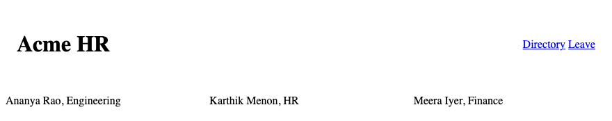

## 66. Responsive Forms

On a narrow screen the leave fields use the full width of the main column. From `40rem`, the fields stop at `24rem` so a line of text is not a full desktop wide. Labels stay above the fields. The submit button stays an `inline-flex` control. The form does not become a table.

### Example

```css
/* styles.css */
input, select, textarea {
  width: 100%;
  padding: 0.5rem;
}

@media (min-width: 40rem) {
  input, select, textarea {
    max-width: 24rem;
  }
}
```

```html
<!DOCTYPE html>
<html lang="en">
<head>
  <meta charset="UTF-8">
  <meta name="viewport" content="width=device-width, initial-scale=1.0">
  <title>Acme HR — Leave</title>
  <link rel="stylesheet" href="styles.css">
</head>
<body>
  <header>
    <h1>Acme HR</h1>
  </header>
  <main>
    <form action="/leave" method="post">
      <p>
        <label for="reason">Reason</label>
        <textarea id="reason" name="reason" rows="4"></textarea>
      </p>
      <button type="submit">Submit leave</button>
    </form>
  </main>
</body>
</html>
```

**This will produce the following result:**

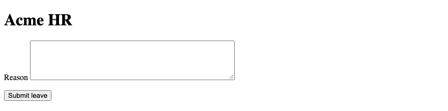

## 67. CSS Custom Properties / Variables

A custom property is a named value you define. It starts with `--`. Define the Acme HR palette on `:root` so every rule can use it. Change the brand colour in one place. Prefer a class over an id for styling. The variable is not a substitute for a class. It is the value the class uses.

### Example

```css
/* styles.css */
:root {
  --ink: #1b2430;
  --brand: #1a365d;
  --page: #f4f6f8;
  --muted: #3d4654;
}

body {
  color: var(--ink);
  background-color: var(--page);
}

h1 {
  color: var(--brand);
}
```

```html
<!DOCTYPE html>
<html lang="en">
<head>
  <meta charset="UTF-8">
  <meta name="viewport" content="width=device-width, initial-scale=1.0">
  <title>Acme HR — Variables</title>
  <link rel="stylesheet" href="styles.css">
</head>
<body>
  <header>
    <h1>Acme HR</h1>
  </header>
  <main>
    <p>The colours come from custom properties.</p>
  </main>
</body>
</html>
```

**This will produce the following result:**

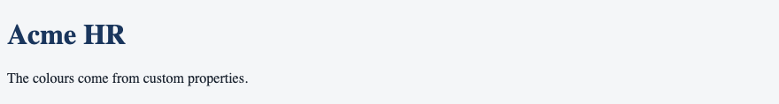

## 68. `var()`

`var()` reads a custom property. The second argument is a fallback, used when the property is not defined. `var(--brand, #1a365d)` uses navy if `--brand` is missing. A property inherits, so a card can override `--brand` for its own subtree.

### Example

```css
/* styles.css */
:root {
  --brand: #1a365d;
}

a {
  color: var(--brand, #1a365d);
}
```

```html
<!DOCTYPE html>
<html lang="en">
<head>
  <meta charset="UTF-8">
  <meta name="viewport" content="width=device-width, initial-scale=1.0">
  <title>Acme HR — var</title>
  <link rel="stylesheet" href="styles.css">
</head>
<body>
  <header>
    <h1>Acme HR</h1>
  </header>
  <main>
    <a href="directory.html">Directory</a>
  </main>
</body>
</html>
```

**This will produce the following result:**

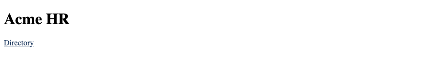

## 69. `calc()`

`calc()` does arithmetic in a value. Adding a length to a percentage is a common case: `calc(100% - 2rem)` is the full width minus a margin. Spaces are required around `+` and `-`. The payslip panel can sit inset from the page edge without a second wrapper.

### Example

```css
/* styles.css */
.panel {
  width: calc(100% - 2rem);
  margin: 1rem;
}
```

```html
<!DOCTYPE html>
<html lang="en">
<head>
  <meta charset="UTF-8">
  <meta name="viewport" content="width=device-width, initial-scale=1.0">
  <title>Acme HR — calc</title>
  <link rel="stylesheet" href="styles.css">
</head>
<body>
  <header>
    <h1>Acme HR</h1>
  </header>
  <main class="panel">
    <h2>Payslip</h2>
    <p>Net pay ₹78,800.</p>
  </main>
</body>
</html>
```

**This will produce the following result:**

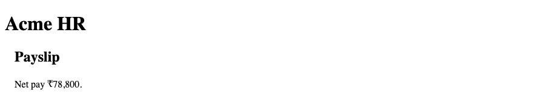

## 70. `min()`, `max()` & `clamp()`

`min()` picks the smaller of two values. `max()` picks the larger. `clamp(min, preferred, max)` stays between the ends. A card can be `width: min(100%, 20rem)` so it never overflows and never grows past 20rem. The heading uses `clamp()` for type. These functions are values. They are not media queries.

| Function | Acme HR use |
|----------|-------------|
| `min(100%, 20rem)` | Card width |
| `max(1rem, 2vw)` | A gap that does not vanish |
| `clamp(1.75rem, 1rem + 2vw, 2.5rem)` | The h1 size |

### Example

```css
/* styles.css */
.employee-card {
  width: min(100%, 20rem);
}

h1 {
  font-size: clamp(1.75rem, 1rem + 2vw, 2.5rem);
}
```

```html
<!DOCTYPE html>
<html lang="en">
<head>
  <meta charset="UTF-8">
  <meta name="viewport" content="width=device-width, initial-scale=1.0">
  <title>Acme HR — clamp</title>
  <link rel="stylesheet" href="styles.css">
</head>
<body>
  <header>
    <h1>Acme HR</h1>
  </header>
  <main>
    <article class="employee-card">
      <h2>Meera Iyer</h2>
      <p>Finance</p>
    </article>
  </main>
</body>
</html>
```

**This will produce the following result:**

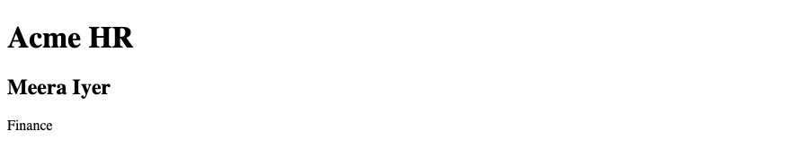

## 71. Container Queries — Introduction

A container query styles an element from the size of a parent, not the viewport. `container-type: inline-size` marks the parent. `@container (min-width: 20rem)` applies inside it. The labs do not use container queries. The directory uses a viewport `min-width` query.

### Example

```css
/* Demo — the labs still use a viewport min-width query. */
.directory {
  container-type: inline-size;
}

@container (min-width: 20rem) {
  .employee-card h2 {
    font-size: 1.25rem;
  }
}
```

```html
<!DOCTYPE html>
<html lang="en">
<head>
  <meta charset="UTF-8">
  <meta name="viewport" content="width=device-width, initial-scale=1.0">
  <title>Acme HR — Container</title>
  <link rel="stylesheet" href="styles.css">
</head>
<body>
  <header>
    <h1>Acme HR</h1>
  </header>
  <main>
    <section class="directory">
      <article class="employee-card">
        <h2>Ananya Rao</h2>
        <p>Engineering</p>
      </article>
    </section>
  </main>
</body>
</html>
```

**This will produce the following result:**

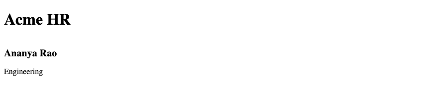

## 72. CSS Nesting — Awareness

CSS nesting lets a rule sit inside another rule. `&` is the parent selector. The labs do not use nesting. A flat `.employee-card h2` selector is the form used in these notes. Nesting is shorter to type. It is the same cascade once the browser expands it.

### Example

```css
/* Not used in the labs. Equivalent flat selector: .employee-card h2 */
.employee-card {
  padding: 1rem;

  & h2 {
    color: #1a365d;
  }
}
```

```html
<!DOCTYPE html>
<html lang="en">
<head>
  <meta charset="UTF-8">
  <meta name="viewport" content="width=device-width, initial-scale=1.0">
  <title>Acme HR — Nesting</title>
  <link rel="stylesheet" href="styles.css">
</head>
<body>
  <header>
    <h1>Acme HR</h1>
  </header>
  <main>
    <article class="employee-card">
      <h2>Ananya Rao</h2>
    </article>
  </main>
</body>
</html>
```

**This will produce the following result:**


## 73. Modern CSS Best Practices

Prefer a class over an id for styling. Use `*` for `box-sizing: border-box`. Avoid `!important`. Keep rules in `styles.css`. Django serves that file from `static/`. Spring Boot serves it from `src/main/resources/static/`. Use `min-width` queries. Ship `:focus-visible`. `prefers-reduced-motion` wraps anything that moves.

### Example

```css
/* styles.css */
* {
  box-sizing: border-box;
}

:root {
  --brand: #1a365d;
}

:focus-visible {
  outline: 2px solid var(--brand);
  outline-offset: 2px;
}
```

```html
<!DOCTYPE html>
<html lang="en">
<head>
  <meta charset="UTF-8">
  <meta name="viewport" content="width=device-width, initial-scale=1.0">
  <title>Acme HR</title>
  <link rel="stylesheet" href="styles.css">
</head>
<body>
  <header>
    <h1>Acme HR</h1>
  </header>
  <main>
    <a href="directory.html">Directory</a>
  </main>
</body>
</html>
```

**This will produce the following result:**

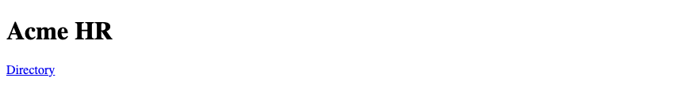
