# 5. CSS — UI Styling & Interactions

**Index:** [CSS and Responsive](../02_CSS_and_Responsive.md)  
**Previous:** [Responsive and Modern CSS](Module_04_Responsive_and_Modern_CSS.md)  
**Next:** [CSS Development Practices](Module_06_CSS_Development_Practices.md)

These rules style the leave form, the buttons, and the September payslip. Motion sits inside a reduced-motion check. `@keyframes` is named at the end and is not used in the labs.

## 74. Styling HTML Forms

Labels stack above the fields. Fields share a width, a border, and padding. The leave form stays in normal flow under the directory. Set `box-sizing: border-box` on the universal selector so the padding stays inside the width.

### Example

```css
/* styles.css */
* {
  box-sizing: border-box;
}

label {
  display: block;
  margin-bottom: 0.25rem;
}

input, select, textarea {
  width: 100%;
  max-width: 24rem;
  padding: 0.5rem;
  border: 1px solid #d0d7de;
  font: inherit;
}
```

```html
<!DOCTYPE html>
<html lang="en">
<head>
  <meta charset="UTF-8">
  <meta name="viewport" content="width=device-width, initial-scale=1.0">
  <title>Acme HR — Leave</title>
  <link rel="stylesheet" href="styles.css">
</head>
<body>
  <header>
    <h1>Acme HR</h1>
  </header>
  <main>
    <h2>Leave request</h2>
    <form action="/leave" method="post">
      <p>
        <label for="reason">Reason</label>
        <textarea id="reason" name="reason" rows="4"></textarea>
      </p>
      <button type="submit">Submit leave</button>
    </form>
  </main>
</body>
</html>
```

**This will produce the following result:**

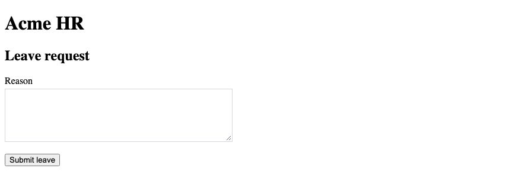

## 75. Styling Buttons

A button and a link that acts as a button share one class. A link styled as a button uses `inline-flex`. The label then lines up in the middle of the padding. Colour is not the only sign of the control. The text says what it does.

### Example

```css
/* styles.css */
button, a.button {
  display: inline-flex;
  align-items: center;
  padding: 0.5rem 1rem;
  border: 2px solid #1a365d;
  background-color: #1a365d;
  color: #ffffff;
  font: inherit;
  text-decoration: none;
}
```

```html
<!DOCTYPE html>
<html lang="en">
<head>
  <meta charset="UTF-8">
  <meta name="viewport" content="width=device-width, initial-scale=1.0">
  <title>Acme HR — Buttons</title>
  <link rel="stylesheet" href="styles.css">
</head>
<body>
  <header>
    <h1>Acme HR</h1>
  </header>
  <main>
    <p><a class="button" href="leave.html">Request leave</a></p>
    <form action="/leave" method="post">
      <button type="submit">Submit leave</button>
    </form>
  </main>
</body>
</html>
```

**This will produce the following result:**

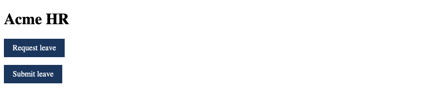

## 76. Styling Tables

The payslip uses collapsed borders, padding in the cells, and right-aligned amounts. The header row has a light navy surface. The footer row carries the net pay. Numbers line up when the amount column is right-aligned.

### Example

```css
/* styles.css */
table {
  border-collapse: collapse;
  width: 100%;
  max-width: 32rem;
}

th, td {
  border: 1px solid #d0d7de;
  padding: 0.5rem;
  text-align: left;
}

thead th {
  background-color: #e8eef6;
}

td {
  text-align: right;
}

th[scope="row"] {
  text-align: left;
}
```

```html
<!DOCTYPE html>
<html lang="en">
<head>
  <meta charset="UTF-8">
  <meta name="viewport" content="width=device-width, initial-scale=1.0">
  <title>Acme HR — Payslip</title>
  <link rel="stylesheet" href="styles.css">
</head>
<body>
  <header>
    <h1>Acme HR</h1>
  </header>
  <main>
    <h2>Payslip</h2>
    <table>
      <caption>Payslip for Ananya Rao, September 2026</caption>
      <thead>
        <tr>
          <th scope="col">Component</th>
          <th scope="col">Amount</th>
        </tr>
      </thead>
      <tbody>
        <tr>
          <th scope="row">Basic</th>
          <td>₹50,000</td>
        </tr>
        <tr>
          <th scope="row">HRA</th>
          <td>₹20,000</td>
        </tr>
        <tr>
          <th scope="row">Net pay</th>
          <td>₹78,800</td>
        </tr>
      </tbody>
    </table>
  </main>
</body>
</html>
```

**This will produce the following result:**

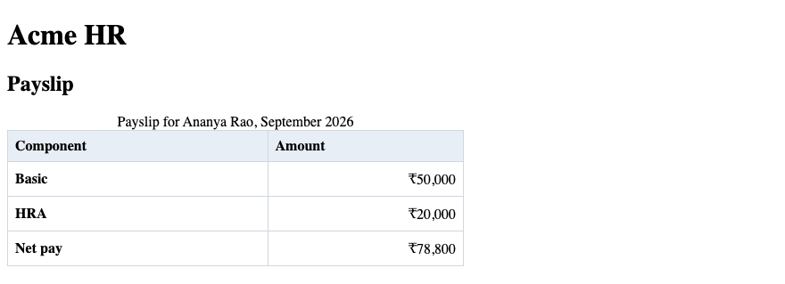

## 77. Cards & Navigation Bars

The nav is a row of links in the header. Each employee card has a border, padding, and the status badge from the positioning section. The header uses Flexbox. The cards use Flexbox or Grid, as the layout module set them. This section adds the surface: border, padding, and background.

### Example

```css
/* styles.css */
header {
  display: flex;
  justify-content: space-between;
  align-items: center;
  padding: 1rem;
  background-color: #1a365d;
  color: #ffffff;
}

nav a {
  color: #ffffff;
  margin-left: 1rem;
}

.employee-card {
  background-color: #ffffff;
  border: 1px solid #d0d7de;
  padding: 1rem;
}
```

```html
<!DOCTYPE html>
<html lang="en">
<head>
  <meta charset="UTF-8">
  <meta name="viewport" content="width=device-width, initial-scale=1.0">
  <title>Acme HR — Nav and cards</title>
  <link rel="stylesheet" href="styles.css">
</head>
<body>
  <header>
    <h1>Acme HR</h1>
    <nav>
      <a href="directory.html">Directory</a>
      <a href="leave.html">Leave</a>
    </nav>
  </header>
  <main>
    <article class="employee-card">
      <h2>Ananya Rao</h2>
      <p>Engineering</p>
    </article>
  </main>
</body>
</html>
```

**This will produce the following result:**

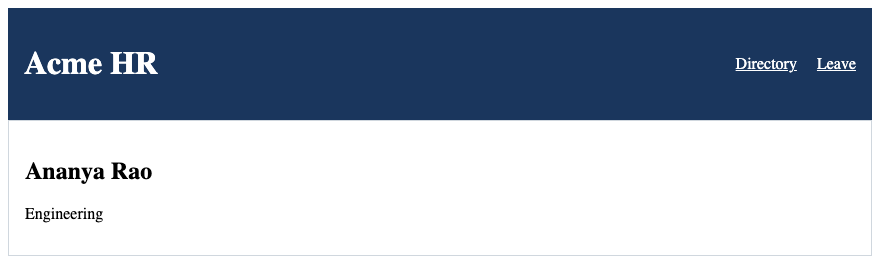

## 78. Common UI Components

A badge, a button, and a muted note are small classes you reuse. The badge names a status such as Active. Muted text must clear 4.5:1 on the page background. `#3d4654` on `#f4f6f8` clears that bar. The badge text uses the same ink on a light blue chip.

### Example

```css
/* styles.css */
body {
  background-color: #f4f6f8;
  color: #1b2430;
}

.badge {
  display: inline-block;
  padding: 0.15rem 0.4rem;
  background-color: #e8eef6;
  color: #1b2430;
}

.muted {
  color: #3d4654;
}
```

```html
<!DOCTYPE html>
<html lang="en">
<head>
  <meta charset="UTF-8">
  <meta name="viewport" content="width=device-width, initial-scale=1.0">
  <title>Acme HR — Components</title>
  <link rel="stylesheet" href="styles.css">
</head>
<body>
  <header>
    <h1>Acme HR</h1>
  </header>
  <main>
    <p>Ananya Rao <span class="badge">Active</span></p>
    <p class="muted">Employee ID E-1042</p>
  </main>
</body>
</html>
```

**This will produce the following result:**

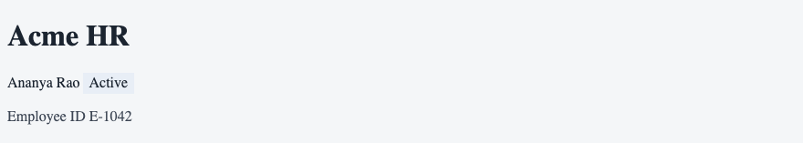

## 79. `:hover`

`:hover` matches an element under the pointer. Use it to change a background or an underline. Do not hide information until hover. A phone has no hover. The directory link can darken. The staff name stays visible without it.

### Example

```css
/* styles.css */
a.button:hover {
  background-color: #0f2744;
}
```

```html
<!DOCTYPE html>
<html lang="en">
<head>
  <meta charset="UTF-8">
  <meta name="viewport" content="width=device-width, initial-scale=1.0">
  <title>Acme HR — Hover</title>
  <link rel="stylesheet" href="styles.css">
</head>
<body>
  <header>
    <h1>Acme HR</h1>
  </header>
  <main>
    <a class="button" href="leave.html">Request leave</a>
  </main>
</body>
</html>
```

**This will produce the following result:**

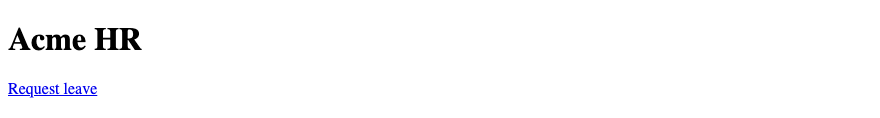

## 80. `:focus`

`:focus` matches the element that has keyboard or pointer focus. A field shows focus when the reader tabs to it. Do not remove an outline unless another visible style replaces it. The next section uses `:focus-visible` for the keyboard ring.

### Example

```css
/* styles.css */
input:focus {
  border-color: #1a365d;
}
```

```html
<!DOCTYPE html>
<html lang="en">
<head>
  <meta charset="UTF-8">
  <meta name="viewport" content="width=device-width, initial-scale=1.0">
  <title>Acme HR — Focus</title>
  <link rel="stylesheet" href="styles.css">
</head>
<body>
  <header>
    <h1>Acme HR</h1>
  </header>
  <main>
    <form action="/leave" method="post">
      <p>
        <label for="reason">Reason</label>
        <input id="reason" name="reason" type="text">
      </p>
    </form>
  </main>
</body>
</html>
```

**This will produce the following result:**

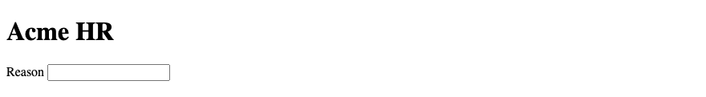

## 81. `:focus-visible`

Ship `:focus-visible`. It matches when the browser would draw a focus ring for a keyboard user. Do not remove an outline unless another visible style replaces it. The leave button keeps a 2 pixel navy outline, offset from the box.

### Example

```css
/* styles.css */
:focus-visible {
  outline: 2px solid #1a365d;
  outline-offset: 2px;
}
```

```html
<!DOCTYPE html>
<html lang="en">
<head>
  <meta charset="UTF-8">
  <meta name="viewport" content="width=device-width, initial-scale=1.0">
  <title>Acme HR — Focus visible</title>
  <link rel="stylesheet" href="styles.css">
</head>
<body>
  <header>
    <h1>Acme HR</h1>
  </header>
  <main>
    <a href="directory.html">Directory</a>
    <a href="leave.html">Leave</a>
  </main>
</body>
</html>
```

**This will produce the following result:**

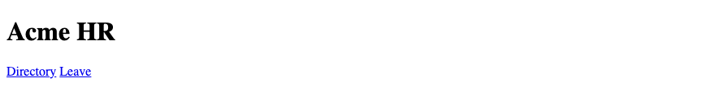

## 82. `:active`

`:active` matches a control while it is being pressed. A short colour change confirms the press. Keep the label readable. The moment is brief. The focus ring from `:focus-visible` still matters after the press.

### Example

```css
/* styles.css */
button:active {
  background-color: #0f2744;
}
```

```html
<!DOCTYPE html>
<html lang="en">
<head>
  <meta charset="UTF-8">
  <meta name="viewport" content="width=device-width, initial-scale=1.0">
  <title>Acme HR — Active</title>
  <link rel="stylesheet" href="styles.css">
</head>
<body>
  <header>
    <h1>Acme HR</h1>
  </header>
  <main>
    <form action="/leave" method="post">
      <button type="submit">Submit leave</button>
    </form>
  </main>
</body>
</html>
```

**This will produce the following result:**


## 83. `:disabled`

`:disabled` matches a control with the `disabled` attribute. Fade the button and stop the pointer. The HTML still owns the meaning: a disabled control is not submitted. The style only shows that the control is off.

### Example

```css
/* styles.css */
button:disabled {
  background-color: #d0d7de;
  color: #3d4654;
  border-color: #d0d7de;
}
```

```html
<!DOCTYPE html>
<html lang="en">
<head>
  <meta charset="UTF-8">
  <meta name="viewport" content="width=device-width, initial-scale=1.0">
  <title>Acme HR — Disabled</title>
  <link rel="stylesheet" href="styles.css">
</head>
<body>
  <header>
    <h1>Acme HR</h1>
  </header>
  <main>
    <form action="/leave" method="post">
      <button type="submit" disabled>Submit leave</button>
    </form>
  </main>
</body>
</html>
```

**This will produce the following result:**

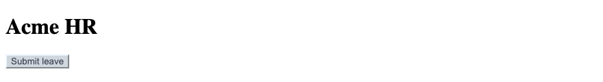

## 84. `:checked`

`:checked` matches a selected radio or checkbox. You can style the label that follows a checked box. The control itself stays a real checkbox so the form still submits it. A selected half-day can show a stronger label.

### Example

```css
/* styles.css */
input:checked + label {
  font-weight: 700;
}
```

```html
<!DOCTYPE html>
<html lang="en">
<head>
  <meta charset="UTF-8">
  <meta name="viewport" content="width=device-width, initial-scale=1.0">
  <title>Acme HR — Checked</title>
  <link rel="stylesheet" href="styles.css">
</head>
<body>
  <header>
    <h1>Acme HR</h1>
  </header>
  <main>
    <form action="/leave" method="post">
      <fieldset>
        <legend>Duration</legend>
        <input id="span-full" name="span" type="radio" value="full" checked>
        <label for="span-full">Full day</label>
      </fieldset>
    </form>
  </main>
</body>
</html>
```

**This will produce the following result:**

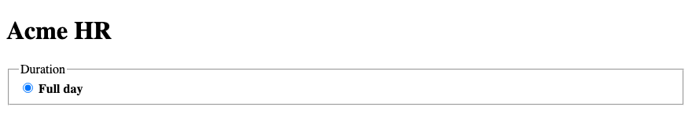

## 85. CSS Transitions

A transition animates a change from one value to another. The button background can take 0.2 seconds. `prefers-reduced-motion` wraps anything that moves. The transition lives inside the `no-preference` query, so a reader who asks for less motion gets an instant change.

### Example

```css
/* styles.css */
@media (prefers-reduced-motion: no-preference) {
  a.button {
    transition: background-color 0.2s;
  }
}

a.button:hover {
  background-color: #0f2744;
}
```

```html
<!DOCTYPE html>
<html lang="en">
<head>
  <meta charset="UTF-8">
  <meta name="viewport" content="width=device-width, initial-scale=1.0">
  <title>Acme HR — Transition</title>
  <link rel="stylesheet" href="styles.css">
</head>
<body>
  <header>
    <h1>Acme HR</h1>
  </header>
  <main>
    <a class="button" href="leave.html">Request leave</a>
  </main>
</body>
</html>
```

**This will produce the following result:**


## 86. CSS Transforms

`transform` moves, scales, or rotates a box without changing the layout around it. A card can lift a few pixels on hover. That move is motion. Wrap it the same way as a transition. The directory does not depend on the lift. The name stays readable if the transform never runs.

### Example

```css
/* styles.css */
@media (prefers-reduced-motion: no-preference) {
  .employee-card:hover {
    transform: translateY(-2px);
  }
}
```

```html
<!DOCTYPE html>
<html lang="en">
<head>
  <meta charset="UTF-8">
  <meta name="viewport" content="width=device-width, initial-scale=1.0">
  <title>Acme HR — Transform</title>
  <link rel="stylesheet" href="styles.css">
</head>
<body>
  <header>
    <h1>Acme HR</h1>
  </header>
  <main>
    <article class="employee-card">
      <h2>Ananya Rao</h2>
      <p>Engineering</p>
    </article>
  </main>
</body>
</html>
```

**This will produce the following result:**

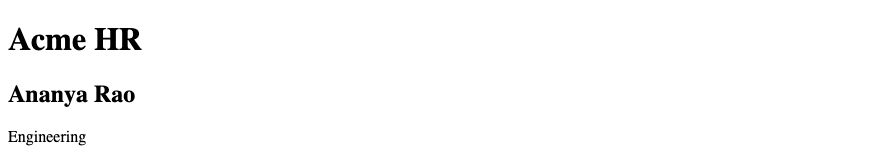

## 87. CSS Animations

An animation runs a set of keyframes, once or in a loop. A transition runs when a property changes. Acme HR uses one transition, on the button. A looping animation is not part of the portal. The labs do not use animations.

### Example

```css
/* styles.css */
@media (prefers-reduced-motion: no-preference) {
  a.button {
    transition: background-color 0.2s;
  }
}
```

```html
<!DOCTYPE html>
<html lang="en">
<head>
  <meta charset="UTF-8">
  <meta name="viewport" content="width=device-width, initial-scale=1.0">
  <title>Acme HR — Motion</title>
  <link rel="stylesheet" href="styles.css">
</head>
<body>
  <header>
    <h1>Acme HR</h1>
  </header>
  <main>
    <a class="button" href="directory.html">Open the directory</a>
  </main>
</body>
</html>
```

**This will produce the following result:**


## 88. `@keyframes`

`@keyframes` names the steps of an animation. The labs do not use `@keyframes`. The sample below fades a badge. Leave it out of the Acme HR pages. The button transition does not need keyframes.

### Example

```css
/* Not used on the Acme HR pages or in the labs. */
@keyframes fade-in {
  from { opacity: 0; }
  to { opacity: 1; }
}
```

```html
<!DOCTYPE html>
<html lang="en">
<head>
  <meta charset="UTF-8">
  <meta name="viewport" content="width=device-width, initial-scale=1.0">
  <title>Acme HR</title>
  <link rel="stylesheet" href="styles.css">
</head>
<body>
  <header>
    <h1>Acme HR</h1>
  </header>
  <main>
    <p>The portal does not run this animation.</p>
  </main>
</body>
</html>
```

**This will produce the following result:**

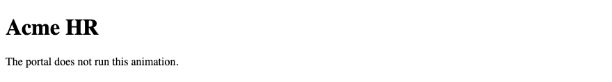

## 89. Accessibility & Focus States

Ship `:focus-visible`. Do not remove an outline unless another visible style replaces it. Muted text must clear 4.5:1 on the page background. A link needs an underline or another cue besides colour. The payslip amounts stay in a table with headers. The styles do not remove those headers.

### Example

```css
/* styles.css */
body {
  background-color: #f4f6f8;
  color: #1b2430;
}

.muted {
  color: #3d4654;
}

a {
  color: #1a365d;
}

:focus-visible {
  outline: 2px solid #1a365d;
  outline-offset: 2px;
}
```

```html
<!DOCTYPE html>
<html lang="en">
<head>
  <meta charset="UTF-8">
  <meta name="viewport" content="width=device-width, initial-scale=1.0">
  <title>Acme HR — Focus and contrast</title>
  <link rel="stylesheet" href="styles.css">
</head>
<body>
  <header>
    <h1>Acme HR</h1>
  </header>
  <main>
    <p><a href="directory.html">Directory</a></p>
    <p class="muted">Hyderabad office</p>
  </main>
</body>
</html>
```

**This will produce the following result:**

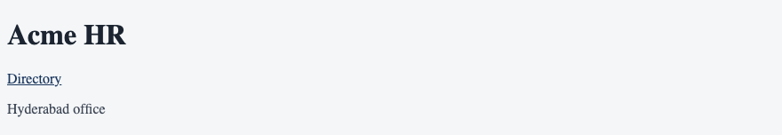

## 90. Reduced Motion — Basic Understanding

`prefers-reduced-motion` wraps anything that moves. Put transitions and transforms inside `@media (prefers-reduced-motion: no-preference)`. A reader who sets the system to reduce motion then gets an instant colour change and no card lift. The information on the page does not depend on the motion.

### Example

```css
/* styles.css */
@media (prefers-reduced-motion: no-preference) {
  a.button {
    transition: background-color 0.2s;
  }

  .employee-card:hover {
    transform: translateY(-2px);
  }
}
```

```html
<!DOCTYPE html>
<html lang="en">
<head>
  <meta charset="UTF-8">
  <meta name="viewport" content="width=device-width, initial-scale=1.0">
  <title>Acme HR — Reduced motion</title>
  <link rel="stylesheet" href="styles.css">
</head>
<body>
  <header>
    <h1>Acme HR</h1>
  </header>
  <main>
    <article class="employee-card">
      <h2>Ananya Rao</h2>
      <p>Engineering</p>
    </article>
    <p><a class="button" href="leave.html">Request leave</a></p>
  </main>
</body>
</html>
```

**This will produce the following result:**

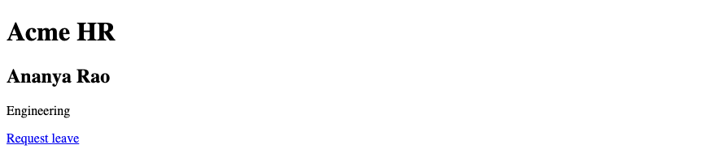
