# 6. CSS — CSS Development Practices

**Index:** [CSS and Responsive](../02_CSS_and_Responsive.md)  
**Previous:** [UI Styling and Interactions](Module_05_UI_Styling_and_Interactions.md)  
**Next:** [Practical Project](Module_07_Practical_Project.md)

The file is `styles.css` for the Acme HR pages. Prefer a class over an id for styling. Use `*` for `box-sizing: border-box`. Avoid `!important`.

## 91. CSS Naming Conventions

Name a class for what the element is. `employee-card`, `site-header`, and `button` stay readable in the HTML. Use lower case and hyphens. A name such as `red-box` breaks when the colour changes. A name such as `employee-card` still fits.

### Example

```css
/* styles.css */
.employee-card {
  border: 1px solid #d0d7de;
  padding: 1rem;
}
```

```html
<!DOCTYPE html>
<html lang="en">
<head>
  <meta charset="UTF-8">
  <meta name="viewport" content="width=device-width, initial-scale=1.0">
  <title>Acme HR — Directory</title>
  <link rel="stylesheet" href="styles.css">
</head>
<body>
  <header>
    <h1>Acme HR</h1>
  </header>
  <main>
    <article class="employee-card">
      <h2>Ananya Rao</h2>
      <p>Engineering</p>
    </article>
  </main>
</body>
</html>
```

**This will produce the following result:**

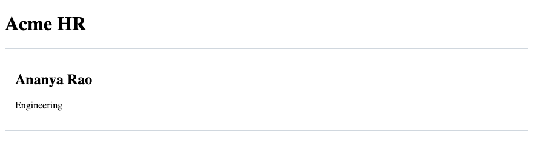

## 92. Reusable CSS Classes

A class is reusable. `button` styles the leave submit control and the directory link. `muted` styles the employee id and the payroll note. One rule, many elements. Prefer a class over an id for styling so the second card can use the same rule.

### Example

```css
/* styles.css */
.muted {
  color: #3d4654;
}
```

```html
<!DOCTYPE html>
<html lang="en">
<head>
  <meta charset="UTF-8">
  <meta name="viewport" content="width=device-width, initial-scale=1.0">
  <title>Acme HR</title>
  <link rel="stylesheet" href="styles.css">
</head>
<body>
  <header>
    <h1>Acme HR</h1>
  </header>
  <main>
    <p class="muted">E-1042</p>
    <p class="muted">Next payroll: 30 September 2026</p>
  </main>
</body>
</html>
```

**This will produce the following result:**

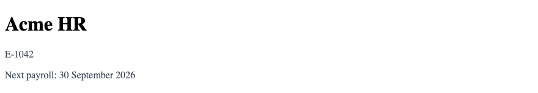

## 93. Organizing CSS Files

Keep one `styles.css` for these pages. Order the file as variables, then base elements, then layout, then components. Django serves the file from `static/`. Spring Boot serves it from `src/main/resources/static/`. The HTML links it with `<link rel="stylesheet" href="styles.css">`. A second page uses the same link.

### Example

```css
/* styles.css
   1. Custom properties
   2. Base elements
   3. Layout
   4. Components
*/
:root {
  --brand: #1a365d;
}

body {
  font-family: system-ui, sans-serif;
  color: #1b2430;
}
```

```html
<!DOCTYPE html>
<html lang="en">
<head>
  <meta charset="UTF-8">
  <meta name="viewport" content="width=device-width, initial-scale=1.0">
  <title>Acme HR</title>
  <link rel="stylesheet" href="styles.css">
</head>
<body>
  <header>
    <h1>Acme HR</h1>
  </header>
  <main>
    <p>Home, directory, and leave share this file.</p>
  </main>
</body>
</html>
```

**This will produce the following result:**

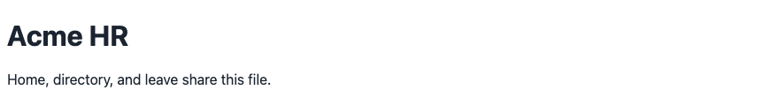

## 94. Component-Based CSS

A component is a piece you repeat: a card, a button, a badge. The rules for `.employee-card` live together. They do not depend on the card being the third child of main. The directory can hold three cards. The same class fits each one.

### Example

```css
/* styles.css */
.employee-card {
  background-color: #ffffff;
  border: 1px solid #d0d7de;
  padding: 1rem;
}

.badge {
  background-color: #e8eef6;
  padding: 0.15rem 0.4rem;
}
```

```html
<!DOCTYPE html>
<html lang="en">
<head>
  <meta charset="UTF-8">
  <meta name="viewport" content="width=device-width, initial-scale=1.0">
  <title>Acme HR — Directory</title>
  <link rel="stylesheet" href="styles.css">
</head>
<body>
  <header>
    <h1>Acme HR</h1>
  </header>
  <main>
    <article class="employee-card">
      <h2>Karthik Menon <span class="badge">Active</span></h2>
      <p>HR</p>
    </article>
  </main>
</body>
</html>
```

**This will produce the following result:**

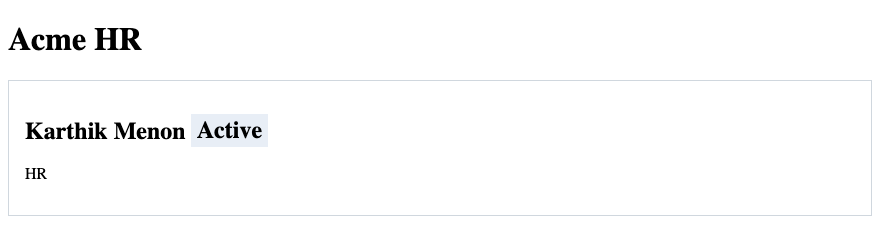

## 95. CSS Reset — Concept

Browsers ship different default margins and heading sizes. A reset is a small set of rules that evens that out before your design. Acme HR needs two: `box-sizing` on every element, and `margin: 0` on `body`. Use `*` for `box-sizing: border-box`. A long reset copied from the web is not required.

### Example

```css
/* styles.css */
* {
  box-sizing: border-box;
}

body {
  margin: 0;
}
```

```html
<!DOCTYPE html>
<html lang="en">
<head>
  <meta charset="UTF-8">
  <meta name="viewport" content="width=device-width, initial-scale=1.0">
  <title>Acme HR</title>
  <link rel="stylesheet" href="styles.css">
</head>
<body>
  <header>
    <h1>Acme HR</h1>
  </header>
  <main>
    <p>The body margin is set in the stylesheet.</p>
  </main>
</body>
</html>
```

**This will produce the following result:**

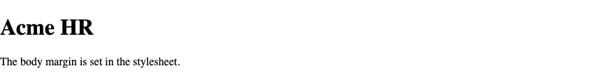

## 96. Maintainable CSS

A later rule wins only when specificity is equal. A class beats an element, so you rarely need a stronger selector. Avoid `!important`. It blocks the next class you write. Keep values that repeat, such as the navy, in custom properties. The leave page and the directory then stay in step.

### Example

```css
/* styles.css */
:root {
  --brand: #1a365d;
}

a {
  color: var(--brand);
}
```

```html
<!DOCTYPE html>
<html lang="en">
<head>
  <meta charset="UTF-8">
  <meta name="viewport" content="width=device-width, initial-scale=1.0">
  <title>Acme HR</title>
  <link rel="stylesheet" href="styles.css">
</head>
<body>
  <header>
    <h1>Acme HR</h1>
    <nav>
      <a href="directory.html">Directory</a>
      <a href="leave.html">Leave</a>
    </nav>
  </header>
  <main>
    <p>The link colour is the brand variable.</p>
  </main>
</body>
</html>
```

**This will produce the following result:**

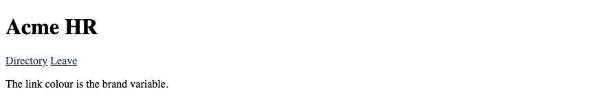

## 97. CSS Accessibility

Ship `:focus-visible`. Do not remove an outline unless another visible style replaces it. A link styled as a button uses `inline-flex` and still has a text name. Muted text must clear 4.5:1 on the page background. `prefers-reduced-motion` wraps anything that moves. Colour is not the only way a link is shown. Keep the underline on text links.

### Example

```css
/* styles.css */
:focus-visible {
  outline: 2px solid #1a365d;
  outline-offset: 2px;
}

a {
  color: #1a365d;
}
```

```html
<!DOCTYPE html>
<html lang="en">
<head>
  <meta charset="UTF-8">
  <meta name="viewport" content="width=device-width, initial-scale=1.0">
  <title>Acme HR</title>
  <link rel="stylesheet" href="styles.css">
</head>
<body>
  <header>
    <h1>Acme HR</h1>
  </header>
  <main>
    <a href="leave.html">Leave</a>
  </main>
</body>
</html>
```

**This will produce the following result:**

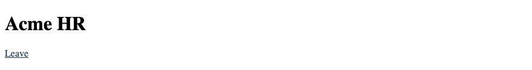

## 98. Color Contrast

Muted text must clear 4.5:1 on the page background. `#3d4654` on `#f4f6f8` clears that bar. White `#ffffff` on the navy header `#1a365d` clears it as well. A light grey on white fails. If a note is hard to read, darken the text. Do not lighten it to make the page look soft.

### Example

```css
/* styles.css */
body {
  background-color: #f4f6f8;
  color: #1b2430;
}

.muted {
  color: #3d4654;
}

.site-header {
  background-color: #1a365d;
  color: #ffffff;
}
```

```html
<!DOCTYPE html>
<html lang="en">
<head>
  <meta charset="UTF-8">
  <meta name="viewport" content="width=device-width, initial-scale=1.0">
  <title>Acme HR</title>
  <link rel="stylesheet" href="styles.css">
</head>
<body>
  <header class="site-header">
    <h1>Acme HR</h1>
  </header>
  <main>
    <p class="muted">Hyderabad office · E-1042</p>
  </main>
</body>
</html>
```

**This will produce the following result:**

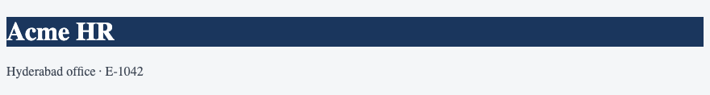

## 99. Browser DevTools

Open developer tools and choose the Elements panel. The Styles pane lists every rule that matches the selected element, including rules that lost. A struck-through declaration lost the cascade. Use it when the office paragraph is the wrong colour. A later rule wins only when specificity is equal. The pane shows which one won.

### Example

```css
/* styles.css */
p {
  color: #1a365d;
}

.muted {
  color: #3d4654;
}
```

```html
<!DOCTYPE html>
<html lang="en">
<head>
  <meta charset="UTF-8">
  <meta name="viewport" content="width=device-width, initial-scale=1.0">
  <title>Acme HR</title>
  <link rel="stylesheet" href="styles.css">
</head>
<body>
  <header>
    <h1>Acme HR</h1>
  </header>
  <main>
    <p class="muted">This paragraph uses the class.</p>
  </main>
</body>
</html>
```

**This will produce the following result:**

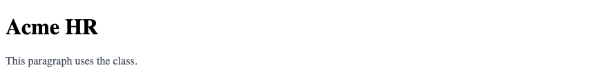

## 100. Inspecting & Editing CSS

In the Styles pane you can toggle a declaration or type a new one. The change lasts until you reload. Copy the change you want to keep into `styles.css`. Editing only in the browser leaves the file unchanged. Django and Spring serve the file, not the temporary pane.

### Example

```css
/* styles.css */
.employee-card {
  padding: 1rem;
  border: 1px solid #d0d7de;
}
```

```html
<!DOCTYPE html>
<html lang="en">
<head>
  <meta charset="UTF-8">
  <meta name="viewport" content="width=device-width, initial-scale=1.0">
  <title>Acme HR — Directory</title>
  <link rel="stylesheet" href="styles.css">
</head>
<body>
  <header>
    <h1>Acme HR</h1>
  </header>
  <main>
    <article class="employee-card">
      <h2>Meera Iyer</h2>
      <p>Finance</p>
    </article>
  </main>
</body>
</html>
```

**This will produce the following result:**

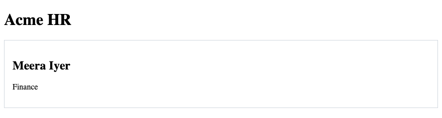

## 101. Debugging Layout Issues

When a card overflows the phone, check `width`, `min-width`, and a missing `flex-wrap` or `minmax`. When a sticky header covers the badge, check `z-index` and `top`. When a field is wider than the screen, check `box-sizing` and padding. Use `*` for `box-sizing: border-box`. The box model pane shows content, padding, border, and margin as separate bands.

### Example

```css
/* styles.css */
* {
  box-sizing: border-box;
}

.employee-card {
  width: min(100%, 20rem);
  padding: 1rem;
}
```

```html
<!DOCTYPE html>
<html lang="en">
<head>
  <meta charset="UTF-8">
  <meta name="viewport" content="width=device-width, initial-scale=1.0">
  <title>Acme HR</title>
  <link rel="stylesheet" href="styles.css">
</head>
<body>
  <header>
    <h1>Acme HR</h1>
  </header>
  <main>
    <article class="employee-card">
      <h2>Ananya Rao</h2>
    </article>
  </main>
</body>
</html>
```

**This will produce the following result:**

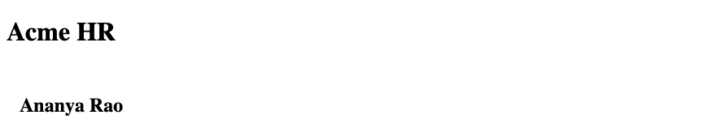

## 102. Flexbox & Grid DevTools

Browsers mark a flex or grid container with a badge in the Elements panel. Open it to see the tracks, the gap, and the item sizes. Use it on the header to confirm the main axis. Use it on the directory to confirm the columns. `flex: 1 1 260px` means grow, shrink, and basis. The overlay shows that basis.

### Example

```css
/* styles.css */
.cards {
  display: flex;
  flex-wrap: wrap;
  gap: 1rem;
}

.employee-card {
  flex: 1 1 260px;
}
```

```html
<!DOCTYPE html>
<html lang="en">
<head>
  <meta charset="UTF-8">
  <meta name="viewport" content="width=device-width, initial-scale=1.0">
  <title>Acme HR — Directory</title>
  <link rel="stylesheet" href="styles.css">
</head>
<body>
  <header>
    <h1>Acme HR</h1>
  </header>
  <main>
    <div class="cards">
      <article class="employee-card">Ananya Rao</article>
      <article class="employee-card">Karthik Menon</article>
      <article class="employee-card">Meera Iyer</article>
    </div>
  </main>
</body>
</html>
```

**This will produce the following result:**


## 103. Responsive Device Testing

The device toolbar in developer tools sets a viewport width. Check the directory below `40rem` and above it. The `min-width` query is what changes. `flex-wrap` and a min-width breakpoint do different jobs. Wrap reacts to leftover space. The query changes the rules at the width you wrote. Reload after you edit `styles.css`, then check both widths again.

### Example

```css
/* styles.css */
.cards {
  display: flex;
  flex-direction: column;
  gap: 1rem;
}

@media (min-width: 40rem) {
  .cards {
    flex-direction: row;
    flex-wrap: wrap;
  }
}
```

```html
<!DOCTYPE html>
<html lang="en">
<head>
  <meta charset="UTF-8">
  <meta name="viewport" content="width=device-width, initial-scale=1.0">
  <title>Acme HR — Directory</title>
  <link rel="stylesheet" href="styles.css">
</head>
<body>
  <header>
    <h1>Acme HR</h1>
  </header>
  <main>
    <div class="cards">
      <article class="employee-card">Ananya Rao</article>
      <article class="employee-card">Karthik Menon</article>
      <article class="employee-card">Meera Iyer</article>
    </div>
  </main>
</body>
</html>
```

**This will produce the following result:**

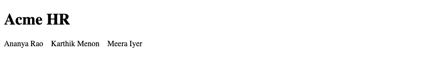
