# 7. CSS — Practical Project

**Index:** [CSS and Responsive](../02_CSS_and_Responsive.md)  
**Previous:** [CSS Development Practices](Module_06_CSS_Development_Practices.md)  
**Next:** [JavaScript DOM Forms](../03_JavaScript_DOM_Forms.md)

This pass styles the same three pages as the HTML project: `index.html`, `directory.html`, and `leave.html`. The rules live in one `styles.css`. Django serves it from `static/` — link with ``. Spring Boot serves it from `src/main/resources/static/` — link with `th:href="@{/css/styles.css}"`. A relative `href="styles.css"` is fine for the local files in this folder; it breaks on nested app routes.

## 104. Build a Responsive Multi-Page Website

The three HTML files already link `styles.css`. This module fills that file. Base rules set the font, the page colour, and `box-sizing`. Use `*` for `box-sizing: border-box`. Later sections add the header, the cards, the form, and the payslip.

### Example

```css
/* styles.css */
* {
  box-sizing: border-box;
}

body {
  margin: 0;
  font-family: system-ui, sans-serif;
  line-height: 1.5;
  color: #1b2430;
  background-color: #f4f6f8;
}
```

```html
<!DOCTYPE html>
<html lang="en">
<head>
  <meta charset="UTF-8">
  <meta name="viewport" content="width=device-width, initial-scale=1.0">
  <meta name="description" content="Acme HR is the employee portal for the Hyderabad office: directory, leave, and payslips.">
  <title>Acme HR</title>
  <link rel="stylesheet" href="styles.css">
</head>
<body>
  <header class="site-header">
    <h1>Acme HR</h1>
    <nav aria-label="Primary">
      <a href="index.html">Home</a>
      <a href="directory.html">Directory</a>
      <a href="leave.html">Leave</a>
    </nav>
  </header>
  <main>
    <section class="hero">
      <h2>Employee portal</h2>
      <p>Staff records, leave, and payslips for the Hyderabad office.</p>
    </section>
  </main>
</body>
</html>
```

**This will produce the following result:**

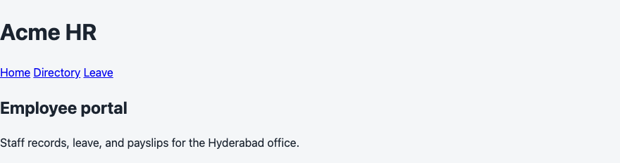

## 105. Page Layout

The header, main, and footer stack in normal flow. Main has padding. A `min-width` query caps the width on a wide screen and centers it. Positioning is not the page layout. The sticky header and the status badge are the only positioned pieces.

### Example

```css
/* styles.css */
main {
  padding: 1rem;
}

@media (min-width: 64rem) {
  main {
    max-width: 64rem;
    margin-inline: auto;
  }
}
```

```html
<!DOCTYPE html>
<html lang="en">
<head>
  <meta charset="UTF-8">
  <meta name="viewport" content="width=device-width, initial-scale=1.0">
  <title>Acme HR</title>
  <link rel="stylesheet" href="styles.css">
</head>
<body>
  <header class="site-header">
    <h1>Acme HR</h1>
  </header>
  <main>
    <h2>Employee portal</h2>
    <p>The main column is capped on a wide screen.</p>
  </main>
  <footer>
    <address>Acme HR, HITEC City, Hyderabad 500081</address>
  </footer>
</body>
</html>
```

**This will produce the following result:**

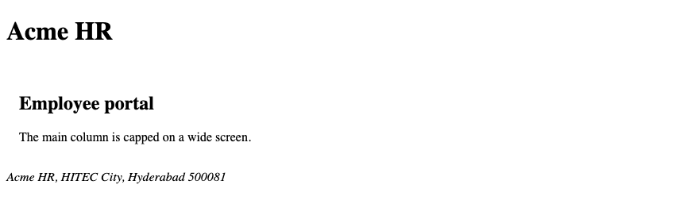

## 106. Navigation Bar

The header is a flex column on a narrow screen and a row from `40rem`. It is `sticky` at the top of the viewport. `z-index` keeps it above the status badge while scrolling. Links in the header are white. `flex-wrap` lets the links wrap. The `min-width` query changes the header direction. Those are different jobs.

### Example

```css
/* styles.css */
.site-header {
  display: flex;
  flex-direction: column;
  gap: 0.5rem;
  position: sticky;
  top: 0;
  z-index: 2;
  padding: 1rem;
  background-color: #1a365d;
  color: #ffffff;
}

.site-header a {
  color: #ffffff;
}

.site-header nav {
  display: flex;
  flex-wrap: wrap;
  gap: 1rem;
}

@media (min-width: 40rem) {
  .site-header {
    flex-direction: row;
    justify-content: space-between;
    align-items: center;
  }
}
```

```html
<!DOCTYPE html>
<html lang="en">
<head>
  <meta charset="UTF-8">
  <meta name="viewport" content="width=device-width, initial-scale=1.0">
  <title>Acme HR</title>
  <link rel="stylesheet" href="styles.css">
</head>
<body>
  <header class="site-header">
    <h1>Acme HR</h1>
    <nav aria-label="Primary">
      <a href="index.html">Home</a>
      <a href="directory.html">Directory</a>
      <a href="leave.html">Leave</a>
    </nav>
  </header>
  <main>
    <p>The header stays at the top while the page scrolls.</p>
  </main>
</body>
</html>
```

**This will produce the following result:**

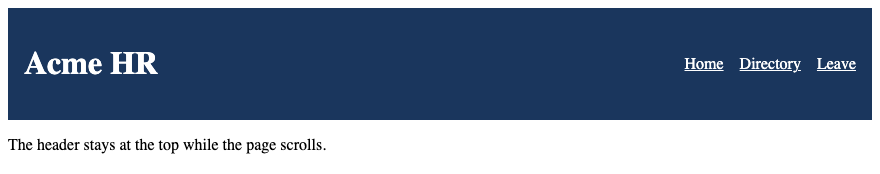

## 107. Hero Section

The hero is the first section on the home page. It holds the portal heading, one sentence, and a link to the directory. The heading size uses `clamp()` so it grows with the viewport and stays inside a range. The section padding uses the spacing variable from the variables section.

### Example

```css
/* styles.css */
.hero {
  padding: 1rem;
}

h1 {
  font-size: clamp(1.75rem, 1rem + 2vw, 2.5rem);
}
```

```html
<!DOCTYPE html>
<html lang="en">
<head>
  <meta charset="UTF-8">
  <meta name="viewport" content="width=device-width, initial-scale=1.0">
  <title>Acme HR</title>
  <link rel="stylesheet" href="styles.css">
</head>
<body>
  <header class="site-header">
    <h1>Acme HR</h1>
  </header>
  <main>
    <section class="hero">
      <h2>Employee portal</h2>
      <p>Staff records, leave, and payslips for the Hyderabad office.</p>
      <a class="button" href="directory.html">Open the directory</a>
    </section>
  </main>
</body>
</html>
```

**This will produce the following result:**

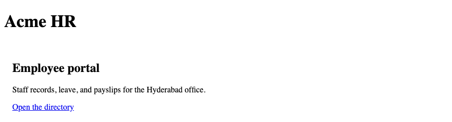

## 108. Cards

Each employee is an article with the class `employee-card`. The card is `position: relative` so the status badge can sit in the corner. The badge is `position: absolute`. That pair is not the page layout. The card surface is white, with a border and padding. Muted pay text uses `#3d4654` on the page background `#f4f6f8`, which clears 4.5:1.

### Example

```css
/* styles.css */
.employee-card {
  position: relative;
  background-color: #ffffff;
  border: 1px solid #6e7781;
  padding: 1rem;
}

.status {
  position: absolute;
  top: 0.5rem;
  right: 0.5rem;
}

.muted {
  color: #3d4654;
}

img {
  max-width: 100%;
  height: auto;
}
```

```html
<!DOCTYPE html>
<html lang="en">
<head>
  <meta charset="UTF-8">
  <meta name="viewport" content="width=device-width, initial-scale=1.0">
  <title>Acme HR — Directory</title>
  <link rel="stylesheet" href="styles.css">
</head>
<body>
  <header class="site-header">
    <h1>Acme HR</h1>
  </header>
  <main>
    <section>
      <h2>Directory</h2>
      <div class="cards">
        <article class="employee-card">
          <p class="status">Active</p>
          
          <h3>Ananya Rao</h3>
          <p>Engineering · E-1042</p>
          <p class="muted">Gross pay ₹85,000</p>
        </article>
      </div>
    </section>
  </main>
</body>
</html>
```

**This will produce the following result:**

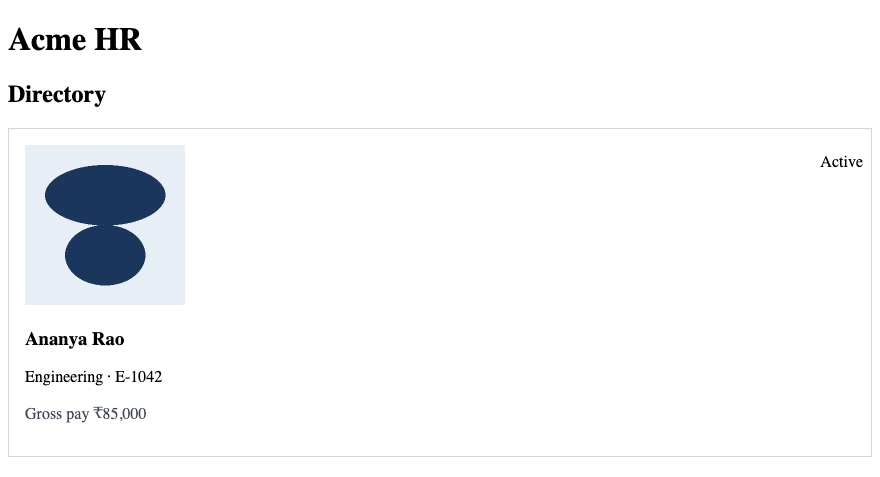

## 109. Buttons

A link styled as a button uses `inline-flex`. The submit button on the leave form uses the same rule. The label sits in the middle of the padding. Text names the action. Colour is not the only cue: the control has a border as well.

### Example

```css
/* styles.css */
a.button,
button {
  display: inline-flex;
  align-items: center;
  padding: 0.5rem 1rem;
  border: 2px solid #1a365d;
  background-color: #1a365d;
  color: #ffffff;
  font: inherit;
  text-decoration: none;
}
```

```html
<!DOCTYPE html>
<html lang="en">
<head>
  <meta charset="UTF-8">
  <meta name="viewport" content="width=device-width, initial-scale=1.0">
  <title>Acme HR</title>
  <link rel="stylesheet" href="styles.css">
</head>
<body>
  <header class="site-header">
    <h1>Acme HR</h1>
  </header>
  <main>
    <a class="button" href="directory.html">Open the directory</a>
  </main>
</body>
</html>
```

**This will produce the following result:**

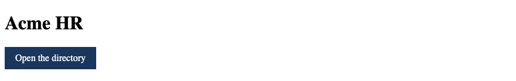

## 110. Forms

Labels stack above the leave fields. Fields are full width on a phone and stop at `24rem` from `40rem`. The payslip table on the directory uses collapsed borders and right-aligned amounts. The HTML is unchanged from the HTML project.

### Example

```css
/* styles.css */
label {
  display: block;
  margin-bottom: 0.25rem;
}

input, select, textarea {
  width: 100%;
  padding: 0.5rem;
  border: 1px solid #6e7781;
  font: inherit;
}

@media (min-width: 40rem) {
  input, select, textarea {
    max-width: 24rem;
  }
}

table {
  border-collapse: collapse;
  width: 100%;
  max-width: 32rem;
}

th, td {
  border: 1px solid #6e7781;
  padding: 0.5rem;
  text-align: left;
}

td {
  text-align: right;
}

th[scope="row"] {
  text-align: left;
}
```

```html
<!DOCTYPE html>
<html lang="en">
<head>
  <meta charset="UTF-8">
  <meta name="viewport" content="width=device-width, initial-scale=1.0">
  <title>Acme HR — Leave</title>
  <link rel="stylesheet" href="styles.css">
</head>
<body>
  <header class="site-header">
    <h1>Acme HR</h1>
  </header>
  <main>
    <h2>Leave request</h2>
    <form action="/leave" method="post" enctype="multipart/form-data">
      <p>
        <label for="reason">Reason</label>
        <textarea id="reason" name="reason" rows="4" required></textarea>
      </p>
      <button type="submit">Submit leave</button>
    </form>
  </main>
</body>
</html>
```

**This will produce the following result:**

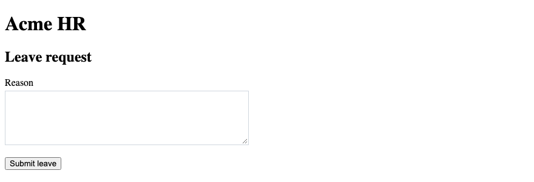

## 111. Flexbox Layout

The header is the flex layout. `flex-direction` changes at the breakpoint. The nav uses `flex-wrap` so links move to the next line when the row is full. `flex: 1 1 260px` means grow, shrink, and basis. It is available if a row of cards uses Flexbox. This project places the directory on Grid instead.

### Example

```css
/* styles.css */
.site-header {
  display: flex;
  justify-content: space-between;
  align-items: center;
  gap: 1rem;
}
```

```html
<!DOCTYPE html>
<html lang="en">
<head>
  <meta charset="UTF-8">
  <meta name="viewport" content="width=device-width, initial-scale=1.0">
  <title>Acme HR</title>
  <link rel="stylesheet" href="styles.css">
</head>
<body>
  <header class="site-header">
    <h1>Acme HR</h1>
    <nav aria-label="Primary">
      <a href="directory.html">Directory</a>
      <a href="leave.html">Leave</a>
    </nav>
  </header>
  <main>
    <p>The title and the nav share one flex row from 40rem.</p>
  </main>
</body>
</html>
```

**This will produce the following result:**

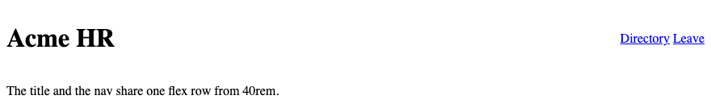

## 112. Grid Layout

The directory cards use Grid. One column is the base. From the content's point of view, `repeat(auto-fit, minmax(16rem, 1fr))` fits as many cards as the width allows. The heading stays outside the grid, in the section. Template areas are not used.

### Example

```css
/* styles.css */
.cards {
  display: grid;
  grid-template-columns: 1fr;
  gap: 1rem;
}

@media (min-width: 40rem) {
  .cards {
    grid-template-columns: repeat(auto-fit, minmax(16rem, 1fr));
  }
}
```

```html
<!DOCTYPE html>
<html lang="en">
<head>
  <meta charset="UTF-8">
  <meta name="viewport" content="width=device-width, initial-scale=1.0">
  <title>Acme HR — Directory</title>
  <link rel="stylesheet" href="styles.css">
</head>
<body>
  <header class="site-header">
    <h1>Acme HR</h1>
  </header>
  <main>
    <section>
      <h2>Directory</h2>
      <div class="cards">
        <article class="employee-card"><h3>Ananya Rao</h3><p>Engineering</p></article>
        <article class="employee-card"><h3>Karthik Menon</h3><p>HR</p></article>
        <article class="employee-card"><h3>Meera Iyer</h3><p>Finance</p></article>
      </div>
    </section>
  </main>
</body>
</html>
```

**This will produce the following result:**

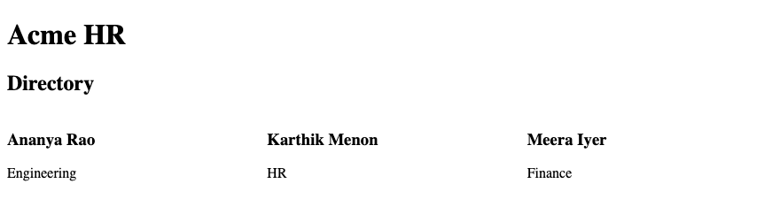

## 113. Responsive Design

Media queries use `min-width`. The narrow layout is the base. At `40rem` the header becomes a row and the cards become a grid. Flex-wrap and a min-width breakpoint do different jobs. Wrap reacts when an item does not fit. The breakpoint applies a new set of rules at a width you choose. Check both widths in the device toolbar.

### Example

```css
/* styles.css */
.cards {
  display: grid;
  grid-template-columns: 1fr;
  gap: 1rem;
}

@media (min-width: 40rem) {
  .site-header {
    flex-direction: row;
    justify-content: space-between;
    align-items: center;
  }

  .cards {
    grid-template-columns: repeat(auto-fit, minmax(16rem, 1fr));
  }
}
```

```html
<!DOCTYPE html>
<html lang="en">
<head>
  <meta charset="UTF-8">
  <meta name="viewport" content="width=device-width, initial-scale=1.0">
  <title>Acme HR — Directory</title>
  <link rel="stylesheet" href="styles.css">
</head>
<body>
  <header class="site-header">
    <h1>Acme HR</h1>
    <nav aria-label="Primary">
      <a href="index.html">Home</a>
      <a href="directory.html">Directory</a>
      <a href="leave.html">Leave</a>
    </nav>
  </header>
  <main>
    <div class="cards">
      <article class="employee-card">Ananya Rao</article>
      <article class="employee-card">Karthik Menon</article>
      <article class="employee-card">Meera Iyer</article>
    </div>
  </main>
</body>
</html>
```

**This will produce the following result:**

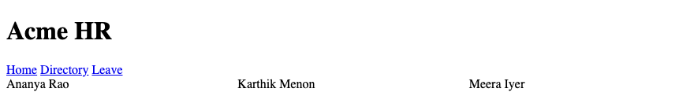

## 114. Hover & Focus States

Ship `:focus-visible`. Do not remove an outline unless another visible style replaces it. The ring is white on the navy header so it stays visible. Hover darkens the button. The hover colour is not required to understand the control.

### Example

```css
/* styles.css */
:focus-visible {
  outline: 2px solid #1a365d;
  outline-offset: 2px;
}

.site-header :focus-visible {
  outline-color: #ffffff;
}

a.button:hover,
button:hover {
  background-color: #0f2744;
}
```

```html
<!DOCTYPE html>
<html lang="en">
<head>
  <meta charset="UTF-8">
  <meta name="viewport" content="width=device-width, initial-scale=1.0">
  <title>Acme HR</title>
  <link rel="stylesheet" href="styles.css">
</head>
<body>
  <header class="site-header">
    <h1>Acme HR</h1>
    <nav aria-label="Primary">
      <a href="leave.html">Leave</a>
    </nav>
  </header>
  <main>
    <a class="button" href="directory.html">Open the directory</a>
  </main>
</body>
</html>
```

**This will produce the following result:**

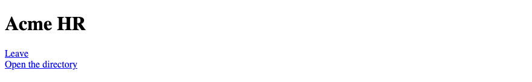

## 115. CSS Variables

The palette and the spacing live on `:root`. `var()` reads them. Change `--brand` once and the header, the button, and the focus ring follow. Prefer a class over an id for styling. The variable is the value. The class is still how you attach it.

### Example

```css
/* styles.css */
:root {
  --ink: #1b2430;
  --brand: #1a365d;
  --page: #f4f6f8;
  --muted: #3d4654;
  --space: 1rem;
}

body {
  color: var(--ink);
  background-color: var(--page);
}

.site-header {
  background-color: var(--brand);
  padding: var(--space);
}
```

```html
<!DOCTYPE html>
<html lang="en">
<head>
  <meta charset="UTF-8">
  <meta name="viewport" content="width=device-width, initial-scale=1.0">
  <title>Acme HR</title>
  <link rel="stylesheet" href="styles.css">
</head>
<body>
  <header class="site-header">
    <h1>Acme HR</h1>
  </header>
  <main>
    <p class="muted">Hyderabad office</p>
  </main>
</body>
</html>
```

**This will produce the following result:**

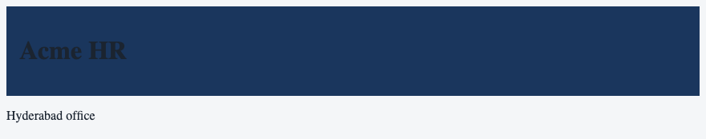

## 116. Transitions

The button background changes over 0.2 seconds. `prefers-reduced-motion` wraps anything that moves. The transition sits inside `no-preference`. A reader who asks for less motion gets an instant change. The labs do not use `@keyframes`.

### Example

```css
/* styles.css */
@media (prefers-reduced-motion: no-preference) {
  a.button,
  button {
    transition: background-color 0.2s;
  }
}

a.button:hover,
button:hover {
  background-color: #0f2744;
}
```

```html
<!DOCTYPE html>
<html lang="en">
<head>
  <meta charset="UTF-8">
  <meta name="viewport" content="width=device-width, initial-scale=1.0">
  <title>Acme HR — Leave</title>
  <link rel="stylesheet" href="styles.css">
</head>
<body>
  <header class="site-header">
    <h1>Acme HR</h1>
  </header>
  <main>
    <form action="/leave" method="post">
      <button type="submit">Submit leave</button>
    </form>
  </main>
</body>
</html>
```

**This will produce the following result:**


## 117. Accessibility

Muted text must clear 4.5:1 on the page background. The focus ring stays. Text links in the main column keep an underline. The header links are white on navy. The payslip headers remain in the HTML. CSS does not remove them. `alt` on the staff photo is unchanged.

### Example

```css
/* styles.css */
body {
  background-color: #f4f6f8;
  color: #1b2430;
}

.muted {
  color: #3d4654;
}

main a {
  color: #1a365d;
}

:focus-visible {
  outline: 2px solid #1a365d;
  outline-offset: 2px;
}
```

```html
<!DOCTYPE html>
<html lang="en">
<head>
  <meta charset="UTF-8">
  <meta name="viewport" content="width=device-width, initial-scale=1.0">
  <title>Acme HR — Directory</title>
  <link rel="stylesheet" href="styles.css">
</head>
<body>
  <header class="site-header">
    <h1>Acme HR</h1>
  </header>
  <main>
    <p class="muted">Gross pay ₹85,000</p>
    <p><a href="leave.html">Leave</a></p>
  </main>
</body>
</html>
```

**This will produce the following result:**

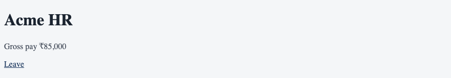

## 118. Browser DevTools

Inspect a card and confirm the grid tracks. Inspect the header and confirm `position: sticky`. A struck-through colour in the Styles pane lost the cascade. A later rule wins only when specificity is equal. Copy any experiment you want to keep back into `styles.css`.

### Example

```css
/* styles.css */
.cards {
  display: grid;
  gap: 1rem;
}

.employee-card {
  border: 1px solid #6e7781;
  padding: 1rem;
}
```

```html
<!DOCTYPE html>
<html lang="en">
<head>
  <meta charset="UTF-8">
  <meta name="viewport" content="width=device-width, initial-scale=1.0">
  <title>Acme HR — Directory</title>
  <link rel="stylesheet" href="styles.css">
</head>
<body>
  <header class="site-header">
    <h1>Acme HR</h1>
  </header>
  <main>
    <h2>Directory</h2>
    <div class="cards">
      <article class="employee-card">
        <h3>Meera Iyer</h3>
        <p>Finance</p>
      </article>
    </div>
  </main>
</body>
</html>
```

**This will produce the following result:**

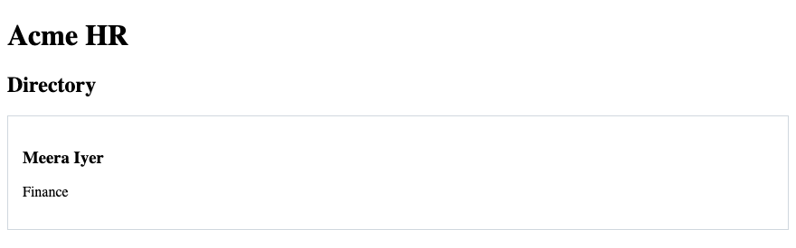

## 119. Final CSS Project

The finished `styles.css` below is the file linked from home, the directory, and the leave request. It uses custom properties, a flex header, a grid of cards, a min-width breakpoint, a focus ring, and one transition inside a reduced-motion query. Container queries, nesting, grid template areas, and `@keyframes` are not in this file. Avoid `!important`.

### Example

```css
/* styles.css */
* {
  box-sizing: border-box;
}

:root {
  --ink: #1b2430;
  --brand: #1a365d;
  --brand-dark: #0f2744;
  --page: #f4f6f8;
  --surface: #ffffff;
  --muted: #3d4654;
  --line: #6e7781;
  --space: 1rem;
}

body {
  margin: 0;
  font-family: system-ui, sans-serif;
  font-size: 1rem;
  line-height: 1.5;
  color: var(--ink);
  background-color: var(--page);
}

h1 {
  font-size: clamp(1.75rem, 1rem + 2vw, 2.5rem);
}

img {
  max-width: 100%;
  height: auto;
}

.muted {
  color: var(--muted);
}

.site-header {
  display: flex;
  flex-direction: column;
  gap: 0.5rem;
  position: sticky;
  top: 0;
  z-index: 2;
  padding: var(--space);
  background-color: var(--brand);
  color: var(--surface);
}

.site-header a {
  color: var(--surface);
}

.site-header nav {
  display: flex;
  flex-wrap: wrap;
  gap: 1rem;
}

main {
  padding: var(--space);
}

.hero {
  padding-block: var(--space);
}

.cards {
  display: grid;
  grid-template-columns: 1fr;
  gap: var(--space);
}

.employee-card {
  position: relative;
  background-color: var(--surface);
  border: 1px solid var(--line);
  padding: var(--space);
}

.status {
  position: absolute;
  top: 0.5rem;
  right: 0.5rem;
}

a.button,
button {
  display: inline-flex;
  align-items: center;
  padding: 0.5rem 1rem;
  border: 2px solid var(--brand);
  background-color: var(--brand);
  color: var(--surface);
  font: inherit;
  text-decoration: none;
}

a.button:hover,
button:hover {
  background-color: var(--brand-dark);
}

:focus-visible {
  outline: 2px solid var(--brand);
  outline-offset: 2px;
}

.site-header :focus-visible {
  outline-color: var(--surface);
}

label {
  display: block;
  margin-bottom: 0.25rem;
}

input, select, textarea {
  width: 100%;
  padding: 0.5rem;
  border: 1px solid var(--line);
  font: inherit;
}

table {
  border-collapse: collapse;
  width: 100%;
  max-width: 32rem;
}

th, td {
  border: 1px solid var(--line);
  padding: 0.5rem;
  text-align: left;
}

td {
  text-align: right;
}

th[scope="row"] {
  text-align: left;
}

@media (min-width: 40rem) {
  .site-header {
    flex-direction: row;
    justify-content: space-between;
    align-items: center;
  }

  .cards {
    grid-template-columns: repeat(auto-fit, minmax(16rem, 1fr));
  }

  input, select, textarea {
    max-width: 24rem;
  }
}

@media (min-width: 64rem) {
  main {
    max-width: 64rem;
    margin-inline: auto;
  }
}

@media (prefers-reduced-motion: no-preference) {
  a.button,
  button {
    transition: background-color 0.2s;
  }
}
```

```html
<!DOCTYPE html>
<html lang="en">
<head>
  <meta charset="UTF-8">
  <meta name="viewport" content="width=device-width, initial-scale=1.0">
  <meta name="description" content="Acme HR is the employee portal for the Hyderabad office: directory, leave, and payslips.">
  <title>Acme HR</title>
  <link rel="stylesheet" href="styles.css">
</head>
<body>
  <header class="site-header">
    <h1>Acme HR</h1>
    <nav aria-label="Primary">
      <a href="index.html">Home</a>
      <a href="directory.html">Directory</a>
      <a href="leave.html">Leave</a>
    </nav>
  </header>
  <main>
    <section class="hero">
      <h2>Employee portal</h2>
      <p>Staff records, leave, and payslips for the Hyderabad office.</p>
      <a class="button" href="directory.html">Open the directory</a>
    </section>
  </main>
  <footer>
    <address>
      Acme HR<br>
      Level 3, Lakshmi Towers<br>
      HITEC City, Hyderabad 500081
    </address>
  </footer>
</body>
</html>
```

**This will produce the following result:**

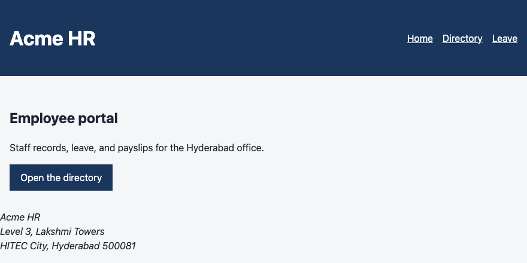
