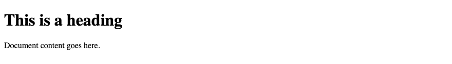
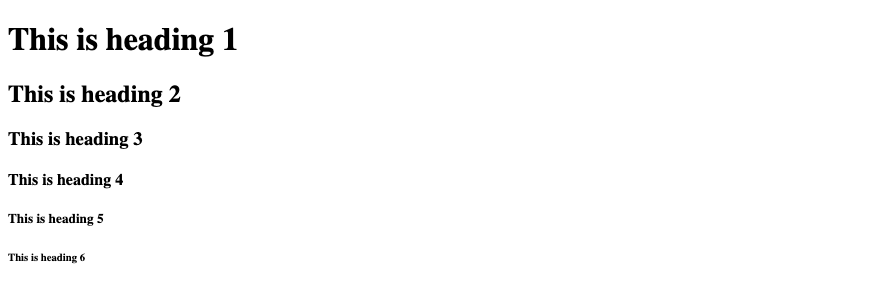
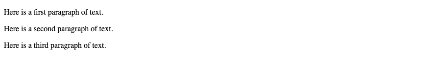
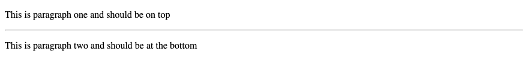
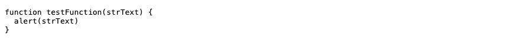
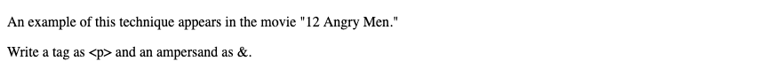

# 1. HTML — Overview and basic tags

**Index:** [HTML tutorial](../01_HTML.md)  
**Next:** [Elements and attributes](02_Elements_and_Attributes.md)

## Basic HTML document

In its simplest form, the following is an HTML document. Save it as `test.html` and open it in a browser.

```html
<!DOCTYPE html>
<html lang="en">
<head>
  <meta charset="UTF-8">
  <meta name="viewport" content="width=device-width, initial-scale=1.0">
  <title>This is document title</title>
</head>
<body>
  <h1>This is a heading</h1>
  <p>Document content goes here.</p>
</body>
</html>
```

**This will produce the following result:**



| Tag | Description |
|-----|-------------|
| `<!DOCTYPE html>` | Tells the browser to use current HTML |
| `<html>` | Root of the document. `lang` is the language of the text |
| `<head>` | Information about the document: title, character set, viewport |
| `<title>` | Text shown on the browser tab |
| `<meta charset="UTF-8">` | Character encoding, so symbols such as ₹ display correctly |
| `<meta name="viewport">` | Sets the layout width for phones |
| `<body>` | Content shown on the page |
| `<h1>` | A heading |
| `<p>` | A paragraph |

## Document structure

```html
<!DOCTYPE html>
<html lang="en">
<head>
  Document header
</head>
<body>
  Document body
</body>
</html>
```

`<!DOCTYPE html>` is the document type used by current HTML. It is the first line of the file.

## Heading tags

A document starts with a heading. HTML has six levels, `<h1>` through `<h6>`. The browser shows `<h1>` as the largest and `<h6>` as the smallest, with space before and after each heading.

### Example

```html
<!DOCTYPE html>
<html lang="en">
<head>
  <meta charset="UTF-8">
  <meta name="viewport" content="width=device-width, initial-scale=1.0">
  <title>Heading Example</title>
</head>
<body>
  <h1>This is heading 1</h1>
  <h2>This is heading 2</h2>
  <h3>This is heading 3</h3>
  <h4>This is heading 4</h4>
  <h5>This is heading 5</h5>
  <h6>This is heading 6</h6>
</body>
</html>
```

**This will produce the following result:**



A page has one `<h1>`. The next section uses `<h2>`. A subsection uses `<h3>`.

A subtitle that belongs with the heading can sit in `<hgroup>`:

```html
<hgroup>
  <h1>HTML</h1>
  <p>HyperText Markup Language</p>
</hgroup>
```

## Paragraph tag

The `<p>` tag structures text into paragraphs. Each paragraph goes between `<p>` and `</p>`.

### Example

```html
<!DOCTYPE html>
<html lang="en">
<head>
  <meta charset="UTF-8">
  <meta name="viewport" content="width=device-width, initial-scale=1.0">
  <title>Paragraph Example</title>
</head>
<body>
  <p>Here is a first paragraph of text.</p>
  <p>Here is a second paragraph of text.</p>
  <p>Here is a third paragraph of text.</p>
</body>
</html>
```

**This will produce the following result:**



## Line break tag

`<br>` starts the following text on the next line. It is an empty element: there is no end tag, because there is no content inside it.

`<wbr>` marks a place where a long word may break.

### Example

```html
<!DOCTYPE html>
<html lang="en">
<head>
  <meta charset="UTF-8">
  <meta name="viewport" content="width=device-width, initial-scale=1.0">
  <title>Line Break Example</title>
</head>
<body>
  <p>Hello<br>
  You delivered your assignment on time.<br>
  Thanks<br>
  Mahnaz</p>
</body>
</html>
```

**This will produce the following result:**


## Horizontal rule

`<hr>` is a thematic break between paragraphs. It is an empty element.

### Example

```html
<!DOCTYPE html>
<html lang="en">
<head>
  <meta charset="UTF-8">
  <meta name="viewport" content="width=device-width, initial-scale=1.0">
  <title>Horizontal Line Example</title>
</head>
<body>
  <p>This is paragraph one and should be on top</p>
  <hr>
  <p>This is paragraph two and should be at the bottom</p>
</body>
</html>
```

**This will produce the following result:**



## Preserve formatting

Text between `<pre>` and `</pre>` keeps the spaces and line breaks of the source.

### Example

```html
<!DOCTYPE html>
<html lang="en">
<head>
  <meta charset="UTF-8">
  <meta name="viewport" content="width=device-width, initial-scale=1.0">
  <title>Preserve Formatting Example</title>
</head>
<body>
<pre>
function testFunction(strText) {
  alert(strText)
}
</pre>
</body>
</html>
```

**This will produce the following result:**



## Nonbreaking spaces

`&nbsp;` is a space that the browser does not turn into a line break. Other characters that must be written as entities:

| Character | Entity |
|-----------|--------|
| nonbreaking space | `&nbsp;` |
| `<` | `&lt;` |
| `>` | `&gt;` |
| `&` | `&amp;` |
| `"` | `&quot;` |

### Example

```html
<!DOCTYPE html>
<html lang="en">
<head>
  <meta charset="UTF-8">
  <meta name="viewport" content="width=device-width, initial-scale=1.0">
  <title>Nonbreaking Spaces Example</title>
</head>
<body>
  <p>An example of this technique appears in the movie "12&nbsp;Angry&nbsp;Men."</p>
  <p>Write a tag as &lt;p&gt; and an ampersand as &amp;.</p>
</body>
</html>
```

**This will produce the following result:**


