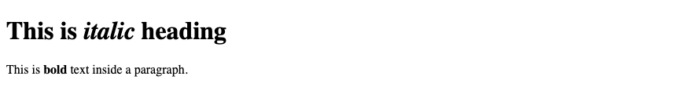
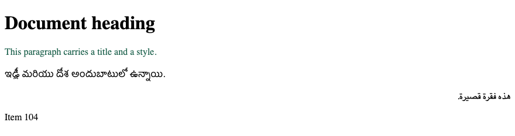

# 2. HTML — Elements and attributes

**Index:** [HTML tutorial](../01_HTML.md)  
**Previous:** [Overview and basic tags](01_Document_and_Tags.md)  
**Next:** [Formatting and phrase tags](03_Text.md)

## HTML tag vs element

An element is a start tag, the content, and an end tag. The end tag repeats the name with a slash.

| Start tag | Content | End tag |
|-----------|---------|---------|
| `<p>` | This is paragraph content. | `</p>` |
| `<h1>` | This is heading content. | `</h1>` |
| `<div>` | This is division content. | `</div>` |
| `<br>` | | |

`<p>...</p>` is one element. `<h1>...</h1>` is another. Empty elements such as `<br>`, `<hr>`, `<meta>`, and `` have no end tag.

## Nested elements

An element can contain another element. The inner element ends before the outer element ends.

### Example

```html
<!DOCTYPE html>
<html lang="en">
<head>
  <meta charset="UTF-8">
  <meta name="viewport" content="width=device-width, initial-scale=1.0">
  <title>Nested Elements Example</title>
</head>
<body>
  <h1>This is <i>italic</i> heading</h1>
  <p>This is <b>bold</b> text inside a paragraph.</p>
</body>
</html>
```

**This will produce the following result:**



## Attributes

An attribute adds information to the start tag. The name, then `=`, then the value in quotes.

These attributes can be used on any element:

| Attribute | Purpose |
|-----------|---------|
| `id` | A unique name for this element on the page |
| `class` | A group name. Several elements may share one class |
| `title` | Advisory text, often shown when the pointer rests on the element |
| `style` | Presentation rules for this element |
| `lang` | Language of this element's text |
| `dir` | `ltr` or `rtl`, the writing direction |
| `hidden` | The element is in the file and is not shown |
| `translate` | `yes` or `no` |
| `tabindex` | Position in the keyboard tab order |
| `data-*` | A custom data value, for example `data-sku="104"` |

### Example

```html
<!DOCTYPE html>
<html lang="en">
<head>
  <meta charset="UTF-8">
  <meta name="viewport" content="width=device-width, initial-scale=1.0">
  <title>Attributes Example</title>
</head>
<body>
  <h1 id="top" class="title">Document heading</h1>
  <p title="Advisory text" style="color: #1a5f4a">This paragraph carries a title and a style.</p>
  <p lang="te">ఇడ్లీ మరియు దోశ అందుబాటులో ఉన్నాయి.</p>
  <p dir="rtl" lang="ar">هذه فقرة قصيرة.</p>
  <p hidden>This paragraph is not shown.</p>
  <p data-sku="104">Item 104</p>
</body>
</html>
```

**This will produce the following result:**


