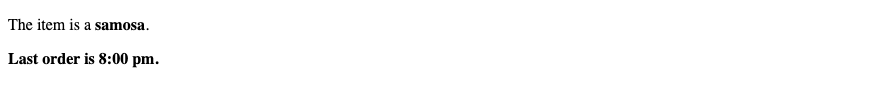
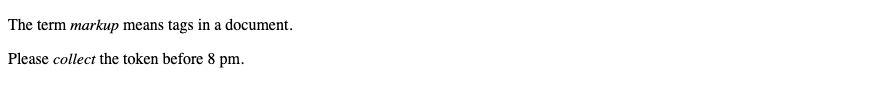
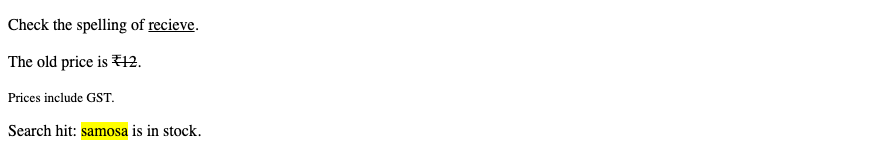
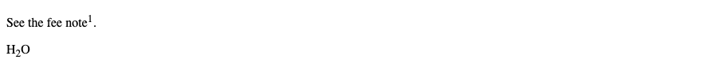
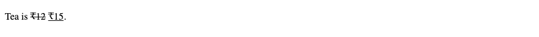
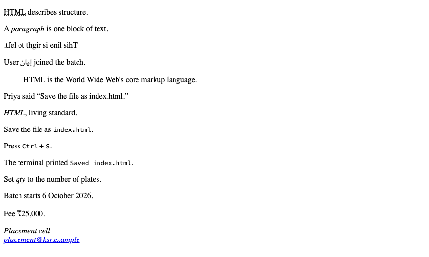

# 3. HTML — Formatting and phrase tags

**Index:** [HTML tutorial](../01_HTML.md)  
**Previous:** [Elements and attributes](02_Elements_and_Attributes.md)  
**Next:** [Meta tags and comments](04_Head_Meta_Comments.md)

These elements describe the text. `<b>` and `<i>` are part of current HTML. `<strong>` and `<em>` add importance and stress.

## Bold and strong

`<b>` sets a span of text in a different voice without extra importance, such as a product name in a sentence. `<strong>` marks text that is important.

### Example

```html
<!DOCTYPE html>
<html lang="en">
<head>
  <meta charset="UTF-8">
  <meta name="viewport" content="width=device-width, initial-scale=1.0">
  <title>Bold Example</title>
</head>
<body>
  <p>The item is a <b>samosa</b>.</p>
  <p><strong>Last order is 8:00 pm.</strong></p>
</body>
</html>
```

**This will produce the following result:**



## Italic and emphasis

`<i>` sets off a span in an alternate voice, such as a term or a name. `<em>` stresses a word.

### Example

```html
<!DOCTYPE html>
<html lang="en">
<head>
  <meta charset="UTF-8">
  <meta name="viewport" content="width=device-width, initial-scale=1.0">
  <title>Italic Example</title>
</head>
<body>
  <p>The term <i>markup</i> means tags in a document.</p>
  <p>Please <em>collect</em> the token before 8 pm.</p>
</body>
</html>
```

**This will produce the following result:**



## Underline, strike, small, and mark

`<u>` marks text with a non-textual annotation, such as a spelling flag. `<s>` marks text that is no longer accurate. `<small>` is a side comment, such as fine print. `<mark>` highlights text that is relevant in the current context.

### Example

```html
<!DOCTYPE html>
<html lang="en">
<head>
  <meta charset="UTF-8">
  <meta name="viewport" content="width=device-width, initial-scale=1.0">
  <title>Underline Example</title>
</head>
<body>
  <p>Check the spelling of <u>recieve</u>.</p>
  <p>The old price is <s>₹12</s>.</p>
  <p><small>Prices include GST.</small></p>
  <p>Search hit: <mark>samosa</mark> is in stock.</p>
</body>
</html>
```

**This will produce the following result:**



## Superscript and subscript

`<sup>` is superscript. `<sub>` is subscript.

### Example

```html
<!DOCTYPE html>
<html lang="en">
<head>
  <meta charset="UTF-8">
  <meta name="viewport" content="width=device-width, initial-scale=1.0">
  <title>Superscript Example</title>
</head>
<body>
  <p>See the fee note<sup>1</sup>.</p>
  <p>H<sub>2</sub>O</p>
</body>
</html>
```

**This will produce the following result:**



## Inserted and deleted text

`<ins>` marks text added in a revision. `<del>` marks text removed. `datetime` records when the change was made.

### Example

```html
<!DOCTYPE html>
<html lang="en">
<head>
  <meta charset="UTF-8">
  <meta name="viewport" content="width=device-width, initial-scale=1.0">
  <title>Inserted Text Example</title>
</head>
<body>
  <p>Tea is <del datetime="2026-09-01">₹12</del> <ins datetime="2026-09-20">₹15</ins>.</p>
</body>
</html>
```

**This will produce the following result:**



## Phrase tags

| Element | Purpose |
|---------|---------|
| `<abbr>` | An abbreviation. `title` holds the expanded form |
| `<dfn>` | The defining instance of a term |
| `<bdo>` | Overrides the text direction. `dir` is `ltr` or `rtl` |
| `<bdi>` | Isolates a span whose direction is unknown, such as a username |
| `<blockquote>` | A quotation of a paragraph or more. `cite` is the source URL |
| `<q>` | A short quotation inside a sentence |
| `<cite>` | The title of a work |
| `<code>` | Computer code |
| `<kbd>` | Input from a keyboard |
| `<samp>` | Sample output from a program |
| `<var>` | A variable |
| `<address>` | Contact information for the page or the article |
| `<time>` | A date or time. `datetime` is the machine-readable value |
| `<data>` | A value paired with human-readable text. `value` is the machine-readable value |

### Example

```html
<!DOCTYPE html>
<html lang="en">
<head>
  <meta charset="UTF-8">
  <meta name="viewport" content="width=device-width, initial-scale=1.0">
  <title>Phrase Tags Example</title>
</head>
<body>
  <p><abbr title="HyperText Markup Language">HTML</abbr> describes structure.</p>
  <p>A <dfn>paragraph</dfn> is one block of text.</p>
  <p><bdo dir="rtl">This line is right to left.</bdo></p>
  <p>User <bdi>إيان</bdi> joined the batch.</p>
  <blockquote cite="https://html.spec.whatwg.org/">
    <p>HTML is the World Wide Web's core markup language.</p>
  </blockquote>
  <p>Priya said <q>Save the file as index.html.</q></p>
  <p><cite>HTML</cite>, living standard.</p>
  <p>Save the file as <code>index.html</code>.</p>
  <p>Press <kbd>Ctrl</kbd> + <kbd>S</kbd>.</p>
  <p>The terminal printed <samp>Saved index.html</samp>.</p>
  <p>Set <var>qty</var> to the number of plates.</p>
  <p>Batch starts <time datetime="2026-10-06">6 October 2026</time>.</p>
  <p>Fee <data value="25000">₹25,000</data>.</p>
  <address>
    Placement cell<br>
    <a href="mailto:placement@ksr.example">placement@ksr.example</a>
  </address>
</body>
</html>
```

**This will produce the following result:**


