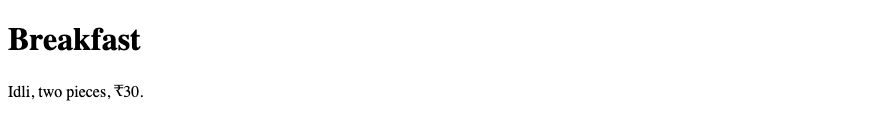

# 4. HTML — Meta tags and comments

**Index:** [HTML tutorial](../01_HTML.md)  
**Previous:** [Formatting and phrase tags](03_Text.md)  
**Next:** [Images](05_Images.md)

## Meta tags

Meta information goes in `<head>`. It describes the document. It is not shown as page content. `<title>` is the name on the browser tab.

| Element | Purpose |
|---------|---------|
| `<title>` | Tab title. One title per document |
| `<meta charset="UTF-8">` | Character encoding. Place it early in `<head>` |
| `<meta name="viewport" content="width=device-width, initial-scale=1.0">` | Layout width on a phone |
| `<meta name="description" content="...">` | A short summary of the page |
| `<meta name="author" content="...">` | The author of the document |

### Example

```html
<!DOCTYPE html>
<html lang="en">
<head>
  <meta charset="UTF-8">
  <meta name="viewport" content="width=device-width, initial-scale=1.0">
  <title>Hours — Canteen</title>
  <meta name="description" content="Canteen hours for the Hyderabad campus.">
  <meta name="author" content="Campus kitchen">
</head>
<body>
  <h1>Hours</h1>
  <p>Breakfast 7:30 am to 11:00 am.</p>
</body>
</html>
```

**This will produce the following result:**


The description and the author are in the document head. View Source shows them. The page shows the heading and the paragraph. The tab shows the title.

## Comments

A comment starts with `<!--` and ends with `-->`. It can span several lines. The browser does not show it. It remains visible in View Source. Do not nest comments. Do not place `--` inside the comment text.

### Example

```html
<!DOCTYPE html>
<html lang="en">
<head>
  <meta charset="UTF-8">
  <meta name="viewport" content="width=device-width, initial-scale=1.0">
  <title>Comment Example</title>
</head>
<body>
  <!-- Menu updated 20 Sep 2026 -->
  <h1>Breakfast</h1>
  <!--
    Sections still to add:
    lunch
    snacks
  -->
  <p>Idli, two pieces, ₹30.</p>
</body>
</html>
```

**This will produce the following result:**


