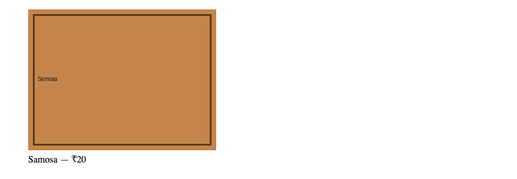

# 5. HTML — Images

**Index:** [HTML tutorial](../01_HTML.md)  
**Previous:** [Meta tags and comments](04_Head_Meta_Comments.md)  
**Next:** [Tables](06_Tables.md)

## Insert an image

`` is an empty element. `src` is the file. `alt` is the text alternative, used when the image is not seen. `width` and `height` reserve space in CSS pixels so the layout does not jump when the file arrives.

| Path | Example | Use |
|------|---------|-----|
| Same folder | `logo.png` | File beside the HTML file |
| Subfolder | `images/logo.png` | File inside this project |
| Parent folder | `../logo.png` | File one folder up |
| Full URL | `https://cdn.example.com/logo.png` | File on another host |

A decorative image that adds nothing to the text uses `alt=""`. The attribute is still present.

`loading="lazy"` defers an image that is below the first screen.

### Example

```html
<!DOCTYPE html>
<html lang="en">
<head>
  <meta charset="UTF-8">
  <meta name="viewport" content="width=device-width, initial-scale=1.0">
  <title>Insert Image Example</title>
</head>
<body>
  <h1>Samosa</h1>
  
</body>
</html>
```

**This will produce the following result:**


## Figure and caption

`<figure>` groups the image with its caption. `<figcaption>` is the caption.

### Example

```html
<!DOCTYPE html>
<html lang="en">
<head>
  <meta charset="UTF-8">
  <meta name="viewport" content="width=device-width, initial-scale=1.0">
  <title>Figure Example</title>
</head>
<body>
  <figure>
    
    <figcaption>Samosa — ₹20</figcaption>
  </figure>
</body>
</html>
```

**This will produce the following result:**



## Picture and srcset

`srcset` offers the same picture at more than one resolution. The browser picks one. `<picture>` offers a different file type or a different crop. The `` inside `<picture>` is required. `alt` stays on that ``.

### Example

```html
<!DOCTYPE html>
<html lang="en">
<head>
  <meta charset="UTF-8">
  <meta name="viewport" content="width=device-width, initial-scale=1.0">
  <title>Picture Example</title>
</head>
<body>
  <picture>
    <source srcset="images/samosa.webp" type="image/webp">
    
  </picture>
</body>
</html>
```

**This will produce the following result:**


