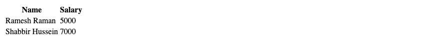
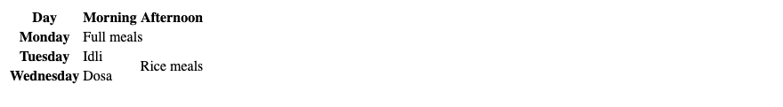
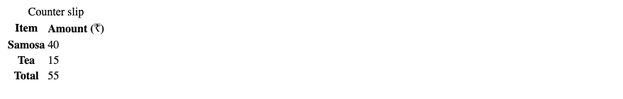
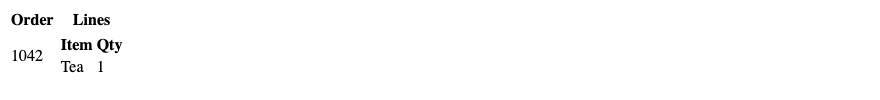

# 6. HTML — Tables

**Index:** [HTML tutorial](../01_HTML.md)  
**Previous:** [Images](05_Images.md)  
**Next:** [Lists](07_Lists.md)

A table is for data in rows and columns. `<tr>` is a row. `<th>` is a header cell. `<td>` is a data cell. `scope="col"` means the header names the column. `scope="row"` means it names the row.

## Table heading

### Example

```html
<!DOCTYPE html>
<html lang="en">
<head>
  <meta charset="UTF-8">
  <meta name="viewport" content="width=device-width, initial-scale=1.0">
  <title>Table Heading Example</title>
</head>
<body>
  <table>
    <tr>
      <th scope="col">Name</th>
      <th scope="col">Salary</th>
    </tr>
    <tr>
      <td>Ramesh Raman</td>
      <td>5000</td>
    </tr>
    <tr>
      <td>Shabbir Hussein</td>
      <td>7000</td>
    </tr>
  </table>
</body>
</html>
```

**This will produce the following result:**



## Colspan and rowspan

`colspan` stretches a cell across columns. `rowspan` stretches it across rows. Cells covered by the span are left out of the markup.

### Example

```html
<!DOCTYPE html>
<html lang="en">
<head>
  <meta charset="UTF-8">
  <meta name="viewport" content="width=device-width, initial-scale=1.0">
  <title>Colspan Example</title>
</head>
<body>
  <table>
    <tr>
      <th scope="col">Day</th>
      <th scope="col">Morning</th>
      <th scope="col">Afternoon</th>
    </tr>
    <tr>
      <th scope="row">Monday</th>
      <td colspan="2">Full meals</td>
    </tr>
    <tr>
      <th scope="row">Tuesday</th>
      <td>Idli</td>
      <td rowspan="2">Rice meals</td>
    </tr>
    <tr>
      <th scope="row">Wednesday</th>
      <td>Dosa</td>
    </tr>
  </table>
</body>
</html>
```

**This will produce the following result:**



## Caption, header, body, and footer

`<caption>` names the table. It is the first child of `<table>`. `<thead>`, `<tbody>`, and `<tfoot>` group the rows. `<colgroup>` and `<col>` describe the columns.

### Example

```html
<!DOCTYPE html>
<html lang="en">
<head>
  <meta charset="UTF-8">
  <meta name="viewport" content="width=device-width, initial-scale=1.0">
  <title>Table Caption Example</title>
</head>
<body>
  <table>
    <caption>Counter slip</caption>
    <colgroup>
      <col>
      <col>
    </colgroup>
    <thead>
      <tr>
        <th scope="col">Item</th>
        <th scope="col">Amount (₹)</th>
      </tr>
    </thead>
    <tbody>
      <tr>
        <th scope="row">Samosa</th>
        <td>40</td>
      </tr>
      <tr>
        <th scope="row">Tea</th>
        <td>15</td>
      </tr>
    </tbody>
    <tfoot>
      <tr>
        <th scope="row">Total</th>
        <td>55</td>
      </tr>
    </tfoot>
  </table>
</body>
</html>
```

**This will produce the following result:**



## Nested tables

A table can sit inside a cell of another table.

### Example

```html
<!DOCTYPE html>
<html lang="en">
<head>
  <meta charset="UTF-8">
  <meta name="viewport" content="width=device-width, initial-scale=1.0">
  <title>Nested Table Example</title>
</head>
<body>
  <table>
    <tr>
      <th scope="col">Order</th>
      <th scope="col">Lines</th>
    </tr>
    <tr>
      <td>1042</td>
      <td>
        <table>
          <tr>
            <th scope="col">Item</th>
            <th scope="col">Qty</th>
          </tr>
          <tr>
            <td>Tea</td>
            <td>1</td>
          </tr>
        </table>
      </td>
    </tr>
  </table>
</body>
</html>
```

**This will produce the following result:**


