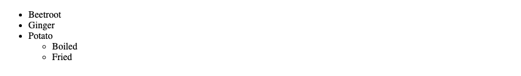
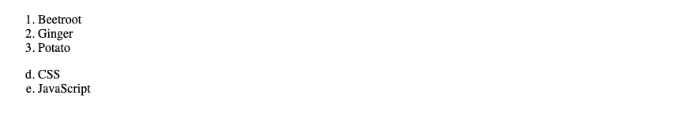
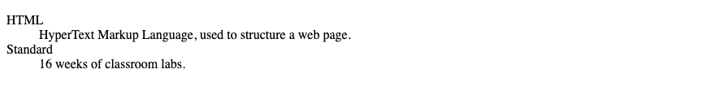

# 7. HTML — Lists

**Index:** [HTML tutorial](../01_HTML.md)  
**Previous:** [Tables](06_Tables.md)  
**Next:** [Links, image maps, email, and iframes](08_Links_and_Iframes.md)

## Unordered lists

`<ul>` is a list in which the order does not change the meaning. `<li>` is one item. A list can contain another list. The inner list sits inside an `<li>`.

### Example

```html
<!DOCTYPE html>
<html lang="en">
<head>
  <meta charset="UTF-8">
  <meta name="viewport" content="width=device-width, initial-scale=1.0">
  <title>Unordered List Example</title>
</head>
<body>
  <ul>
    <li>Beetroot</li>
    <li>Ginger</li>
    <li>Potato
      <ul>
        <li>Boiled</li>
        <li>Fried</li>
      </ul>
    </li>
  </ul>
</body>
</html>
```

**This will produce the following result:**



## Ordered lists

`<ol>` is a list in which the sequence matters. `type` is `1`, `a`, `A`, `i`, or `I`. `start` sets the first number. `reversed` counts downward.

### Example

```html
<!DOCTYPE html>
<html lang="en">
<head>
  <meta charset="UTF-8">
  <meta name="viewport" content="width=device-width, initial-scale=1.0">
  <title>Ordered List Example</title>
</head>
<body>
  <ol>
    <li>Beetroot</li>
    <li>Ginger</li>
    <li>Potato</li>
  </ol>
  <ol type="a" start="4">
    <li>CSS</li>
    <li>JavaScript</li>
  </ol>
</body>
</html>
```

**This will produce the following result:**



The second list starts at d, because `start` is 4 and `type` is letters.

## Description lists

`<dl>` pairs a name with its description. `<dt>` is the name. `<dd>` is the description.

### Example

```html
<!DOCTYPE html>
<html lang="en">
<head>
  <meta charset="UTF-8">
  <meta name="viewport" content="width=device-width, initial-scale=1.0">
  <title>Definition List Example</title>
</head>
<body>
  <dl>
    <dt>HTML</dt>
    <dd>HyperText Markup Language, used to structure a web page.</dd>
    <dt>Standard</dt>
    <dd>16 weeks of classroom labs.</dd>
  </dl>
</body>
</html>
```

**This will produce the following result:**


