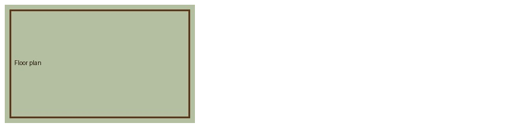
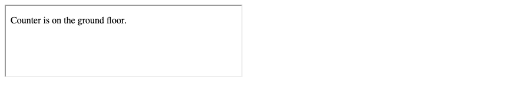

# 8. HTML — Links, image maps, email, and iframes

**Index:** [HTML tutorial](../01_HTML.md)  
**Previous:** [Lists](07_Lists.md)  
**Next:** [Blocks](09_Page_Regions.md)

## Text links

`<a>` with `href` is a link. The text inside the element is the label of the link.

| href | Destination |
|------|-------------|
| `menu.html` | A file in the same folder |
| `pages/about.html` | A file in a subfolder |
| `../index.html` | A file in the parent folder |
| `https://www.python.org/` | Another site |
| `#hours` | The element with `id="hours"` on this page |
| `menu.html#breakfast` | An element on another page |

### Example

```html
<!DOCTYPE html>
<html lang="en">
<head>
  <meta charset="UTF-8">
  <meta name="viewport" content="width=device-width, initial-scale=1.0">
  <title>Link Example</title>
</head>
<body>
  <a href="https://www.python.org/">Python</a>
</body>
</html>
```

**This will produce the following result:**


## The target attribute

`target="_blank"` opens the link in a new browsing context. `rel="noopener noreferrer"` keeps that page from reaching back into this one. `target="_self"` opens it in the same context. That is the default.

### Example

```html
<!DOCTYPE html>
<html lang="en">
<head>
  <meta charset="UTF-8">
  <meta name="viewport" content="width=device-width, initial-scale=1.0">
  <title>Target Example</title>
</head>
<body>
  <a href="https://www.python.org/" target="_blank" rel="noopener noreferrer">Python</a>
</body>
</html>
```

**This will produce the following result:**


## Base path

`<base href>` in `<head>` sets the base URL for relative links on the page.

### Example

```html
<!DOCTYPE html>
<html lang="en">
<head>
  <meta charset="UTF-8">
  <meta name="viewport" content="width=device-width, initial-scale=1.0">
  <base href="https://www.example.com/docs/">
  <title>Base Example</title>
</head>
<body>
  <a href="start.html">Start</a>
</body>
</html>
```

**This will produce the following result:**


The visible label is Start. The address of the link is `https://www.example.com/docs/start.html`.

## Linking to a page section

The value after `#` matches the `id` of an element, including letter case.

### Example

```html
<!DOCTYPE html>
<html lang="en">
<head>
  <meta charset="UTF-8">
  <meta name="viewport" content="width=device-width, initial-scale=1.0">
  <title>Page Section Example</title>
</head>
<body>
  <a href="#hours">Hours</a>
  <h2 id="hours">Hours</h2>
  <p>Open until 8 pm.</p>
</body>
</html>
```

**This will produce the following result:**


## Download links

`download` asks the browser to download the file. A value sets the suggested file name.

### Example

```html
<!DOCTYPE html>
<html lang="en">
<head>
  <meta charset="UTF-8">
  <meta name="viewport" content="width=device-width, initial-scale=1.0">
  <title>Download Example</title>
</head>
<body>
  <a href="files/menu.pdf" download="menu.pdf">Download the menu</a>
</body>
</html>
```

**This will produce the following result:**


## Image links

An image inside `<a>` is a link. `alt` still describes the image.

### Example

```html
<!DOCTYPE html>
<html lang="en">
<head>
  <meta charset="UTF-8">
  <meta name="viewport" content="width=device-width, initial-scale=1.0">
  <title>Image Link Example</title>
</head>
<body>
  <a href="samosa.html">
    
  </a>
</body>
</html>
```

**This will produce the following result:**


## Image maps

`<map>` and `<area>` define regions of an image. `usemap` on `` names the map. `shape` is `rect`, `circle`, or `poly`. `coords` lists the positions in pixels of the image. `alt` on each `<area>` names that region.

### Example

```html
<!DOCTYPE html>
<html lang="en">
<head>
  <meta charset="UTF-8">
  <meta name="viewport" content="width=device-width, initial-scale=1.0">
  <title>Image Map Example</title>
</head>
<body>
  
  <map name="plan">
    <area shape="rect" coords="10,10,150,190" href="counter.html" alt="Counter">
    <area shape="rect" coords="160,10,310,190" href="seating.html" alt="Seating">
  </map>
</body>
</html>
```

**This will produce the following result:**



## Email links

`mailto:` opens the visitor's email program. `subject`, `cc`, and `body` can be added as a query. A space in that query is written as `%20`.

### Example

```html
<!DOCTYPE html>
<html lang="en">
<head>
  <meta charset="UTF-8">
  <meta name="viewport" content="width=device-width, initial-scale=1.0">
  <title>Email Link Example</title>
</head>
<body>
  <a href="mailto:placement@ksr.example?subject=Profile%20review&amp;body=Please%20review%20my%20profile.">Send a profile</a>
</body>
</html>
```

**This will produce the following result:**


## Iframes

`<iframe>` shows another document in a rectangle on this page. `title` names the frame. `width` and `height` set the box. `name` is the target name other links can use. `sandbox` restricts the embedded document. An empty `sandbox` applies every restriction. `srcdoc` supplies the embedded document in the attribute itself.

### Example

```html
<!DOCTYPE html>
<html lang="en">
<head>
  <meta charset="UTF-8">
  <meta name="viewport" content="width=device-width, initial-scale=1.0">
  <title>Iframe Example</title>
</head>
<body>
  <iframe
    title="Canteen note"
    width="400"
    height="120"
    sandbox=""
    srcdoc="<p>Counter is on the ground floor.</p>">
  </iframe>
</body>
</html>
```

**This will produce the following result:**


