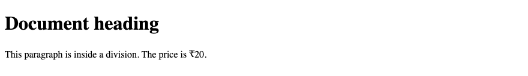
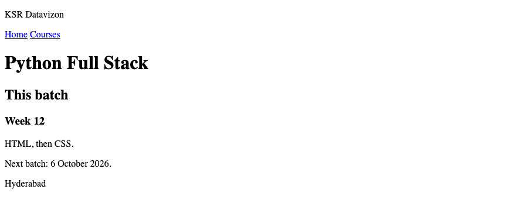
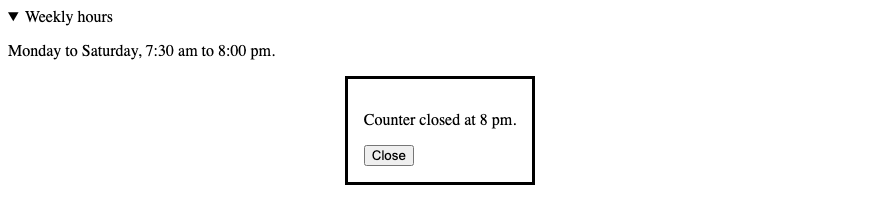

# 9. HTML — Blocks

**Index:** [HTML tutorial](../01_HTML.md)  
**Previous:** [Links, image maps, email, and iframes](08_Links_and_Iframes.md)  
**Next:** [Forms](10_Forms.md)

## Block and inline

A block element starts on a new line and takes the width of its container. A paragraph, a heading, and a division are block elements. An inline element sits in the line. A link, `<span>`, `<b>`, and `` are inline elements.

## The div tag

`<div>` is a block container with no further meaning. Use it when the group is not one of the regions below.

## The span tag

`<span>` is an inline container with no further meaning.

### Example

```html
<!DOCTYPE html>
<html lang="en">
<head>
  <meta charset="UTF-8">
  <meta name="viewport" content="width=device-width, initial-scale=1.0">
  <title>Div and Span Example</title>
</head>
<body>
  <div>
    <h1>Document heading</h1>
    <p>This paragraph is inside a division. The price is <span>₹20</span>.</p>
  </div>
</body>
</html>
```

**This will produce the following result:**



## Page regions

These elements name the regions of a page.

| Element | Purpose |
|---------|---------|
| `<header>` | Introductory content for the page or for an article |
| `<nav>` | A group of links |
| `<main>` | The main content. One `<main>` on the page |
| `<section>` | A thematic group. It has a heading |
| `<article>` | A self-contained piece, such as a post or a product |
| `<aside>` | Content related to the main text |
| `<footer>` | Closing content for the page or for an article |
| `<search>` | A search form for the page |

`aria-label` names a `<nav>` when the page has more than one.

### Example

```html
<!DOCTYPE html>
<html lang="en">
<head>
  <meta charset="UTF-8">
  <meta name="viewport" content="width=device-width, initial-scale=1.0">
  <title>Page Regions Example</title>
</head>
<body>
  <header>
    <p>KSR Datavizon</p>
    <nav aria-label="Primary">
      <a href="index.html">Home</a>
      <a href="courses.html">Courses</a>
    </nav>
  </header>
  <main>
    <h1>Python Full Stack</h1>
    <section>
      <h2>This batch</h2>
      <article>
        <h3>Week 12</h3>
        <p>HTML, then CSS.</p>
      </article>
    </section>
    <aside>
      <p>Next batch: 6 October 2026.</p>
    </aside>
  </main>
  <footer>
    <p>Hyderabad</p>
  </footer>
</body>
</html>
```

**This will produce the following result:**



## Details and dialog

`<details>` hides extra text until it is opened. `<summary>` is the label. The `open` attribute shows the content when the page loads.

`<dialog>` is a panel above the page. The `open` attribute shows it. A form with `method="dialog"` closes the panel.

### Example

```html
<!DOCTYPE html>
<html lang="en">
<head>
  <meta charset="UTF-8">
  <meta name="viewport" content="width=device-width, initial-scale=1.0">
  <title>Details Example</title>
</head>
<body>
  <details open>
    <summary>Weekly hours</summary>
    <p>Monday to Saturday, 7:30 am to 8:00 pm.</p>
  </details>
  <dialog open>
    <p>Counter closed at 8 pm.</p>
    <form method="dialog">
      <button>Close</button>
    </form>
  </dialog>
</body>
</html>
```

**This will produce the following result:**


