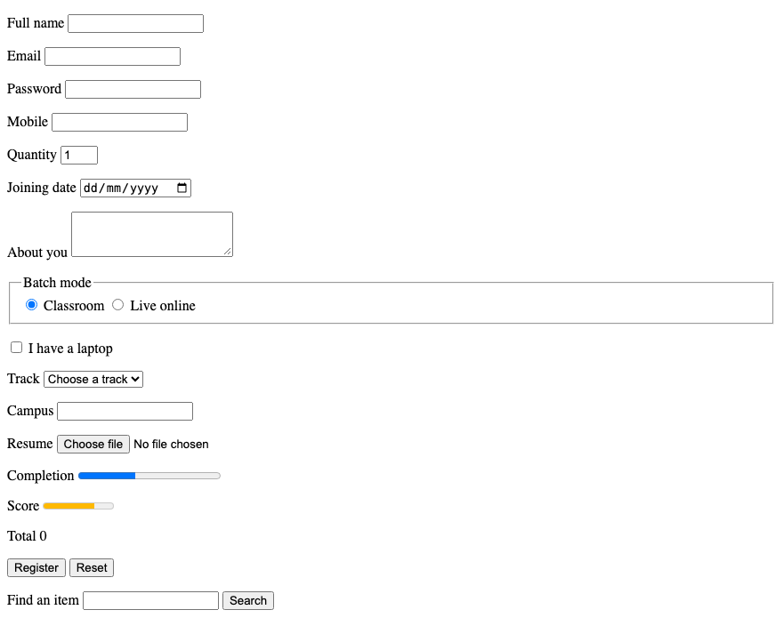

# 10. HTML — Forms

**Index:** [HTML tutorial](../01_HTML.md)  
**Previous:** [Blocks](09_Page_Regions.md)  
**Next:** [Multimedia](11_Media.md)

A form collects input. `action` is the URL that receives it. `method="get"` puts the fields in the page address. `method="post"` puts them in the request body. Use `post` when the form creates or changes data, including a login. Each control has a `name`. That name is the key sent with the form.

`<label for>` matches the `id` of its control.

## Text, password, and current input types

| type | Purpose |
|------|---------|
| `text` | A single line of text |
| `password` | A single line, characters hidden |
| `email` | An email address |
| `tel` | A telephone number |
| `url` | A web address |
| `search` | A search field |
| `number` | A number. `min` and `max` limit it |
| `range` | A number chosen on a slider |
| `date`, `time`, `datetime-local`, `month`, `week` | A date or a time |
| `color` | A colour |
| `checkbox` | A yes-or-no choice. Several boxes may share one `name` |
| `radio` | One choice in a group. The group shares one `name` |
| `file` | A file from the visitor's computer. `accept` lists the types |
| `hidden` | A value the visitor does not edit |

`required` blocks submit until the field has a value. `placeholder` is a hint inside an empty field. The label remains. `autocomplete` names the saved value the browser may offer, such as `name` or `email`. `inputmode` asks the phone for a matching keyboard, such as `tel` or `numeric`. `minlength`, `maxlength`, and `pattern` constrain the text.

`<textarea>` is more than one line. It has an end tag. `<select>` is a menu of `<option>` elements. `<optgroup>` groups those options. `<datalist>` offers suggestions for a text field. `list` on the input names the datalist.

## Buttons, groups, output, meter, and progress

| Element | Purpose |
|---------|---------|
| `<button type="submit">` | Sends the form |
| `<button type="reset">` | Restores the initial values |
| `<button type="button">` | A button with no built-in form action |
| `<fieldset>` and `<legend>` | A group of controls and its name |
| `<output>` | A calculated result |
| `<meter>` | A value inside a known range |
| `<progress>` | Completion of a task |

`<search>` wraps a search form.

### Example

```html
<!DOCTYPE html>
<html lang="en">
<head>
  <meta charset="UTF-8">
  <meta name="viewport" content="width=device-width, initial-scale=1.0">
  <title>Form Example</title>
</head>
<body>
  <form action="#" method="post" autocomplete="on">
    <p>
      <label for="full-name">Full name</label>
      <input id="full-name" name="full_name" type="text" autocomplete="name" required>
    </p>
    <p>
      <label for="email">Email</label>
      <input id="email" name="email" type="email" autocomplete="email" required>
    </p>
    <p>
      <label for="password">Password</label>
      <input id="password" name="password" type="password" autocomplete="new-password" required>
    </p>
    <p>
      <label for="phone">Mobile</label>
      <input id="phone" name="phone" type="tel" autocomplete="tel" inputmode="tel">
    </p>
    <p>
      <label for="qty">Quantity</label>
      <input id="qty" name="qty" type="number" min="1" max="10" value="1">
    </p>
    <p>
      <label for="join">Joining date</label>
      <input id="join" name="join_date" type="date">
    </p>
    <p>
      <label for="about">About you</label>
      <textarea id="about" name="about" rows="3"></textarea>
    </p>
    <fieldset>
      <legend>Batch mode</legend>
      <input id="mode-class" name="mode" type="radio" value="classroom" checked>
      <label for="mode-class">Classroom</label>
      <input id="mode-live" name="mode" type="radio" value="live">
      <label for="mode-live">Live online</label>
    </fieldset>
    <p>
      <input id="laptop" name="has_laptop" type="checkbox" value="yes">
      <label for="laptop">I have a laptop</label>
    </p>
    <p>
      <label for="track">Track</label>
      <select id="track" name="track">
        <option value="">Choose a track</option>
        <optgroup label="Full stack">
          <option value="python">Python</option>
          <option value="java">Java</option>
        </optgroup>
      </select>
    </p>
    <p>
      <label for="campus">Campus</label>
      <input id="campus" name="campus" type="text" list="campus-list">
      <datalist id="campus-list">
        <option value="Hyderabad">
        <option value="Bengaluru">
      </datalist>
    </p>
    <p>
      <label for="resume">Resume</label>
      <input id="resume" name="resume" type="file" accept=".pdf,application/pdf">
    </p>
    <input type="hidden" name="source" value="register-page">
    <p>Completion <progress value="40" max="100">40%</progress></p>
    <p>Score <meter min="0" max="100" low="40" high="80" optimum="90" value="72">72</meter></p>
    <p>Total <output name="total">0</output></p>
    <p>
      <button type="submit">Register</button>
      <button type="reset">Reset</button>
    </p>
  </form>
  <search>
    <form action="/menu" method="get">
      <label for="q">Find an item</label>
      <input id="q" name="q" type="search">
      <button type="submit">Search</button>
    </form>
  </search>
</body>
</html>
```

**This will produce the following result:**


