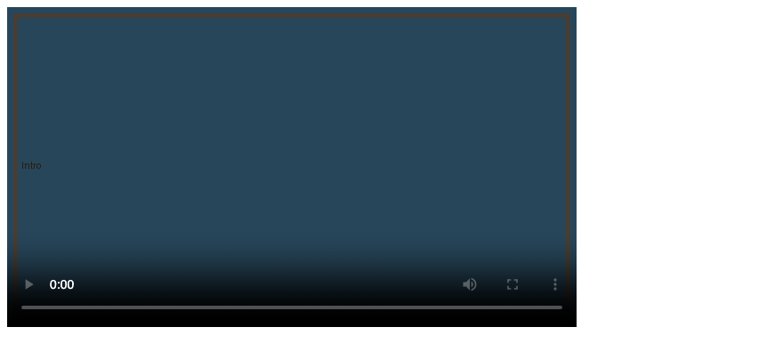

# 11. HTML — Multimedia

**Index:** [HTML tutorial](../01_HTML.md)  
**Previous:** [Forms](10_Forms.md)  
**Next:** [Header, style sheets, and script](12_Style_and_Script.md)

## Video

`<video>` plays a video file. `controls` shows the player. `width` and `height` set the box. `poster` is the image shown before playback. `preload` is `none`, `metadata`, or `auto`.

`<source>` lists more than one file. The browser uses the first type it can play. Text inside `<video>` is the fallback, including a download link.

### Example

```html
<!DOCTYPE html>
<html lang="en">
<head>
  <meta charset="UTF-8">
  <meta name="viewport" content="width=device-width, initial-scale=1.0">
  <title>Video Example</title>
</head>
<body>
  <video controls width="640" height="360" poster="images/intro-poster.jpg" preload="metadata">
    <source src="media/intro.webm" type="video/webm">
    <source src="media/intro.mp4" type="video/mp4">
    <p><a href="media/intro.mp4">Download the intro</a>.</p>
  </video>
</body>
</html>
```

**This will produce the following result:**



## Captions

`<track>` points at a WebVTT file. `kind="captions"` is the dialogue as text. `srclang` is the language. `label` is the name in the player menu. `default` selects that track at the start.

```html
<video controls width="640" height="360">
  <source src="media/intro.mp4" type="video/mp4">
  <track src="media/intro-en.vtt" kind="captions" srclang="en" label="English" default>
</video>
```

A captions file begins with `WEBVTT` and then the time ranges:

```
WEBVTT

00:00:00.000 --> 00:00:04.000
Welcome to the canteen counter.
```

## Audio

`<audio>` plays a sound file. `controls` shows the player bar.

### Example

```html
<!DOCTYPE html>
<html lang="en">
<head>
  <meta charset="UTF-8">
  <meta name="viewport" content="width=device-width, initial-scale=1.0">
  <title>Audio Example</title>
</head>
<body>
  <audio controls preload="metadata">
    <source src="media/chime.mp3" type="audio/mpeg">
    <source src="media/chime.ogg" type="audio/ogg">
    <p><a href="media/chime.mp3">Download the chime</a>.</p>
  </audio>
</body>
</html>
```

**This will produce the following result:**


## Embed

`<embed>` places an external resource in the page. `src` is the file. `type` is its media type. `width` and `height` set the box.

### Example

```html
<!DOCTYPE html>
<html lang="en">
<head>
  <meta charset="UTF-8">
  <meta name="viewport" content="width=device-width, initial-scale=1.0">
  <title>Embed Example</title>
</head>
<body>
  <embed src="files/notes.pdf" type="application/pdf" width="640" height="400">
</body>
</html>
```

**This will produce the following result:**


