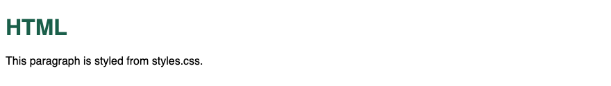

# 12. HTML — Header, style sheets, and script

**Index:** [HTML tutorial](../01_HTML.md)  
**Previous:** [Multimedia](11_Media.md)  
**Next:** [CSS and Responsive](../02_CSS_and_Responsive.md)

## The document header

`<head>` holds the title, the meta tags from chapter 4, and the elements below.

| Element | Purpose |
|---------|---------|
| `<title>` | Name of the document, shown on the tab |
| `<base href>` | Default URL for relative links. See chapter 8 |
| `<link>` | A relationship to another file, such as a style sheet or an icon |
| `<style>` | Style rules written in this document |
| `<script>` | A script written in this document, or loaded from a file |

`<link rel="icon" href="favicon.ico">` sets the tab icon. `<link rel="stylesheet" href="styles.css">` loads a style sheet.

## Style sheets

An external style sheet is a separate file:

```html
<link rel="stylesheet" href="styles.css">
```

An internal style sheet uses `<style>` in `<head>`. An inline style uses the `style` attribute on an element.

### Example

```html
<!DOCTYPE html>
<html lang="en">
<head>
  <meta charset="UTF-8">
  <meta name="viewport" content="width=device-width, initial-scale=1.0">
  <title>Style Sheet Example</title>
  <style>
    body { font-family: sans-serif; }
    h1 { color: #1a5f4a; }
  </style>
</head>
<body>
  <h1>HTML</h1>
  <p style="color: #333333">This paragraph uses an inline style.</p>
</body>
</html>
```

**This will produce the following result:**


### Example

```html
<!DOCTYPE html>
<html lang="en">
<head>
  <meta charset="UTF-8">
  <meta name="viewport" content="width=device-width, initial-scale=1.0">
  <title>External Style Sheet Example</title>
  <link rel="stylesheet" href="styles.css">
</head>
<body>
  <h1>HTML</h1>
  <p>This paragraph is styled from styles.css.</p>
</body>
</html>
```

**This will produce the following result:**



`styles.css` for that example:

```css
body { font-family: sans-serif; }
h1 { color: #1a5f4a; }
```

## Script

`<script src="main.js"></script>` loads an external script. `<script>` with code between the tags is an internal script. Place the script at the end of `<body>` so the elements exist when it runs. `defer` on an external script in `<head>` waits until the document is parsed. `type="module"` loads the file as a JavaScript module.

`<noscript>` is content shown when the browser is not running scripts.

### Example

```html
<!DOCTYPE html>
<html lang="en">
<head>
  <meta charset="UTF-8">
  <meta name="viewport" content="width=device-width, initial-scale=1.0">
  <title>Script Example</title>
</head>
<body>
  <p id="msg">Loading</p>
  <script>
    document.getElementById("msg").textContent = "HTML page ready.";
  </script>
  <noscript>
    <p>Scripts are off. The line above stays as Loading.</p>
  </noscript>
</body>
</html>
```

**This will produce the following result:**


### Example

```html
<!DOCTYPE html>
<html lang="en">
<head>
  <meta charset="UTF-8">
  <meta name="viewport" content="width=device-width, initial-scale=1.0">
  <title>External Script Example</title>
  <script src="main.js" defer></script>
</head>
<body>
  <p id="year">Year</p>
</body>
</html>
```

**This will produce the following result:**


`main.js` for that example:

```javascript
document.getElementById("year").textContent = "2026";
```
