# 1. HTML — Web & HTML Fundamentals

**Index:** [HTML tutorial](../01_HTML.md)  
**Previous:** [HTML tutorial](../01_HTML.md)  
**Next:** [Text, Formatting and Attributes](Module_02_Text_Formatting_and_Attributes.md)

The examples in this tutorial are pages from Acme HR, an employee portal for an office in Hyderabad. Amounts are in ₹.

## 1. Introduction to Web Development

A web page is a file the browser shows. You write that file in a text editor and open it in the browser. Acme HR starts as one HTML file on your computer. The same file is what a server sends later.

### Example

```html
<!DOCTYPE html>
<html lang="en">
<head>
  <meta charset="UTF-8">
  <meta name="viewport" content="width=device-width, initial-scale=1.0">
  <title>Acme HR</title>
</head>
<body>
  <h1>Acme HR</h1>
  <p>Employee portal for the Hyderabad office.</p>
</body>
</html>
```

**This will produce the following result:**


## 2. How the Web Works — Browser, Client & Server

The browser is the client. It asks for a page. The server sends the HTML file, and the browser reads the tags and paints the page. Opening a file from your disk uses the same HTML a server would send. In the full-stack tracks that server is Django or Spring Boot.

### Example

```html
<!DOCTYPE html>
<html lang="en">
<head>
  <meta charset="UTF-8">
  <meta name="viewport" content="width=device-width, initial-scale=1.0">
  <title>Acme HR — Request</title>
</head>
<body>
  <h1>Acme HR</h1>
  <p>The browser requested this page. The server answered with this HTML.</p>
</body>
</html>
```

**This will produce the following result:**

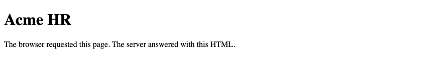

## 3. HTML, CSS & JavaScript — Roles

HTML names the parts of the page: a heading, a paragraph, a form. CSS sets how those parts look. JavaScript changes the page after it has loaded. This tutorial writes the HTML. The CSS tutorial writes the look. A later tutorial writes the script.

### Example

```html
<!DOCTYPE html>
<html lang="en">
<head>
  <meta charset="UTF-8">
  <meta name="viewport" content="width=device-width, initial-scale=1.0">
  <title>Acme HR — Roles</title>
</head>
<body>
  <h1>Acme HR</h1>
  <p>This heading and this paragraph are HTML.</p>
</body>
</html>
```

**This will produce the following result:**


## 4. Introduction to HTML

HTML stands for HyperText Markup Language. Hypertext is the links between pages. Markup is the tags around the text. A tag name sits between `<` and `>`. Save the file with the `.html` extension.

### Example

```html
<!DOCTYPE html>
<html lang="en">
<head>
  <meta charset="UTF-8">
  <meta name="viewport" content="width=device-width, initial-scale=1.0">
  <title>Acme HR — Markup</title>
</head>
<body>
  <h1>Acme HR</h1>
  <p>Tags mark this sentence as a paragraph.</p>
</body>
</html>
```

**This will produce the following result:**

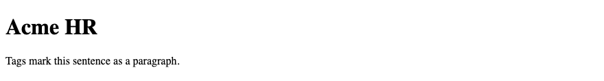

## 5. HTML Document Structure

An HTML file has a document type, a root element, a head, and a body. The head describes the document. The body is what the visitor sees. The examples in this tutorial use this structure every time.

| Piece | Role |
|-------|------|
| `<!DOCTYPE html>` | Asks the browser to use current HTML |
| `<html lang="en">` | Root element. `lang` is the language of the text |
| `<head>` | Title, character set, viewport, and links to CSS |
| `<body>` | The page the visitor reads |

### Example

```html
<!DOCTYPE html>
<html lang="en">
<head>
  <meta charset="UTF-8">
  <meta name="viewport" content="width=device-width, initial-scale=1.0">
  <title>Acme HR</title>
</head>
<body>
  <h1>Acme HR</h1>
  <p>Document content goes in the body.</p>
</body>
</html>
```

**This will produce the following result:**

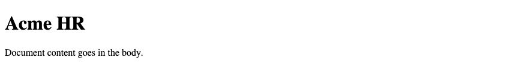

## 6. `<!DOCTYPE html>`

`<!DOCTYPE html>` is the first line of the file. It tells the browser to use current HTML. Leave the line out and older browsers may switch to an old layout mode. It is not a tag with an end tag.

### Example

```html
<!DOCTYPE html>
<html lang="en">
<head>
  <meta charset="UTF-8">
  <meta name="viewport" content="width=device-width, initial-scale=1.0">
  <title>Acme HR — Doctype</title>
</head>
<body>
  <h1>Acme HR</h1>
  <p>The first line of this file is the document type.</p>
</body>
</html>
```

**This will produce the following result:**

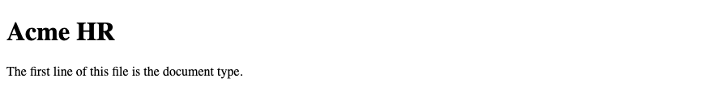

## 7. `<html>`, `<head>`, `<body>`

`<html>` wraps the whole document. `<head>` holds information about the page, not the visible article. `<body>` holds the heading, the text, and the forms. One document has one `html`, one `head`, and one `body`.

### Example

```html
<!DOCTYPE html>
<html lang="en">
<head>
  <meta charset="UTF-8">
  <meta name="viewport" content="width=device-width, initial-scale=1.0">
  <title>Acme HR — Head and body</title>
</head>
<body>
  <h1>Acme HR</h1>
  <p>This paragraph is in the body. The title is in the head.</p>
</body>
</html>
```

**This will produce the following result:**


## 8. HTML Comments

A comment is a note for the person reading the source. The browser does not show it. A comment starts with `<!--` and ends with `-->`. Do not put private data in a comment. View source still shows it.

### Example

```html
<!DOCTYPE html>
<html lang="en">
<head>
  <meta charset="UTF-8">
  <meta name="viewport" content="width=device-width, initial-scale=1.0">
  <title>Acme HR — Comment</title>
</head>
<body>
  <h1>Acme HR</h1>
  <!-- Payroll date for the Hyderabad office: 30 September 2026 -->
  <p>The next payroll date is on the page. The note above is a comment.</p>
</body>
</html>
```

**This will produce the following result:**


## 9. HTML Entities

Some characters are part of HTML syntax. Write them as entities when they should appear as text. `&nbsp;` is a space that does not become a line break. The rupee sign ₹ can be typed directly when the character set is UTF-8.

| Character | Entity |
|-----------|--------|
| nonbreaking space | `&nbsp;` |
| `<` | `&lt;` |
| `>` | `&gt;` |
| `&` | `&amp;` |
| `"` | `&quot;` |

### Example

```html
<!DOCTYPE html>
<html lang="en">
<head>
  <meta charset="UTF-8">
  <meta name="viewport" content="width=device-width, initial-scale=1.0">
  <title>Acme HR — Entities</title>
</head>
<body>
  <h1>Acme HR</h1>
  <p>Net pay is ₹78,800.</p>
  <p>Write a tag as &lt;p&gt; and an ampersand as &amp;.</p>
  <p>Employee&nbsp;ID&nbsp;E-1042 stays on one line.</p>
</body>
</html>
```

**This will produce the following result:**

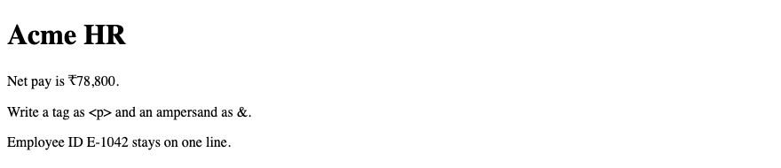

## 10. Character Encoding — `<meta charset>`

`<meta charset="UTF-8">` sets the character encoding. UTF-8 covers English text and the rupee sign. Put this tag in the first kilobyte of the file, as the first child of `<head>`. A wrong encoding turns ₹ into a different character.

### Example

```html
<!DOCTYPE html>
<html lang="en">
<head>
  <meta charset="UTF-8">
  <meta name="viewport" content="width=device-width, initial-scale=1.0">
  <title>Acme HR — Charset</title>
</head>
<body>
  <h1>Acme HR</h1>
  <p>Basic pay ₹50,000. HRA ₹20,000.</p>
</body>
</html>
```

**This will produce the following result:**

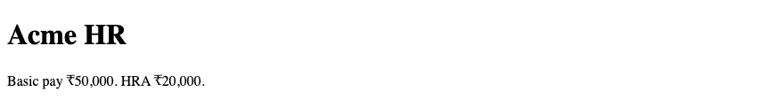

## 11. `lang` Attribute

`lang` on `<html>` names the language of the page. `en` means English. Screen readers use it to choose a voice. The Hyderabad office pages in this tutorial are in English, so each document uses `lang="en"`.

### Example

```html
<!DOCTYPE html>
<html lang="en">
<head>
  <meta charset="UTF-8">
  <meta name="viewport" content="width=device-width, initial-scale=1.0">
  <title>Acme HR — Language</title>
</head>
<body>
  <h1>Acme HR</h1>
  <p lang="en">The directory is in English.</p>
</body>
</html>
```

**This will produce the following result:**

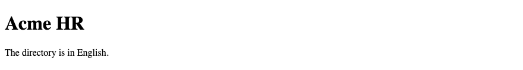

## 12. `<title>`

`<title>` is the name of the document. The browser shows it on the tab. Search results use it as the link. Each Acme HR page has its own title. The text inside `<title>` is not shown in the body. The visible heading is `<h1>`.

### Example

```html
<!DOCTYPE html>
<html lang="en">
<head>
  <meta charset="UTF-8">
  <meta name="viewport" content="width=device-width, initial-scale=1.0">
  <title>Acme HR — Directory</title>
</head>
<body>
  <h1>Acme HR</h1>
  <p>The tab reads “Acme HR — Directory”. The page heading is Acme HR.</p>
</body>
</html>
```

**This will produce the following result:**

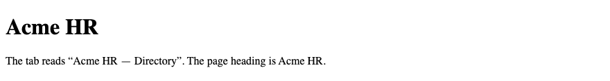

## 13. `<meta>`

A `<meta>` tag gives a fact about the document. It is an empty element. `charset` sets the encoding. `name` and `content` form a pair, such as a description. The description is for search results. The visitor does not see the tag on the page.

| Attribute | Example | Purpose |
|-----------|---------|---------|
| `charset` | `UTF-8` | Character encoding |
| `name` | `description` | What kind of fact this is |
| `content` | A short sentence | The fact itself |
| `name` | `viewport` | Layout width on a phone |

### Example

```html
<!DOCTYPE html>
<html lang="en">
<head>
  <meta charset="UTF-8">
  <meta name="description" content="Acme HR is the employee portal for the Hyderabad office.">
  <meta name="viewport" content="width=device-width, initial-scale=1.0">
  <title>Acme HR</title>
</head>
<body>
  <h1>Acme HR</h1>
  <p>The description sits in the head. This paragraph sits on the page.</p>
</body>
</html>
```

**This will produce the following result:**

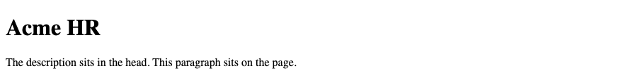

## 14. `<link>`

`<link>` connects another file to this document. A style sheet uses `rel="stylesheet"` and `href` for the file name. The CSS tutorial writes `styles.css`. Django serves that file from `static/`. Spring Boot serves it from `src/main/resources/static/`.

### Example

```html
<!DOCTYPE html>
<html lang="en">
<head>
  <meta charset="UTF-8">
  <meta name="viewport" content="width=device-width, initial-scale=1.0">
  <title>Acme HR — Stylesheet link</title>
  <link rel="stylesheet" href="styles.css">
</head>
<body>
  <h1>Acme HR</h1>
  <p>The look of this page comes from styles.css.</p>
</body>
</html>
```

```css
/* styles.css — the CSS modules explain this file */
h1 {
  color: #1a365d;
}
```

**This will produce the following result:**

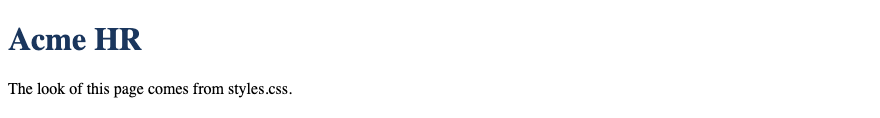

## 15. Viewport Meta Tag

The viewport is the visible area of the page on a phone. Without a viewport tag, a phone may shrink a desktop page until the text is too small to read. `width=device-width` uses the phone's width. `initial-scale=1.0` opens the page at normal zoom.

### Example

```html
<!DOCTYPE html>
<html lang="en">
<head>
  <meta charset="UTF-8">
  <meta name="viewport" content="width=device-width, initial-scale=1.0">
  <title>Acme HR — Viewport</title>
</head>
<body>
  <h1>Acme HR</h1>
  <p>On a phone, this page uses the width of the screen.</p>
</body>
</html>
```

**This will produce the following result:**

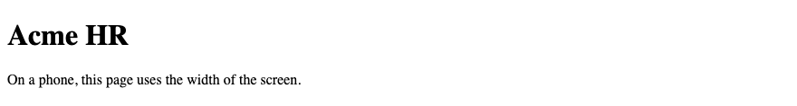
