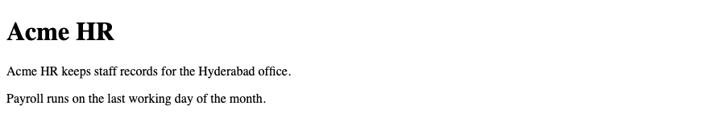
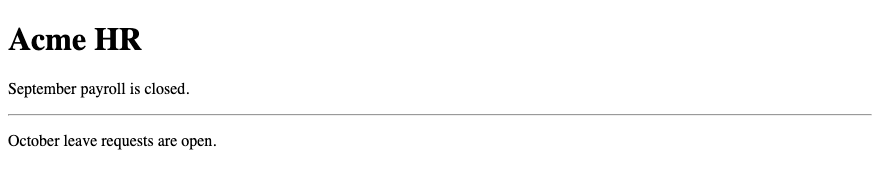
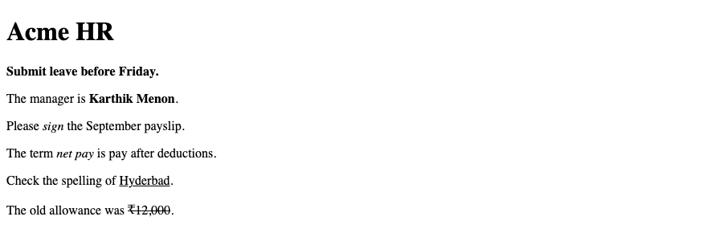
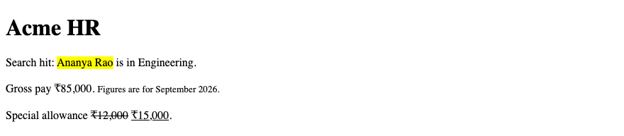
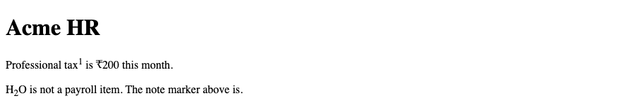
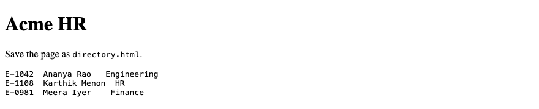
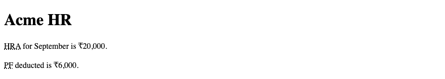
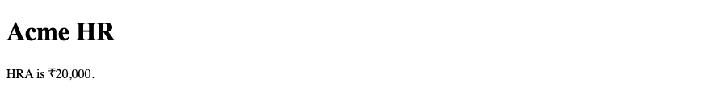
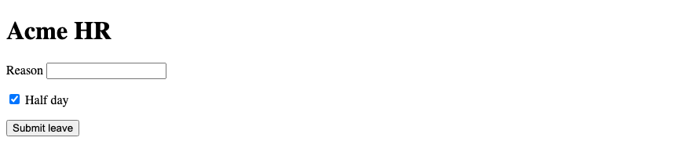
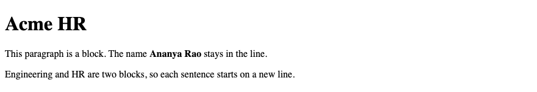

# 2. HTML — Text, Formatting & Attributes

**Index:** [HTML tutorial](../01_HTML.md)  
**Previous:** [Web and HTML Fundamentals](Module_01_Web_and_HTML_Fundamentals.md)  
**Next:** [Links, Images and Lists](Module_03_Links_Images_and_Lists.md)

## 1. Headings — `<h1>` to `<h6>`

A page has one `<h1>`. On these pages the `<h1>` is Acme HR. The next section uses `<h2>`. A subsection uses `<h3>`. Do not skip heading levels. The browser draws `<h1>` largest and `<h6>` smallest.

A subtitle that belongs with the heading sits in `<hgroup>`. An hgroup subtitle is a `p`.

| Tag | Use on Acme HR |
|-----|----------------|
| `<h1>` | Acme HR, once on the page |
| `<h2>` | Directory, Leave request, Payslip |
| `<h3>` | One employee, or one part of a form |
| `<h4>` to `<h6>` | A deeper subsection, in order |

### Example

```html
<!DOCTYPE html>
<html lang="en">
<head>
  <meta charset="UTF-8">
  <meta name="viewport" content="width=device-width, initial-scale=1.0">
  <title>Acme HR — Headings</title>
</head>
<body>
  <hgroup>
    <h1>Acme HR</h1>
    <p>Employee portal, Hyderabad</p>
  </hgroup>
  <h2>Directory</h2>
  <h3>Engineering</h3>
</body>
</html>
```

**This will produce the following result:**


## 2. Paragraph — `<p>`

`<p>` marks one paragraph. Each paragraph starts with `<p>` and ends with `</p>`. The browser adds space between paragraphs. Put the office introduction in a paragraph under the heading.

### Example

```html
<!DOCTYPE html>
<html lang="en">
<head>
  <meta charset="UTF-8">
  <meta name="viewport" content="width=device-width, initial-scale=1.0">
  <title>Acme HR — Paragraphs</title>
</head>
<body>
  <h1>Acme HR</h1>
  <p>Acme HR keeps staff records for the Hyderabad office.</p>
  <p>Payroll runs on the last working day of the month.</p>
</body>
</html>
```

**This will produce the following result:**



## 3. Line Break — `<br>`

`<br>` starts the following text on the next line. It is an empty element: there is no end tag. Use it inside an address or a short list of lines that belong to one paragraph. A new idea is a new `<p>`, not a row of `<br>` tags.

### Example

```html
<!DOCTYPE html>
<html lang="en">
<head>
  <meta charset="UTF-8">
  <meta name="viewport" content="width=device-width, initial-scale=1.0">
  <title>Acme HR — Line break</title>
</head>
<body>
  <h1>Acme HR</h1>
  <p>Level 3, Lakshmi Towers<br>
  HITEC City, Hyderabad 500081<br>
  040 4000 2100</p>
</body>
</html>
```

**This will produce the following result:**


## 4. Thematic Break — `<hr>`

`<hr>` is a thematic break between blocks of text. It is an empty element. On a payslip it can separate earnings from the note under the table. It does not start a new section. A new subject uses a heading.

### Example

```html
<!DOCTYPE html>
<html lang="en">
<head>
  <meta charset="UTF-8">
  <meta name="viewport" content="width=device-width, initial-scale=1.0">
  <title>Acme HR — Thematic break</title>
</head>
<body>
  <h1>Acme HR</h1>
  <p>September payroll is closed.</p>
  <hr>
  <p>October leave requests are open.</p>
</body>
</html>
```

**This will produce the following result:**



## 5. Text Formatting — `<strong>`, `<em>`, `<b>`, `<i>`

These elements match the HTML living standard. `<strong>` marks text that is important. `<b>` brings attention to a span without extra importance, such as an employee name in a sentence. `<em>` stresses a word. `<i>` sets off an alternate voice, such as a term. `<u>` marks a non-textual annotation, such as a spelling flag. `<s>` marks text that is no longer accurate.

| Element | Meaning |
|---------|---------|
| `<strong>` | Important |
| `<b>` | Bring attention, without extra importance |
| `<em>` | Stress |
| `<i>` | Alternate voice, such as a term |
| `<u>` | Unarticulated annotation |
| `<s>` | No longer accurate |

### Example

```html
<!DOCTYPE html>
<html lang="en">
<head>
  <meta charset="UTF-8">
  <meta name="viewport" content="width=device-width, initial-scale=1.0">
  <title>Acme HR — Text formatting</title>
</head>
<body>
  <h1>Acme HR</h1>
  <p><strong>Submit leave before Friday.</strong></p>
  <p>The manager is <b>Karthik Menon</b>.</p>
  <p>Please <em>sign</em> the September payslip.</p>
  <p>The term <i>net pay</i> is pay after deductions.</p>
  <p>Check the spelling of <u>Hyderbad</u>.</p>
  <p>The old allowance was <s>₹12,000</s>.</p>
</body>
</html>
```

**This will produce the following result:**



## 6. Highlight & Text Changes — `<mark>`, `<small>`, `<del>`, `<ins>`

`<mark>` highlights text that matters in the current context, such as a search hit. `<small>` is a side comment, such as a note under a salary. `<del>` marks text removed from the document. `<ins>` marks text added. `<s>` says the words are no longer true. `<del>` says they were edited out.

### Example

```html
<!DOCTYPE html>
<html lang="en">
<head>
  <meta charset="UTF-8">
  <meta name="viewport" content="width=device-width, initial-scale=1.0">
  <title>Acme HR — Highlight</title>
</head>
<body>
  <h1>Acme HR</h1>
  <p>Search hit: <mark>Ananya Rao</mark> is in Engineering.</p>
  <p>Gross pay ₹85,000. <small>Figures are for September 2026.</small></p>
  <p>Special allowance <del>₹12,000</del> <ins>₹15,000</ins>.</p>
</body>
</html>
```

**This will produce the following result:**



## 7. Subscript & Superscript — `<sub>`, `<sup>`

`<sub>` drops a character below the line. `<sup>` lifts it above the line. A footnote marker and an ordinal can use `<sup>`. Chemical formulas are the usual case for `<sub>`. Acme HR uses `<sup>` for a payslip note number.

### Example

```html
<!DOCTYPE html>
<html lang="en">
<head>
  <meta charset="UTF-8">
  <meta name="viewport" content="width=device-width, initial-scale=1.0">
  <title>Acme HR — Sub and sup</title>
</head>
<body>
  <h1>Acme HR</h1>
  <p>Professional tax<sup>1</sup> is ₹200 this month.</p>
  <p>H<sub>2</sub>O is not a payroll item. The note marker above is.</p>
</body>
</html>
```

**This will produce the following result:**



## 8. Code & Preformatted Text — `<code>`, `<pre>`

`<code>` marks a short piece of code in a sentence, such as a file name or an employee-id pattern. `<pre>` keeps the spaces and line breaks of the source. A sample of a data file belongs in `<pre>`. The browser uses a monospace font for both.

### Example

```html
<!DOCTYPE html>
<html lang="en">
<head>
  <meta charset="UTF-8">
  <meta name="viewport" content="width=device-width, initial-scale=1.0">
  <title>Acme HR — Code</title>
</head>
<body>
  <h1>Acme HR</h1>
  <p>Save the page as <code>directory.html</code>.</p>
<pre>
E-1042  Ananya Rao   Engineering
E-1108  Karthik Menon  HR
E-0981  Meera Iyer    Finance
</pre>
</body>
</html>
```

**This will produce the following result:**



## 9. Abbreviation — `<abbr>`

`<abbr>` marks an abbreviation. The `title` attribute holds the expanded words. Hovering the abbreviation shows that expansion. The first use on a page is the one to expand. PF and HRA on a payslip are abbreviations.

### Example

```html
<!DOCTYPE html>
<html lang="en">
<head>
  <meta charset="UTF-8">
  <meta name="viewport" content="width=device-width, initial-scale=1.0">
  <title>Acme HR — Abbreviation</title>
</head>
<body>
  <h1>Acme HR</h1>
  <p><abbr title="House Rent Allowance">HRA</abbr> for September is ₹20,000.</p>
  <p><abbr title="Provident Fund">PF</abbr> deducted is ₹6,000.</p>
</body>
</html>
```

**This will produce the following result:**



## 10. Time — `<time>`

`<time>` marks a date or a time. The `datetime` attribute is the machine-readable value. The text inside the element is what the visitor reads. A payroll date and a leave date belong in `<time>`.

### Example

```html
<!DOCTYPE html>
<html lang="en">
<head>
  <meta charset="UTF-8">
  <meta name="viewport" content="width=device-width, initial-scale=1.0">
  <title>Acme HR — Time</title>
</head>
<body>
  <h1>Acme HR</h1>
  <p>Next payroll: <time datetime="2026-09-30">30 September 2026</time>.</p>
  <p>Leave starts <time datetime="2026-10-06">6 October 2026</time>.</p>
</body>
</html>
```

**This will produce the following result:**


## 11. HTML Attributes

An attribute adds a fact to a start tag. The name, an equals sign, and a quoted value sit inside the tag. One element can carry several attributes. The value is in double quotes in these notes.

### Example

```html
<!DOCTYPE html>
<html lang="en">
<head>
  <meta charset="UTF-8">
  <meta name="viewport" content="width=device-width, initial-scale=1.0">
  <title>Acme HR — Attributes</title>
</head>
<body>
  <h1>Acme HR</h1>
  <p lang="en" title="Hyderabad office">Staff records for HITEC City.</p>
</body>
</html>
```

**This will produce the following result:**


## 12. Global Attributes

Global attributes may be used on any element. `id` identifies one element. `class` groups elements. `title` is extra information. `lang` sets the language of that element. `hidden` removes the element from view. `data-*` stores a private fact for a script.

| Attribute | Purpose |
|-----------|---------|
| `id` | One unique name on the page |
| `class` | A group name, reusable |
| `title` | Advisory text, often a tooltip |
| `lang` | Language of this element |
| `hidden` | Not shown |
| `data-*` | Custom data for scripts |

### Example

```html
<!DOCTYPE html>
<html lang="en">
<head>
  <meta charset="UTF-8">
  <meta name="viewport" content="width=device-width, initial-scale=1.0">
  <title>Acme HR — Global attributes</title>
</head>
<body>
  <h1>Acme HR</h1>
  <p id="payroll" class="notice" lang="en" title="September 2026">Payroll is closed.</p>
  <p hidden>This line is not shown.</p>
</body>
</html>
```

**This will produce the following result:**


## 13. `id` and `class`

An `id` appears once on the page. A fragment link can point at it. A `class` may appear on many elements. Prefer a class over an id for styling. The CSS tutorial uses classes such as `notice` and `employee-card`. The id `payroll` is there so a link can jump to that paragraph.

### Example

```html
<!DOCTYPE html>
<html lang="en">
<head>
  <meta charset="UTF-8">
  <meta name="viewport" content="width=device-width, initial-scale=1.0">
  <title>Acme HR — id and class</title>
</head>
<body>
  <h1>Acme HR</h1>
  <p id="payroll" class="notice">Next payroll is 30 September 2026.</p>
  <p class="notice">Leave requests close two days before payroll.</p>
</body>
</html>
```

**This will produce the following result:**


## 14. `style` and `title`

`title` gives advisory text. The browser often shows it when the pointer rests on the element. `style` holds CSS declarations on that one tag. These notes show that attribute once, in the CSS fundamentals chapter, and then move the declaration into a class. A class is the normal way to style Acme HR.

### Example

```html
<!DOCTYPE html>
<html lang="en">
<head>
  <meta charset="UTF-8">
  <meta name="viewport" content="width=device-width, initial-scale=1.0">
  <title>Acme HR — Title attribute</title>
</head>
<body>
  <h1>Acme HR</h1>
  <p title="House Rent Allowance">HRA is ₹20,000.</p>
</body>
</html>
```

**This will produce the following result:**



## 15. `data-*` Attributes

A `data-*` attribute stores a fact that HTML itself does not define. The name starts with `data-`. A script can read it later. The visitor does not see the attribute. Use visible text for anything the employee must read. `data-employee-id` can repeat the id for a script without replacing the paragraph.

### Example

```html
<!DOCTYPE html>
<html lang="en">
<head>
  <meta charset="UTF-8">
  <meta name="viewport" content="width=device-width, initial-scale=1.0">
  <title>Acme HR — data attributes</title>
</head>
<body>
  <h1>Acme HR</h1>
  <p data-employee-id="E-1042" data-department="Engineering">Ananya Rao, Engineering.</p>
</body>
</html>
```

**This will produce the following result:**


## 16. Boolean Attributes

A boolean attribute is true when it is present. The value is not what turns it on. `required="false"` is still required. Write `required` or `hidden` with no value. Remove the attribute when the fact is false.

| Present | Meaning |
|---------|---------|
| `required` | The field must have a value |
| `disabled` | The control is off |
| `checked` | The box or radio starts selected |
| `hidden` | The element is not shown |

### Example

```html
<!DOCTYPE html>
<html lang="en">
<head>
  <meta charset="UTF-8">
  <meta name="viewport" content="width=device-width, initial-scale=1.0">
  <title>Acme HR — Boolean attributes</title>
</head>
<body>
  <h1>Acme HR</h1>
  <form action="/leave" method="post">
    <p>
      <label for="reason">Reason</label>
      <input id="reason" name="reason" type="text" required>
    </p>
    <p>
      <input id="half-day" name="half_day" type="checkbox" checked>
      <label for="half-day">Half day</label>
    </p>
    <button type="submit">Submit leave</button>
  </form>
</body>
</html>
```

**This will produce the following result:**



## 17. `div` and `span`

`<div>` is a block container with no further meaning. `<span>` is an inline container with no further meaning. Use them when no semantic element fits. A paragraph, a heading, a list, and a header already have meaning. Reach for those first. A wrapper that exists only so CSS can lay out a row may be a `div`.

### Example

```html
<!DOCTYPE html>
<html lang="en">
<head>
  <meta charset="UTF-8">
  <meta name="viewport" content="width=device-width, initial-scale=1.0">
  <title>Acme HR — div and span</title>
</head>
<body>
  <h1>Acme HR</h1>
  <p>Net pay for <span>Ananya Rao</span> is ₹78,800.</p>
  <div>
    <p>This division has no region name. The paragraph inside it does.</p>
  </div>
</body>
</html>
```

**This will produce the following result:**


## 18. Block vs Inline Elements

Block vs inline is default CSS display. A block box starts on a new line and takes the width of its container. An inline box stays in the line of text. `` is a replaced element: the picture comes from the file in `src`, and the box has its own width and height. The CSS layout module changes `display` when a row of cards needs it.

| Default | Examples |
|---------|----------|
| Block | `<p>`, `<h1>`, `<div>`, `<ul>`, `<section>` |
| Inline | `<a>`, `<span>`, `<strong>`, `<em>` |
| Replaced | `` |

### Example

```html
<!DOCTYPE html>
<html lang="en">
<head>
  <meta charset="UTF-8">
  <meta name="viewport" content="width=device-width, initial-scale=1.0">
  <title>Acme HR — Block and inline</title>
</head>
<body>
  <h1>Acme HR</h1>
  <p>This paragraph is a block. The name <strong>Ananya Rao</strong> stays in the line.</p>
  <p>Engineering and HR are two blocks, so each sentence starts on a new line.</p>
</body>
</html>
```

**This will produce the following result:**


