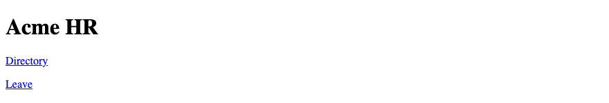
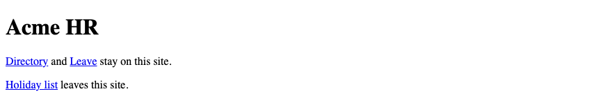
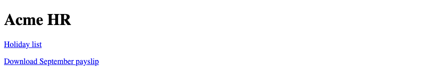
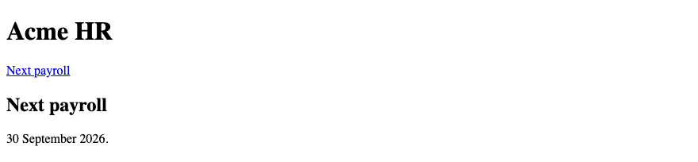
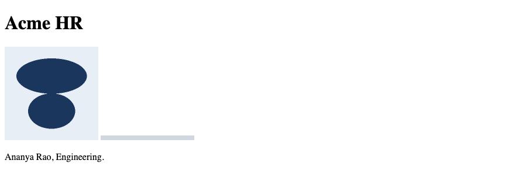
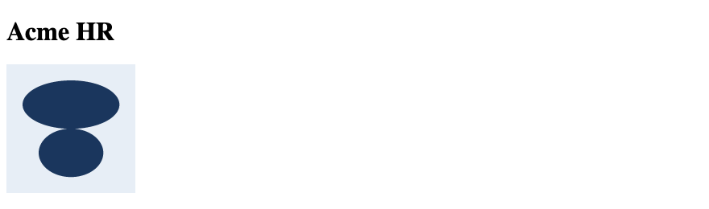
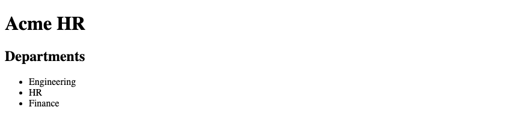
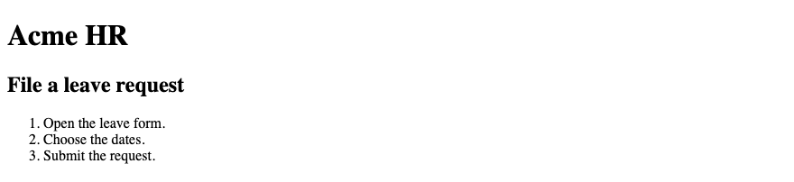
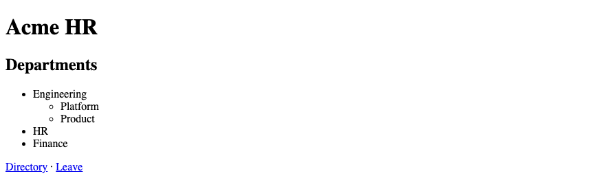

# 3. HTML — Links, Images & Lists

**Index:** [HTML tutorial](../01_HTML.md)  
**Previous:** [Text, Formatting and Attributes](Module_02_Text_Formatting_and_Attributes.md)  
**Next:** [HTML Tables](Module_04_HTML_Tables.md)

The page is Acme HR. Links go to the directory and the leave request. The photo is a member of staff. The list is the departments in the Hyderabad office.

## 1. Anchor — `<a>`

`<a>` is a link. The `href` attribute is the address. The text inside the element is the link. Write the destination in that text. "Directory" tells the reader where the link goes. "Click here" does not.

### Example

```html
<!DOCTYPE html>
<html lang="en">
<head>
  <meta charset="UTF-8">
  <meta name="viewport" content="width=device-width, initial-scale=1.0">
  <title>Acme HR — Links</title>
</head>
<body>
  <h1>Acme HR</h1>
  <p><a href="directory.html">Directory</a></p>
  <p><a href="leave.html">Leave</a></p>
</body>
</html>
```

**This will produce the following result:**



## 2. Absolute & Relative URLs

An absolute URL includes the scheme and the host, such as `https://example.com/holiday-list`. A relative URL is a path from the current page, such as `directory.html`. A path that starts with `/` starts at the host root. Pages in the same folder use a relative URL.

| URL | Kind |
|-----|------|
| `https://example.com/holiday-list` | Absolute |
| `directory.html` | Relative, same folder |
| `images/ananya.jpg` | Relative, in a subfolder |
| `/leave.html` | From the host root |

### Example

```html
<!DOCTYPE html>
<html lang="en">
<head>
  <meta charset="UTF-8">
  <meta name="viewport" content="width=device-width, initial-scale=1.0">
  <title>Acme HR — URLs</title>
</head>
<body>
  <h1>Acme HR</h1>
  <p><a href="directory.html">Directory</a></p>
  <p><a href="https://example.com/holiday-list">Holiday list</a></p>
</body>
</html>
```

**This will produce the following result:**


## 3. Internal & External Links

An internal link stays on the Acme HR site. `directory.html` and `leave.html` are internal. An external link leaves the site. The holiday list on `example.com` is external. Internal links use a relative path. External links use an absolute URL.

### Example

```html
<!DOCTYPE html>
<html lang="en">
<head>
  <meta charset="UTF-8">
  <meta name="viewport" content="width=device-width, initial-scale=1.0">
  <title>Acme HR — Internal and external</title>
</head>
<body>
  <h1>Acme HR</h1>
  <p><a href="directory.html">Directory</a> and <a href="leave.html">Leave</a> stay on this site.</p>
  <p><a href="https://example.com/holiday-list">Holiday list</a> leaves this site.</p>
</body>
</html>
```

**This will produce the following result:**



## 4. `target`, `rel` and `download`

`target="_blank"` opens the link in a new tab. Current browsers treat `_blank` as `noopener` by default, so the new page cannot reach back into this one. `rel="noreferrer"` still withholds the address of this page when you want that. Writing `rel="noopener noreferrer"` remains fine and makes the intent explicit. `download` asks the browser to save the file. A payslip PDF can use `download`.

### Example

```html
<!DOCTYPE html>
<html lang="en">
<head>
  <meta charset="UTF-8">
  <meta name="viewport" content="width=device-width, initial-scale=1.0">
  <title>Acme HR — New tab and download</title>
</head>
<body>
  <h1>Acme HR</h1>
  <p><a href="https://example.com/holiday-list" target="_blank" rel="noopener noreferrer">Holiday list</a></p>
  <p><a href="payslip-ananya.pdf" download>Download September payslip</a></p>
</body>
</html>
```

**This will produce the following result:**



## 5. Email & Telephone Links

`mailto:` opens the mail program with that address. `tel:` starts a call on a phone. The visible text can be the same address, written for a person to read. The Hyderabad office number is written with spaces. The `href` keeps the digits and the country code.

### Example

```html
<!DOCTYPE html>
<html lang="en">
<head>
  <meta charset="UTF-8">
  <meta name="viewport" content="width=device-width, initial-scale=1.0">
  <title>Acme HR — Email and phone</title>
</head>
<body>
  <h1>Acme HR</h1>
  <p><a href="mailto:hr@acme.example">hr@acme.example</a></p>
  <p><a href="tel:+914040002100">040 4000 2100</a></p>
</body>
</html>
```

**This will produce the following result:**


## 6. Fragment / Page Links

A fragment points at an `id` on the same page. The `href` is a hash plus that id. The payroll note uses `id="payroll"`. The link `href="#payroll"` scrolls to it. A link to another file can include a fragment too: `directory.html#engineering`.

### Example

```html
<!DOCTYPE html>
<html lang="en">
<head>
  <meta charset="UTF-8">
  <meta name="viewport" content="width=device-width, initial-scale=1.0">
  <title>Acme HR — Fragment</title>
</head>
<body>
  <h1>Acme HR</h1>
  <p><a href="#payroll">Next payroll</a></p>
  <h2 id="payroll">Next payroll</h2>
  <p>30 September 2026.</p>
</body>
</html>
```

**This will produce the following result:**



## 7. Image — ``

`` places a picture. It is an empty element. It is a replaced element: the pixels come from the file in `src`. The staff photo of Ananya Rao sits beside her name in the directory. The text of the page still names her. The image does not replace that text.

### Example

```html
<!DOCTYPE html>
<html lang="en">
<head>
  <meta charset="UTF-8">
  <meta name="viewport" content="width=device-width, initial-scale=1.0">
  <title>Acme HR — Staff photo</title>
</head>
<body>
  <h1>Acme HR</h1>
  <h2>Directory</h2>
  <p></p>
  <p>Ananya Rao, Engineering.</p>
</body>
</html>
```

**This will produce the following result:**


## 8. `src`, `alt`, `width`, `height`

`src` is the file path. `alt` is the text used when the image is not seen. `width` and `height` reserve a box so the page does not jump when the file arrives. Set them to the real pixel size of the file, or to the size you want the box to hold. The CSS module can scale the image. The attributes still reserve the ratio.

### Example

```html
<!DOCTYPE html>
<html lang="en">
<head>
  <meta charset="UTF-8">
  <meta name="viewport" content="width=device-width, initial-scale=1.0">
  <title>Acme HR — Image attributes</title>
</head>
<body>
  <h1>Acme HR</h1>
  
</body>
</html>
```

**This will produce the following result:**


## 9. Image Accessibility

`alt` states what the picture is for. A staff photo uses the person's name and department. A decorative image uses `alt=""`. An empty alt tells assistive technology to skip the picture. A missing alt is a gap. The photo of Ananya is informative. A divider graphic is decorative.

### Example

```html
<!DOCTYPE html>
<html lang="en">
<head>
  <meta charset="UTF-8">
  <meta name="viewport" content="width=device-width, initial-scale=1.0">
  <title>Acme HR — Alt text</title>
</head>
<body>
  <h1>Acme HR</h1>
  
  
  <p>Ananya Rao, Engineering.</p>
</body>
</html>
```

**This will produce the following result:**



## 10. `<figure>` and `<figcaption>`

`<figure>` groups a picture with its caption. `<figcaption>` is the caption. The caption can name the person and the department. `alt` still describes the photo for someone who does not see it. The caption is extra visible text, not a replacement for `alt`.

### Example

```html
<!DOCTYPE html>
<html lang="en">
<head>
  <meta charset="UTF-8">
  <meta name="viewport" content="width=device-width, initial-scale=1.0">
  <title>Acme HR — Figure</title>
</head>
<body>
  <h1>Acme HR</h1>
  <figure>
    
    <figcaption>Ananya Rao, Engineering, E-1042</figcaption>
  </figure>
</body>
</html>
```

**This will produce the following result:**


## 11. Responsive Images — `<picture>`, `<source>`, `srcset`

`srcset` lists files and their widths. `sizes` tells the browser how wide the image will be on the page. The browser picks a file. `<picture>` wraps that image when the art direction changes. Each `<source>` can carry a `media` condition. The `` inside `<picture>` is the fallback, and it still has `alt`.

### Example

```html
<!DOCTYPE html>
<html lang="en">
<head>
  <meta charset="UTF-8">
  <meta name="viewport" content="width=device-width, initial-scale=1.0">
  <title>Acme HR — Responsive image</title>
</head>
<body>
  <h1>Acme HR</h1>
  <picture>
    <source media="(min-width: 40rem)" srcset="images/ananya-wide.jpg">
    
  </picture>
</body>
</html>
```

**This will produce the following result:**



## 12. Unordered List — `<ul>`, `<li>`

`<ul>` is a list with no order. Each item is an `<li>`. The departments in the Hyderabad office have no ranking, so they are an unordered list. Do not build a list from paragraphs and dashes.

### Example

```html
<!DOCTYPE html>
<html lang="en">
<head>
  <meta charset="UTF-8">
  <meta name="viewport" content="width=device-width, initial-scale=1.0">
  <title>Acme HR — Departments</title>
</head>
<body>
  <h1>Acme HR</h1>
  <h2>Departments</h2>
  <ul>
    <li>Engineering</li>
    <li>HR</li>
    <li>Finance</li>
  </ul>
</body>
</html>
```

**This will produce the following result:**



## 13. Ordered List — `<ol>`, `<li>`

`<ol>` is a list with an order. The browser numbers the items. The steps to file a leave request are an ordered list. The number is the sequence, not a decoration you type yourself.

### Example

```html
<!DOCTYPE html>
<html lang="en">
<head>
  <meta charset="UTF-8">
  <meta name="viewport" content="width=device-width, initial-scale=1.0">
  <title>Acme HR — Leave steps</title>
</head>
<body>
  <h1>Acme HR</h1>
  <h2>File a leave request</h2>
  <ol>
    <li>Open the leave form.</li>
    <li>Choose the dates.</li>
    <li>Submit the request.</li>
  </ol>
</body>
</html>
```

**This will produce the following result:**



## 14. Description List — `<dl>`, `<dt>`, `<dd>`

`<dl>` is a list of names and values. `<dt>` is the name. `<dd>` is the value. An employee record is a description list: id, department, and gross pay. It is not a table. A payslip with rows of money is a table, in the next module.

### Example

```html
<!DOCTYPE html>
<html lang="en">
<head>
  <meta charset="UTF-8">
  <meta name="viewport" content="width=device-width, initial-scale=1.0">
  <title>Acme HR — Employee facts</title>
</head>
<body>
  <h1>Acme HR</h1>
  <h2>Ananya Rao</h2>
  <dl>
    <dt>Employee ID</dt>
    <dd>E-1042</dd>
    <dt>Department</dt>
    <dd>Engineering</dd>
    <dt>Gross pay</dt>
    <dd>₹85,000</dd>
  </dl>
</body>
</html>
```

**This will produce the following result:**


## 15. Nested Lists

A list item can contain another list. The inner list sits inside the `<li>`, after the item's text. Engineering has two teams. The teams are a nested unordered list under that department. Keep the nesting to what a reader can follow.

### Example

```html
<!DOCTYPE html>
<html lang="en">
<head>
  <meta charset="UTF-8">
  <meta name="viewport" content="width=device-width, initial-scale=1.0">
  <title>Acme HR — Nested departments</title>
</head>
<body>
  <h1>Acme HR</h1>
  <h2>Departments</h2>
  <ul>
    <li>Engineering
      <ul>
        <li>Platform</li>
        <li>Product</li>
      </ul>
    </li>
    <li>HR</li>
    <li>Finance</li>
  </ul>
  <p><a href="directory.html">Directory</a> · <a href="leave.html">Leave</a></p>
</body>
</html>
```

**This will produce the following result:**


