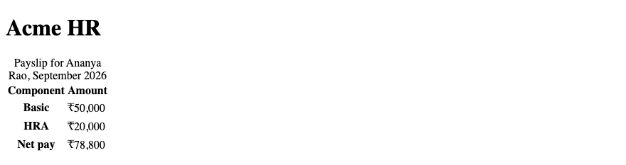
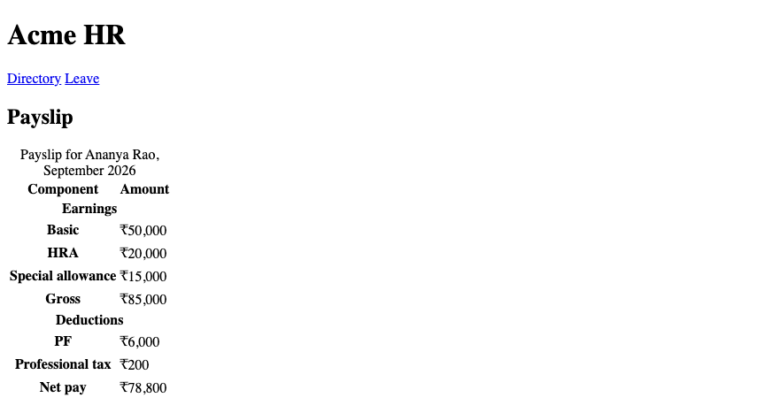
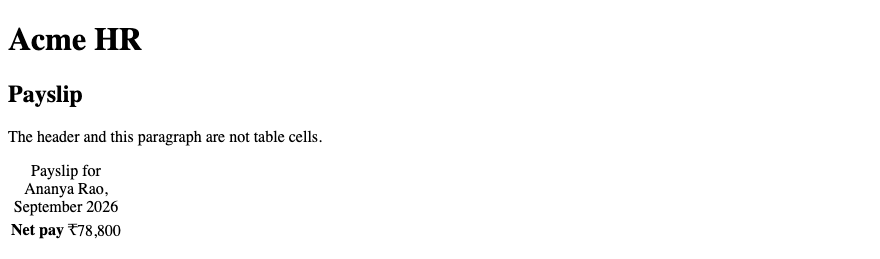

# 4. HTML — HTML Tables

**Index:** [HTML tutorial](../01_HTML.md)  
**Previous:** [Links, Images and Lists](Module_03_Links_Images_and_Lists.md)  
**Next:** [HTML Forms](Module_05_HTML_Forms.md)

The table in this module is a payslip for Ananya Rao. Amounts are in ₹. September 2026. The CSS module styles this table. The markup here is the data.

## 1. Introduction to HTML Tables

A table is data in rows and columns. A payslip is that kind of data: a label and an amount on each row. The directory page is not a table. Cards and headings lay out a page. A table lays out a grid of facts.

### Example

```html
<!DOCTYPE html>
<html lang="en">
<head>
  <meta charset="UTF-8">
  <meta name="viewport" content="width=device-width, initial-scale=1.0">
  <title>Acme HR — Payslip</title>
</head>
<body>
  <header>
    <h1>Acme HR</h1>
  </header>
  <main>
    <h2>Payslip</h2>
    <p>Ananya Rao, September 2026.</p>
  </main>
</body>
</html>
```

**This will produce the following result:**


## 2. `<table>`

`<table>` wraps the rows. The browser lines the cells up. Put the payslip in `<main>`, after a heading. The heading is not inside the table. The table's own name is the caption, in the next section.

### Example

```html
<!DOCTYPE html>
<html lang="en">
<head>
  <meta charset="UTF-8">
  <meta name="viewport" content="width=device-width, initial-scale=1.0">
  <title>Acme HR — Table</title>
</head>
<body>
  <header>
    <h1>Acme HR</h1>
  </header>
  <main>
    <h2>Payslip</h2>
    <table>
      <tr>
        <td>Basic</td>
        <td>₹50,000</td>
      </tr>
    </table>
  </main>
</body>
</html>
```

**This will produce the following result:**


## 3. `<caption>`

`<caption>` is the name of the table. It is the first element inside `<table>`. Screen readers announce it before the rows. The payslip caption names the employee and the month. The page still has one `<h1>`, Acme HR, and an `<h2>` for the section.

### Example

```html
<!DOCTYPE html>
<html lang="en">
<head>
  <meta charset="UTF-8">
  <meta name="viewport" content="width=device-width, initial-scale=1.0">
  <title>Acme HR — Caption</title>
</head>
<body>
  <header>
    <h1>Acme HR</h1>
  </header>
  <main>
    <h2>Payslip</h2>
    <table>
      <caption>Payslip for Ananya Rao, September 2026</caption>
      <tr>
        <td>Basic</td>
        <td>₹50,000</td>
      </tr>
    </table>
  </main>
</body>
</html>
```

**This will produce the following result:**


## 4. `<tr>`, `<th>`, `<td>`

`<tr>` is a row. `<th>` is a header cell. `<td>` is a data cell. Header cells name the column or the row. Data cells hold the amounts. Use `<th>` for "Basic" when that cell labels the amount beside it.

### Example

```html
<!DOCTYPE html>
<html lang="en">
<head>
  <meta charset="UTF-8">
  <meta name="viewport" content="width=device-width, initial-scale=1.0">
  <title>Acme HR — Cells</title>
</head>
<body>
  <header>
    <h1>Acme HR</h1>
  </header>
  <main>
    <table>
      <caption>Payslip for Ananya Rao, September 2026</caption>
      <tr>
        <th>Component</th>
        <th>Amount</th>
      </tr>
      <tr>
        <th>Basic</th>
        <td>₹50,000</td>
      </tr>
    </table>
  </main>
</body>
</html>
```

**This will produce the following result:**


## 5. `<thead>`, `<tbody>`, `<tfoot>`

`<thead>` holds the column headings. `<tbody>` holds the line items. `<tfoot>` holds the summary, such as net pay. The browser may repeat the head when a long table prints. Keep net pay in the footer so it stays the total, not one more earning.

### Example

```html
<!DOCTYPE html>
<html lang="en">
<head>
  <meta charset="UTF-8">
  <meta name="viewport" content="width=device-width, initial-scale=1.0">
  <title>Acme HR — Table sections</title>
</head>
<body>
  <header>
    <h1>Acme HR</h1>
  </header>
  <main>
    <table>
      <caption>Payslip for Ananya Rao, September 2026</caption>
      <thead>
        <tr>
          <th>Component</th>
          <th>Amount</th>
        </tr>
      </thead>
      <tbody>
        <tr>
          <th>Basic</th>
          <td>₹50,000</td>
        </tr>
        <tr>
          <th>HRA</th>
          <td>₹20,000</td>
        </tr>
      </tbody>
      <tfoot>
        <tr>
          <th>Net pay</th>
          <td>₹78,800</td>
        </tr>
      </tfoot>
    </table>
  </main>
</body>
</html>
```

**This will produce the following result:**



## 6. `colspan` and `rowspan`

`colspan` stretches a cell across columns. `rowspan` stretches it across rows. A row that only says "Earnings" spans both columns. The cells it covers are omitted from that row. Count the columns so each row still adds up to the same width.

### Example

```html
<!DOCTYPE html>
<html lang="en">
<head>
  <meta charset="UTF-8">
  <meta name="viewport" content="width=device-width, initial-scale=1.0">
  <title>Acme HR — Span</title>
</head>
<body>
  <header>
    <h1>Acme HR</h1>
  </header>
  <main>
    <table>
      <caption>Payslip for Ananya Rao, September 2026</caption>
      <thead>
        <tr>
          <th>Component</th>
          <th>Amount</th>
        </tr>
      </thead>
      <tbody>
        <tr>
          <th colspan="2">Earnings</th>
        </tr>
        <tr>
          <th>Basic</th>
          <td>₹50,000</td>
        </tr>
      </tbody>
    </table>
  </main>
</body>
</html>
```

**This will produce the following result:**


## 7. `scope` and Accessible Tables

`scope` tells which cells a header labels. `scope="col"` means the column under that header. `scope="row"` means the row beside that header. The amount column uses `scope="col"`. "Basic" uses `scope="row"`. A caption names the table. Together, a screen reader can say "Basic, ₹50,000" instead of a bare number.

| Attribute | Payslip use |
|-----------|-------------|
| `scope="col"` | Component, Amount |
| `scope="row"` | Basic, HRA, Net pay |
| `<caption>` | Who the payslip is for, and which month |

### Example

```html
<!DOCTYPE html>
<html lang="en">
<head>
  <meta charset="UTF-8">
  <meta name="viewport" content="width=device-width, initial-scale=1.0">
  <title>Acme HR — Scope</title>
</head>
<body>
  <header>
    <h1>Acme HR</h1>
  </header>
  <main>
    <table>
      <caption>Payslip for Ananya Rao, September 2026</caption>
      <thead>
        <tr>
          <th scope="col">Component</th>
          <th scope="col">Amount</th>
        </tr>
      </thead>
      <tbody>
        <tr>
          <th scope="row">Basic</th>
          <td>₹50,000</td>
        </tr>
      </tbody>
    </table>
  </main>
</body>
</html>
```

**This will produce the following result:**


## 8. Real-World Data Tables

This is the September payslip. Basic ₹50,000, HRA ₹20,000, and special allowance ₹15,000 make a gross of ₹85,000. PF ₹6,000 and professional tax ₹200 leave a net pay of ₹78,800. Earnings and deductions each sit in their own `<tbody>`. The group title is a row header with `scope="rowgroup"`. Do not use `scope="colgroup"` here: there is no `<colgroup>`, and these titles label rows, not columns.

### Example

```html
<!DOCTYPE html>
<html lang="en">
<head>
  <meta charset="UTF-8">
  <meta name="viewport" content="width=device-width, initial-scale=1.0">
  <title>Acme HR — September payslip</title>
</head>
<body>
  <header>
    <h1>Acme HR</h1>
    <nav>
      <a href="directory.html">Directory</a>
      <a href="leave.html">Leave</a>
    </nav>
  </header>
  <main>
    <h2>Payslip</h2>
    <table>
      <caption>Payslip for Ananya Rao, September 2026</caption>
      <thead>
        <tr>
          <th scope="col">Component</th>
          <th scope="col">Amount</th>
        </tr>
      </thead>
      <tbody>
        <tr>
          <th colspan="2" scope="rowgroup">Earnings</th>
        </tr>
        <tr>
          <th scope="row">Basic</th>
          <td>₹50,000</td>
        </tr>
        <tr>
          <th scope="row">HRA</th>
          <td>₹20,000</td>
        </tr>
        <tr>
          <th scope="row">Special allowance</th>
          <td>₹15,000</td>
        </tr>
        <tr>
          <th scope="row">Gross</th>
          <td>₹85,000</td>
        </tr>
      </tbody>
      <tbody>
        <tr>
          <th colspan="2" scope="rowgroup">Deductions</th>
        </tr>
        <tr>
          <th scope="row">PF</th>
          <td>₹6,000</td>
        </tr>
        <tr>
          <th scope="row">Professional tax</th>
          <td>₹200</td>
        </tr>
      </tbody>
      <tfoot>
        <tr>
          <th scope="row">Net pay</th>
          <td>₹78,800</td>
        </tr>
      </tfoot>
    </table>
  </main>
</body>
</html>
```

**This will produce the following result:**



## 9. Tables vs Page Layout

Use a table for the payslip. Do not use a table to place the header, the directory, and the leave form. Those regions are header, main, and sections. CSS Flexbox and Grid place them. A table read aloud becomes a grid of cells. A layout table would announce the whole page that way.

### Example

```html
<!DOCTYPE html>
<html lang="en">
<head>
  <meta charset="UTF-8">
  <meta name="viewport" content="width=device-width, initial-scale=1.0">
  <title>Acme HR — Data table</title>
</head>
<body>
  <header>
    <h1>Acme HR</h1>
  </header>
  <main>
    <h2>Payslip</h2>
    <p>The header and this paragraph are not table cells.</p>
    <table>
      <caption>Payslip for Ananya Rao, September 2026</caption>
      <tr>
        <th scope="row">Net pay</th>
        <td>₹78,800</td>
      </tr>
    </table>
  </main>
</body>
</html>
```

**This will produce the following result:**


