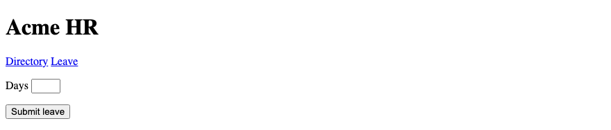

# 5. HTML — HTML Forms

**Index:** [HTML tutorial](../01_HTML.md)  
**Previous:** [HTML Tables](Module_04_HTML_Tables.md)  
**Next:** [Semantic HTML](Module_06_Semantic_HTML.md)

The leave request is the running example. Controls need a `name` so the server can read them. HTML forms only support `GET` and `POST`. Browser checks are a convenience — Django and Spring must validate again.

**How to read this module.** The full page shell appears once below. Later examples are fragments you drop into `<main>`. Each topic follows the same block: concept → example → common bug → DevTools → backend → try it → interview.

### Page shell (once)

```html
<!DOCTYPE html>
<html lang="en">
<head>
  <meta charset="UTF-8">
  <meta name="viewport" content="width=device-width, initial-scale=1.0">
  <title>Acme HR — Leave request</title>
</head>
<body>
  <header>
    <h1>Acme HR</h1>
    <nav>
      <a href="directory.html">Directory</a>
      <a href="leave.html">Leave</a>
    </nav>
  </header>
  <main>
    <!-- topic fragments go here -->
  </main>
</body>
</html>
```

## 1. Introduction to HTML Forms

A form is a named packet of fields the browser sends to a URL. The leave request collects type, dates, and reason so HR can create a record. Each control’s `name` becomes a key in that packet. Without `name`, the value never leaves the browser. The visitor sees labels and buttons; the server only sees names and values.

### Example

```html
<h2>Leave request</h2>
<form action="/leave" method="post">
  <input type="hidden" name="csrfmiddlewaretoken" value="…">
  <p>
    <label for="employee">Employee</label>
    <input id="employee" name="employee" type="text" required>
  </p>
  <button type="submit">Submit leave</button>
</form>
```

**This will produce the following result:**


⚠ **Common bug:** A beautiful form with no `name` on the inputs. Symptom: Network shows an empty body or only the CSRF field. Fix: every value you need on the server gets `name="…"`.

🔍 **DevTools:** Submit once, open **Network**, click the `/leave` request, read **Payload** / **Form Data**.

🔗 **Backend:** Django `request.POST.get("employee")`. Spring `@RequestParam String employee` or a `@ModelAttribute` DTO field named `employee`.

✍ **Try it:** Basic — add a `reason` text field with `name="reason"`. Stretch — open Network and list every name that was sent.

💬 **Interview:** Why does a control without `name` never reach the server?

## 2. `<form>`

`<form>` groups the controls that belong to one submit. Controls outside that form are ignored when it submits. One leave request is one form. A directory search is a second form with its own `action` and `method`. Nested forms are invalid — the parser silently “fixes” them and you get confusing submits.

### Example

```html
<form action="/leave" method="post">
  <input type="hidden" name="csrfmiddlewaretoken" value="…">
  <p>
    <label for="employee">Employee</label>
    <input id="employee" name="employee" type="text">
  </p>
  <button type="submit">Submit leave</button>
</form>
```

**This will produce the following result:**


⚠ **Common bug:** A second `<form>` inside the first. Symptom: only some buttons work; markup validators complain. Fix: sibling forms, never nested.

🔍 **DevTools:** In **Elements**, confirm which inputs sit under which `<form>` node.

🔗 **Backend:** One form → one view or controller method. Map `action` to the route (`path("leave/", …)` / `@PostMapping("/leave")`).

✍ **Try it:** Basic — put a search `<form method="get">` next to the leave form. Stretch — deliberately nest forms, validate the page, and note what the browser tree shows.

💬 **Interview:** What happens if you nest two `<form>` elements?

## 3. `action` and `method`

`action` is the URL that receives the submit. `method="post"` puts fields in the request body — use it when the submit creates or changes data (leave request). `method="get"` puts fields in the query string — use it for searches you want to bookmark or share. HTML cannot send `PUT` or `DELETE` from a plain form; those need JavaScript or a framework helper.

### Example

```html
<form action="/leave" method="post">
  <input type="hidden" name="csrfmiddlewaretoken" value="…">
  <p>
    <label for="employee">Employee</label>
    <input id="employee" name="employee" type="text">
  </p>
  <button type="submit">Submit leave</button>
</form>
```

**This will produce the following result:**


⚠ **Common bug:** Using `GET` for a leave create. Symptom: the request lands in logs and browser history with personal data in the URL. Fix: `method="post"` for creates and updates.

🔍 **DevTools:** Network → check the request method and whether names appear under **Query String Parameters** or **Form Data**.

🔗 **Backend:** Django `@require_POST` / `LoginRequiredMixin`. Spring `@PostMapping("/leave")`. After a successful POST, redirect (POST-Redirect-GET) so refresh does not resubmit.

✍ **Try it:** Basic — change leave to `get` and watch the address bar. Stretch — after a fake success page, explain why a redirect is better than rendering HTML from the POST.

💬 **Interview:** When do you choose GET over POST for a form?

## 4. `<label>`

A label names a control for sighted users and for assistive tech. Prefer `<label for="id">` matching the control’s `id`. Clicking the label focuses the control. A control without a proper label is a common accessibility failure and a common support ticket (“I don’t know what this box is”).

### Example

```html
<form action="/leave" method="post">
  <input type="hidden" name="csrfmiddlewaretoken" value="…">
  <p>
    <label for="reason">Reason</label>
    <input id="reason" name="reason" type="text">
  </p>
  <button type="submit">Submit leave</button>
</form>
```

**This will produce the following result:**


⚠ **Common bug:** Placeholder used as the only label. Symptom: empty field shows no name; screen readers get a poor name. Fix: visible `<label>`; placeholder is a hint only.

🔍 **DevTools:** **Accessibility** pane → check the control’s **Name** comes from the label.

🔗 **Backend:** Labels are HTML-only. Server error text should point at the same field name (`reason`) when you re-render the form.

✍ **Try it:** Basic — wire `for`/`id` for three fields. Stretch — break the `id`, open the Accessibility tree, and fix it.

💬 **Interview:** Why is a placeholder not a substitute for a `<label>`?

## 5. `<input>`

`<input>` is a single-line control whose behaviour comes from `type`. Default `type` is `text`. Always set `type` on purpose: it changes the keyboard on phones, the browser check, and sometimes the widget (date, file, checkbox). Pair every input with a label and a `name`.

### Example

```html
<form action="/leave" method="post">
  <input type="hidden" name="csrfmiddlewaretoken" value="…">
  <p>
    <label for="employee">Employee</label>
    <input id="employee" name="employee" type="text">
  </p>
  <button type="submit">Submit leave</button>
</form>
```

**This will produce the following result:**


⚠ **Common bug:** Wrong `type` (plain `text` for email). Symptom: no format check; wrong mobile keyboard. Fix: use the matching type (`email`, `number`, `date`, …).

🔍 **DevTools:** Inspect the input → **Properties** / attributes; confirm `type` and `name`.

🔗 **Backend:** Type hints the UI only. Still validate types and ranges in Django forms / Bean Validation.

✍ **Try it:** Basic — add `type="email"` for work email. Stretch — list three types you would refuse to fake with `text`.

💬 **Interview:** What does `type` change besides appearance?

## 6. Text & Password Inputs

`type="text"` is ordinary text. `type="password"` hides glyphs but still sends plain text over HTTP unless the page is HTTPS — masking is not encryption. Use `autocomplete` values the browser understands (`username`, `current-password`, `new-password`) so password managers fill the right box.

### Example

```html
<form action="/login" method="post">
  <input type="hidden" name="csrfmiddlewaretoken" value="…">
  <p>
    <label for="username">Username</label>
    <input id="username" name="username" type="text" autocomplete="username">
  </p>
  <p>
    <label for="password">Password</label>
    <input id="password" name="password" type="password" autocomplete="current-password">
  </p>
  <button type="submit">Sign in</button>
</form>
```

**This will produce the following result:**


⚠ **Common bug:** `autocomplete="off"` on a login form “for security”. Symptom: users reuse weak passwords or mistype; managers cannot help. Fix: use the standard autocomplete tokens.

🔍 **DevTools:** Network → confirm `password` appears in form data on HTTPS only in real apps (never log it).

🔗 **Backend:** Django `AuthenticationForm`. Spring Security login processing URL. Never echo the password back into HTML.

✍ **Try it:** Basic — build a two-field login fragment. Stretch — add `autocomplete="new-password"` on a “set password” field and explain the difference.

💬 **Interview:** Does `type="password"` encrypt the value on the wire?

## 7. Email, URL, Tel & Search Inputs

`email`, `url`, `tel`, and `search` give better keyboards and light browser checks. `email` expects an email shape. `url` expects a full URL. `tel` does not enforce a world-wide format. `search` is for queries — often on a `GET` form. Use them when the data really is that kind of value.

### Example

```html
<form action="/leave" method="post">
  <input type="hidden" name="csrfmiddlewaretoken" value="…">
  <p>
    <label for="email">Work email</label>
    <input id="email" name="email" type="email" autocomplete="email" required>
  </p>
  <p>
    <label for="policy">Policy link</label>
    <input id="policy" name="policy_url" type="url" placeholder="https://">
  </p>
  <p>
    <label for="phone">Mobile</label>
    <input id="phone" name="phone" type="tel" autocomplete="tel">
  </p>
</form>

<form action="/directory" method="get">
  <p>
    <label for="q">Find an employee</label>
    <input id="q" name="q" type="search">
  </p>
  <button type="submit">Search</button>
</form>
```

**This will produce the following result:**


⚠ **Common bug:** Trusting `type="email"` alone. Symptom: `a@b` may pass some browsers; garbage still hits the server. Fix: server-side email validation.

🔍 **DevTools:** Try an invalid email and watch the browser’s validation message before any request appears in Network.

🔗 **Backend:** Django `EmailField`. Spring `@Email` on the DTO. Search: `request.GET["q"]` / `@RequestParam String q`.

✍ **Try it:** Basic — add email + search forms. Stretch — submit `not-an-email` and note whether Network logged a request.

💬 **Interview:** Why can `type="tel"` not fully validate phone numbers?

## 8. Number, Date & Time Inputs

`number` is for numeric values with optional `min`, `max`, and `step`. `date`, `time`, and `datetime-local` give a picker where the browser supports it. The value format is ISO-like (`2026-10-06`), not whatever the locale displays. Always validate again on the server — the user can edit the DOM.

### Example

```html
<form action="/leave" method="post">
  <input type="hidden" name="csrfmiddlewaretoken" value="…">
  <p>
    <label for="days">Days</label>
    <input id="days" name="days" type="number" min="1" max="30" step="1" required>
  </p>
  <p>
    <label for="start">From</label>
    <input id="start" name="start" type="date" required>
  </p>
  <button type="submit">Submit leave</button>
</form>
```

**This will produce the following result:**


⚠ **Common bug:** Parsing the displayed date string in your own JS (`dd/mm/yyyy`). Symptom: off-by-one and locale bugs. Fix: read the input’s `.value` (ISO) or let the form submit it.

🔍 **DevTools:** Set a date, submit, read the raw value in the Network payload.

🔗 **Backend:** Django `DateField` / `IntegerField`. Spring `LocalDate` / `Integer` with `@Min` / `@Max`.

✍ **Try it:** Basic — days 1–30 and a start date. Stretch — set `min` on the date to today via a tiny script or a server-rendered attribute.

💬 **Interview:** What value format does `type="date"` submit?

## 9. Radio & Checkbox

Radios share a `name` so only one value in the group is sent. Checkboxes send their `value` only when checked — an unchecked box sends **nothing**, not `false`. If several checkboxes share a name, the server may receive multiple values for that name. Defaults belong in careful UX; silence is not “no”.

### Example

```html
<form action="/leave" method="post">
  <input type="hidden" name="csrfmiddlewaretoken" value="…">
  <fieldset>
    <legend>Duration</legend>
    <p>
      <input id="span-full" name="span" type="radio" value="full" checked>
      <label for="span-full">Full day</label>
    </p>
    <p>
      <input id="span-half" name="span" type="radio" value="half">
      <label for="span-half">Half day</label>
    </p>
  </fieldset>
  <p>
    <input id="cert-ack" name="cert_ack" type="checkbox" value="yes">
    <label for="cert-ack">I will upload a certificate if asked</label>
  </p>
  <button type="submit">Submit leave</button>
</form>
```

**This will produce the following result:**


⚠ **Common bug:** Expecting `cert_ack=false` when unchecked. Symptom: key missing in `request.POST` / `@RequestParam` optional empty. Fix: treat missing as unchecked.

🔍 **DevTools:** Submit twice — once checked, once not — and compare Form Data.

🔗 **Backend:** Django: `'cert_ack' in request.POST`. Spring: `Optional` / default `false` when the parameter is absent. Multiple values: `getlist("dept")` / `String[]`.

✍ **Try it:** Basic — two radios + one checkbox. Stretch — three checkboxes named `notify` and read all values on the server (or in Network).

💬 **Interview:** What does an unchecked checkbox contribute to the submitted form?

## 10. File Input

`type="file"` selects a file from disk. The form **must** use `enctype="multipart/form-data"` or the file is not sent. `accept` is a hint, not security — the server must check type and size. One file control sends one file unless `multiple` is set.

### Example

```html
<form action="/leave" method="post" enctype="multipart/form-data">
  <input type="hidden" name="csrfmiddlewaretoken" value="…">
  <p>
    <label for="certificate">Medical certificate</label>
    <input id="certificate" name="certificate" type="file" accept=".pdf,application/pdf">
  </p>
  <button type="submit">Submit leave</button>
</form>
```

**This will produce the following result:**


⚠ **Common bug:** File field with default `enctype`. Symptom: filename missing; server sees no upload. Fix: `enctype="multipart/form-data"` on that form.

🔍 **DevTools:** Network → request payload should be multipart sections, not a simple urlencoded body.

🔗 **Backend:** Django `request.FILES["certificate"]`. Spring `MultipartFile certificate`. Configure size limits in both stacks.

✍ **Try it:** Basic — add the file field and enctype. Stretch — omit enctype, submit a PDF, and describe what Network shows.

💬 **Interview:** Why does a file input require a different `enctype`?

## 11. Hidden Input

`type="hidden"` is still in the HTML source. Anyone can read or change it. Do not store secrets there. Do not treat a hidden `employee_id` as proof of who is logged in — the server must take identity from the session.

The usual legitimate hidden field on every Django/Spring POST is the **CSRF token**. Without it those frameworks respond with **403**.

### Example

```html
<p>Signed in as Ananya Rao (E-1042). The server reads the employee from the session.</p>
<form action="/leave" method="post">
  <!-- Django:  -->
  <!-- Spring: th:name="${_csrf.parameterName}" th:value="${_csrf.token}" -->
  <input type="hidden" name="csrfmiddlewaretoken" value="…">
  <p>
    <label for="reason">Reason</label>
    <input id="reason" name="reason" type="text">
  </p>
  <button type="submit">Submit leave</button>
</form>
```

**This will produce the following result:**


⚠ **Common bug:** POST without CSRF under Django/Spring. Symptom: 403 Forbidden. Fix: `` or the Spring `_csrf` hidden fields.

🔍 **DevTools:** View source / Elements → find the hidden token; Network → confirm it is posted.

🔗 **Backend:** Django middleware + ``. Spring Security CSRF + Thymeleaf `_csrf`. SPA/API apps use header tokens instead of form fields.

✍ **Try it:** Basic — add a CSRF hidden field to a POST form. Stretch — remove it and explain what a 403 means for the trainee.

💬 **Interview:** Why is a hidden `employee_id` not authorization?

## 12. Submit, Reset & Button

A `<button>` inside a form defaults to `submit`. Always set `type` explicitly: `submit`, `reset`, or `button`. Use `<button type="submit">` for send, `type="button">` for script-only actions (open a dialog), and avoid `reset` in real apps — it wipes the form with one click. A link (`<a>`) navigates; it does not submit. Do not use `href="#"` as a fake button.

### Example

```html
<form action="/leave" method="post">
  <input type="hidden" name="csrfmiddlewaretoken" value="…">
  <p>
    <label for="reason">Reason</label>
    <input id="reason" name="reason" type="text">
  </p>
  <button type="submit" name="action" value="submit">Submit leave</button>
  <button type="button" id="open-confirm">Review leave</button>
</form>
```

**This will produce the following result:**


⚠ **Common bug:** `<button>Cancel</button>` with no `type` inside a form. Symptom: Cancel submits the leave request. Fix: `type="button"` (or move it outside the form).

🔍 **DevTools:** Watch Network while clicking each button; only submit should create the request.

🔗 **Backend:** Named submit buttons appear as extra POST keys (`action=submit`). Useful when one form has “Save draft” and “Submit”.

✍ **Try it:** Basic — give every button an explicit `type`. Stretch — add a second submit button with a different `value`.

💬 **Interview:** What is the default `type` of `<button>` inside a form?

## 13. `<textarea>`

`<textarea>` is multi-line text with an end tag. The initial value is the text between the tags, not a `value` attribute. `rows` hints at height. `name` is still required if the reason should be submitted.

### Example

```html
<form action="/leave" method="post">
  <input type="hidden" name="csrfmiddlewaretoken" value="…">
  <p>
    <label for="reason">Reason</label>
    <textarea id="reason" name="reason" rows="4"></textarea>
  </p>
  <button type="submit">Submit leave</button>
</form>
```

**This will produce the following result:**


⚠ **Common bug:** Writing `<textarea value="…">`. Symptom: ignored; field empty. Fix: put the text between the tags.

🔍 **DevTools:** Edit the text, submit, confirm the payload length matches what you typed.

🔗 **Backend:** Ordinary string field. Enforce `min_length` / `@Size` on the server even if the browser has `minlength`.

✍ **Try it:** Basic — reason with four rows. Stretch — prefill a draft reason between the tags from the server template.

💬 **Interview:** How do you set the initial text of a `<textarea>`?

## 14. `<select>`, `<option>`, `<optgroup>`

A select sends the chosen option’s `value`. For `required` to work, include an empty first option (`value=""`). If every option already has a value, the control always has a value and `required` never blocks. `optgroup` labels a group; it is not itself submitted.

### Example

```html
<form action="/leave" method="post">
  <input type="hidden" name="csrfmiddlewaretoken" value="…">
  <p>
    <label for="leave-type">Leave type</label>
    <select id="leave-type" name="leave_type" required>
      <option value="">Choose a type</option>
      <optgroup label="Paid">
        <option value="casual">Casual</option>
        <option value="earned">Earned</option>
      </optgroup>
    </select>
  </p>
  <button type="submit">Submit leave</button>
</form>
```

**This will produce the following result:**


⚠ **Common bug:** `required` select with no empty option. Symptom: user can submit the first real option without choosing. Fix: `<option value="">…</option>` first.

🔍 **DevTools:** Submit with “Choose a type” selected; confirm the browser blocks and Network stays quiet.

🔗 **Backend:** Compare against an allow-list (`casual`, `earned`). Never trust an arbitrary string from the client.

✍ **Try it:** Basic — required select with empty first option. Stretch — add Sick under an Unpaid group.

💬 **Interview:** Why does a required `<select>` need an empty first option?

## 15. `<fieldset>` and `<legend>`

`fieldset` groups related controls. `legend` names the group for everyone, including screen readers. Use it for radio sets, address blocks, or “Duration” on the leave form. Do not use a fieldset only for a border — the legend is the point.

### Example

```html
<form action="/leave" method="post">
  <input type="hidden" name="csrfmiddlewaretoken" value="…">
  <fieldset>
    <legend>Duration</legend>
    <p>
      <input id="span-full" name="span" type="radio" value="full" checked>
      <label for="span-full">Full day</label>
    </p>
    <p>
      <input id="span-half" name="span" type="radio" value="half">
      <label for="span-half">Half day</label>
    </p>
  </fieldset>
  <button type="submit">Submit leave</button>
</form>
```

**This will produce the following result:**


⚠ **Common bug:** Radios without a fieldset/legend. Symptom: screen reader announces loose buttons with no group name. Fix: wrap with legend “Duration”.

🔍 **DevTools:** Accessibility tree → fieldset exposes the legend as the group name.

🔗 **Backend:** Grouping is HTML-only; names inside still map one-to-one to POST keys.

✍ **Try it:** Basic — wrap duration radios. Stretch — nest is usually wrong; keep one level and say why.

💬 **Interview:** What does `<legend>` provide that a heading inside the form does not?

## 16. `<datalist>`

`datalist` offers suggestions for an input while still allowing other values. Hook it with `list="datalist-id"`. It is not a replacement for `<select>` when the value must be one of a fixed set.

### Example

```html
<form action="/leave" method="post">
  <input type="hidden" name="csrfmiddlewaretoken" value="…">
  <p>
    <label for="team">Team</label>
    <input id="team" name="team" type="text" list="teams">
    <datalist id="teams">
      <option value="Engineering"></option>
      <option value="HR"></option>
      <option value="Finance"></option>
    </datalist>
  </p>
  <button type="submit">Submit leave</button>
</form>
```

**This will produce the following result:**


⚠ **Common bug:** Using datalist when only three legal values exist. Symptom: user types a fourth value; server must reject. Fix: `<select>` for closed sets.

🔍 **DevTools:** Confirm `list` points at the datalist `id`.

🔗 **Backend:** Still validate against allowed teams if the set is closed; datalist does not enforce.

✍ **Try it:** Basic — team suggestions. Stretch — explain when you would switch this to a select.

💬 **Interview:** How is `<datalist>` different from `<select>`?

## 17. `<output>`

`<output>` shows a result calculated in the page (for example days between two dates). It can take a `name` and be submitted, but many apps keep it display-only and recompute on the server. Use it when the visible result should be part of the document semantics.

### Example

```html
<form action="/leave" method="post" id="leave-form">
  <input type="hidden" name="csrfmiddlewaretoken" value="…">
  <p>
    <label for="days">Days</label>
    <input id="days" name="days" type="number" min="1" value="1">
  </p>
  <p>
    Remaining after request:
    <output name="remaining" for="days">11</output>
  </p>
  <button type="submit">Submit leave</button>
</form>
```

**This will produce the following result:**


⚠ **Common bug:** Trusting a client-calculated remaining balance. Symptom: user edits the DOM and “grants” extra leave. Fix: server recomputes balance.

🔍 **DevTools:** Edit the output text in Elements; submit; confirm the server ignores forged display values.

🔗 **Backend:** Authoritative balance lives in the database; HTML output is UX only.

✍ **Try it:** Basic — show an `<output>` beside days. Stretch — wire a tiny script that updates it when days change, then argue why the server still decides.

💬 **Interview:** Should leave balance be trusted from an `<output>` field?

## 18. Form Attributes

Useful form-level attributes: `action`, `method`, `enctype`, `autocomplete`, `novalidate`. `novalidate` turns off browser checks — useful for testing server errors, dangerous in production pages. `autocomplete` on the form sets a default for controls inside it.

### Example

```html
<form action="/leave" method="post" enctype="multipart/form-data" autocomplete="on">
  <input type="hidden" name="csrfmiddlewaretoken" value="…">
  <p>
    <label for="email">Work email</label>
    <input id="email" name="email" type="email" autocomplete="email">
  </p>
  <button type="submit">Submit leave</button>
</form>
```

**This will produce the following result:**


⚠ **Common bug:** Shipping `novalidate` by accident. Symptom: bad data reaches the server more often. Fix: remove it except on deliberate test pages.

🔍 **DevTools:** Inspect the `<form>` element; read attributes in the sidebar.

🔗 **Backend:** `enctype` must match how you read files. Autocomplete does not change server code.

✍ **Try it:** Basic — list the attributes on the leave form. Stretch — toggle `novalidate` and compare browser vs server errors.

💬 **Interview:** Name three attributes that belong on `<form>` itself.

## 19. `placeholder`

Placeholder is a short hint inside an empty field. It is not a label. It disappears when the user types, so it must not carry information the user still needs. Prefer examples (`E-1042`) over instructions (`Enter your id`).

### Example

```html
<form action="/leave" method="post">
  <input type="hidden" name="csrfmiddlewaretoken" value="…">
  <p>
    <label for="employee">Employee ID</label>
    <input id="employee" name="employee" type="text" placeholder="E-1042">
  </p>
  <button type="submit">Submit leave</button>
</form>
```

**This will produce the following result:**


⚠ **Common bug:** Only a placeholder, no label. Symptom: accessibility fail; hint gone while typing. Fix: keep `<label>`; placeholder optional.

🔍 **DevTools:** Accessibility name should still come from the label when placeholder is present.

🔗 **Backend:** Placeholders are never submitted.

✍ **Try it:** Basic — add a safe placeholder. Stretch — rewrite a bad placeholder that was doing the label’s job.

💬 **Interview:** Why do placeholders hurt more on mobile than on desktop?

## 20. `required`

`required` blocks submit until the field has a value. Boolean attributes are true when present — `required="false"` is still required. Remove the attribute to make the field optional. Pair with server required rules; users can bypass the browser.

### Example

```html
<form action="/leave" method="post">
  <input type="hidden" name="csrfmiddlewaretoken" value="…">
  <p>
    <label for="reason">Reason</label>
    <input id="reason" name="reason" type="text" required>
  </p>
  <button type="submit">Submit leave</button>
</form>
```

**This will produce the following result:**


⚠ **Common bug:** `required="false"`. Symptom: field still required. Fix: omit the attribute.

🔍 **DevTools:** Submit empty; no Network request; validation message visible.

🔗 **Backend:** Django `required=True`. Spring `@NotBlank`. Re-render errors next to the field (`aria-describedby` in a later a11y pass).

✍ **Try it:** Basic — require reason. Stretch — show a server-side error string under the field as static HTML.

💬 **Interview:** Is `required="false"` optional? Why?

## 21. `readonly` and `disabled`

`readonly` shows a value the visitor cannot edit; it **is** submitted. `disabled` turns the control off; it is **not** submitted. Neither is a security control. Anyone can edit the DOM or craft a POST. Show an employee id for convenience if you want; authorize from the session.

### Example

```html
<form action="/leave" method="post">
  <input type="hidden" name="csrfmiddlewaretoken" value="…">
  <p>
    <label for="employee-id">Employee ID</label>
    <input id="employee-id" name="employee_id" type="text" value="E-1042" readonly>
  </p>
  <p>
    <label for="approver">Approver</label>
    <input id="approver" name="approver" type="text" value="Pending" disabled>
  </p>
  <button type="submit">Submit leave</button>
</form>
```

**This will produce the following result:**


⚠ **Common bug:** Authorizing leave based on posted `employee_id`. Symptom: trainees can change another employee’s id in DevTools. Fix: ignore that field; use `request.user` / `Authentication`.

🔍 **DevTools:** Edit the readonly value in Elements, submit, watch the forged id in Network — then explain why the server must not trust it.

🔗 **Backend:** Session/principal is source of truth. Readonly fields are UX only.

✍ **Try it:** Basic — one readonly, one disabled; compare Network. Stretch — remove `name` from the displayed id and show identity as text instead.

💬 **Interview:** Which of `readonly` and `disabled` is included in the submit?

## 22. `min`, `max`, `step`

These constrain numbers and dates in the browser. `step` sets the allowed interval (`1`, `0.5`, …). They are hints — the server must enforce the same rules.

### Example

```html
<form action="/leave" method="post">
  <input type="hidden" name="csrfmiddlewaretoken" value="…">
  <p>
    <label for="days">Days</label>
    <input id="days" name="days" type="number" min="1" max="30" step="1" required>
  </p>
  <button type="submit">Submit leave</button>
</form>
```

**This will produce the following result:**



⚠ **Common bug:** `min`/`max` only in HTML. Symptom: crafted POST with `days=999` succeeds. Fix: identical checks in the form class / DTO.

🔍 **DevTools:** Use Elements to set `days` to `999`, submit with `novalidate` on a test form, confirm the server rejects.

🔗 **Backend:** Django validators / `MaxValueValidator`. Spring `@Min` `@Max`.

✍ **Try it:** Basic — 1–30 days. Stretch — half-day with `step="0.5"`.

💬 **Interview:** Who must enforce `max` for it to be safe?

## 23. `minlength`, `maxlength`

Length limits on text and textarea. `maxlength` stops extra typing in many browsers; `minlength` usually fails at submit. Server length limits still required.

### Example

```html
<form action="/leave" method="post">
  <input type="hidden" name="csrfmiddlewaretoken" value="…">
  <p>
    <label for="reason">Reason</label>
    <textarea id="reason" name="reason" rows="4" minlength="10" maxlength="200" required></textarea>
  </p>
  <button type="submit">Submit leave</button>
</form>
```

**This will produce the following result:**


⚠ **Common bug:** Counting characters only in JavaScript. Symptom: bypass via Network. Fix: model field `max_length` / `@Size(max=200)`.

🔍 **DevTools:** Paste a long string; observe maxlength behaviour; check payload length.

🔗 **Backend:** Match DB column size to the field limit so saves cannot blow up.

✍ **Try it:** Basic — 10–200 on reason. Stretch — show a “200 characters max” hint with `aria-describedby`.

💬 **Interview:** Does `maxlength` protect your database by itself?

## 24. `pattern`

`pattern` is a JavaScript-style regular expression for text inputs. It fails closed when the value does not match. Always keep a human `title` or visible hint — regex errors are opaque. Prefer specific `type`s when they exist.

### Example

```html
<form action="/leave" method="post">
  <input type="hidden" name="csrfmiddlewaretoken" value="…">
  <p>
    <label for="employee-id">Employee ID</label>
    <input id="employee-id" name="employee_id" type="text"
           pattern="E-[0-9]{4}" title="E- followed by four digits" required>
  </p>
  <button type="submit">Submit leave</button>
</form>
```

**This will produce the following result:**


⚠ **Common bug:** Complex pattern with no explanation. Symptom: users cannot tell why submit fails. Fix: `title` plus visible example.

🔍 **DevTools:** Try `E-12` vs `E-1042`; watch validation.

🔗 **Backend:** Repeat the regex or a stricter parser server-side.

✍ **Try it:** Basic — employee id pattern. Stretch — write the same check in Django/`Pattern` annotation.

💬 **Interview:** Why is `type="email"` usually better than a custom email `pattern`?

## 25. HTML Form Validation

The browser checks required, type, length, range, and pattern before it sends the form. If a check fails, it shows a message and does not submit. That is a courtesy for fast feedback. Anyone can bypass it. Your Django form or Spring `@Valid` DTO is the real gate. Prefer built-in checks before writing custom JS validation.

### Example

```html
<form action="/leave" method="post">
  <input type="hidden" name="csrfmiddlewaretoken" value="…">
  <p>
    <label for="email">Work email</label>
    <input id="email" name="email" type="email" required>
  </p>
  <p>
    <label for="days">Days</label>
    <input id="days" name="days" type="number" min="1" max="30" required>
  </p>
  <button type="submit">Submit leave</button>
</form>
```

**This will produce the following result:**


⚠ **Common bug:** “We validated in the browser, so the API skips checks.” Symptom: forged POSTs corrupt data. Fix: always validate on the server.

🔍 **DevTools:** Submit invalid data (no Network). Then use a crafted fetch/curl to show the server still must reject.

🔗 **Backend:** On failure, re-render the form with errors next to fields (and later `aria-invalid` / `aria-describedby`).

✍ **Try it:** Basic — trip three built-in checks. Stretch — sketch the JSON or template context for one server error.

💬 **Interview:** Why is client-side validation not enough?

## 26. GET vs POST

**GET** puts names in the URL: good for search and filters; bad for secrets and creates. **POST** puts names in the body: good for leave create, login, uploads. After a successful POST, redirect to a GET page (POST-Redirect-GET) so Refresh does not create a second leave. HTML forms cannot send PUT/PATCH/DELETE without JavaScript or method spoofing.

### Example

```html
<!-- Search: bookmarkable -->
<form action="/directory" method="get">
  <p>
    <label for="q">Find an employee</label>
    <input id="q" name="q" type="search">
  </p>
  <button type="submit">Search</button>
</form>

<!-- Create: body + CSRF -->
<form action="/leave" method="post">
  <input type="hidden" name="csrfmiddlewaretoken" value="…">
  <p>
    <label for="reason">Reason</label>
    <input id="reason" name="reason" type="text" required>
  </p>
  <button type="submit">Submit leave</button>
</form>
```

**This will produce the following result:**


⚠ **Common bug:** Rendering a success HTML page as the direct POST response with no redirect. Symptom: Refresh duplicates the leave. Fix: `redirect("leave_success")` / `RedirectView`.

🔍 **DevTools:** Compare a GET search (query string) with a POST leave (form body) in Network.

🔗 **Backend:** Django `redirect(...)`. Spring `return "redirect:/leave/success"`.

✍ **Try it:** Basic — one GET and one POST form on the same page. Stretch — write the three-step PRG sequence in comments.

💬 **Interview:** What problem does POST-Redirect-GET solve?

## 27. Form Submission

On submit, the browser runs checks, then builds a payload of successful controls. `disabled` is omitted. `readonly` is included. Files need multipart encoding. Default encoding for ordinary fields is `application/x-www-form-urlencoded` (name/value pairs in the body). Multipart wraps each part when files are present. The submitting button is included when it has a `name`. Django and Spring read those names on the server — and still apply CSRF, auth, and validation.

### Example

```html
<p>Signed in as Ananya Rao (E-1042).</p>
<form action="/leave" method="post" enctype="multipart/form-data">
  <input type="hidden" name="csrfmiddlewaretoken" value="…">
  <p>
    <label for="leave-type">Leave type</label>
    <select id="leave-type" name="leave_type" required>
      <option value="">Choose a type</option>
      <option value="casual">Casual</option>
      <option value="earned">Earned</option>
    </select>
  </p>
  <p>
    <label for="start">From</label>
    <input id="start" name="start" type="date" required>
  </p>
  <p>
    <label for="reason">Reason</label>
    <textarea id="reason" name="reason" rows="4" required></textarea>
  </p>
  <p>
    <label for="certificate">Medical certificate</label>
    <input id="certificate" name="certificate" type="file" accept=".pdf,application/pdf">
  </p>
  <button type="submit" name="action" value="submit">Submit leave</button>
</form>
```

**This will produce the following result:**


⚠ **Common bug:** Treating the HTML page as done when Network shows 200. Symptom: no row in the database because the view never saved. Fix: trace route → validation → `save()` / repository.

🔍 **DevTools:** Network payload + server log / debugger breakpoint on the view. Use **Payload** to match each `name` to backend code.

🔗 **Backend:**  
Django: `LeaveForm(request.POST, request.FILES)` → `form.save()` → `redirect(...)`.  
Spring: `@Valid @ModelAttribute LeaveRequest dto`, `MultipartFile certificate`, then `RedirectView`.

✍ **Try it:** Basic — assemble this leave form from fragments. Stretch — on paper, map each `name` to `request.POST[...]` and to a Java DTO field.

💬 **Interview:** Walk through one leave submit from click to database row, including CSRF and PRG.
