# 5. HTML — HTML Forms

**Index:** [HTML tutorial](../01_HTML.md)  
**Previous:** [HTML Tables](Module_04_HTML_Tables.md)  
**Next:** [Semantic HTML](Module_06_Semantic_HTML.md)

The leave request sits inside `<main>`. Each control has a `<label>`. The form uses `method="post"`.

## 1. Introduction to HTML Forms

A form collects input and sends it to a server. The leave request collects the employee, the dates, and the reason. The browser can check required fields before it sends anything. The names on the controls are the keys the server receives.

### Example

```html
<!DOCTYPE html>
<html lang="en">
<head>
  <meta charset="UTF-8">
  <meta name="viewport" content="width=device-width, initial-scale=1.0">
  <title>Acme HR — Leave request</title>
</head>
<body>
  <header>
    <h1>Acme HR</h1>
  </header>
  <main>
    <h2>Leave request</h2>
    <form action="/leave" method="post">
      <p>
        <label for="employee">Employee</label>
        <input id="employee" name="employee" type="text" required>
      </p>
      <button type="submit">Submit leave</button>
    </form>
  </main>
</body>
</html>
```

**This will produce the following result:**

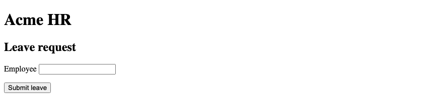

## 2. `<form>`

`<form>` wraps the controls that belong to one submission. Controls outside the form are not sent with it. One leave request is one form. A second task, such as a directory search, is a second form.

### Example

```html
<!DOCTYPE html>
<html lang="en">
<head>
  <meta charset="UTF-8">
  <meta name="viewport" content="width=device-width, initial-scale=1.0">
  <title>Acme HR — Form element</title>
</head>
<body>
  <header>
    <h1>Acme HR</h1>
  </header>
  <main>
    <h2>Leave request</h2>
    <form action="/leave" method="post">
      <p>
        <label for="employee">Employee</label>
        <input id="employee" name="employee" type="text">
      </p>
      <button type="submit">Submit leave</button>
    </form>
  </main>
</body>
</html>
```

**This will produce the following result:**


## 3. `action` and `method`

`action` is the URL that receives the form. `method="post"` puts the fields in the request body. `method="get"` puts them in the page address. A leave request creates a record, so it uses `post`. A directory search uses `get`, because the query is a page address someone can bookmark.

### Example

```html
<!DOCTYPE html>
<html lang="en">
<head>
  <meta charset="UTF-8">
  <meta name="viewport" content="width=device-width, initial-scale=1.0">
  <title>Acme HR — Action and method</title>
</head>
<body>
  <header>
    <h1>Acme HR</h1>
  </header>
  <main>
    <h2>Leave request</h2>
    <form action="/leave" method="post">
      <p>
        <label for="employee">Employee</label>
        <input id="employee" name="employee" type="text">
      </p>
      <button type="submit">Submit leave</button>
    </form>
  </main>
</body>
</html>
```

**This will produce the following result:**


## 4. `<label>`

`<label for>` matches the `id` of its control. A click on the label focuses that control. The label text stays visible. Placeholder text is not a label. Every leave field has a label.

### Example

```html
<!DOCTYPE html>
<html lang="en">
<head>
  <meta charset="UTF-8">
  <meta name="viewport" content="width=device-width, initial-scale=1.0">
  <title>Acme HR — Labels</title>
</head>
<body>
  <header>
    <h1>Acme HR</h1>
  </header>
  <main>
    <h2>Leave request</h2>
    <form action="/leave" method="post">
      <p>
        <label for="employee">Employee</label>
        <input id="employee" name="employee" type="text">
      </p>
      <button type="submit">Submit leave</button>
    </form>
  </main>
</body>
</html>
```

**This will produce the following result:**

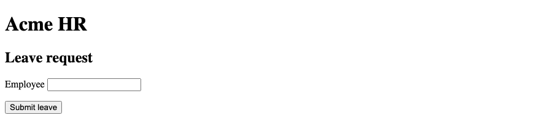

## 5. `<input>`

`<input>` is an empty element. `type` chooses the kind of control. `name` is the key sent with the form. `id` ties the control to its label. A control without a `name` is not submitted, except a submit button that only needs to send the form.

### Example

```html
<!DOCTYPE html>
<html lang="en">
<head>
  <meta charset="UTF-8">
  <meta name="viewport" content="width=device-width, initial-scale=1.0">
  <title>Acme HR — Input</title>
</head>
<body>
  <header>
    <h1>Acme HR</h1>
  </header>
  <main>
    <h2>Leave request</h2>
    <form action="/leave" method="post">
      <p>
        <label for="employee">Employee</label>
        <input id="employee" name="employee" type="text">
      </p>
      <button type="submit">Submit leave</button>
    </form>
  </main>
</body>
</html>
```

**This will produce the following result:**


## 6. Text & Password Inputs

`type="text"` is one line of text. `type="password"` hides the characters. The leave form uses text for the employee name. A password field belongs on a sign-in form, not on a leave request. The value is still sent to the server. Hiding it on screen is not encryption.

### Example

```html
<!DOCTYPE html>
<html lang="en">
<head>
  <meta charset="UTF-8">
  <meta name="viewport" content="width=device-width, initial-scale=1.0">
  <title>Acme HR — Text and password</title>
</head>
<body>
  <header>
    <h1>Acme HR</h1>
  </header>
  <main>
    <h2>Sign in</h2>
    <form action="/login" method="post">
      <p>
        <label for="staff-id">Staff email</label>
        <input id="staff-id" name="email" type="text" autocomplete="username">
      </p>
      <p>
        <label for="password">Password</label>
        <input id="password" name="password" type="password" autocomplete="current-password">
      </p>
      <button type="submit">Sign in</button>
    </form>
  </main>
</body>
</html>
```

**This will produce the following result:**

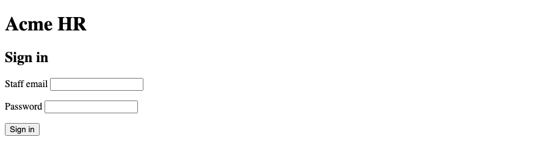

## 7. Email, URL, Tel & Search Inputs

`email` checks for an email address. `url` checks for a web address. `tel` is a telephone number. `search` is a search field. The phone keyboard can follow `inputmode`. These types help the browser check the value and choose a keyboard. They are still single-line inputs.

| type | Leave request use |
|------|-------------------|
| `email` | Work email |
| `tel` | Phone while on leave |
| `url` | A link to a medical note, if it is online |
| `search` | Find an employee in the directory |

### Example

```html
<!DOCTYPE html>
<html lang="en">
<head>
  <meta charset="UTF-8">
  <meta name="viewport" content="width=device-width, initial-scale=1.0">
  <title>Acme HR — Email, URL, tel, and search</title>
</head>
<body>
  <header>
    <h1>Acme HR</h1>
  </header>
  <main>
    <h2>Leave request</h2>
    <form action="/leave" method="post">
      <p>
        <label for="email">Work email</label>
        <input id="email" name="email" type="email" autocomplete="email">
      </p>
      <p>
        <label for="phone">Phone</label>
        <input id="phone" name="phone" type="tel" autocomplete="tel" inputmode="tel">
      </p>
      <p>
        <label for="note">Medical note link</label>
        <input id="note" name="note" type="url" autocomplete="url">
      </p>
      <button type="submit">Submit leave</button>
    </form>
    <h2>Directory</h2>
    <form action="/directory" method="get">
      <p>
        <label for="q">Find an employee</label>
        <input id="q" name="q" type="search">
      </p>
      <button type="submit">Search</button>
    </form>
  </main>
</body>
</html>
```

**This will produce the following result:**

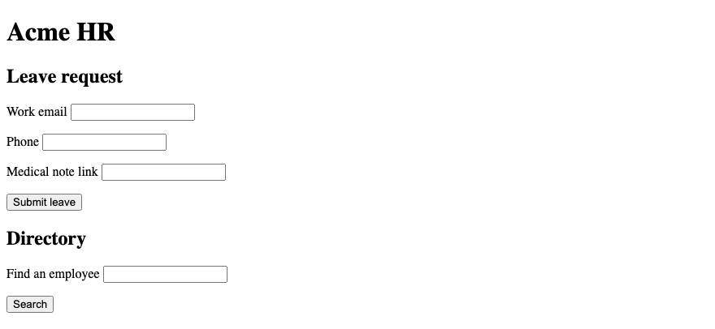

## 8. Number, Date & Time Inputs

`number` is a numeric value. `min` and `max` limit it. `date` is a calendar day. `time` is a time of day. Leave dates use `type="date"`. A half-day count can use `type="number"`. The value of a date input is `YYYY-MM-DD`.

### Example

```html
<!DOCTYPE html>
<html lang="en">
<head>
  <meta charset="UTF-8">
  <meta name="viewport" content="width=device-width, initial-scale=1.0">
  <title>Acme HR — Dates</title>
</head>
<body>
  <header>
    <h1>Acme HR</h1>
  </header>
  <main>
    <h2>Leave request</h2>
    <form action="/leave" method="post">
      <p>
        <label for="start">From</label>
        <input id="start" name="start" type="date" value="2026-10-06">
      </p>
      <p>
        <label for="end">To</label>
        <input id="end" name="end" type="date" value="2026-10-07">
      </p>
      <p>
        <label for="days">Days</label>
        <input id="days" name="days" type="number" min="1" max="30" value="2">
      </p>
      <button type="submit">Submit leave</button>
    </form>
  </main>
</body>
</html>
```

**This will produce the following result:**

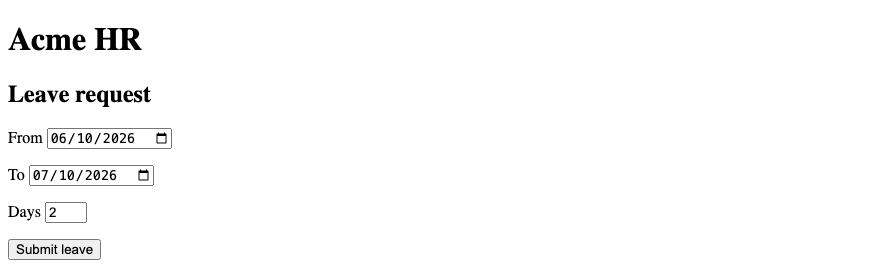

## 9. Radio & Checkbox

A checkbox is a yes-or-no choice. Several boxes may share one `name`. A radio is one choice in a group. The group shares one `name`. Each radio has its own `value`. `checked` marks the initial choice. A boolean attribute is true when it is present.

### Example

```html
<!DOCTYPE html>
<html lang="en">
<head>
  <meta charset="UTF-8">
  <meta name="viewport" content="width=device-width, initial-scale=1.0">
  <title>Acme HR — Choice fields</title>
</head>
<body>
  <header>
    <h1>Acme HR</h1>
  </header>
  <main>
    <h2>Leave request</h2>
    <form action="/leave" method="post">
      <p>
        <input id="span-full" name="span" type="radio" value="full" checked>
        <label for="span-full">Full day</label>
        <input id="span-half" name="span" type="radio" value="half">
        <label for="span-half">Half day</label>
      </p>
      <p>
        <input id="inform-manager" name="inform_manager" type="checkbox" value="yes">
        <label for="inform-manager">Email my manager</label>
      </p>
      <button type="submit">Submit leave</button>
    </form>
  </main>
</body>
</html>
```

**This will produce the following result:**

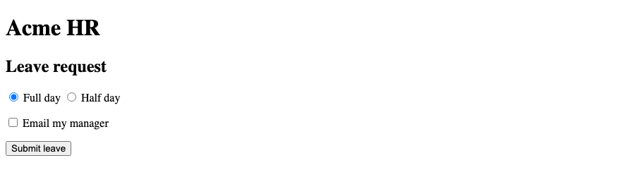

## 10. File Input

`type="file"` picks a file from the computer. A medical certificate uses this control. A file input needs `enctype="multipart/form-data"` on the form. Without that encoding, the file is not sent. `accept` lists the types the field expects.

### Example

```html
<!DOCTYPE html>
<html lang="en">
<head>
  <meta charset="UTF-8">
  <meta name="viewport" content="width=device-width, initial-scale=1.0">
  <title>Acme HR — Medical certificate</title>
</head>
<body>
  <header>
    <h1>Acme HR</h1>
  </header>
  <main>
    <h2>Leave request</h2>
    <form action="/leave" method="post" enctype="multipart/form-data">
      <p>
        <label for="certificate">Medical certificate</label>
        <input id="certificate" name="certificate" type="file" accept=".pdf,application/pdf">
      </p>
      <button type="submit">Submit leave</button>
    </form>
  </main>
</body>
</html>
```

**This will produce the following result:**

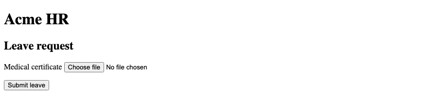

## 11. Hidden Input

`type="hidden"` sends a value the visitor does not edit. The employee id can travel with the form when the name is already on the page. The value is in the page source. Do not put a secret in a hidden field. Anyone can read it.

### Example

```html
<!DOCTYPE html>
<html lang="en">
<head>
  <meta charset="UTF-8">
  <meta name="viewport" content="width=device-width, initial-scale=1.0">
  <title>Acme HR — Hidden id</title>
</head>
<body>
  <header>
    <h1>Acme HR</h1>
  </header>
  <main>
    <h2>Leave request</h2>
    <p>Ananya Rao, Engineering.</p>
    <form action="/leave" method="post">
      <input type="hidden" name="employee_id" value="E-1042">
      <p>
        <label for="reason">Reason</label>
        <input id="reason" name="reason" type="text">
      </p>
      <button type="submit">Submit leave</button>
    </form>
  </main>
</body>
</html>
```

**This will produce the following result:**

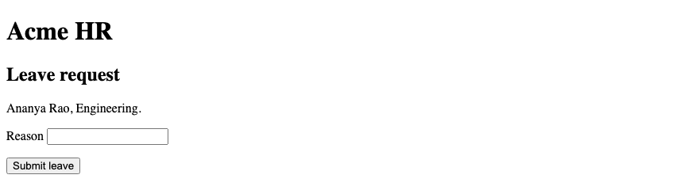

## 12. Submit, Reset & Button

`<button type="submit">` sends the form. `<button type="reset">` restores the initial values. `<button type="button">` has no built-in form action. Give every button a `type`. A button with no type inside a form submits the form. The leave form uses submit and reset.

| type | Action |
|------|--------|
| `submit` | Sends the form |
| `reset` | Restores the initial values |
| `button` | No built-in form action |

### Example

```html
<!DOCTYPE html>
<html lang="en">
<head>
  <meta charset="UTF-8">
  <meta name="viewport" content="width=device-width, initial-scale=1.0">
  <title>Acme HR — Buttons</title>
</head>
<body>
  <header>
    <h1>Acme HR</h1>
  </header>
  <main>
    <h2>Leave request</h2>
    <form action="/leave" method="post">
      <p>
        <label for="reason">Reason</label>
        <input id="reason" name="reason" type="text">
      </p>
      <button type="submit">Submit leave</button>
      <button type="reset">Reset</button>
      <button type="button">Preview</button>
    </form>
  </main>
</body>
</html>
```

**This will produce the following result:**

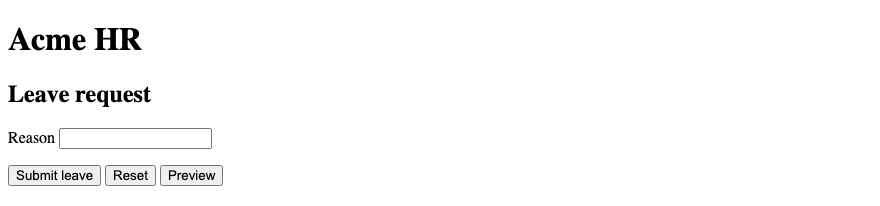

## 13. `<textarea>`

`<textarea>` is more than one line. It has an end tag. The reason for leave goes here. `rows` suggests a height. The text between the tags is the initial value. `name` is still required if the reason should be submitted.

### Example

```html
<!DOCTYPE html>
<html lang="en">
<head>
  <meta charset="UTF-8">
  <meta name="viewport" content="width=device-width, initial-scale=1.0">
  <title>Acme HR — Reason</title>
</head>
<body>
  <header>
    <h1>Acme HR</h1>
  </header>
  <main>
    <h2>Leave request</h2>
    <form action="/leave" method="post">
      <p>
        <label for="reason">Reason</label>
        <textarea id="reason" name="reason" rows="4"></textarea>
      </p>
      <button type="submit">Submit leave</button>
    </form>
  </main>
</body>
</html>
```

**This will produce the following result:**


## 14. `<select>`, `<option>`, `<optgroup>`

`<select>` is a menu. Each `<option>` is a choice. `value` is what is submitted. The text inside the option is what the visitor reads. `<optgroup>` groups options under a label. Leave types sit in two groups: paid and unpaid.

### Example

```html
<!DOCTYPE html>
<html lang="en">
<head>
  <meta charset="UTF-8">
  <meta name="viewport" content="width=device-width, initial-scale=1.0">
  <title>Acme HR — Leave type</title>
</head>
<body>
  <header>
    <h1>Acme HR</h1>
  </header>
  <main>
    <h2>Leave request</h2>
    <form action="/leave" method="post">
      <p>
        <label for="leave-type">Leave type</label>
        <select id="leave-type" name="leave_type">
          <option value="">Choose a type</option>
          <optgroup label="Paid">
            <option value="casual">Casual</option>
            <option value="earned">Earned</option>
          </optgroup>
          <optgroup label="Unpaid">
            <option value="unpaid">Unpaid</option>
          </optgroup>
        </select>
      </p>
      <button type="submit">Submit leave</button>
    </form>
  </main>
</body>
</html>
```

**This will produce the following result:**

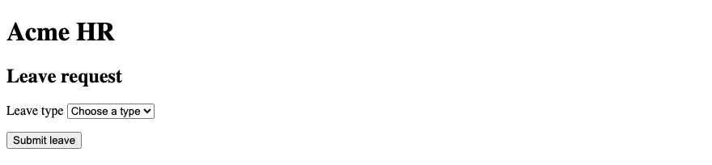

## 15. `<fieldset>` and `<legend>`

`<fieldset>` groups related controls. `<legend>` is the name of the group. A screen reader announces the legend with each control in the group. The full-day and half-day radios share a fieldset. The legend is "Duration".

### Example

```html
<!DOCTYPE html>
<html lang="en">
<head>
  <meta charset="UTF-8">
  <meta name="viewport" content="width=device-width, initial-scale=1.0">
  <title>Acme HR — Fieldset</title>
</head>
<body>
  <header>
    <h1>Acme HR</h1>
  </header>
  <main>
    <h2>Leave request</h2>
    <form action="/leave" method="post">
      <fieldset>
        <legend>Duration</legend>
        <input id="span-full" name="span" type="radio" value="full" checked>
        <label for="span-full">Full day</label>
        <input id="span-half" name="span" type="radio" value="half">
        <label for="span-half">Half day</label>
      </fieldset>
      <button type="submit">Submit leave</button>
    </form>
  </main>
</body>
</html>
```

**This will produce the following result:**

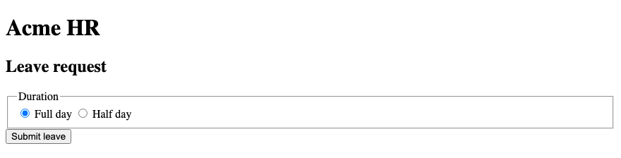

## 16. `<datalist>`

`<datalist>` offers suggestions for a text field. The input's `list` attribute names the datalist `id`. The visitor can type a value that is not in the list. Manager names are suggestions. A `<select>` is the right control when the value must be one of a fixed set.

### Example

```html
<!DOCTYPE html>
<html lang="en">
<head>
  <meta charset="UTF-8">
  <meta name="viewport" content="width=device-width, initial-scale=1.0">
  <title>Acme HR — Manager</title>
</head>
<body>
  <header>
    <h1>Acme HR</h1>
  </header>
  <main>
    <h2>Leave request</h2>
    <form action="/leave" method="post">
      <p>
        <label for="manager">Manager</label>
        <input id="manager" name="manager" type="text" list="manager-list">
        <datalist id="manager-list">
          <option value="Karthik Menon">
          <option value="Meera Iyer">
        </datalist>
      </p>
      <button type="submit">Submit leave</button>
    </form>
  </main>
</body>
</html>
```

**This will produce the following result:**

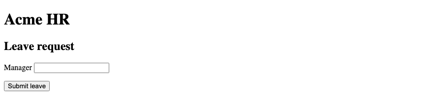

## 17. `<output>`

`<output>` shows a result. The leave form shows the number of days. `for` lists the ids of the controls that feed the result. A script fills the number when the dates change. The element is in the page so the result has a place to go.

### Example

```html
<!DOCTYPE html>
<html lang="en">
<head>
  <meta charset="UTF-8">
  <meta name="viewport" content="width=device-width, initial-scale=1.0">
  <title>Acme HR — Day count</title>
</head>
<body>
  <header>
    <h1>Acme HR</h1>
  </header>
  <main>
    <h2>Leave request</h2>
    <form action="/leave" method="post">
      <p>
        <label for="days">Days</label>
        <input id="days" name="days" type="number" value="2">
      </p>
      <p>Days requested <output name="day_count" for="days">2</output></p>
      <button type="submit">Submit leave</button>
    </form>
  </main>
</body>
</html>
```

**This will produce the following result:**

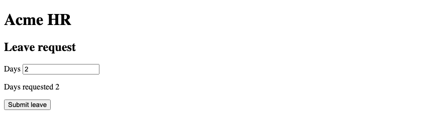

## 18. Form Attributes

These attributes sit on `<form>` or on a control. `autocomplete` names the saved value the browser may offer. `novalidate` turns off the browser's checks. The leave form does not use `novalidate`. The checks in the later sections should run.

| Attribute | Role |
|-----------|------|
| `action` | Where the form is sent |
| `method` | `get` or `post` |
| `enctype` | How the body is encoded |
| `autocomplete` | Whether saved values may be offered |
| `novalidate` | Skips the built-in checks |

### Example

```html
<!DOCTYPE html>
<html lang="en">
<head>
  <meta charset="UTF-8">
  <meta name="viewport" content="width=device-width, initial-scale=1.0">
  <title>Acme HR — Form attributes</title>
</head>
<body>
  <header>
    <h1>Acme HR</h1>
  </header>
  <main>
    <h2>Leave request</h2>
    <form action="/leave" method="post" autocomplete="on">
      <p>
        <label for="email">Work email</label>
        <input id="email" name="email" type="email" autocomplete="email">
      </p>
      <button type="submit">Submit leave</button>
    </form>
  </main>
</body>
</html>
```

**This will produce the following result:**

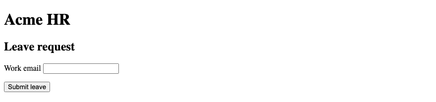

## 19. `placeholder`

`placeholder` is a hint inside an empty field. It disappears when the visitor types. The label remains. Do not put the field name only in the placeholder. A short example, such as a date written out, is a useful hint.

### Example

```html
<!DOCTYPE html>
<html lang="en">
<head>
  <meta charset="UTF-8">
  <meta name="viewport" content="width=device-width, initial-scale=1.0">
  <title>Acme HR — Placeholder</title>
</head>
<body>
  <header>
    <h1>Acme HR</h1>
  </header>
  <main>
    <h2>Leave request</h2>
    <form action="/leave" method="post">
      <p>
        <label for="reason">Reason</label>
        <input id="reason" name="reason" type="text" placeholder="Family function in Hyderabad">
      </p>
      <button type="submit">Submit leave</button>
    </form>
  </main>
</body>
</html>
```

**This will produce the following result:**

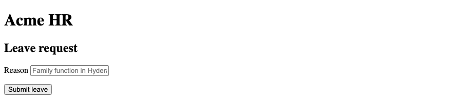

## 20. `required`

`required` blocks submit until the field has a value. A boolean attribute is true when it is present. `required="false"` is still required. Remove the attribute to make the field optional. The reason on a leave request is required. The medical file is required only when you add the attribute.

### Example

```html
<!DOCTYPE html>
<html lang="en">
<head>
  <meta charset="UTF-8">
  <meta name="viewport" content="width=device-width, initial-scale=1.0">
  <title>Acme HR — Required</title>
</head>
<body>
  <header>
    <h1>Acme HR</h1>
  </header>
  <main>
    <h2>Leave request</h2>
    <form action="/leave" method="post">
      <p>
        <label for="reason">Reason</label>
        <input id="reason" name="reason" type="text" required>
      </p>
      <button type="submit">Submit leave</button>
    </form>
  </main>
</body>
</html>
```

**This will produce the following result:**


## 21. `readonly` and `disabled`

`readonly` shows a value the visitor cannot edit. The value is submitted. `disabled` turns the control off. `disabled` is not submitted. The employee id on this form is readonly, so it is sent. The approver field is disabled, so it is not sent.

### Example

```html
<!DOCTYPE html>
<html lang="en">
<head>
  <meta charset="UTF-8">
  <meta name="viewport" content="width=device-width, initial-scale=1.0">
  <title>Acme HR — Readonly and disabled</title>
</head>
<body>
  <header>
    <h1>Acme HR</h1>
  </header>
  <main>
    <h2>Leave request</h2>
    <form action="/leave" method="post">
      <p>
        <label for="employee-id">Employee ID</label>
        <input id="employee-id" name="employee_id" type="text" value="E-1042" readonly>
      </p>
      <p>
        <label for="approver">Approver</label>
        <input id="approver" name="approver" type="text" value="Pending" disabled>
      </p>
      <button type="submit">Submit leave</button>
    </form>
  </main>
</body>
</html>
```

**This will produce the following result:**

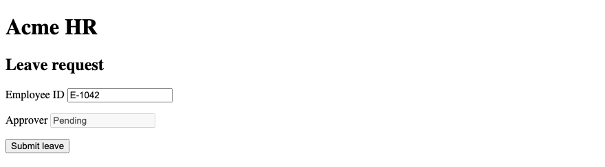

## 22. `min`, `max`, `step`

`min` and `max` limit a number or a date. `step` sets the allowed interval. Days of leave run from 1 to 30 in steps of 1. A half day can use `step="0.5"`. A start date can use `min` so the request cannot begin in the past.

### Example

```html
<!DOCTYPE html>
<html lang="en">
<head>
  <meta charset="UTF-8">
  <meta name="viewport" content="width=device-width, initial-scale=1.0">
  <title>Acme HR — Min and max</title>
</head>
<body>
  <header>
    <h1>Acme HR</h1>
  </header>
  <main>
    <h2>Leave request</h2>
    <form action="/leave" method="post">
      <p>
        <label for="days">Days</label>
        <input id="days" name="days" type="number" min="1" max="30" step="1" value="2">
      </p>
      <p>
        <label for="start">From</label>
        <input id="start" name="start" type="date" min="2026-10-01">
      </p>
      <button type="submit">Submit leave</button>
    </form>
  </main>
</body>
</html>
```

**This will produce the following result:**

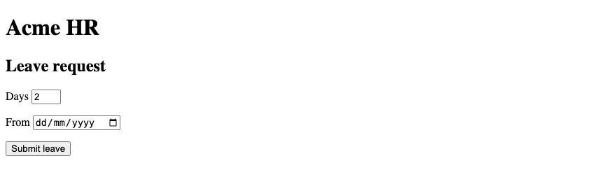

## 23. `minlength`, `maxlength`

`minlength` and `maxlength` constrain the number of characters. The reason must be at least 10 characters and at most 200. `maxlength` stops further typing at the limit. `minlength` is checked when the form is submitted.

### Example

```html
<!DOCTYPE html>
<html lang="en">
<head>
  <meta charset="UTF-8">
  <meta name="viewport" content="width=device-width, initial-scale=1.0">
  <title>Acme HR — Length</title>
</head>
<body>
  <header>
    <h1>Acme HR</h1>
  </header>
  <main>
    <h2>Leave request</h2>
    <form action="/leave" method="post">
      <p>
        <label for="reason">Reason</label>
        <textarea id="reason" name="reason" rows="4" minlength="10" maxlength="200" required></textarea>
      </p>
      <button type="submit">Submit leave</button>
    </form>
  </main>
</body>
</html>
```

**This will produce the following result:**

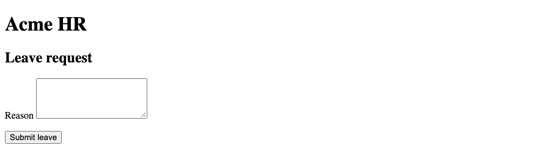

## 24. `pattern`

`pattern` is a regular expression the value must match. The employee id pattern is `E-` followed by four digits. The pattern is checked on submit. Add a `title` that explains the format in a sentence a person can read. The pattern does not replace the label.

### Example

```html
<!DOCTYPE html>
<html lang="en">
<head>
  <meta charset="UTF-8">
  <meta name="viewport" content="width=device-width, initial-scale=1.0">
  <title>Acme HR — Pattern</title>
</head>
<body>
  <header>
    <h1>Acme HR</h1>
  </header>
  <main>
    <h2>Leave request</h2>
    <form action="/leave" method="post">
      <p>
        <label for="employee-id">Employee ID</label>
        <input id="employee-id" name="employee_id" type="text" pattern="E-[0-9]{4}" title="E- followed by four digits" required>
      </p>
      <button type="submit">Submit leave</button>
    </form>
  </main>
</body>
</html>
```

**This will produce the following result:**

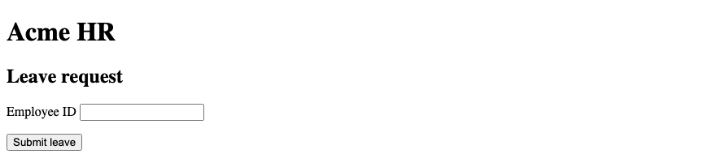

## 25. HTML Form Validation

The browser checks constraints before it sends the form. Required fields, types, lengths, range, and pattern are those checks. If a check fails, the browser shows a message and does not submit. This leave form uses those checks. A script is not required for them. `novalidate` on the form would skip them.

### Example

```html
<!DOCTYPE html>
<html lang="en">
<head>
  <meta charset="UTF-8">
  <meta name="viewport" content="width=device-width, initial-scale=1.0">
  <title>Acme HR — Validation</title>
</head>
<body>
  <header>
    <h1>Acme HR</h1>
  </header>
  <main>
    <h2>Leave request</h2>
    <form action="/leave" method="post">
      <p>
        <label for="email">Work email</label>
        <input id="email" name="email" type="email" required>
      </p>
      <p>
        <label for="days">Days</label>
        <input id="days" name="days" type="number" min="1" max="30" required>
      </p>
      <button type="submit">Submit leave</button>
    </form>
  </main>
</body>
</html>
```

**This will produce the following result:**

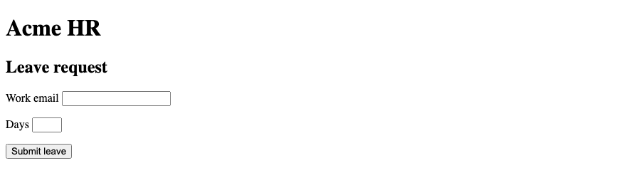

## 26. GET vs POST

`get` puts the fields in the URL. Use it for a search that only reads data. `post` puts the fields in the request body. Use it when the form creates or changes data. A leave request uses `post`. A directory search uses `get`. Do not send a password with `get`. The address would hold it.

| Method | Use on Acme HR |
|--------|----------------|
| `get` | Directory search |
| `post` | Leave request, profile update, sign in |

### Example

```html
<!DOCTYPE html>
<html lang="en">
<head>
  <meta charset="UTF-8">
  <meta name="viewport" content="width=device-width, initial-scale=1.0">
  <title>Acme HR — GET and POST</title>
</head>
<body>
  <header>
    <h1>Acme HR</h1>
  </header>
  <main>
    <h2>Directory search</h2>
    <form action="/directory" method="get">
      <p>
        <label for="q">Name</label>
        <input id="q" name="q" type="search">
      </p>
      <button type="submit">Search</button>
    </form>
  </main>
</body>
</html>
```

**This will produce the following result:**

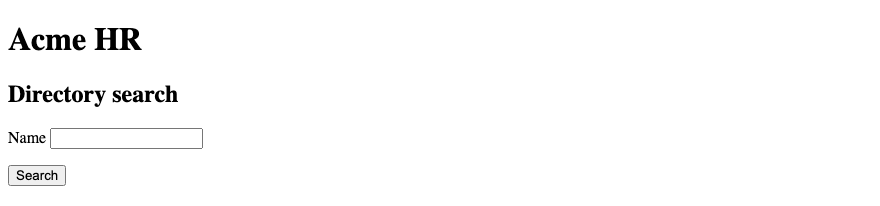

## 27. Form Submission

On submit, the browser runs the checks, then sends each successful control as a name and a value. `disabled` is not submitted. `readonly` is. A file input needs `enctype="multipart/form-data"`. The button that submitted the form is included when that button has a `name`. Django or Spring reads these names on the server.

### Example

```html
<!DOCTYPE html>
<html lang="en">
<head>
  <meta charset="UTF-8">
  <meta name="viewport" content="width=device-width, initial-scale=1.0">
  <title>Acme HR — Submit leave</title>
</head>
<body>
  <header>
    <h1>Acme HR</h1>
    <nav>
      <a href="directory.html">Directory</a>
      <a href="leave.html">Leave</a>
    </nav>
  </header>
  <main>
    <h2>Leave request</h2>
    <form action="/leave" method="post" enctype="multipart/form-data">
      <p>
        <label for="employee-id">Employee ID</label>
        <input id="employee-id" name="employee_id" type="text" value="E-1042" readonly>
      </p>
      <p>
        <label for="leave-type">Leave type</label>
        <select id="leave-type" name="leave_type" required>
          <option value="casual">Casual</option>
          <option value="earned">Earned</option>
        </select>
      </p>
      <p>
        <label for="start">From</label>
        <input id="start" name="start" type="date" required>
      </p>
      <p>
        <label for="reason">Reason</label>
        <textarea id="reason" name="reason" rows="4" required></textarea>
      </p>
      <p>
        <label for="certificate">Medical certificate</label>
        <input id="certificate" name="certificate" type="file" accept=".pdf,application/pdf">
      </p>
      <button type="submit" name="action" value="submit">Submit leave</button>
    </form>
  </main>
</body>
</html>
```

**This will produce the following result:**

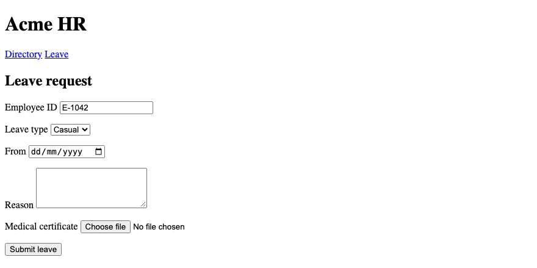
