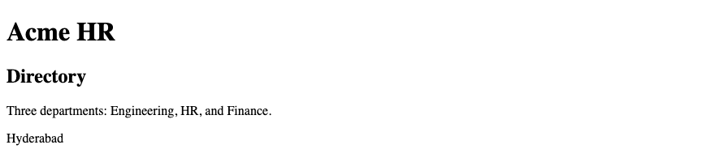
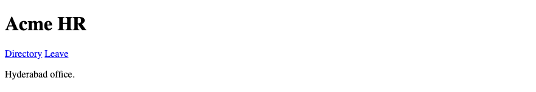
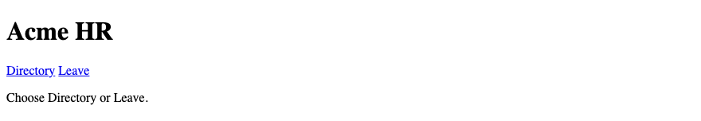
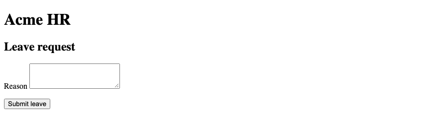
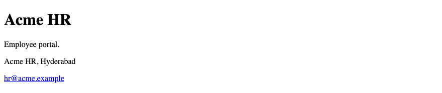
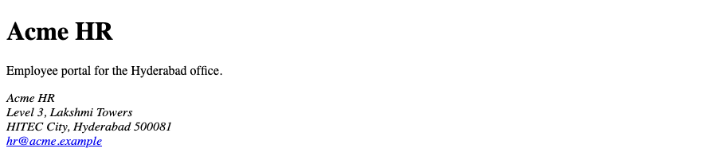
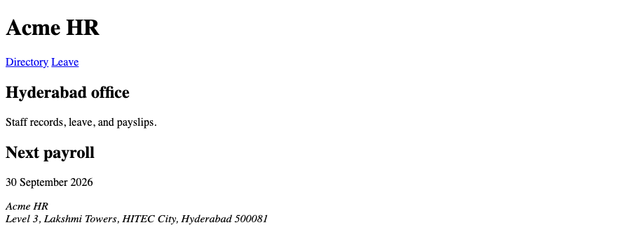

# 6. HTML — Semantic HTML

**Index:** [HTML tutorial](../01_HTML.md)  
**Previous:** [HTML Forms](Module_05_HTML_Forms.md)  
**Next:** [Multimedia and Modern HTML](Module_07_Multimedia_and_Modern_HTML.md)

Semantic elements name the region. The page has one `<h1>`, Acme HR. Do not skip heading levels. An hgroup subtitle is a `p`.

## 1. Introduction to Semantic HTML

A semantic element says what the content is. `<header>` is a header. `<p>` is a paragraph. The browser, a screen reader, and a search index can use that name. A `<div>` does not say what the region is. Use a semantic element when one fits.

### Example

```html
<!DOCTYPE html>
<html lang="en">
<head>
  <meta charset="UTF-8">
  <meta name="viewport" content="width=device-width, initial-scale=1.0">
  <title>Acme HR</title>
</head>
<body>
  <header>
    <h1>Acme HR</h1>
  </header>
  <main>
    <p>Employee portal for the Hyderabad office.</p>
  </main>
</body>
</html>
```

**This will produce the following result:**


## 2. Why Semantic HTML Matters

A screen reader can jump to `<main>` and skip the repeated header. The document outline follows the headings. CSS can style `header` and `main` without a class on every region. Search tools read the same structure. The class is still useful for a card. The element name comes first.

### Example

```html
<!DOCTYPE html>
<html lang="en">
<head>
  <meta charset="UTF-8">
  <meta name="viewport" content="width=device-width, initial-scale=1.0">
  <title>Acme HR — Landmarks</title>
</head>
<body>
  <header>
    <h1>Acme HR</h1>
  </header>
  <main>
    <h2>Directory</h2>
    <p>Three departments: Engineering, HR, and Finance.</p>
  </main>
  <footer>
    <p>Hyderabad</p>
  </footer>
</body>
</html>
```

**This will produce the following result:**



## 3. `<header>`

`<header>` is introductory content for the page or for an article. The page header holds the `<h1>` and the nav. An employee article can have its own header with the person's name as an `<h2>` or `<h3>`. The page still has one `<h1>`.

### Example

```html
<!DOCTYPE html>
<html lang="en">
<head>
  <meta charset="UTF-8">
  <meta name="viewport" content="width=device-width, initial-scale=1.0">
  <title>Acme HR — Header</title>
</head>
<body>
  <header>
    <h1>Acme HR</h1>
    <nav>
      <a href="directory.html">Directory</a>
      <a href="leave.html">Leave</a>
    </nav>
  </header>
  <main>
    <p>Hyderabad office.</p>
  </main>
</body>
</html>
```

**This will produce the following result:**



## 4. `<nav>`

`<nav>` is a group of links for navigation. The primary links are Directory and Leave. A footer link to the same pages can be a second `<nav>`. When a page has more than one nav, `aria-label` names each one. The links module covers the addresses.

### Example

```html
<!DOCTYPE html>
<html lang="en">
<head>
  <meta charset="UTF-8">
  <meta name="viewport" content="width=device-width, initial-scale=1.0">
  <title>Acme HR — Nav</title>
</head>
<body>
  <header>
    <h1>Acme HR</h1>
    <nav aria-label="Primary">
      <a href="directory.html">Directory</a>
      <a href="leave.html">Leave</a>
    </nav>
  </header>
  <main>
    <p>Choose Directory or Leave.</p>
  </main>
</body>
</html>
```

**This will produce the following result:**



## 5. `<main>`

`<main>` is the main content of the page. One page has one `<main>`. The header and the footer sit outside it. The leave request form goes inside `<main>`. A screen reader can skip straight to this region. Do not put `<main>` inside `<article>`, `<header>`, or `<footer>`.

### Example

```html
<!DOCTYPE html>
<html lang="en">
<head>
  <meta charset="UTF-8">
  <meta name="viewport" content="width=device-width, initial-scale=1.0">
  <title>Acme HR — Main</title>
</head>
<body>
  <header>
    <h1>Acme HR</h1>
  </header>
  <main>
    <h2>Leave request</h2>
    <form action="/leave" method="post">
      <p>
        <label for="reason">Reason</label>
        <textarea id="reason" name="reason" rows="3"></textarea>
      </p>
      <button type="submit">Submit leave</button>
    </form>
  </main>
</body>
</html>
```

**This will produce the following result:**



## 6. `<section>`

`<section>` is a thematic group. It has a heading. The directory is a section. The payslip is a section. Do not wrap every paragraph in a section. A section without a heading is a sign the group may not be a section. The heading level follows the outline. After `<h1>`, the section heading is `<h2>`.

### Example

```html
<!DOCTYPE html>
<html lang="en">
<head>
  <meta charset="UTF-8">
  <meta name="viewport" content="width=device-width, initial-scale=1.0">
  <title>Acme HR — Section</title>
</head>
<body>
  <header>
    <h1>Acme HR</h1>
  </header>
  <main>
    <section>
      <h2>Hyderabad office</h2>
      <p>Staff records for HITEC City.</p>
    </section>
  </main>
  <footer>
    <p>Acme HR, Hyderabad</p>
  </footer>
</body>
</html>
```

**This will produce the following result:**


## 7. `<article>`

`<article>` is a self-contained piece. One employee in the directory is an article. The article still makes sense if it is read alone: the name, the department, and the id. Its heading is `<h3>` when the directory section is an `<h2>`. Do not skip from `<h2>` to `<h4>`.

### Example

```html
<!DOCTYPE html>
<html lang="en">
<head>
  <meta charset="UTF-8">
  <meta name="viewport" content="width=device-width, initial-scale=1.0">
  <title>Acme HR — Employee</title>
</head>
<body>
  <header>
    <h1>Acme HR</h1>
  </header>
  <main>
    <section>
      <h2>Directory</h2>
      <article>
        <h3>Ananya Rao</h3>
        <p>Engineering · E-1042</p>
        
      </article>
    </section>
  </main>
</body>
</html>
```

**This will produce the following result:**


## 8. `<aside>`

`<aside>` is content related to the main text, set beside it or after it. The next payroll date is an aside on the directory. It is not the directory itself. The aside has a heading so its topic is clear. CSS can place it in a column. The element name does not depend on that column.

### Example

```html
<!DOCTYPE html>
<html lang="en">
<head>
  <meta charset="UTF-8">
  <meta name="viewport" content="width=device-width, initial-scale=1.0">
  <title>Acme HR — Aside</title>
</head>
<body>
  <header>
    <h1>Acme HR</h1>
  </header>
  <main>
    <section>
      <h2>Directory</h2>
      <p>Engineering, HR, and Finance.</p>
    </section>
    <aside>
      <h2>Next payroll</h2>
      <p><time datetime="2026-09-30">30 September 2026</time></p>
    </aside>
  </main>
</body>
</html>
```

**This will produce the following result:**


## 9. `<footer>`

`<footer>` is closing content for the page or for an article. The page footer holds the office line and a contact link. An article footer can hold the employee id. The page footer is not a dump for the whole directory. One page footer is enough.

### Example

```html
<!DOCTYPE html>
<html lang="en">
<head>
  <meta charset="UTF-8">
  <meta name="viewport" content="width=device-width, initial-scale=1.0">
  <title>Acme HR — Footer</title>
</head>
<body>
  <header>
    <h1>Acme HR</h1>
  </header>
  <main>
    <p>Employee portal.</p>
  </main>
  <footer>
    <p>Acme HR, Hyderabad</p>
    <p><a href="mailto:hr@acme.example">hr@acme.example</a></p>
  </footer>
</body>
</html>
```

**This will produce the following result:**



## 10. `<address>`

`<address>` is contact information for the nearest `<article>` or for the page. The HR office address belongs here, in the footer. It is not a postal address for every employee. The element does not have to be italic. The browser's default style is separate from the meaning.

### Example

```html
<!DOCTYPE html>
<html lang="en">
<head>
  <meta charset="UTF-8">
  <meta name="viewport" content="width=device-width, initial-scale=1.0">
  <title>Acme HR — Address</title>
</head>
<body>
  <header>
    <h1>Acme HR</h1>
  </header>
  <main>
    <p>Employee portal for the Hyderabad office.</p>
  </main>
  <footer>
    <address>
      Acme HR<br>
      Level 3, Lakshmi Towers<br>
      HITEC City, Hyderabad 500081<br>
      <a href="mailto:hr@acme.example">hr@acme.example</a>
    </address>
  </footer>
</body>
</html>
```

**This will produce the following result:**



## 11. Semantic HTML vs `<div>`

`<div>` and `<span>` are for when no semantic element fits. A flex or grid wrapper that has no region name can be a `<div>`. The employee is an `<article>`, not a `<div>`. The office line is an `<address>`, not a `<div>`. Add a class for styling. The class does not replace the element.

| Content | Element |
|---------|---------|
| Site title and nav | `<header>` and `<nav>` |
| Directory | `<section>` |
| One employee | `<article>` |
| Next payroll | `<aside>` |
| Office contact | `<address>` inside `<footer>` |
| A row that is only a layout hook | `<div>` |

### Example

```html
<!DOCTYPE html>
<html lang="en">
<head>
  <meta charset="UTF-8">
  <meta name="viewport" content="width=device-width, initial-scale=1.0">
  <title>Acme HR — Element choice</title>
</head>
<body>
  <header>
    <h1>Acme HR</h1>
  </header>
  <main>
    <section>
      <h2>Directory</h2>
      <div class="cards">
        <article>
          <h3>Ananya Rao</h3>
          <p>Engineering</p>
        </article>
      </div>
    </section>
  </main>
</body>
</html>
```

**This will produce the following result:**


## 12. Building a Semantic Page Layout

The home page is a header, a main with one section, an aside for the payroll date, and a footer with the office address. The `<h1>` is Acme HR. The section heading is an `<h2>`. Links point at the directory and the leave request. This is the document the CSS modules style.

### Example

```html
<!DOCTYPE html>
<html lang="en">
<head>
  <meta charset="UTF-8">
  <meta name="viewport" content="width=device-width, initial-scale=1.0">
  <title>Acme HR</title>
</head>
<body>
  <header>
    <h1>Acme HR</h1>
    <nav aria-label="Primary">
      <a href="directory.html">Directory</a>
      <a href="leave.html">Leave</a>
    </nav>
  </header>
  <main>
    <section>
      <h2>Hyderabad office</h2>
      <p>Staff records, leave, and payslips.</p>
    </section>
    <aside>
      <h2>Next payroll</h2>
      <p><time datetime="2026-09-30">30 September 2026</time></p>
    </aside>
  </main>
  <footer>
    <address>
      Acme HR<br>
      Level 3, Lakshmi Towers, HITEC City, Hyderabad 500081
    </address>
  </footer>
</body>
</html>
```

**This will produce the following result:**


