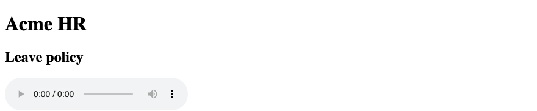
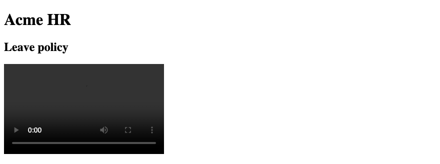
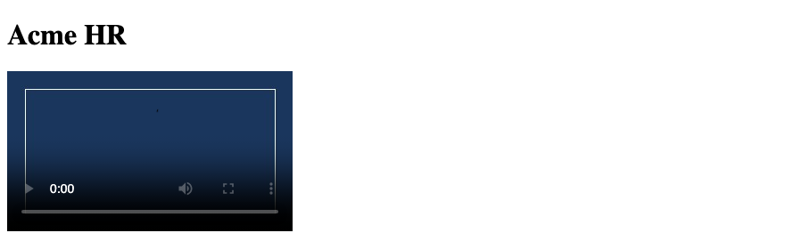
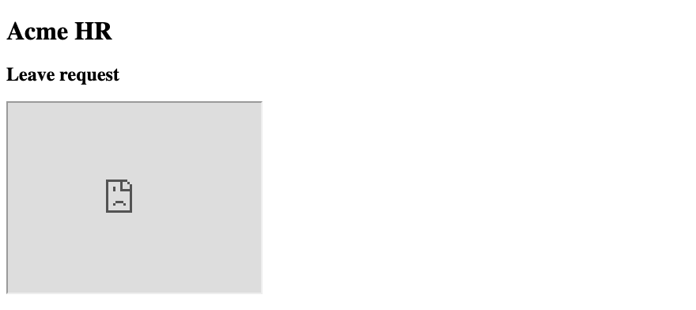
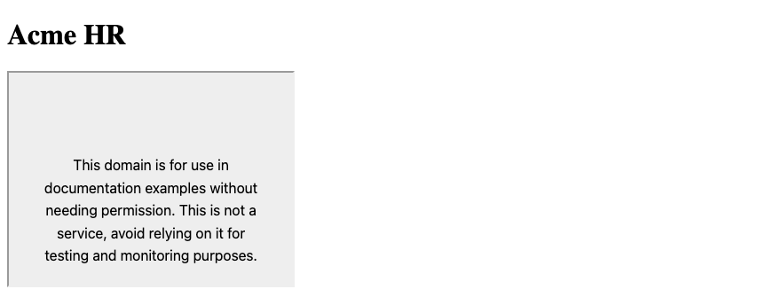
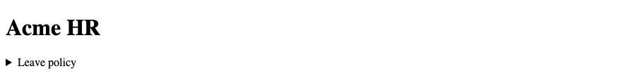
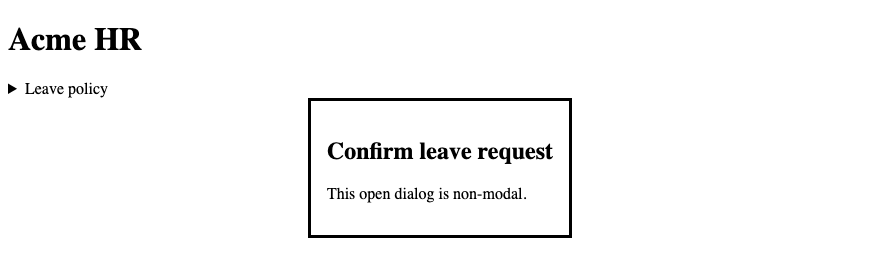

# 7. HTML — Multimedia & Modern HTML

**Index:** [HTML tutorial](../01_HTML.md)  
**Previous:** [Semantic HTML](Module_06_Semantic_HTML.md)  
**Next:** [Accessibility and SEO Basics](Module_08_Accessibility_and_SEO.md)

The clip in this module is a short HR policy recording. The dialog says Confirm leave request.

## 1. `<audio>`

`<audio>` plays a sound file. `controls` shows the browser's play bar. The HR policy clip can be audio when a video is not needed. Text of the policy still belongs on the page. The recording is an extra, not the only copy.

### Example

```html
<!DOCTYPE html>
<html lang="en">
<head>
  <meta charset="UTF-8">
  <meta name="viewport" content="width=device-width, initial-scale=1.0">
  <title>Acme HR — Policy audio</title>
</head>
<body>
  <header>
    <h1>Acme HR</h1>
  </header>
  <main>
    <h2>Leave policy</h2>
    <audio controls src="media/leave-policy.mp3">
      A short HR policy clip.
    </audio>
  </main>
</body>
</html>
```

**This will produce the following result:**



## 2. `<video>`

`<video>` plays a picture with sound. `controls` shows the play bar. `width` and `height` reserve the box. The same leave policy can be a short clip. The words inside the element are a fallback when the browser cannot play the file.

### Example

```html
<!DOCTYPE html>
<html lang="en">
<head>
  <meta charset="UTF-8">
  <meta name="viewport" content="width=device-width, initial-scale=1.0">
  <title>Acme HR — Policy clip</title>
</head>
<body>
  <header>
    <h1>Acme HR</h1>
  </header>
  <main>
    <h2>Leave policy</h2>
    <video controls width="320" height="180" src="media/leave-policy.mp4">
      A short HR policy clip.
    </video>
  </main>
</body>
</html>
```

**This will produce the following result:**



## 3. `<source>`

`<source>` lists a file inside `<audio>` or `<video>`. The browser picks the first type it can play. `type` is the media type, such as `video/mp4`. More than one source covers more browsers. The fallback text still sits inside the media element.

### Example

```html
<!DOCTYPE html>
<html lang="en">
<head>
  <meta charset="UTF-8">
  <meta name="viewport" content="width=device-width, initial-scale=1.0">
  <title>Acme HR — Sources</title>
</head>
<body>
  <header>
    <h1>Acme HR</h1>
  </header>
  <main>
    <h2>Leave policy</h2>
    <video controls width="320" height="180">
      <source src="media/leave-policy.webm" type="video/webm">
      <source src="media/leave-policy.mp4" type="video/mp4">
      A short HR policy clip.
    </video>
  </main>
</body>
</html>
```

**This will produce the following result:**


## 4. `<track>`

`<track>` attaches a timed text file, such as captions. `kind="captions"` is the dialogue and the sounds. `srclang` is the language. `default` marks the track to show first. The policy clip has an English caption file. Captions are how the clip is read without sound.

### Example

```html
<!DOCTYPE html>
<html lang="en">
<head>
  <meta charset="UTF-8">
  <meta name="viewport" content="width=device-width, initial-scale=1.0">
  <title>Acme HR — Captions</title>
</head>
<body>
  <header>
    <h1>Acme HR</h1>
  </header>
  <main>
    <h2>Leave policy</h2>
    <video controls width="320" height="180">
      <source src="media/leave-policy.mp4" type="video/mp4">
      <track src="media/leave-policy.vtt" kind="captions" srclang="en" label="English" default>
      A short HR policy clip.
    </video>
  </main>
</body>
</html>
```

**This will produce the following result:**


## 5. Audio & Video Attributes

`controls` shows the player. `poster` is an image shown before the video plays. `preload` hints how much to fetch: `none`, `metadata`, or `auto`. `loop` and `autoplay` repeat or start on their own. Do not autoplay the policy clip. The employee starts it with the controls.

| Attribute | Use on the policy clip |
|-----------|------------------------|
| `controls` | Show the play bar |
| `poster` | A still frame before play |
| `preload="metadata"` | Load duration, not the whole file |
| `width`, `height` | Reserve the box |

### Example

```html
<!DOCTYPE html>
<html lang="en">
<head>
  <meta charset="UTF-8">
  <meta name="viewport" content="width=device-width, initial-scale=1.0">
  <title>Acme HR — Player attributes</title>
</head>
<body>
  <header>
    <h1>Acme HR</h1>
  </header>
  <main>
    <video controls width="320" height="180" poster="images/policy-poster.jpg" preload="metadata">
      <source src="media/leave-policy.mp4" type="video/mp4">
      A short HR policy clip.
    </video>
  </main>
</body>
</html>
```

**This will produce the following result:**



## 6. `<iframe>`

`<iframe>` embeds another HTML page in a rectangle. `title` names the frame for assistive technology. `width` and `height` set the box. A holiday list page can sit in a frame on the leave page. The title is "Hyderabad holiday list".

### Example

```html
<!DOCTYPE html>
<html lang="en">
<head>
  <meta charset="UTF-8">
  <meta name="viewport" content="width=device-width, initial-scale=1.0">
  <title>Acme HR — Holiday list</title>
</head>
<body>
  <header>
    <h1>Acme HR</h1>
  </header>
  <main>
    <h2>Leave request</h2>
    <iframe src="holiday-list.html" title="Hyderabad holiday list" width="320" height="240"></iframe>
  </main>
</body>
</html>
```

**This will produce the following result:**



## 7. Embedding External Content

An external page uses an absolute URL in `src`. Trust the page you embed. It runs in your layout. `referrerpolicy` and `sandbox` limit what that page can do. A holiday list on example.com is enough. Do not embed a page you would not open yourself.

### Example

```html
<!DOCTYPE html>
<html lang="en">
<head>
  <meta charset="UTF-8">
  <meta name="viewport" content="width=device-width, initial-scale=1.0">
  <title>Acme HR — External frame</title>
</head>
<body>
  <header>
    <h1>Acme HR</h1>
  </header>
  <main>
    <iframe src="https://example.com/holiday-list" title="Holiday list" width="320" height="240" sandbox></iframe>
  </main>
</body>
</html>
```

**This will produce the following result:**



## 8. `<details>`

`<details>` is a disclosure box. The content is hidden until the reader opens it. The leave policy text can sit in one, under the clip. The employee who already knows the rule can leave it closed. The summary in the next section is the visible label.

### Example

```html
<!DOCTYPE html>
<html lang="en">
<head>
  <meta charset="UTF-8">
  <meta name="viewport" content="width=device-width, initial-scale=1.0">
  <title>Acme HR — Details</title>
</head>
<body>
  <header>
    <h1>Acme HR</h1>
  </header>
  <main>
    <details>
      <summary>Leave policy</summary>
      <p>Casual leave is filed two days before the start date.</p>
    </details>
  </main>
</body>
</html>
```

**This will produce the following result:**



## 9. `<summary>`

`<summary>` is the label of a `<details>` element. It is the first child. The rest of the details is the hidden part. Write the summary as the question or the name of the note. "Leave policy" is the label. The rule itself is the paragraph inside.

### Example

```html
<!DOCTYPE html>
<html lang="en">
<head>
  <meta charset="UTF-8">
  <meta name="viewport" content="width=device-width, initial-scale=1.0">
  <title>Acme HR — Summary</title>
</head>
<body>
  <header>
    <h1>Acme HR</h1>
  </header>
  <main>
    <details>
      <summary>Leave policy</summary>
      <p>A medical certificate is required for sick leave over two days.</p>
    </details>
  </main>
</body>
</html>
```

**This will produce the following result:**


## 10. `<dialog>`

`<dialog>` is a window on the page. The `open` attribute shows it as non-modal: the rest of the page still works. A modal needs `showModal()` in script. The confirm dialog is modal, so the script calls `showModal()`. The heading inside the dialog is Confirm leave request. `method="dialog"` on a form closes the dialog and records the button value.

### Example

```html
<!DOCTYPE html>
<html lang="en">
<head>
  <meta charset="UTF-8">
  <meta name="viewport" content="width=device-width, initial-scale=1.0">
  <title>Acme HR — Confirm leave</title>
</head>
<body>
  <header>
    <h1>Acme HR</h1>
  </header>
  <main>
    <h2>Leave request</h2>
    <button type="button" id="open-confirm">Review leave</button>
    <dialog id="confirm-leave">
      <h2>Confirm leave request</h2>
      <p>Submit casual leave for 6 October 2026?</p>
      <form method="dialog">
        <button value="cancel">Cancel</button>
        <button value="confirm">Confirm</button>
      </form>
    </dialog>
  </main>
  <script>
    document.querySelector("#open-confirm").addEventListener("click", function () {
      document.querySelector("#confirm-leave").showModal();
    });
  </script>
</body>
</html>
```

**This will produce the following result:**


## 11. Native HTML Interactivity

`<details>`, `<dialog>`, and form validation work without a script, except a modal dialog. `showModal()` is the script a modal needs. The `open` attribute is the non-modal path and needs no script. Prefer these elements before adding a script for the same job. The leave form's `required` checks are the same kind of built-in behaviour.

### Example

```html
<!DOCTYPE html>
<html lang="en">
<head>
  <meta charset="UTF-8">
  <meta name="viewport" content="width=device-width, initial-scale=1.0">
  <title>Acme HR — Built-in behaviour</title>
</head>
<body>
  <header>
    <h1>Acme HR</h1>
  </header>
  <main>
    <details>
      <summary>Leave policy</summary>
      <p>A short HR policy clip is on this page.</p>
    </details>
    <dialog open>
      <h2>Confirm leave request</h2>
      <p>This open dialog is non-modal.</p>
    </dialog>
  </main>
</body>
</html>
```

**This will produce the following result:**


