# 8. HTML — Accessibility & SEO Basics

**Index:** [HTML tutorial](../01_HTML.md)  
**Previous:** [Multimedia and Modern HTML](Module_07_Multimedia_and_Modern_HTML.md)  
**Next:** [HTML Development Practices](Module_09_HTML_Development_Practices.md)

This module reviews the headings, the alt text, and the labels from earlier modules. It does not introduce them.

## 1. Introduction to Web Accessibility

Accessibility means an employee can use the portal with a keyboard, a screen reader, or a zoomed page. The HTML already carries most of that: headings, labels, alt text, and buttons with names. This module checks those pieces on Acme HR. It does not add a new set of tags for the same jobs.

### Example

```html
<!DOCTYPE html>
<html lang="en">
<head>
  <meta charset="UTF-8">
  <meta name="viewport" content="width=device-width, initial-scale=1.0">
  <title>Acme HR</title>
</head>
<body>
  <header>
    <h1>Acme HR</h1>
  </header>
  <main>
    <p>Directory, leave, and payslips for the Hyderabad office.</p>
  </main>
</body>
</html>
```

**This will produce the following result:**

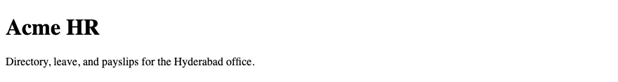

## 2. Semantic HTML & Accessibility

Landmarks are how a screen reader moves around the page. `<header>`, `<nav>`, `<main>`, and `<footer>` are those landmarks. One `<main>` holds the directory or the leave form. The element names were set in the semantic module. Here you check that the leave page still has them.

### Example

```html
<!DOCTYPE html>
<html lang="en">
<head>
  <meta charset="UTF-8">
  <meta name="viewport" content="width=device-width, initial-scale=1.0">
  <title>Acme HR — Leave</title>
</head>
<body>
  <header>
    <h1>Acme HR</h1>
    <nav aria-label="Primary">
      <a href="directory.html">Directory</a>
      <a href="leave.html">Leave</a>
    </nav>
  </header>
  <main>
    <h2>Leave request</h2>
  </main>
  <footer>
    <p>Hyderabad</p>
  </footer>
</body>
</html>
```

**This will produce the following result:**

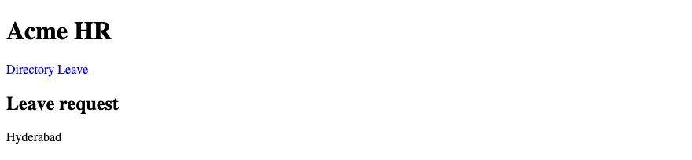

## 3. Proper Heading Hierarchy

A page has one `<h1>`. On the home page that heading is Acme HR. Do not skip heading levels. The directory is an `<h2>`. An employee name is an `<h3>`. This is a review of the heading module. An hgroup subtitle is a `p`.

### Example

```html
<!DOCTYPE html>
<html lang="en">
<head>
  <meta charset="UTF-8">
  <meta name="viewport" content="width=device-width, initial-scale=1.0">
  <title>Acme HR — Directory</title>
</head>
<body>
  <header>
    <hgroup>
      <h1>Acme HR</h1>
      <p>Hyderabad office</p>
    </hgroup>
  </header>
  <main>
    <h2>Directory</h2>
    <article>
      <h3>Ananya Rao</h3>
      <p>Engineering</p>
    </article>
  </main>
</body>
</html>
```

**This will produce the following result:**

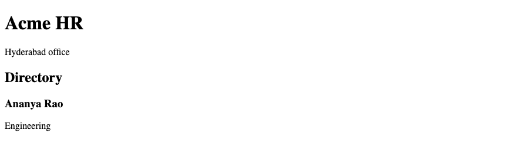

## 4. Accessible Images — `alt`

`alt` was introduced with the staff photo. This module checks it. An informative photo names the person and the department. A decorative image uses `alt=""`. A missing alt is a gap. The caption in a figure does not replace `alt`.

### Example

```html
<!DOCTYPE html>
<html lang="en">
<head>
  <meta charset="UTF-8">
  <meta name="viewport" content="width=device-width, initial-scale=1.0">
  <title>Acme HR — Alt review</title>
</head>
<body>
  <header>
    <h1>Acme HR</h1>
  </header>
  <main>
    
    
  </main>
</body>
</html>
```

**This will produce the following result:**

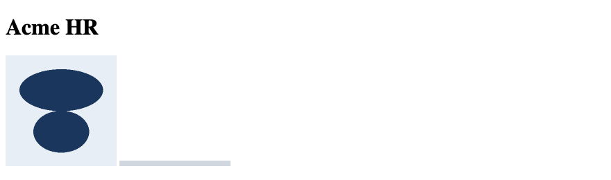

## 5. Accessible Links & Buttons

Link text names the destination: Directory, Leave. A button's text names the action: Submit leave. `target="_blank"` is paired with `rel="noopener noreferrer"`. A link styled as a button is still an `<a>` when it navigates, and a `<button>` when it submits or opens the dialog.

### Example

```html
<!DOCTYPE html>
<html lang="en">
<head>
  <meta charset="UTF-8">
  <meta name="viewport" content="width=device-width, initial-scale=1.0">
  <title>Acme HR — Names</title>
</head>
<body>
  <header>
    <h1>Acme HR</h1>
  </header>
  <main>
    <p><a href="directory.html">Directory</a></p>
    <p><a href="https://example.com/holiday-list" target="_blank" rel="noopener noreferrer">Holiday list</a></p>
    <form action="/leave" method="post">
      <button type="submit">Submit leave</button>
    </form>
  </main>
</body>
</html>
```

**This will produce the following result:**

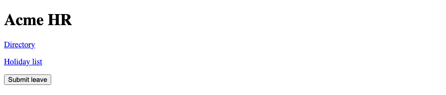

## 6. Accessible Forms

Labels were introduced with the leave form. This module checks them. Each control has a `<label for>` that matches its `id`. Placeholder text is not the label. `disabled` is not submitted. `readonly` is. A file field keeps `enctype="multipart/form-data"`.

### Example

```html
<!DOCTYPE html>
<html lang="en">
<head>
  <meta charset="UTF-8">
  <meta name="viewport" content="width=device-width, initial-scale=1.0">
  <title>Acme HR — Label review</title>
</head>
<body>
  <header>
    <h1>Acme HR</h1>
  </header>
  <main>
    <form action="/leave" method="post" enctype="multipart/form-data">
      <p>
        <label for="reason">Reason</label>
        <textarea id="reason" name="reason" required></textarea>
      </p>
      <p>
        <label for="employee-id">Employee ID</label>
        <input id="employee-id" name="employee_id" type="text" value="E-1042" readonly>
      </p>
      <button type="submit">Submit leave</button>
    </form>
  </main>
</body>
</html>
```

**This will produce the following result:**

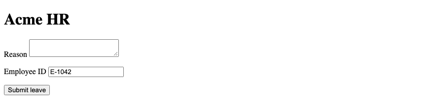

## 7. Keyboard Accessibility

A person can reach every link, button, and field with the Tab key, in an order that follows the page. Do not remove the focus outline unless another visible style replaces it. The CSS module ships `:focus-visible` for that ring. The confirm dialog, once opened with `showModal()`, keeps focus inside the dialog until it closes.

### Example

```html
<!DOCTYPE html>
<html lang="en">
<head>
  <meta charset="UTF-8">
  <meta name="viewport" content="width=device-width, initial-scale=1.0">
  <title>Acme HR — Keyboard</title>
</head>
<body>
  <header>
    <h1>Acme HR</h1>
    <nav aria-label="Primary">
      <a href="directory.html">Directory</a>
      <a href="leave.html">Leave</a>
    </nav>
  </header>
  <main>
    <form action="/leave" method="post">
      <p>
        <label for="start">From</label>
        <input id="start" name="start" type="date">
      </p>
      <button type="submit">Submit leave</button>
    </form>
  </main>
</body>
</html>
```

**This will produce the following result:**

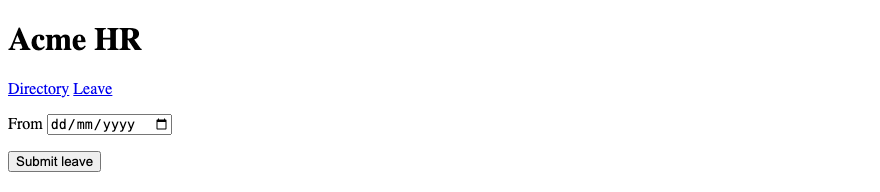

## 8. `tabindex` — Basic Understanding

`tabindex` is only `0` and `-1`. `0` puts an element in the natural tab order. `-1` takes it out of the tab order and still allows a script to focus it. Do not use `1`, `2`, or any positive number. Positive values rearrange the order and are easy to get wrong. Most controls need no `tabindex` at all.

| Value | Meaning |
|-------|---------|
| omitted | Links, buttons, and fields are already in the tab order |
| `0` | Add an element to the natural order |
| `-1` | Remove it from the tab order; a script may still focus it |

### Example

```html
<!DOCTYPE html>
<html lang="en">
<head>
  <meta charset="UTF-8">
  <meta name="viewport" content="width=device-width, initial-scale=1.0">
  <title>Acme HR — tabindex</title>
</head>
<body>
  <header>
    <h1>Acme HR</h1>
  </header>
  <main>
    <p><a href="directory.html">Directory</a></p>
    <p tabindex="-1" id="payroll">Next payroll is 30 September 2026.</p>
  </main>
</body>
</html>
```

**This will produce the following result:**

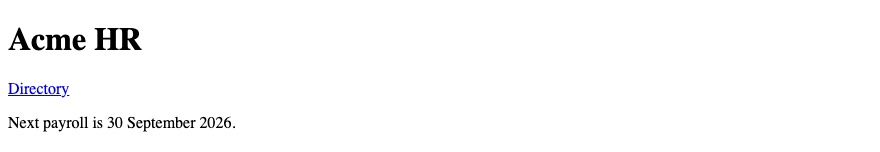

## 9. ARIA — Introduction

ARIA adds a name or a state when native HTML cannot say it. Prefer the native element. A `<button>` does not need `role="button"`. A labeled input does not need `aria-label`. Use ARIA for the gap, such as a nav that needs a name because the page has two navs.

### Example

```html
<!DOCTYPE html>
<html lang="en">
<head>
  <meta charset="UTF-8">
  <meta name="viewport" content="width=device-width, initial-scale=1.0">
  <title>Acme HR — ARIA</title>
</head>
<body>
  <header>
    <h1>Acme HR</h1>
    <nav aria-label="Primary">
      <a href="directory.html">Directory</a>
      <a href="leave.html">Leave</a>
    </nav>
  </header>
  <main>
    <button type="submit">Submit leave</button>
  </main>
</body>
</html>
```

**This will produce the following result:**

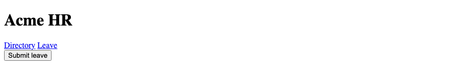

## 10. `role`

Many elements have an implicit role. `<nav>` is navigation. `<button>` is a button. Set `role` only when the native element does not exist for the job. Adding `role="button"` to a `<div>` is a poorer path than using `<button>`. The payslip stays a `<table>`, which already has the table role.

### Example

```html
<!DOCTYPE html>
<html lang="en">
<head>
  <meta charset="UTF-8">
  <meta name="viewport" content="width=device-width, initial-scale=1.0">
  <title>Acme HR — Role</title>
</head>
<body>
  <header>
    <h1>Acme HR</h1>
  </header>
  <main>
    <form action="/leave" method="post">
      <button type="submit">Submit leave</button>
    </form>
  </main>
</body>
</html>
```

**This will produce the following result:**

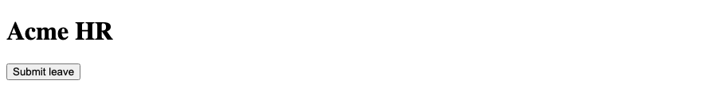

## 11. `aria-label` — Basic Usage

`aria-label` sets an accessible name when there is no visible text to use. A primary nav uses it when a second nav also exists. Do not put `aria-label` on a control that already has a `<label>` or visible text. The visible text and the accessible name would disagree. If they disagree, assistive technology may read the aria-label and hide the visible words.

### Example

```html
<!DOCTYPE html>
<html lang="en">
<head>
  <meta charset="UTF-8">
  <meta name="viewport" content="width=device-width, initial-scale=1.0">
  <title>Acme HR — aria-label</title>
</head>
<body>
  <header>
    <h1>Acme HR</h1>
    <nav aria-label="Primary">
      <a href="index.html">Home</a>
      <a href="directory.html">Directory</a>
      <a href="leave.html">Leave</a>
    </nav>
  </header>
  <main>
    <p>Home, Directory, and Leave.</p>
  </main>
  <footer>
    <nav aria-label="Footer">
      <a href="mailto:hr@acme.example">Email HR</a>
    </nav>
  </footer>
</body>
</html>
```

**This will produce the following result:**

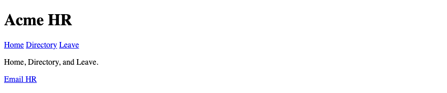

## 12. HTML & SEO

Search tools read the title, the headings, the text, and the links. The `<title>` is the tab name and the usual search link. One clear `<h1>` names the page. Real sentences in paragraphs are the content. A page built only from images of text gives the index little to read.

### Example

```html
<!DOCTYPE html>
<html lang="en">
<head>
  <meta charset="UTF-8">
  <meta name="viewport" content="width=device-width, initial-scale=1.0">
  <title>Acme HR — Employee portal</title>
</head>
<body>
  <header>
    <h1>Acme HR</h1>
  </header>
  <main>
    <p>Employee directory, leave requests, and payslips for the Hyderabad office.</p>
  </main>
</body>
</html>
```

**This will produce the following result:**

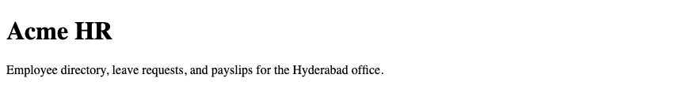

## 13. Meta Description

`<meta name="description">` is a short summary. Search results may show it under the title. It does not appear on the page. One or two sentences are enough. The Hyderabad office and the three tasks — directory, leave, payslip — belong in that sentence.

### Example

```html
<!DOCTYPE html>
<html lang="en">
<head>
  <meta charset="UTF-8">
  <meta name="viewport" content="width=device-width, initial-scale=1.0">
  <meta name="description" content="Acme HR is the employee portal for the Hyderabad office: directory, leave, and payslips.">
  <title>Acme HR</title>
</head>
<body>
  <header>
    <h1>Acme HR</h1>
  </header>
  <main>
    <p>The description is in the head. This paragraph is on the page.</p>
  </main>
</body>
</html>
```

**This will produce the following result:**

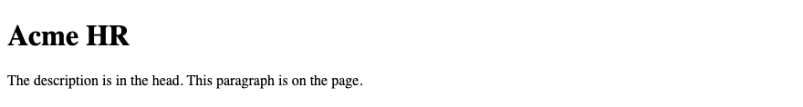

## 14. SEO-Friendly Headings

The headings already follow one `<h1>` and no skipped levels. For search, those headings also name the real topics: Directory, Leave request, Payslip. A heading that says "Welcome" and nothing else wastes the outline. The employee name is the article heading because that is the topic of the article.

### Example

```html
<!DOCTYPE html>
<html lang="en">
<head>
  <meta charset="UTF-8">
  <meta name="viewport" content="width=device-width, initial-scale=1.0">
  <title>Acme HR — Directory</title>
</head>
<body>
  <header>
    <h1>Acme HR</h1>
  </header>
  <main>
    <h2>Directory</h2>
    <article>
      <h3>Karthik Menon</h3>
      <p>HR · E-1108</p>
    </article>
  </main>
</body>
</html>
```

**This will produce the following result:**

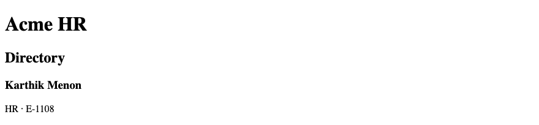

## 15. SEO-Friendly Links & Images

Link text is the words a search tool associates with the destination. "Directory" and "Leave" are those words. An image that carries meaning has `alt` that states the meaning, which search tools also read. A decorative image uses `alt=""`. The file name can be plain, such as `ananya.jpg`. The alt is what describes the photo.

### Example

```html
<!DOCTYPE html>
<html lang="en">
<head>
  <meta charset="UTF-8">
  <meta name="viewport" content="width=device-width, initial-scale=1.0">
  <title>Acme HR — Directory</title>
</head>
<body>
  <header>
    <h1>Acme HR</h1>
  </header>
  <main>
    <p><a href="directory.html">Directory</a></p>
    
  </main>
</body>
</html>
```

**This will produce the following result:**

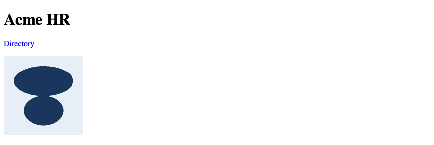

## 16. Semantic HTML & SEO

Search tools use the same landmarks people use. `<main>` marks the content that is unique to the page. `<nav>` marks the repeated links. `<article>` marks one employee. A page of `<div>` elements can still be styled. It gives the index less structure. The semantic page from the previous module is the one to publish.

### Example

```html
<!DOCTYPE html>
<html lang="en">
<head>
  <meta charset="UTF-8">
  <meta name="description" content="Staff directory for Acme HR, Hyderabad.">
  <meta name="viewport" content="width=device-width, initial-scale=1.0">
  <title>Acme HR — Directory</title>
</head>
<body>
  <header>
    <h1>Acme HR</h1>
    <nav aria-label="Primary">
      <a href="directory.html">Directory</a>
      <a href="leave.html">Leave</a>
    </nav>
  </header>
  <main>
    <article>
      <h2>Ananya Rao</h2>
      <p>Engineering · E-1042</p>
    </article>
  </main>
</body>
</html>
```

**This will produce the following result:**

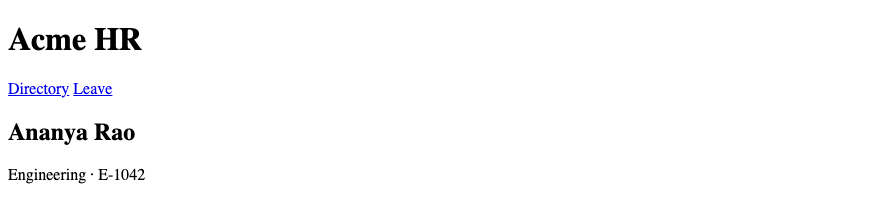
