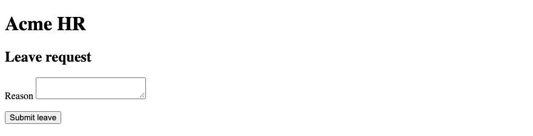
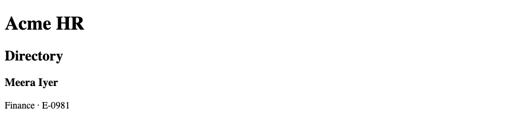
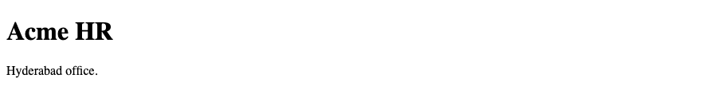
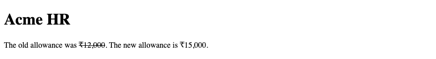
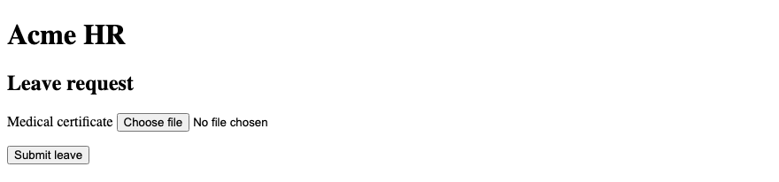
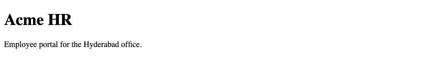
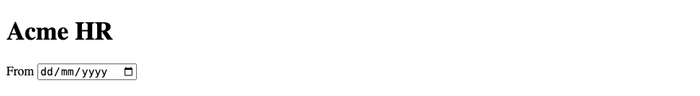
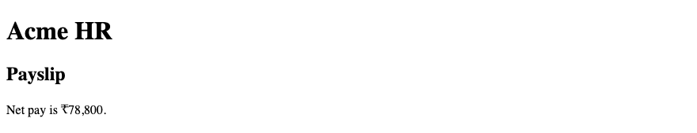

# 9. HTML — HTML Development Practices

**Index:** [HTML tutorial](../01_HTML.md)  
**Previous:** [Accessibility and SEO Basics](Module_08_Accessibility_and_SEO.md)  
**Next:** [Practical HTML Project](Module_10_Practical_HTML_Project.md)

These checks are for the Acme HR pages: home, directory, and leave request.

## 1. HTML Best Practices

One `<h1>`. Do not skip heading levels. Every field has a label. Every informative image has alt text. A decorative image uses `alt=""`. The charset is UTF-8 so ₹ displays. The viewport meta tag is present. The leave form uses `method="post"`. A file input needs `enctype="multipart/form-data"`.

### Example

```html
<!DOCTYPE html>
<html lang="en">
<head>
  <meta charset="UTF-8">
  <meta name="viewport" content="width=device-width, initial-scale=1.0">
  <title>Acme HR — Leave</title>
</head>
<body>
  <header>
    <h1>Acme HR</h1>
  </header>
  <main>
    <h2>Leave request</h2>
    <form action="/leave" method="post" enctype="multipart/form-data">
      <p>
        <label for="reason">Reason</label>
        <textarea id="reason" name="reason" required></textarea>
      </p>
      <button type="submit">Submit leave</button>
    </form>
  </main>
</body>
</html>
```

**This will produce the following result:**



## 2. Meaningful Element Selection

Choose the element that names the content. An employee is an `<article>`. The payroll date is an `<aside>`. The office is an `<address>`. The payslip is a `<table>`. `<div>` and `<span>` are for when no semantic element fits. A layout wrapper around the cards can be a `<div>`. The card itself is not a `<div>`.

### Example

```html
<!DOCTYPE html>
<html lang="en">
<head>
  <meta charset="UTF-8">
  <meta name="viewport" content="width=device-width, initial-scale=1.0">
  <title>Acme HR — Directory</title>
</head>
<body>
  <header>
    <h1>Acme HR</h1>
  </header>
  <main>
    <section>
      <h2>Directory</h2>
      <article>
        <h3>Meera Iyer</h3>
        <p>Finance · E-0981</p>
      </article>
    </section>
  </main>
</body>
</html>
```

**This will produce the following result:**



## 3. Proper Indentation & Formatting

Indent child elements by two spaces. One element that fits on a line can stay on one line. A form field and its label are easier to check when each tag is on its own line. Put the doctype on line 1. Keep attributes in a stable order: `id`, `name`, `type`, then the rest. The file is easier to diff when the shape does not drift.

### Example

```html
<!DOCTYPE html>
<html lang="en">
<head>
  <meta charset="UTF-8">
  <meta name="viewport" content="width=device-width, initial-scale=1.0">
  <title>Acme HR</title>
</head>
<body>
  <header>
    <h1>Acme HR</h1>
  </header>
  <main>
    <p>Hyderabad office.</p>
  </main>
</body>
</html>
```

**This will produce the following result:**



## 4. Avoiding Deprecated HTML

Current HTML does not use `<font>`, `<center>`, `<marquee>`, or the `bgcolor` attribute. `<s>` marks text that is no longer accurate. `<del>` marks an edit. Presentational tags are replaced by CSS in `styles.css`. If you meet `<font>` in an old page, move the colour into a class.

### Example

```html
<!DOCTYPE html>
<html lang="en">
<head>
  <meta charset="UTF-8">
  <meta name="viewport" content="width=device-width, initial-scale=1.0">
  <title>Acme HR — Current markup</title>
  <link rel="stylesheet" href="styles.css">
</head>
<body>
  <header>
    <h1>Acme HR</h1>
  </header>
  <main>
    <p>The old allowance was <s>₹12,000</s>. The new allowance is ₹15,000.</p>
  </main>
</body>
</html>
```

**This will produce the following result:**



## 5. Common HTML Mistakes

A `<div>` is not a heading. An input without an `id` cannot be tied to a label. `required="false"` is still required. A file field without `enctype="multipart/form-data"` does not send the file. `target="_blank"` without `rel="noopener noreferrer"` is incomplete. Skipped heading levels break the outline. A missing `alt` on a staff photo is a missing name.

### Example

```html
<!DOCTYPE html>
<html lang="en">
<head>
  <meta charset="UTF-8">
  <meta name="viewport" content="width=device-width, initial-scale=1.0">
  <title>Acme HR — Leave</title>
</head>
<body>
  <header>
    <h1>Acme HR</h1>
  </header>
  <main>
    <h2>Leave request</h2>
    <form action="/leave" method="post" enctype="multipart/form-data">
      <p>
        <label for="certificate">Medical certificate</label>
        <input id="certificate" name="certificate" type="file" accept=".pdf,application/pdf">
      </p>
      <button type="submit">Submit leave</button>
    </form>
  </main>
</body>
</html>
```

**This will produce the following result:**



## 6. HTML Validation

Validation compares the file with the HTML standard. The W3C Markup Validation Service and the validator built into some editors both report unclosed tags, bad nesting, and duplicate ids. A valid page can still be a poor page. Validation does not check whether the alt text is true. Fix the reported errors, then read the page.

### Example

```html
<!DOCTYPE html>
<html lang="en">
<head>
  <meta charset="UTF-8">
  <meta name="viewport" content="width=device-width, initial-scale=1.0">
  <title>Acme HR</title>
</head>
<body>
  <header>
    <h1>Acme HR</h1>
  </header>
  <main>
    <p>Employee portal for the Hyderabad office.</p>
  </main>
</body>
</html>
```

**This will produce the following result:**



## 7. Browser Developer Tools

Developer tools open from the browser menu, or with a right-click and Inspect. The Elements panel shows the live tree. The Styles pane shows which CSS rule won. Use this on the directory when a card looks wrong. The tools are for reading the page the browser built, after it parsed your file.

### Example

```html
<!DOCTYPE html>
<html lang="en">
<head>
  <meta charset="UTF-8">
  <meta name="viewport" content="width=device-width, initial-scale=1.0">
  <title>Acme HR — Directory</title>
  <link rel="stylesheet" href="styles.css">
</head>
<body>
  <header>
    <h1>Acme HR</h1>
  </header>
  <main>
    <h2>Directory</h2>
    <article class="employee-card">
      <h3>Ananya Rao</h3>
      <p>Engineering</p>
    </article>
  </main>
</body>
</html>
```

**This will produce the following result:**


## 8. Inspecting HTML

Inspect shows the element under the pointer, its ancestors, and its attributes. Check that `for` and `id` match on the leave form. Check that the payslip caption is inside the table. The tree in the panel can differ from the file after a script runs. `showModal()` adds the open modal state in this tree.

### Example

```html
<!DOCTYPE html>
<html lang="en">
<head>
  <meta charset="UTF-8">
  <meta name="viewport" content="width=device-width, initial-scale=1.0">
  <title>Acme HR — Inspect</title>
</head>
<body>
  <header>
    <h1>Acme HR</h1>
  </header>
  <main>
    <form action="/leave" method="post">
      <p>
        <label for="start">From</label>
        <input id="start" name="start" type="date">
      </p>
    </form>
  </main>
</body>
</html>
```

**This will produce the following result:**



## 9. Debugging HTML

If the rest of the page is bold, a tag is unclosed. If ₹ is garbled, the charset is missing or the file was saved as another encoding. If a click on a label does nothing, `for` and `id` do not match. If the staff photo is a broken icon, `src` points at the wrong path. If a heading level jumps from `h1` to `h3`, put the missing `h2` back.

### Example

```html
<!DOCTYPE html>
<html lang="en">
<head>
  <meta charset="UTF-8">
  <meta name="viewport" content="width=device-width, initial-scale=1.0">
  <title>Acme HR — Payslip</title>
</head>
<body>
  <header>
    <h1>Acme HR</h1>
  </header>
  <main>
    <h2>Payslip</h2>
    <p>Net pay is ₹78,800.</p>
  </main>
</body>
</html>
```

**This will produce the following result:**



## 10. View Page Source

View page source shows the HTML the server sent, or the file you opened from disk. It does not show changes a script made after load. Use it to confirm the doctype, the charset, and the form's `enctype`. Inspect shows the live tree. Source shows the file. Django and Spring send this same file. CSS linked from it is a separate request.

### Example

```html
<!DOCTYPE html>
<html lang="en">
<head>
  <meta charset="UTF-8">
  <meta name="viewport" content="width=device-width, initial-scale=1.0">
  <title>Acme HR</title>
  <link rel="stylesheet" href="styles.css">
</head>
<body>
  <header>
    <h1>Acme HR</h1>
  </header>
  <main>
    <p>View source on this page and find the title and the stylesheet link.</p>
  </main>
</body>
</html>
```

**This will produce the following result:**


