# 10. HTML — Practical HTML Project

**Index:** [HTML tutorial](../01_HTML.md)  
**Previous:** [HTML Development Practices](Module_09_HTML_Development_Practices.md)  
**Next:** [CSS and Responsive](../02_CSS_and_Responsive.md)

This pass is the HTML for three pages: home (`index.html`), the directory (`directory.html`), and the leave request (`leave.html`). The CSS project styles these same files. The `<h1>` on each page is Acme HR. Do not skip heading levels.

## 1. Build a Multi-Page Website

The site is three documents in one folder. Home introduces the Hyderabad office. The directory lists staff and shows one payslip. The leave page collects a request. Each file has a doctype, `lang`, charset, viewport, a title, and a link to `styles.css`. For these local files a relative `href="styles.css"` is fine. Under Django or Spring a route like `/leave/new/` would break that path — use `` or `th:href="@{...}"` instead.

| File | Page |
|------|------|
| `index.html` | Home |
| `directory.html` | Directory and payslip |
| `leave.html` | Leave request |

### Example

```html
<!DOCTYPE html>
<html lang="en">
<head>
  <meta charset="UTF-8">
  <meta name="viewport" content="width=device-width, initial-scale=1.0">
  <meta name="description" content="Acme HR is the employee portal for the Hyderabad office: directory, leave, and payslips.">
  <title>Acme HR</title>
  <link rel="stylesheet" href="styles.css">
</head>
<body>
  <header class="site-header">
    <h1>Acme HR</h1>
    <nav aria-label="Primary">
      <a href="index.html">Home</a>
      <a href="directory.html">Directory</a>
      <a href="leave.html">Leave</a>
    </nav>
  </header>
  <main>
    <section class="hero">
      <h2>Employee portal</h2>
      <p>Staff records, leave, and payslips for the Hyderabad office.</p>
      <a class="button" href="directory.html">Open the directory</a>
    </section>
  </main>
  <footer>
    <address>
      Acme HR<br>
      Level 3, Lakshmi Towers<br>
      HITEC City, Hyderabad 500081
    </address>
  </footer>
</body>
</html>
```

**This will produce the following result:**

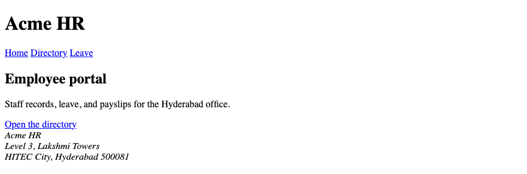

## 2. Page Structure

Each page is a header, a main, and a footer. Home also has a section for the portal introduction, a section for departments, and an aside for the next payroll date. One `<main>` per page. The header and the footer sit outside it.

### Example

```html
<!DOCTYPE html>
<html lang="en">
<head>
  <meta charset="UTF-8">
  <meta name="viewport" content="width=device-width, initial-scale=1.0">
  <meta name="description" content="Acme HR is the employee portal for the Hyderabad office: directory, leave, and payslips.">
  <title>Acme HR</title>
  <link rel="stylesheet" href="styles.css">
</head>
<body>
  <header class="site-header">
    <h1>Acme HR</h1>
    <nav aria-label="Primary">
      <a href="index.html">Home</a>
      <a href="directory.html">Directory</a>
      <a href="leave.html">Leave</a>
    </nav>
  </header>
  <main>
    <section class="hero">
      <h2>Employee portal</h2>
      <p>Staff records, leave, and payslips for the Hyderabad office.</p>
    </section>
    <section>
      <h2>Departments</h2>
      <ul>
        <li>Engineering</li>
        <li>HR</li>
        <li>Finance</li>
      </ul>
    </section>
    <aside>
      <h2>Next payroll</h2>
      <p><time datetime="2026-09-30">30 September 2026</time></p>
    </aside>
  </main>
  <footer>
    <address>
      Acme HR<br>
      Level 3, Lakshmi Towers<br>
      HITEC City, Hyderabad 500081
    </address>
  </footer>
</body>
</html>
```

**This will produce the following result:**

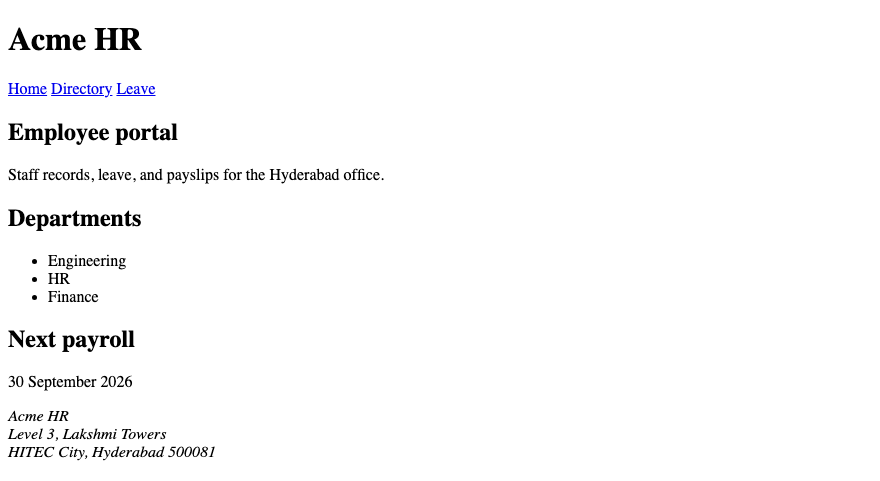

## 3. Navigation

The same nav appears on every page. The links are Home, Directory, and Leave. The words are the destinations. `aria-label="Primary"` names the nav. A second nav is not required on these three pages.

### Example

```html
<!DOCTYPE html>
<html lang="en">
<head>
  <meta charset="UTF-8">
  <meta name="viewport" content="width=device-width, initial-scale=1.0">
  <title>Acme HR</title>
  <link rel="stylesheet" href="styles.css">
</head>
<body>
  <header class="site-header">
    <h1>Acme HR</h1>
    <nav aria-label="Primary">
      <a href="index.html">Home</a>
      <a href="directory.html">Directory</a>
      <a href="leave.html">Leave</a>
    </nav>
  </header>
  <main>
    <h2>Employee portal</h2>
    <p>The same three links are on the directory and the leave page.</p>
  </main>
</body>
</html>
```

**This will produce the following result:**

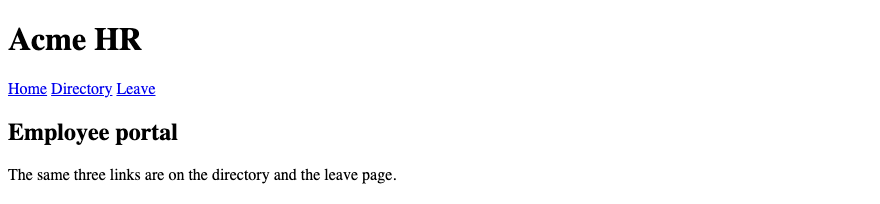

## 4. Images

The directory shows a staff photo of Ananya Rao. `alt` is her name and department. `width` and `height` reserve the box. A decorative divider, if you add one, uses `alt=""`. The photo does not replace her heading.

### Example

```html
<!DOCTYPE html>
<html lang="en">
<head>
  <meta charset="UTF-8">
  <meta name="viewport" content="width=device-width, initial-scale=1.0">
  <title>Acme HR — Directory</title>
  <link rel="stylesheet" href="styles.css">
</head>
<body>
  <header class="site-header">
    <h1>Acme HR</h1>
    <nav aria-label="Primary">
      <a href="index.html">Home</a>
      <a href="directory.html">Directory</a>
      <a href="leave.html">Leave</a>
    </nav>
  </header>
  <main>
    <section>
      <h2>Directory</h2>
      <article class="employee-card">
        
        <h3>Ananya Rao</h3>
        <p>Engineering · E-1042</p>
      </article>
    </section>
  </main>
</body>
</html>
```

**This will produce the following result:**

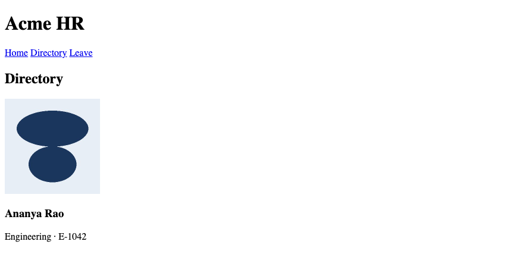

## 5. Lists

Departments on the home page are an unordered list. Engineering has a nested list of teams. The steps to file leave can be an ordered list on the leave page. An employee id and a department can be a description list inside an article. The payslip stays a table.

### Example

```html
<!DOCTYPE html>
<html lang="en">
<head>
  <meta charset="UTF-8">
  <meta name="viewport" content="width=device-width, initial-scale=1.0">
  <title>Acme HR</title>
  <link rel="stylesheet" href="styles.css">
</head>
<body>
  <header class="site-header">
    <h1>Acme HR</h1>
  </header>
  <main>
    <section>
      <h2>Departments</h2>
      <ul>
        <li>Engineering
          <ul>
            <li>Platform</li>
            <li>Product</li>
          </ul>
        </li>
        <li>HR</li>
        <li>Finance</li>
      </ul>
    </section>
  </main>
</body>
</html>
```

**This will produce the following result:**

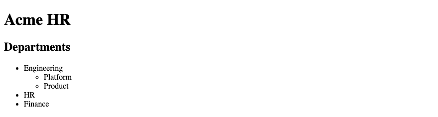

## 6. Tables

The directory page includes the September payslip for Ananya Rao. The caption names her and the month. Column headers use `scope="col"`. Row headers use `scope="row"`. Earnings and deductions span both columns. Net pay is ₹78,800. The table is data. It is not the page layout.

### Example

```html
<!DOCTYPE html>
<html lang="en">
<head>
  <meta charset="UTF-8">
  <meta name="viewport" content="width=device-width, initial-scale=1.0">
  <title>Acme HR — Directory</title>
  <link rel="stylesheet" href="styles.css">
</head>
<body>
  <header class="site-header">
    <h1>Acme HR</h1>
    <nav aria-label="Primary">
      <a href="index.html">Home</a>
      <a href="directory.html">Directory</a>
      <a href="leave.html">Leave</a>
    </nav>
  </header>
  <main>
    <section>
      <h2>Payslip</h2>
      <table>
        <caption>Payslip for Ananya Rao, September 2026</caption>
        <thead>
          <tr>
            <th scope="col">Component</th>
            <th scope="col">Amount</th>
          </tr>
        </thead>
        <tbody>
          <tr>
            <th colspan="2" scope="rowgroup">Earnings</th>
          </tr>
          <tr>
            <th scope="row">Basic</th>
            <td>₹50,000</td>
          </tr>
          <tr>
            <th scope="row">HRA</th>
            <td>₹20,000</td>
          </tr>
          <tr>
            <th scope="row">Special allowance</th>
            <td>₹15,000</td>
          </tr>
          <tr>
            <th scope="row">Gross</th>
            <td>₹85,000</td>
          </tr>
        </tbody>
        <tbody>
          <tr>
            <th colspan="2" scope="rowgroup">Deductions</th>
          </tr>
          <tr>
            <th scope="row">PF</th>
            <td>₹6,000</td>
          </tr>
          <tr>
            <th scope="row">Professional tax</th>
            <td>₹200</td>
          </tr>
        </tbody>
        <tfoot>
          <tr>
            <th scope="row">Net pay</th>
            <td>₹78,800</td>
          </tr>
        </tfoot>
      </table>
    </section>
  </main>
</body>
</html>
```

**This will produce the following result:**

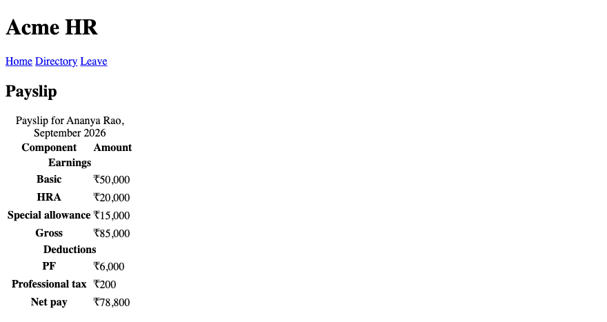

## 7. Forms

The leave page posts to `/leave`. A file input needs `enctype="multipart/form-data"`. Each control has a label. The POST includes a CSRF token so Django or Spring Security will accept it. The signed-in employee is shown as text; the server takes identity from the session, not from a form field. `required="false"` is still required, so the optional certificate omits `required`. The leave-type select starts with an empty option so `required` can block submit. Every button has an explicit `type`. Confirm closes the dialog and, when its value is `confirm`, submits the leave form.

### Example

```html
<!DOCTYPE html>
<html lang="en">
<head>
  <meta charset="UTF-8">
  <meta name="viewport" content="width=device-width, initial-scale=1.0">
  <title>Acme HR — Leave</title>
  <link rel="stylesheet" href="styles.css">
</head>
<body>
  <header class="site-header">
    <h1>Acme HR</h1>
    <nav aria-label="Primary">
      <a href="index.html">Home</a>
      <a href="directory.html">Directory</a>
      <a href="leave.html">Leave</a>
    </nav>
  </header>
  <main>
    <h2>Leave request</h2>
    <p>Signed in as Ananya Rao (E-1042).</p>
    <form id="leave-form" action="/leave" method="post" enctype="multipart/form-data">
      <input type="hidden" name="csrfmiddlewaretoken" value="…">
      <p>
        <label for="email">Work email</label>
        <input id="email" name="email" type="email" autocomplete="email" required>
      </p>
      <p>
        <label for="leave-type">Leave type</label>
        <select id="leave-type" name="leave_type" required>
          <option value="">Choose a type</option>
          <optgroup label="Paid">
            <option value="casual">Casual</option>
            <option value="earned">Earned</option>
          </optgroup>
        </select>
      </p>
      <p>
        <label for="start">From</label>
        <input id="start" name="start" type="date" required>
      </p>
      <p>
        <label for="reason">Reason</label>
        <textarea id="reason" name="reason" rows="4" minlength="10" maxlength="200" required></textarea>
      </p>
      <p>
        <label for="certificate">Medical certificate</label>
        <input id="certificate" name="certificate" type="file" accept=".pdf,application/pdf">
      </p>
      <button type="submit">Submit leave</button>
      <button type="button" id="open-confirm" command="show-modal" commandfor="confirm-leave">Review leave</button>
    </form>
    <dialog id="confirm-leave">
      <h2>Confirm leave request</h2>
      <p>Submit this leave request?</p>
      <form method="dialog">
        <button type="submit" value="cancel">Cancel</button>
        <button type="submit" value="confirm">Confirm</button>
      </form>
    </dialog>
  </main>
  <script>
    const leaveForm = document.querySelector("#leave-form");
    const dialog = document.querySelector("#confirm-leave");
    const openConfirm = document.querySelector("#open-confirm");
    if (!("command" in HTMLButtonElement.prototype)) {
      openConfirm.addEventListener("click", function () {
        dialog.showModal();
      });
    }
    dialog.addEventListener("close", function () {
      if (dialog.returnValue === "confirm") {
        leaveForm.requestSubmit();
      }
    });
  </script>
</body>
</html>
```

**This will produce the following result:**

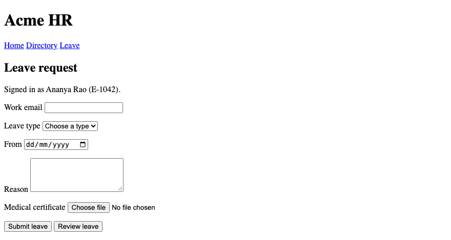

## 8. Semantic HTML

Home uses `header`, `nav`, `main`, `section`, `aside`, `footer`, and `address`. The directory uses an `article` for each employee. The card row is a `div` because no semantic element names that layout hook. `<div>` and `<span>` are for when no semantic element fits. The payroll date stays an `aside`.

### Example

```html
<!DOCTYPE html>
<html lang="en">
<head>
  <meta charset="UTF-8">
  <meta name="viewport" content="width=device-width, initial-scale=1.0">
  <title>Acme HR — Directory</title>
  <link rel="stylesheet" href="styles.css">
</head>
<body>
  <header class="site-header">
    <h1>Acme HR</h1>
  </header>
  <main>
    <section>
      <h2>Directory</h2>
      <div class="cards">
        <article class="employee-card">
          <h3>Ananya Rao</h3>
          <p>Engineering · E-1042</p>
        </article>
        <article class="employee-card">
          <h3>Karthik Menon</h3>
          <p>HR · E-1108</p>
        </article>
        <article class="employee-card">
          <h3>Meera Iyer</h3>
          <p>Finance · E-0981</p>
        </article>
      </div>
    </section>
    <aside>
      <h2>Next payroll</h2>
      <p><time datetime="2026-09-30">30 September 2026</time></p>
    </aside>
  </main>
  <footer>
    <address>
      Acme HR<br>
      Level 3, Lakshmi Towers, HITEC City, Hyderabad 500081
    </address>
  </footer>
</body>
</html>
```

**This will produce the following result:**

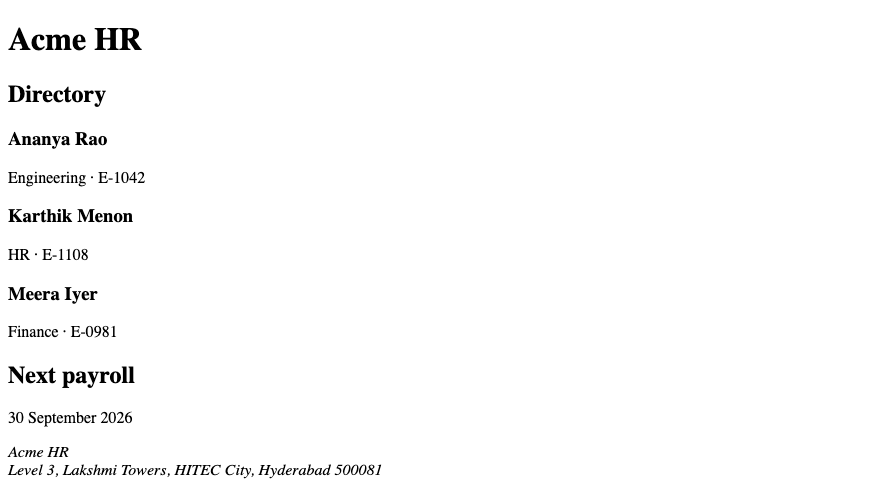

## 9. Accessibility

This is a review of alt text, labels, and headings. The staff photo has alt text. Every leave field has a label whose `for` matches the control `id`. The page has one `h1` (the site name, Acme HR). The directory is an `h2`. An employee is an `h3`. Prefer `tabindex` of `0` or `-1` only; these pages need neither. Current browsers treat `target="_blank"` as `noopener` by default; `rel="noreferrer"` is still useful when you want to withhold the referrer.

### Example

```html
<!DOCTYPE html>
<html lang="en">
<head>
  <meta charset="UTF-8">
  <meta name="viewport" content="width=device-width, initial-scale=1.0">
  <title>Acme HR — Leave</title>
  <link rel="stylesheet" href="styles.css">
</head>
<body>
  <header class="site-header">
    <h1>Acme HR</h1>
  </header>
  <main>
    <h2>Leave request</h2>
    <form action="/leave" method="post">
      <p>
        <label for="reason">Reason</label>
        <textarea id="reason" name="reason" required></textarea>
      </p>
      <button type="submit">Submit leave</button>
    </form>
  </main>
</body>
</html>
```

**This will produce the following result:**


## 10. SEO Metadata

Each page has its own `<title>` and meta description. Home is "Acme HR". The directory title adds Directory. The leave title adds Leave. The description states the office and the task. The visible `<h1>` remains Acme HR. Headings name Directory, Payslip, and Leave request.

### Example

```html
<!DOCTYPE html>
<html lang="en">
<head>
  <meta charset="UTF-8">
  <meta name="viewport" content="width=device-width, initial-scale=1.0">
  <meta name="description" content="Staff directory for Acme HR, Hyderabad.">
  <title>Acme HR — Directory</title>
  <link rel="stylesheet" href="styles.css">
</head>
<body>
  <header class="site-header">
    <h1>Acme HR</h1>
  </header>
  <main>
    <h2>Directory</h2>
    <p>Engineering, HR, and Finance.</p>
  </main>
</body>
</html>
```

**This will produce the following result:**

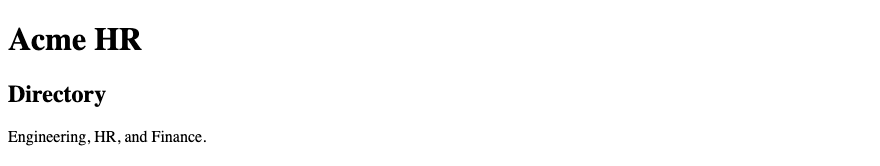

## 11. HTML Validation

Run the three files through a markup validator before the CSS pass. Fix unclosed tags, duplicate ids, and a caption that is not inside the table. A valid file can still miss a label. After the validator is clean, tab through the leave form and read the alt text on the staff photo.

### Example

```html
<!DOCTYPE html>
<html lang="en">
<head>
  <meta charset="UTF-8">
  <meta name="viewport" content="width=device-width, initial-scale=1.0">
  <title>Acme HR</title>
  <link rel="stylesheet" href="styles.css">
</head>
<body>
  <header class="site-header">
    <h1>Acme HR</h1>
  </header>
  <main>
    <p>Validate index.html, directory.html, and leave.html.</p>
  </main>
  <footer>
    <address>Acme HR, HITEC City, Hyderabad 500081</address>
  </footer>
</body>
</html>
```

**This will produce the following result:**

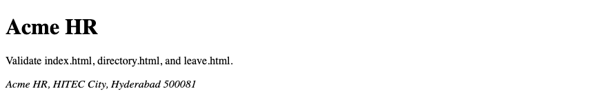

## 12. Browser DevTools

Open the directory and inspect an employee article. Confirm the heading level is `h3` under the directory `h2`. Inspect the leave form and confirm `for` matches `id`. View source shows the file. Inspect shows the live tree, including the dialog after `showModal()`.

### Example

```html
<!DOCTYPE html>
<html lang="en">
<head>
  <meta charset="UTF-8">
  <meta name="viewport" content="width=device-width, initial-scale=1.0">
  <title>Acme HR — Directory</title>
  <link rel="stylesheet" href="styles.css">
</head>
<body>
  <header class="site-header">
    <h1>Acme HR</h1>
  </header>
  <main>
    <section>
      <h2>Directory</h2>
      <article class="employee-card">
        <h3>Ananya Rao</h3>
        <p>Engineering · E-1042</p>
      </article>
    </section>
  </main>
</body>
</html>
```

**This will produce the following result:**

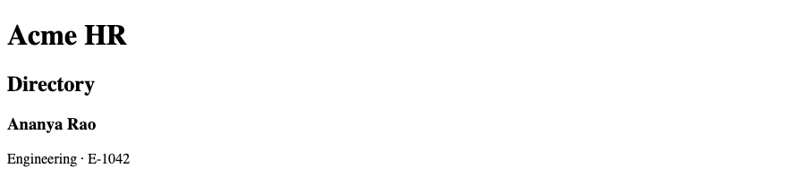

## 13. Final Project Review

Home, directory, and leave share the header, the nav, and the office address. The directory holds three articles, the staff photo, and the payslip. The leave page holds the form and the confirm dialog. Money is in ₹. The next module writes `styles.css` for these same pages. Django will serve that file from `static/` with ``. Spring Boot will serve it from `src/main/resources/static/` with `th:href="@{...}"`.

### Example

```html
<!DOCTYPE html>
<html lang="en">
<head>
  <meta charset="UTF-8">
  <meta name="viewport" content="width=device-width, initial-scale=1.0">
  <meta name="description" content="Acme HR is the employee portal for the Hyderabad office: directory, leave, and payslips.">
  <title>Acme HR</title>
  <link rel="stylesheet" href="styles.css">
</head>
<body>
  <header class="site-header">
    <h1>Acme HR</h1>
    <nav aria-label="Primary">
      <a href="index.html">Home</a>
      <a href="directory.html">Directory</a>
      <a href="leave.html">Leave</a>
    </nav>
  </header>
  <main>
    <section class="hero">
      <h2>Employee portal</h2>
      <p>Staff records, leave, and payslips for the Hyderabad office.</p>
      <a class="button" href="directory.html">Open the directory</a>
    </section>
    <aside>
      <h2>Next payroll</h2>
      <p><time datetime="2026-09-30">30 September 2026</time></p>
    </aside>
  </main>
  <footer>
    <address>
      Acme HR<br>
      Level 3, Lakshmi Towers<br>
      HITEC City, Hyderabad 500081<br>
      <a href="mailto:hr@acme.example">hr@acme.example</a>
    </address>
  </footer>
</body>
</html>
```

**This will produce the following result:**

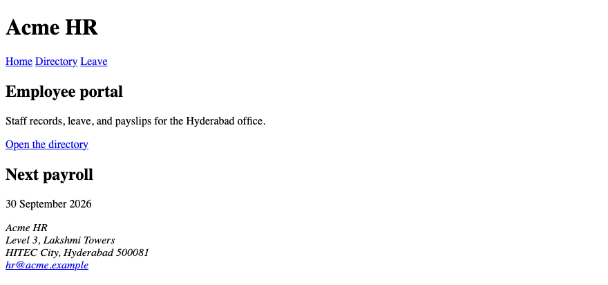
