# Lesson 3 — Page Structure & the Box Model

**Course:** HTML & CSS for Full Stack · **Session 3 of 9** · [Learning path](README.md) · **Previous:** [Lesson 2](02_Content_and_Your_First_CSS.md) · **Next:** [Lesson 4 — Images, Navigation & Flexbox](04_Images_Navigation_and_Flexbox.md)

**Module Outcome:** You can divide a page into meaningful regions, show label–value data correctly, and control the size and spacing of every box on the page.

| | |
|---|---|
| **You will build** | The AcmeHR **Employee profile** page |
| **New HTML** | `header`, `nav`, `main`, `section`, `aside`, `footer`, `div`, `span`, `dl`, `dt`, `dd` |
| **New CSS** | The box model: `margin`, `padding`, `border`, `border-radius`, `width`, `max-width`, `box-sizing`, the `*` selector · `display` · `list-style` · `font-size`, `text-align` · units `px`, `rem`, `%` |
| **You need** | Lessons 1 and 2 |

**From the requirements.** The AcmeHR employee profile stores the employee ID, name, contact information, emergency contact, employment details, reporting manager, department and designation. Employees can view their profile.

**Where we are going:**

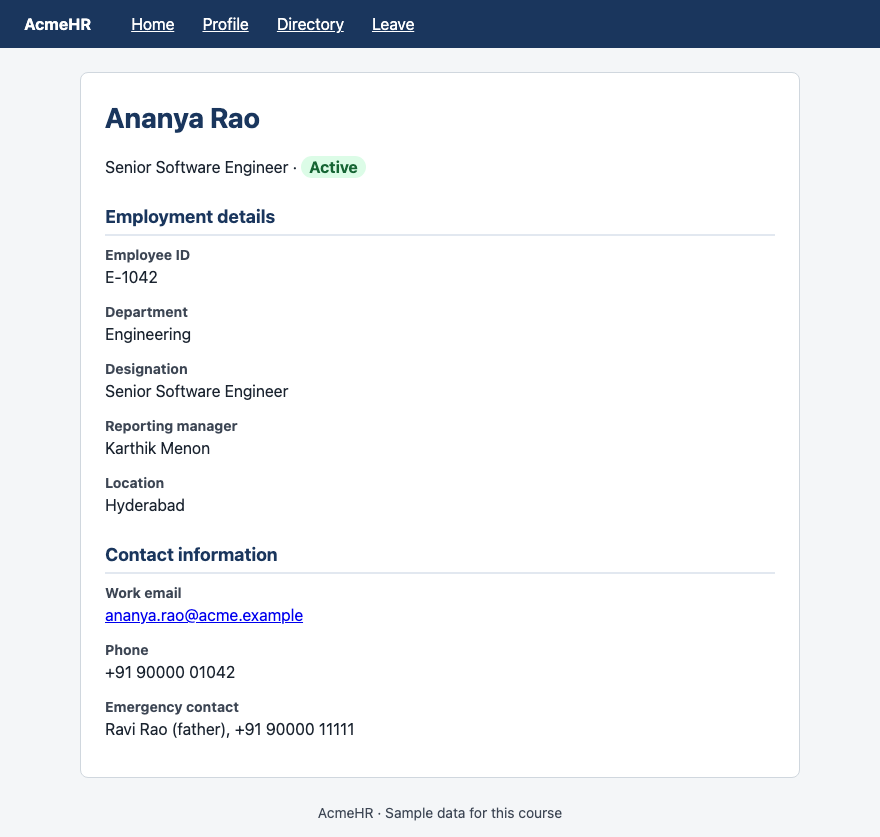

All example files: [`examples/lesson03/`](examples/lesson03/)

---

# Part A — Structure

## 1. Page regions

Most pages have the same regions. HTML has an element for each one:

```html
<header>
  <p>header — AcmeHR logo and name</p>
  <nav>
    <p>nav — links to other pages</p>
  </nav>
</header>
<main>
  <h1>main — Ananya Rao</h1>
  <section>
    <h2>section — Employment details</h2>
  </section>
  <section>
    <h2>section — Contact information</h2>
  </section>
</main>
<aside>
  <p>aside — related: reporting manager</p>
</aside>
<footer>
  <p>footer — © Acme · Help</p>
</footer>
```

**Output** (blue outlines = regions, red dashed = sections):

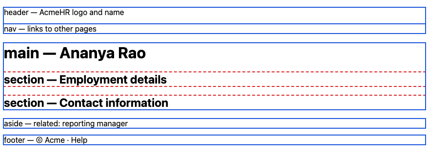

| Element | Holds | Per page |
|---|---|---|
| `<header>` | Logo, site name, often the `nav` | Usually one at the top |
| `<nav>` | The main links to other pages | One or two |
| `<main>` | The content that is unique to this page | **Exactly one** |
| `<section>` | One themed part of the content, **with a heading** | Any number |
| `<aside>` | Related but secondary content | Optional |
| `<footer>` | Copyright, help links, contact | Usually one at the bottom |

**Why it matters:** Screen readers offer a "jump to main content" and "jump to navigation" shortcut for these regions. Search engines use them too. And your CSS becomes readable: `header`, `nav`, `main` say what they are.

## 2. `div` and `span` — boxes with no meaning

```html
<div class="card">
  <h2>Ananya Rao</h2>
  <p>Senior Software Engineer · <span class="status">Active</span></p>
</div>
```

```css
.status { color: #15803d; font-weight: bold; }
.card { background-color: #eef2f7; }
```

**Output:**


- `<div>` is a **block** box with no meaning. `<span>` is an **inline** box with no meaning.
- Use them only for styling hooks, when no meaningful element fits.

**Common Error:** "div soup" — a page built only from `div`s. If an element exists for the job (`header`, `nav`, `main`, `section`, `p`, `ul`), use it.

## 3. Label–value pairs — `dl`, `dt`, `dd`

```html
<h2>Employment details</h2>
<dl>
  <dt>Employee ID</dt>
  <dd>E-1042</dd>
  <dt>Department</dt>
  <dd>Engineering</dd>
  <dt>Reporting manager</dt>
  <dd>Karthik Menon</dd>
</dl>
```

**Output:**

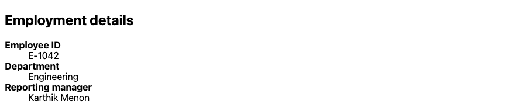

| Element | Meaning |
|---|---|
| `<dl>` | Description list — a list of label–value pairs |
| `<dt>` | The label (term) |
| `<dd>` | The value (description) |

Profile fields, order summaries, and settings pages are all label–value data. `dl` keeps each label tied to its value.

## 4. The profile page in HTML

```html
<header>
  <p>AcmeHR</p>
  <nav>
    <ul>
      <li><a href="#">Home</a></li>
      <li><a href="#">Profile</a></li>
      <li><a href="#">Directory</a></li>
      <li><a href="#">Leave</a></li>
    </ul>
  </nav>
</header>

<main>
  <h1>Ananya Rao</h1>
  <p>Senior Software Engineer · <span class="status">Active</span></p>

  <section>
    <h2>Employment details</h2>
    <dl>
      <dt>Employee ID</dt>
      <dd>E-1042</dd>
      <dt>Department</dt>
      <dd>Engineering</dd>
      <dt>Designation</dt>
      <dd>Senior Software Engineer</dd>
      <dt>Reporting manager</dt>
      <dd>Karthik Menon</dd>
      <dt>Location</dt>
      <dd>Hyderabad</dd>
    </dl>
  </section>

  <section>
    <h2>Contact information</h2>
    <dl>
      <dt>Work email</dt>
      <dd><a href="mailto:ananya.rao@acme.example">ananya.rao@acme.example</a></dd>
      <dt>Phone</dt>
      <dd>+91 90000 01042</dd>
      <dt>Emergency contact</dt>
      <dd>Ravi Rao (father), +91 90000 11111</dd>
    </dl>
  </section>
</main>

<footer>
  <p>AcmeHR · Sample data for this course</p>
</footer>
```

**Output:**

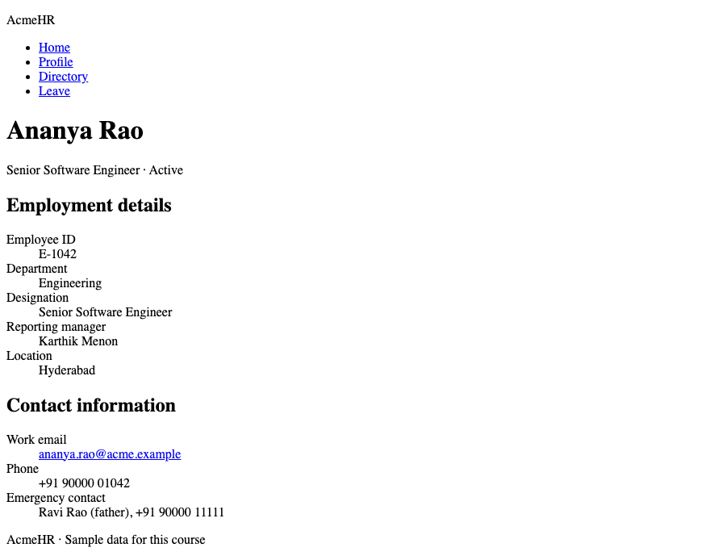

The navigation is a **list of links** inside `nav`. In section 11 it becomes a horizontal bar.

**Note:** The `href="#"` links are placeholders until those pages exist.

---

# Part B — The box model

## 5. Every element is a box

Every element — block or inline — is drawn as a box with four layers:

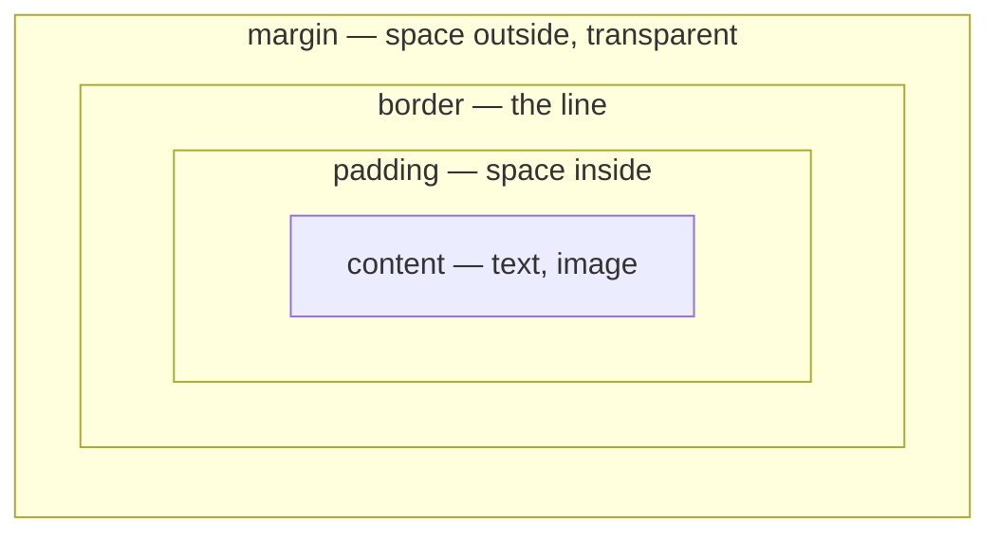

```css
body { background-color: #fde68a; }  /* yellow = the margin area around the box */
.box {
  margin: 32px;
  border: 8px solid #1a365d;
  padding: 24px;
  background-color: #bfdbfe;     /* blue = padding + content */
}
```

```html
<div class="box">Content: Ananya Rao, Engineering</div>
```

**Output:**

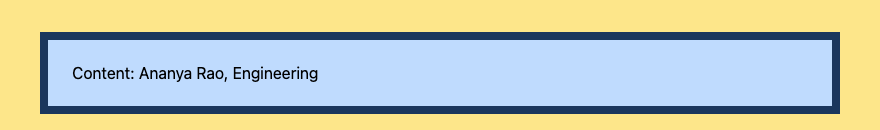

- **Content** — the text.
- **Padding** — space between the content and the border. The background colour fills it.
- **Border** — `width style colour`, for example `8px solid #1a365d`.
- **Margin** — space outside the border, between this box and its neighbours. Always transparent.

## 6. Margin and padding values

```css
p { background-color: #bfdbfe; }
.tight { padding: 0; margin: 0; }
.roomy { padding: 16px; margin: 24px 0; }
.sides { padding: 8px 32px; }
```

**Output:**

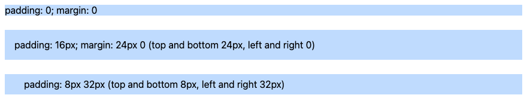

| You write | Means |
|---|---|
| `padding: 16px` | All four sides 16px |
| `padding: 8px 32px` | Top and bottom 8px, left and right 32px |
| `margin: 24px 0 8px` | Top 24px, left and right 0, bottom 8px |
| `padding: 1px 2px 3px 4px` | Top, right, bottom, left — clockwise from the top |
| `margin-top: 24px` | One side only (also `-right`, `-bottom`, `-left`) |

## 7. `box-sizing` — what does `width` measure?

```css
.ruler { width: 300px; height: 8px; background-color: #1b2430; }
.box {
  width: 300px;
  padding: 20px;
  border: 5px solid #1a365d;
}
.content-box { box-sizing: content-box; }
.border-box  { box-sizing: border-box; }
```

**Output** (each black ruler is exactly 300px):

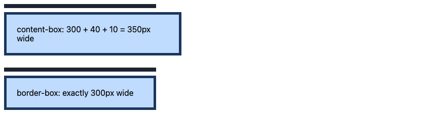

- **`content-box`** (the browser default): `width` is the content only. Padding and border are **added**: 300 + 40 + 10 = 350px.
- **`border-box`**: `width` includes padding and border. 300px means 300px.

Every professional stylesheet starts by switching every element to `border-box`. `*` is the **universal selector** — it matches every element:

```css
* {
  box-sizing: border-box;
}
```

## 8. Centring a box — `max-width` + `margin: auto`

```css
body { background-color: #f4f6f8; }
.card {
  max-width: 400px;
  margin: 24px auto;      /* auto left and right = centred */
  padding: 16px;
  background-color: #ffffff;
  border: 1px solid #d0d7de;
  border-radius: 8px;
}
```

**Output:**

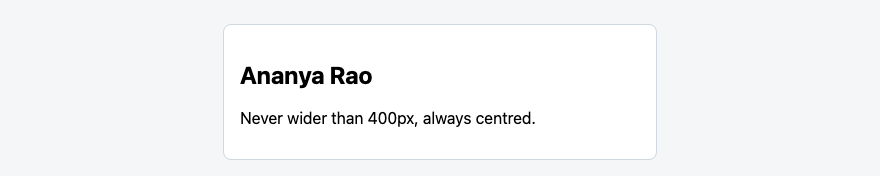

- `max-width: 400px` — never wider than 400px, but narrower on a small screen. (`width: 400px` would overflow a phone.)
- `margin: 24px auto` — the browser splits the leftover space equally left and right.
- `border-radius` rounds the corners.

## 9. Margins between paragraphs collapse

```css
.note { margin: 24px 0; background-color: #bfdbfe; }
```

```html
<p class="note">This paragraph has margin-bottom: 24px.</p>
<p class="note">This one has margin-top: 24px. The gap between them is 24px, not 48px.</p>
```

**Output:**

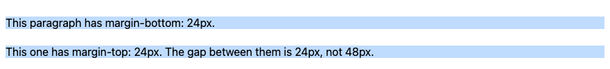

When a bottom margin meets a top margin, the browser uses the **larger one**, not the sum. This is called **margin collapse**. It only happens with vertical (top and bottom) margins of block elements.

**Common Error:** "I added `margin-top: 24px` and nothing moved." The neighbour already had a margin of 24px or more, and the two collapsed.

## 10. `display` — choosing the box type

```css
span { background-color: #bfdbfe; width: 120px; padding: 4px; }
.inline-block { display: inline-block; }
.block { display: block; }
.hidden { display: none; }
```

**Output:**

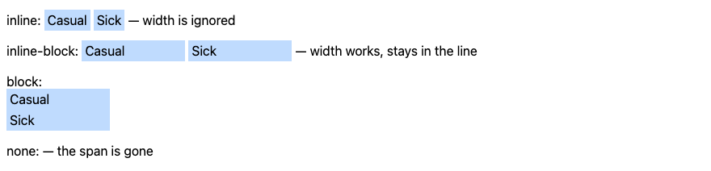

| `display` | New line? | `width` / `height` work? |
|---|---|---|
| `inline` (span, a, strong) | No | No |
| `inline-block` | No | Yes |
| `block` (div, p, li) | Yes | Yes |
| `none` | The element is removed from the page | — |

## 11. The navigation bar

```css
nav ul {
  list-style: none;   /* no bullets */
  margin: 0;
  padding: 0;
  background-color: #1a365d;
}
nav li {
  display: inline-block;
}
nav a {
  display: block;
  padding: 12px 16px;
  color: #ffffff;
}
```

**Output:**


1. `list-style: none` removes the bullets; `margin: 0` and `padding: 0` remove the list's default indent.
2. `display: inline-block` puts the `li`s side by side.
3. `display: block` + `padding` on the link makes the **whole padded area clickable**, not just the text.

In Lesson 4, Flexbox does this with less code.

## 12. Units — `px`, `rem`, `%`

```css
.px  { font-size: 16px; }
.rem { font-size: 1.25rem; }   /* 1.25 × the root font size (16px by default) = 20px */
.half { width: 50%; }
```

**Output:**

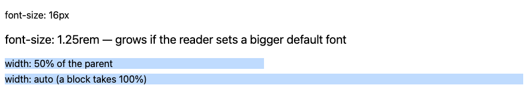

| Unit | Relative to | Use for |
|---|---|---|
| `px` | Nothing — fixed | Borders, small fixed details |
| `rem` | The root font size (16px unless the reader changed it) | **Font sizes** |
| `%` | The parent's width | Widths |

**Why `rem` for text:** Some readers set a bigger default font in their browser. Text in `rem` grows with that setting; text in `px` ignores it.

## 13. Putting it together — the styled profile

The HTML from section 4, linked to `profile.css`:

```css
/* AcmeHR — employee profile */

* {
  box-sizing: border-box;
}

body {
  margin: 0;
  font-family: system-ui, sans-serif;
  line-height: 1.5;
  color: #1b2430;
  background-color: #f4f6f8;
}

/* Header and navigation */
header {
  padding: 0 24px;
  background-color: #1a365d;
  color: #ffffff;
}

header p {
  display: inline-block;
  margin: 0;
  padding: 12px 0;
  font-weight: bold;
}

nav {
  display: inline-block;
  margin-left: 24px;
}

nav ul {
  list-style: none;
  margin: 0;
  padding: 0;
}

nav li {
  display: inline-block;
}

nav a {
  display: block;
  padding: 12px;
  color: #ffffff;
}

/* Main card */
main {
  max-width: 720px;
  margin: 24px auto;
  padding: 24px;
  background-color: #ffffff;
  border: 1px solid #d0d7de;
  border-radius: 8px;
}

h1 {
  margin: 0;
  font-size: 1.75rem;
  color: #1a365d;
}

h2 {
  margin: 24px 0 8px;
  padding-bottom: 4px;
  border-bottom: 2px solid #e2e8f0;
  font-size: 1.125rem;
  color: #1a365d;
}

.status {
  padding: 2px 8px;
  border-radius: 999px;
  background-color: #dcfce7;
  color: #166534;
  font-weight: bold;
}

/* Label and value pairs */
dl {
  margin: 0;
}

dt {
  font-weight: bold;
  font-size: 0.875rem;
  color: #3d4654;
}

dd {
  margin: 0 0 12px;
}

footer {
  text-align: center;
  font-size: 0.875rem;
  color: #3d4654;
}
```

**Output:**


Files: [`13_profile_styled.html`](examples/lesson03/13_profile_styled.html) · [`profile.css`](examples/lesson03/profile.css)

- `body { margin: 0; }` removes the browser's default 8px margin, so the header touches the edges.
- `border-radius: 999px` on the badge gives a pill shape: any radius larger than the box rounds the ends fully.
- `text-align: center` centres the text inside the footer.

**Common Error:** Spacing that looks random. Use a small set of values — 4, 8, 12, 16, 24, 32px — and reuse them everywhere. Real design systems do exactly this.

**Where used?** Django and Spring apps reuse one header, nav and footer on every page through a **base template** (`` in Django, a Thymeleaf layout in Spring). The regions you wrote today are what goes into that base template.

---

## Try these

1. **(Easy)** Add an `<aside>` to the profile with the heading "Leave balance" and a `dl` of three leave types and their balances.
2. **(Easy)** Change `main` to `max-width: 960px`. What changes, and what stays the same?
3. **(Medium)** Remove the `*` rule from `profile.css`. Which boxes change size, and why?
4. **(Medium)** Give the `.status` badge a 1px solid border in `#166534`. Keep the pill shape.
5. **(Stretch)** Make the footer a navy bar like the header, with white text and 16px padding.

**Interview:** *"Explain the CSS box model."* — Every element is a box: content, then padding, then border, then margin. By default, `width` sets only the content, so padding and border are added. With `box-sizing: border-box`, `width` includes padding and border, which is why most stylesheets set it on every element.

**Interview:** *"What is margin collapse?"* — When the vertical margins of two block elements meet, the browser uses the larger margin instead of adding them.

**Interview:** *"`section` or `div`?"* — `section` for a themed part of the content with its own heading. `div` only as a styling wrapper with no meaning.

**Key takeaways**

- Use `header`, `nav`, `main`, `section`, `aside`, `footer` for regions; `div` and `span` only as styling hooks.
- `dl` / `dt` / `dd` for label–value data.
- Box = content + padding + border + margin. Always set `box-sizing: border-box`.
- Centre a box with `max-width` and `margin: 0 auto`.
- Vertical margins collapse to the larger one.
- `rem` for font sizes.

---

## Lab

👉 [Lab 03 — AcmeHR employee profile](labs/L03_employee_profile/README.md)

**Next:** [Lesson 4 — Images, Navigation & Flexbox](04_Images_Navigation_and_Flexbox.md)
