# Lesson 5 — Grid & Positioning

**Course:** HTML & CSS for Full Stack · **Session 5 of 9** · [Learning path](README.md) · **Previous:** [Lesson 4](04_Images_Navigation_and_Flexbox.md) · **Next:** [Lesson 6 — Forms](06_Forms.md)

**Module Outcome:** You can lay out a page in rows and columns with CSS Grid, choose between Grid and Flexbox, and place small elements exactly with `position`.

| | |
|---|---|
| **You will build** | The AcmeHR **HR dashboard** |
| **New HTML** | — (nothing new: this lesson is all layout) |
| **New CSS** | `display: grid`, `grid-template-columns`, `fr`, `repeat()`, `minmax()`, `auto-fit`, `grid-column`, `grid-template-areas`, `grid-area` · `position` (`relative`, `absolute`, `sticky`), `top` / `right` / `bottom` / `left`, `z-index` |
| **You need** | Lessons 1–4 |

**From the requirements.** AcmeHR has HR dashboards with workforce figures: headcount, absenteeism, late arrivals, attrition and leave. Managers approve leave requests.

**Where we are going:**

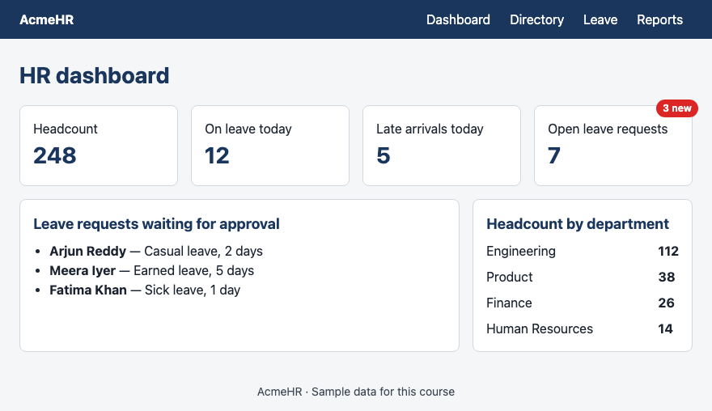

All example files: [`examples/lesson05/`](examples/lesson05/)

---

# Part A — Grid

## 1. Columns with `display: grid`

```css
.tiles {
  display: grid;
  grid-template-columns: 1fr 1fr 1fr;
  gap: 16px;
}
```

```html
<div class="tiles">
  <div class="tile"><p>Headcount</p><p class="number">248</p></div>
  <div class="tile"><p>On leave today</p><p class="number">12</p></div>
  <div class="tile"><p>Late arrivals today</p><p class="number">5</p></div>
  <div class="tile"><p>Attrition, last 12 months</p><p class="number">8.4%</p></div>
  <div class="tile"><p>Open leave requests</p><p class="number">7</p></div>
  <div class="tile"><p>New joiners this month</p><p class="number">3</p></div>
</div>
```

**Output:**

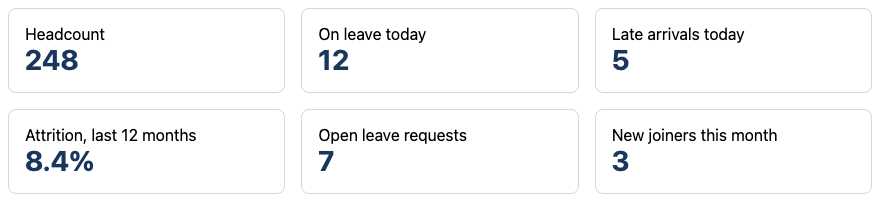

- `display: grid` makes the element a **grid container**; its direct children are **grid items**.
- `grid-template-columns` lists the columns. Three values = three columns.
- `1fr` = one **fraction** of the free space. `1fr 1fr 1fr` = three equal columns.
- Items fill the cells in order, left to right, then start a new row. Rows line up — unlike wrapped flex items.

## 2. Fixed and flexible columns

```css
.layout {
  display: grid;
  grid-template-columns: 200px 1fr;
  gap: 16px;
}
```

**Output:**

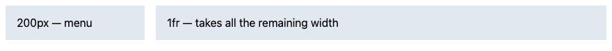

The 200px column never changes. `1fr` takes everything that is left. `2fr 1fr` would split the space two-to-one.

## 3. As many columns as fit — `repeat`, `auto-fit`, `minmax`

```css
.tiles {
  display: grid;
  grid-template-columns: repeat(auto-fit, minmax(180px, 1fr));
  gap: 16px;
}
```

**Output at 880px wide:**

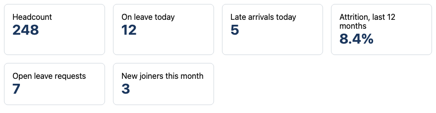

**Output at 420px wide — same CSS:**

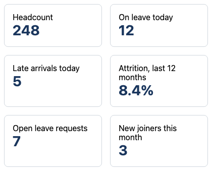

Read it from the inside out:

| Part | Means |
|---|---|
| `minmax(180px, 1fr)` | Each column is at least 180px, and at most one equal share |
| `auto-fit` | Make as many columns as fit |
| `repeat(…, …)` | Repeat that column pattern |

One line of CSS, and the tiles adapt to any screen — no extra rules.

## 4. Spanning columns

```css
.tiles {
  display: grid;
  grid-template-columns: repeat(3, 1fr);
  gap: 16px;
}
.wide { grid-column: span 2; }    /* two columns */
.full { grid-column: 1 / -1; }    /* from the first line to the last */
```

```html
<div class="tile full"><p>Welcome back, Rahul. 7 leave requests need your attention.</p></div>
<div class="tile wide"><p>Leave utilisation this quarter</p><p class="number">62%</p></div>
<div class="tile"><p>Headcount</p><p class="number">248</p></div>
...
```

**Output:**

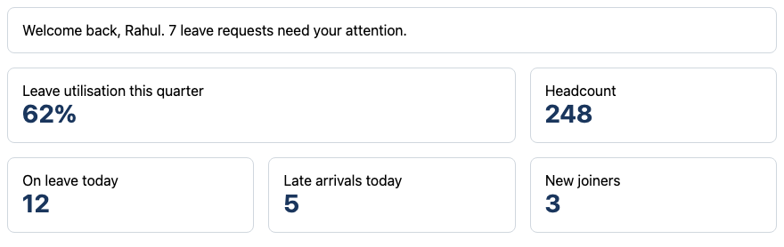

- `span 2` — this item covers two columns.
- `1 / -1` — from grid line 1 to the last line: the full width, however many columns there are.

## 5. Naming the layout — `grid-template-areas`

```css
.page {
  display: grid;
  grid-template-columns: 200px 1fr;
  grid-template-areas:
    "header header"
    "menu   main"
    "footer footer";
  gap: 8px;
}
header { grid-area: header; }
nav    { grid-area: menu; }
main   { grid-area: main; }
footer { grid-area: footer; }
```

```html
<body class="page">
  <header>header</header>
  <nav>nav (area "menu")</nav>
  <main>main</main>
  <footer>footer</footer>
</body>
```

**Output:**

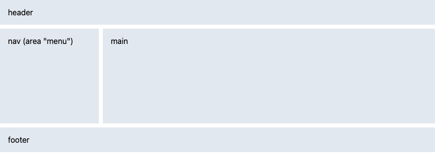

Each string is one row; each word is one cell. Repeat a name to stretch an area across cells. You can read the page layout straight from the CSS.

## 6. Grid or Flexbox?

| Use | When | AcmeHR examples |
|---|---|---|
| **Flexbox** | Items in **one** line (row *or* column), sized by their content | Header, nav links, avatar + text, buttons in a row |
| **Grid** | Rows **and** columns that must line up | Dashboard tiles, page layout, label–value columns |

Most pages use both: Grid for the page and the tiles, Flexbox inside the header and inside each card.

---

# Part B — Positioning

## 7. `relative` + `absolute` — a badge in the corner

```css
.tile {
  position: relative;        /* the badge is placed inside this box */
  max-width: 260px;
}
.badge {
  position: absolute;
  top: -8px;
  right: -8px;
  padding: 2px 8px;
  border-radius: 999px;
  background-color: #dc2626;
  color: #ffffff;
  font-size: 0.75rem;
  font-weight: bold;
}
```

```html
<div class="tile">
  <span class="badge">3 new</span>
  <p>Open leave requests</p>
  <p class="number">7</p>
</div>
```

**Output:**

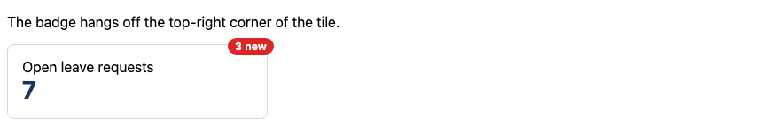

- `position: absolute` takes the badge out of the normal flow; other content ignores it.
- `top` and `right` measure from the nearest ancestor that has a `position` — here the tile with `position: relative`. Negative values push it outside the edge.
- `position: relative` on the parent changes nothing visible. It just becomes the **anchor**.

**Common Error:** The badge flies to the corner of the whole page. The parent is missing `position: relative`, so the badge is measured from the page instead.

## 8. `z-index` — which box is on top

```css
.box  { position: absolute; width: 200px; padding: 16px; }
.one   { top: 16px; left: 16px;  z-index: 1; }
.two   { top: 40px; left: 96px;  z-index: 3; }
.three { top: 64px; left: 176px; z-index: 2; }
```

**Output:**

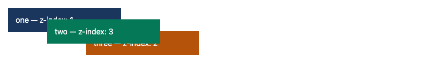

Higher `z-index` = closer to you. It only works on positioned elements (and grid or flex items).

## 9. `sticky` — a header that stays visible

```css
header {
  position: sticky;
  top: 0;
}
```

**Before scrolling:**

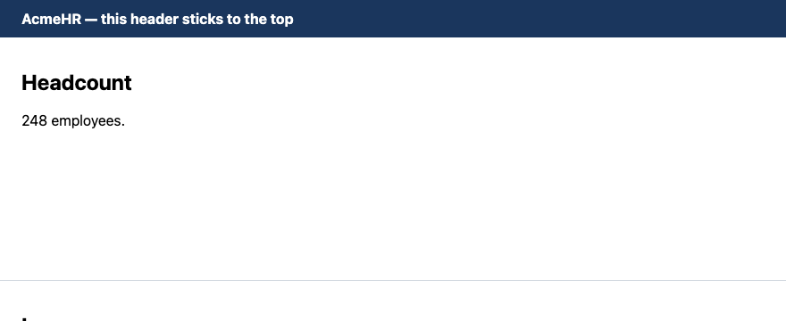

**After scrolling down 520px:**

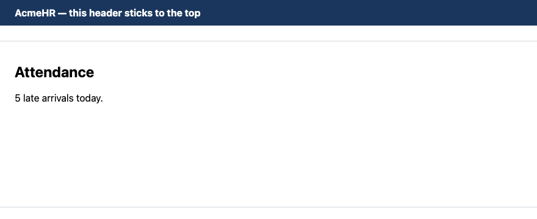

The header scrolls normally until it reaches `top: 0`, then sticks there.

| `position` | Moves with the page? | Measured from |
|---|---|---|
| `static` (default) | Yes | — (`top` etc. are ignored) |
| `relative` | Yes | Its own normal place |
| `absolute` | Yes, with its anchor | The nearest positioned ancestor |
| `sticky` | Until it hits its `top` value, then stays | The scrolling area |
| `fixed` | No — stays on screen | The browser window |

**Common Error:** Using `position: absolute` to lay out whole pages. It breaks on every other screen size. Lay out pages with Grid and Flexbox; use positioning only for small things like badges and sticky headers.

---

## 10. Putting it together — the HR dashboard

The HTML:

```html
<header>
  <p>AcmeHR</p>
  <nav>
    <ul>
      <li><a href="#">Dashboard</a></li>
      <li><a href="#">Directory</a></li>
      <li><a href="#">Leave</a></li>
      <li><a href="#">Reports</a></li>
    </ul>
  </nav>
</header>

<main class="dashboard">
  <h1>HR dashboard</h1>

  <section class="tiles">
    <div class="tile"><p>Headcount</p><p class="number">248</p></div>
    <div class="tile"><p>On leave today</p><p class="number">12</p></div>
    <div class="tile"><p>Late arrivals today</p><p class="number">5</p></div>
    <div class="tile">
      <span class="badge">3 new</span>
      <p>Open leave requests</p>
      <p class="number">7</p>
    </div>
  </section>

  <section class="panel requests">
    <h2>Leave requests waiting for approval</h2>
    <ul>
      <li><strong>Arjun Reddy</strong> — Casual leave, 2 days</li>
      <li><strong>Meera Iyer</strong> — Earned leave, 5 days</li>
      <li><strong>Fatima Khan</strong> — Sick leave, 1 day</li>
    </ul>
  </section>

  <section class="panel departments">
    <h2>Headcount by department</h2>
    <dl>
      <dt>Engineering</dt><dd>112</dd>
      <dt>Product</dt><dd>38</dd>
      <dt>Finance</dt><dd>26</dd>
      <dt>Human Resources</dt><dd>14</dd>
    </dl>
  </section>
</main>

<footer>
  <p>AcmeHR · Sample data for this course</p>
</footer>
```

**Output, HTML only:**

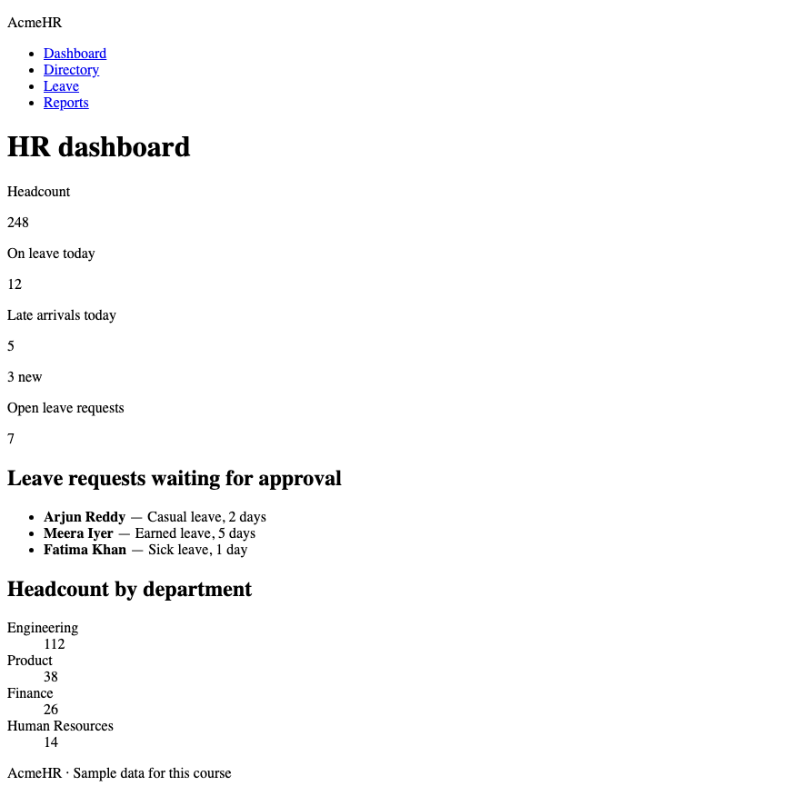

`dashboard.css`:

```css
/* AcmeHR — HR dashboard */

* {
  box-sizing: border-box;
}

body {
  margin: 0;
  font-family: system-ui, sans-serif;
  line-height: 1.5;
  color: #1b2430;
  background-color: #f4f6f8;
}

/* Header sticks to the top while the page scrolls */
header {
  position: sticky;
  top: 0;
  z-index: 10;
  display: flex;
  justify-content: space-between;
  align-items: center;
  padding: 0 24px;
  background-color: #1a365d;
  color: #ffffff;
}

header p {
  margin: 0;
  font-weight: bold;
}

nav ul {
  display: flex;
  list-style: none;
  margin: 0;
  padding: 0;
}

nav a {
  display: block;
  padding: 12px;
  color: #ffffff;
  text-decoration: none;
}

/* Page layout: title, tiles, then two panels side by side */
.dashboard {
  display: grid;
  grid-template-columns: 2fr 1fr;
  grid-template-areas:
    "title    title"
    "tiles    tiles"
    "requests departments";
  gap: 16px;
  max-width: 1040px;
  margin: 0 auto;
  padding: 24px;
}

.dashboard h1 {
  grid-area: title;
  margin: 0;
  font-size: 1.75rem;
  color: #1a365d;
}

.tiles        { grid-area: tiles; }
.requests     { grid-area: requests; }
.departments  { grid-area: departments; }

/* Tiles: as many columns as fit, each at least 180px */
.tiles {
  display: grid;
  grid-template-columns: repeat(auto-fit, minmax(180px, 1fr));
  gap: 16px;
}

.tile,
.panel {
  padding: 16px;
  background-color: #ffffff;
  border: 1px solid #d0d7de;
  border-radius: 8px;
}

.tile {
  position: relative;
}

.tile p {
  margin: 0;
}

.number {
  font-size: 1.75rem;
  font-weight: bold;
  color: #1a365d;
}

.badge {
  position: absolute;
  top: -8px;
  right: -8px;
  padding: 2px 8px;
  border-radius: 999px;
  background-color: #dc2626;
  color: #ffffff;
  font-size: 0.75rem;
  font-weight: bold;
}

.panel h2 {
  margin: 0 0 8px;
  font-size: 1.125rem;
  color: #1a365d;
}

.panel ul {
  margin: 0;
  padding-left: 20px;
}

/* Department counts: label left, number right */
.departments dl {
  display: grid;
  grid-template-columns: 1fr auto;
  gap: 8px;
  margin: 0;
}

.departments dd {
  margin: 0;
  font-weight: bold;
}

footer {
  text-align: center;
  font-size: 0.875rem;
  color: #3d4654;
}
```

**Output, styled:**


Files: [`10_dashboard_styled.html`](examples/lesson05/10_dashboard_styled.html) · [`dashboard.css`](examples/lesson05/dashboard.css)

Three grids work together:

1. `.dashboard` — the page: title, tiles, then the two panels in a 2 : 1 split.
2. `.tiles` — the number tiles, as many per row as fit.
3. `.departments dl` — a two-column list: names in `1fr`, numbers in `auto` (just as wide as the number).

`z-index: 10` on the sticky header keeps it above the tiles and badges when they scroll under it.

**Where used?** On a real dashboard every number comes from the database. Django or Spring calculates the counts and the template fills them in: `{{ headcount }}` in Django, `th:text="${headcount}"` in Thymeleaf. The layout you built does not change.

---

## Try these

1. **(Easy)** Change `.dashboard` to `grid-template-columns: 1fr 1fr`. What happens to the two panels?
2. **(Easy)** Add a fifth tile, "New joiners this month: 3". Does the tiles row still work?
3. **(Medium)** Rewrite `grid-template-areas` so the department panel is on the **left** and the requests panel on the right.
4. **(Medium)** Remove `position: relative` from `.tile`. Where does the badge go? Why?
5. **(Stretch)** Add a full-width "Announcements" panel below the two panels, using a new area name.

**Interview:** *"When do you use Grid instead of Flexbox?"* — Grid when items must line up in rows and columns at the same time (page layouts, tiles). Flexbox for a single row or column of items sized by their content (navbars, toolbars, a card's inside).

**Interview:** *"How does `position: absolute` decide where to go?"* — It is placed relative to its nearest ancestor that has a `position` other than `static`. If there is none, it is placed relative to the page.

**Interview:** *"What does `repeat(auto-fit, minmax(180px, 1fr))` do?"* — It creates as many columns as fit, each at least 180px wide, sharing any leftover space equally. The grid adapts to the screen width without media queries.

**Key takeaways**

- `display: grid` + `grid-template-columns` = rows and columns that line up.
- `fr` shares free space. `repeat(auto-fit, minmax(180px, 1fr))` adapts to any width.
- `grid-column: 1 / -1` spans the full width. `grid-template-areas` names the layout.
- Grid for 2-D layouts, Flexbox for 1-D rows.
- Absolute positioning needs a `position: relative` parent. Use it only for small things.
- `position: sticky; top: 0` keeps a header visible.

---

## Lab

👉 [Lab 05 — AcmeHR HR dashboard](labs/L05_hr_dashboard/README.md)

**Next:** [Lesson 6 — Forms](06_Forms.md)
