# Lesson 8 — Responsive Design

**Course:** HTML & CSS for Full Stack · **Session 8 of 9** · [Learning path](README.md) · **Previous:** [Lesson 7](07_Tables.md) · **Next:** [Lesson 9 — Polish, Accessibility & Final Project](09_Polish_Accessibility_and_Final_Project.md)

**Module Outcome:** You can make every AcmeHR page work on a 375px phone and a wide desktop, using mobile-first media queries, fluid layouts, fluid type and responsive images.

| | |
|---|---|
| **You will build** | Responsive versions of the AcmeHR header, directory, dashboard and pages |
| **New HTML** | `picture`, `source` (`media`, `srcset`) |
| **New CSS** | `@media (min-width: …)`, `min()`, `clamp()`, units `vw` and `ch`, `max-width: 100%` + `height: auto` for images |
| **You need** | Lessons 1–7 |

**From the requirements.** AcmeHR must be usable by every employee, and the BRD targets over 90% self-service adoption. Many employees will open it on a phone — to apply for leave or check attendance away from their desk.

**Where we are going** — the same dashboard at 375px and at 880px:

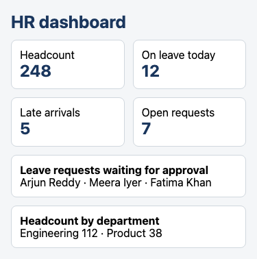

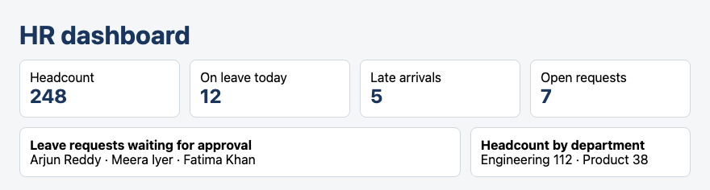

All example files: [`examples/lesson08/`](examples/lesson08/). To test them, make your browser window narrow, or open the page on your phone.

---

## 1. The viewport tag — the first line of responsive design

You have written this line since Lesson 1. Here is what it does. The same page on a 375px phone, without and with it:

**Without `<meta name="viewport">`:**


**With `<meta name="viewport" content="width=device-width, initial-scale=1.0">`:**

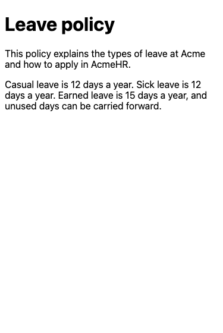

Without the tag, phones pretend to be a desktop screen (usually 980px wide) and shrink the result. With it, the page is laid out at the phone's real width. **No media query works properly without this tag.**

## 2. Fixed widths break on phones

```css
.card { width: 560px; padding: 16px; border: 1px solid #d0d7de; border-radius: 8px; }
```

**Output at 375px — the red dashed line is the edge of the phone screen:**

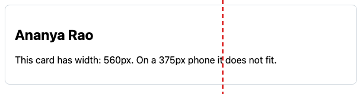

The fix you already know from Lesson 3: `max-width: 560px` instead of `width: 560px`. The card is never wider than 560px, but shrinks on a small screen.

**Remember:** Most responsive design is not media queries. It is avoiding fixed widths: `max-width`, `%`, `fr`, `flex-wrap`, and `auto-fit`.

## 3. Mobile first — `@media (min-width: …)`

```css
/* Base: phones — one column */
.layout {
  display: grid;
  gap: 16px;
}

/* From 640px wide: two columns */
@media (min-width: 40rem) {
  .layout {
    grid-template-columns: 2fr 1fr;
  }
}
```

**Output at 375px:**

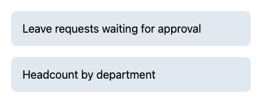

**Output at 880px:**

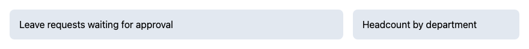

- A **media query** applies the rules inside it only when its condition is true.
- `(min-width: 40rem)` — when the screen is at least 40rem (640px) wide.
- **Mobile first:** write the simple phone layout as the base, then **add** columns for wider screens. Phones get less CSS to apply, and you never have to undo desktop rules.
- `rem` in a media query means 16px × 40 = 640px (unless the user enlarged their default font, in which case the layout switches later — which is what they need).

The width where the layout changes is a **breakpoint**. Choose it where your content stops fitting, not by phone model. One or two breakpoints are enough for most pages.

## 4. The responsive header

In Lab 07 the header's links overflowed a phone screen. Mobile first fixes it:

```css
/* Base: phones — logo on its own line, links wrap underneath */
header {
  padding: 8px 16px;
  background-color: #1a365d;
  color: #ffffff;
}
header p { margin: 0 0 4px; font-weight: bold; }
nav ul {
  display: flex;
  flex-wrap: wrap;
  gap: 4px 16px;
  list-style: none;
  margin: 0;
  padding: 0;
}
nav a {
  display: block;
  padding: 8px 0;
  color: #ffffff;
  text-decoration: none;
}

/* From 640px wide: logo left, links right, one line */
@media (min-width: 40rem) {
  header {
    display: flex;
    justify-content: space-between;
    align-items: center;
    padding: 0 24px;
  }
  header p { margin: 0; }
  nav a { padding: 12px 0; }
}
```

**Output at 375px:**

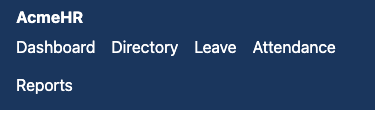

**Output at 880px:**


- `flex-wrap: wrap` lets the links continue on the next line instead of overflowing.
- `gap: 4px 16px` — 4px between rows, 16px between links.
- Each link keeps `8px` of padding top and bottom, so it is a comfortable target for a thumb.

## 5. Layouts that adapt without a media query

```css
.cards {
  display: grid;
  grid-template-columns: repeat(auto-fit, minmax(min(220px, 100%), 1fr));
  gap: 12px;
}
```

**Output at 375px:**

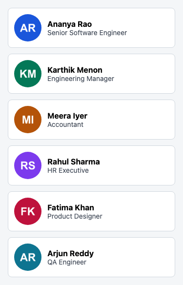

**Output at 880px:**

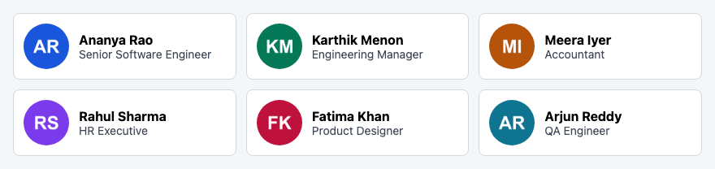

- `auto-fit` + `minmax` from Lesson 5 already adapts to the width.
- `min(220px, 100%)` picks the **smaller** of the two values. On a screen narrower than 220px plus padding, a 220px minimum would overflow; `min()` lets the column shrink to the full width instead.

## 6. Fluid type — `clamp()`

```css
h1 {
  font-size: clamp(1.5rem, 1rem + 2.5vw, 2.5rem);   /* at least 1.5rem, at most 2.5rem */
}
p {
  max-width: 60ch;    /* about 60 characters per line */
}
```

**Output at 375px:**

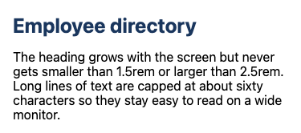

**Output at 880px:**

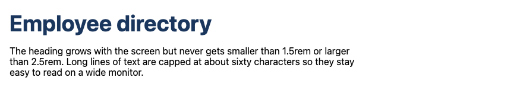

| Value | Means |
|---|---|
| `clamp(min, preferred, max)` | Use the preferred value, but never below `min` or above `max` |
| `1vw` | 1% of the screen's width — so `2.5vw` grows as the screen gets wider |
| `1rem + 2.5vw` | A fixed part plus a growing part. The `rem` part keeps the text zoomable. |
| `60ch` | About 60 characters (`ch` is the width of the "0" in the current font) |

Lines of 50–75 characters are the most comfortable to read. On a wide monitor, uncapped paragraphs can be 200 characters long.

## 7. The dashboard — rearranging grid areas

```css
.dashboard {
  display: grid;
  grid-template-areas:
    "title"
    "tiles"
    "requests"
    "departments";
  gap: 12px;
  padding: 16px;
}

@media (min-width: 40rem) {
  .dashboard {
    grid-template-columns: 2fr 1fr;
    grid-template-areas:
      "title    title"
      "tiles    tiles"
      "requests departments";
    padding: 24px;
  }
}
```

**Output at 375px and at 880px:**


With `grid-template-areas`, the media query only has to **redraw the map**. The HTML does not change.

## 8. Responsive images

```css
img {
  max-width: 100%;   /* never wider than its container */
  height: auto;      /* keep the shape when it shrinks */
}
```

```html
<picture>
  <source media="(min-width: 40rem)" srcset="images/office-wide.png" width="640" height="320">
  
</picture>
```

**Output at 375px:**

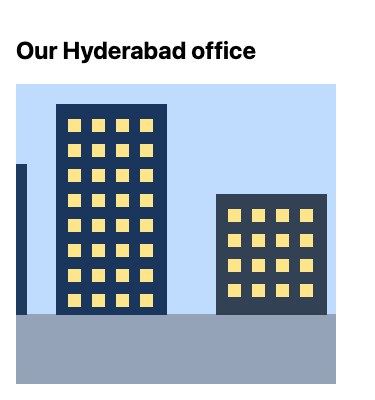

**Output at 880px:**

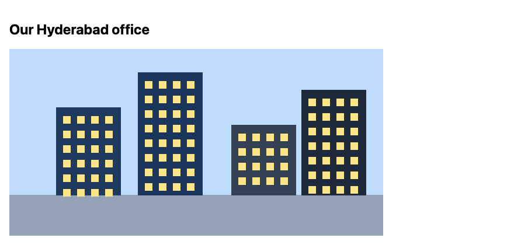

- `max-width: 100%; height: auto;` — the most important two lines for images. Put them in every stylesheet.
- `picture` lets you choose a **different image** for different screens. The browser uses the first `source` whose `media` matches; otherwise the `img`. Use it when a phone needs a different crop, not just a smaller size.
- The `img` inside `picture` is required — it holds the `alt` text and is the fallback.

**Common Error:** Forgetting the `img` inside `picture`. Nothing is shown at all.

---

## Testing checklist for every page

Narrow your browser window slowly from wide to about 320px, and check:

1. **No sideways scrolling** of the page (a table in its own scroll box is fine).
2. **Text is readable** without zooming — at least 1rem for body text.
3. **Nothing overlaps** and nothing is cut off.
4. **Links and buttons are easy to tap** — roughly 44px tall, with space between them.
5. **Images shrink** and keep their shape.

Then open the page on your real phone. With `python3 -m http.server 8000` running, phones on the same Wi-Fi can open `http://<your-computer's-IP>:8000`.

**Where used?** Django and Spring send the same HTML to every device. Responsive design happens entirely in your CSS, so it works the same with any backend.

---

## Try these

1. **(Easy)** Open the Lesson 4 directory and Lesson 5 dashboard at 375px. Write down every problem you see.
2. **(Easy)** Change the breakpoint in section 3 from `40rem` to `48rem`. At which window width does the layout now switch?
3. **(Medium)** Make the Lesson 6 leave form mobile-first: From and To stacked on phones, side by side from `40rem`.
4. **(Medium)** Give the profile page's `h1` a `clamp()` size between `1.5rem` and `2.25rem`.
5. **(Stretch)** In the dashboard, show three columns from `64rem`: requests, departments, and a new "Announcements" panel.

**Interview:** *"What does mobile-first mean?"* — Write the base CSS for small screens, then add `min-width` media queries that enhance the layout for larger screens.

**Interview:** *"What does the viewport meta tag do?"* — It tells mobile browsers to lay out the page at the device's real width instead of a virtual desktop width. Without it, media queries and readable text sizes do not work on phones.

**Interview:** *"How do you make an image responsive?"* — `max-width: 100%; height: auto;`, plus `width` and `height` attributes in the HTML so space is reserved. Use `picture` with `source media` when different screens need different crops.

**Key takeaways**

- The viewport tag is required; no fixed widths — use `max-width`, `%`, `fr`.
- Mobile first: phone layout as the base, `@media (min-width: …)` to add.
- `flex-wrap`, `auto-fit` + `minmax(min(…, 100%), 1fr)` adapt without media queries.
- `clamp()` for fluid headings; `max-width: 60ch` for readable lines.
- `img { max-width: 100%; height: auto; }` everywhere; `picture` for different crops.
- Test from wide down to 320px, then on a real phone.

---

## Lab

👉 [Lab 08 — Make AcmeHR responsive](labs/L08_responsive_portal/README.md)

**Next:** [Lesson 9 — Polish, Accessibility & Final Project](09_Polish_Accessibility_and_Final_Project.md)
