# Lesson 9 — Polish, Accessibility & Final Project

**Course:** HTML & CSS for Full Stack · **Session 9 of 9** · [Learning path](README.md) · **Previous:** [Lesson 8](08_Responsive_Design.md) · **Next phase:** [JavaScript, DOM & Forms](../03_JavaScript_DOM_Forms.md)

**Module Outcome:** You can run one consistent stylesheet across a whole site with design tokens, give every interactive element clear hover and focus states, check a page for accessibility, and deliver the AcmeHR portal as a finished project.

| | |
|---|---|
| **You will build** | The finished **AcmeHR portal**: seven pages, one stylesheet |
| **New HTML** | `details`, `summary` · `aria-current`, `aria-label` · `<meta name="description">`, `<meta name="robots">`, `<link rel="icon">` |
| **New CSS** | Custom properties (`--name`, `var()`), `:hover`, `:active`, `:focus`, `transition`, `transform`, `@media (prefers-reduced-motion: reduce)`, `border-color`, `border-bottom-color` |
| **You need** | Lessons 1–8 |

**From the requirements.** The BRD's success metrics include **over 90% self-service adoption**, and it lists *poor user adoption* as a high-impact risk. A portal that is consistent, clear and usable by everyone — including keyboard and screen-reader users — is how a frontend developer reduces that risk.

**Where we are going** — the final portal on a desktop and on a phone:

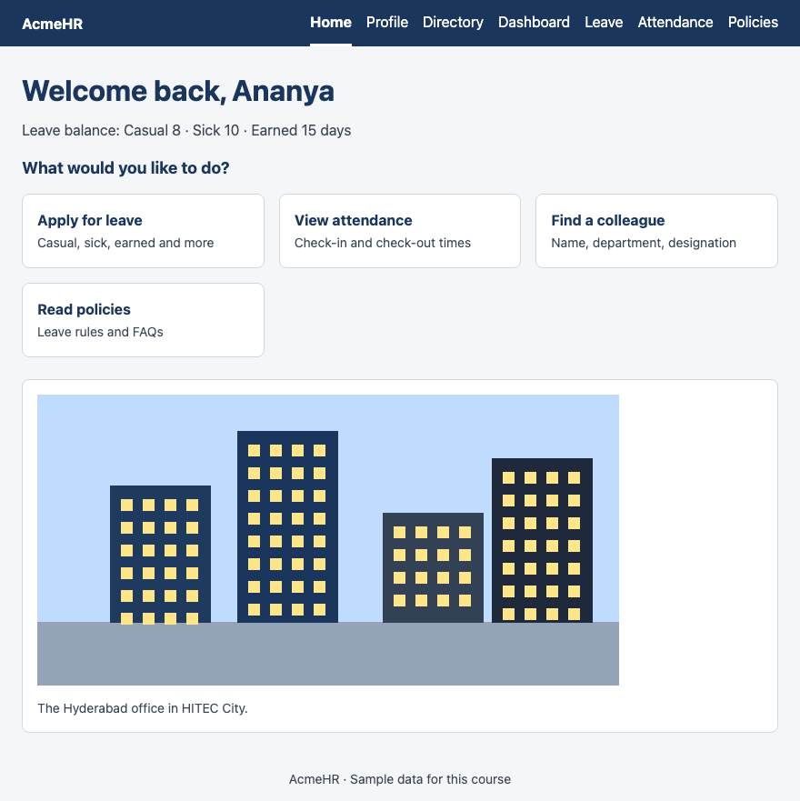

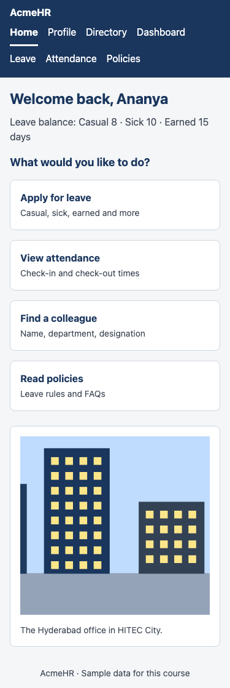

All example files: [`examples/lesson09/`](examples/lesson09/)

---

# Part A — One stylesheet for the whole site

## 1. Design tokens — custom properties

Until now, colours like `#1a365d` were repeated in every rule. Professional stylesheets name them once:

```css
:root {
  --color-brand: #1a365d;
  --color-ink: #1b2430;
  --color-muted: #3d4654;
  --color-surface: #ffffff;
  --color-border: #d0d7de;
  --color-focus: #ea580c;
  --space-2: 8px;
  --space-4: 16px;
  --radius: 8px;
}

.card {
  max-width: 320px;
  margin-bottom: var(--space-4);
  padding: var(--space-4);
  border: 1px solid var(--color-border);
  border-top: 4px solid var(--color-brand);
  border-radius: var(--radius);
}
.card h2 { margin: 0 0 var(--space-2); color: var(--color-brand); font-size: 1.125rem; }
.card p { margin: 0; color: var(--color-muted); }

/* Change one token for one section: every rule that uses it follows */
.theme-finance { --color-brand: #047857; }
```

```html
<div class="card">
  <h2>Engineering</h2>
  <p>112 employees</p>
</div>
<div class="card theme-finance">
  <h2>Finance</h2>
  <p>26 employees</p>
</div>
```

**Output:**

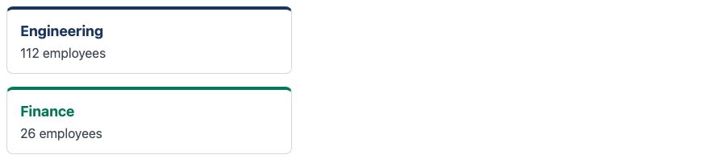

- A **custom property** starts with `--`. `:root` is the top of the page (the `html` element), so properties defined there are available everywhere.
- `var(--color-brand)` reads the value.
- Custom properties **inherit**: `.theme-finance` changes `--color-brand` for itself and everything inside it, so its border and heading turn green with no other rule.
- These named values are called **design tokens**. Real design systems are built on them: colours, spacing steps, corner radius.

**Remember:** Tokens are for values you reuse. A colour that appears once does not need one.

## 2. Organising one stylesheet

The final project uses **one** file, `css/acmehr.css`, for all seven pages, in sections:

```text
1. Design tokens      — :root
2. Base               — *, body, img, a, h1, h2
3. Header and footer  — .site-header, .site-footer
4. Page layouts       — .page, .page-narrow, .card, .dashboard
5. Components         — .panel, .tile, .person-card, .status, .badge
6. Forms              — .field, .field-row, .choices, .button
7. Tables             — .table-scroll, .data-table, .num
8. States and motion  — :focus-visible, :hover, transitions
```

Name classes after **what the thing is** (`.person-card`, `.status-warning`), not how it looks today (`.blue-box`, `.margin-16`). When the design changes, the names still make sense.

---

# Part B — States and motion

## 3. Hover, focus and active

```css
.button {
  padding: 10px 20px;
  border: 0;
  border-radius: 6px;
  background-color: var(--color-brand);
  color: #ffffff;
  font: inherit;
  font-weight: bold;
  cursor: pointer;
  transition: background-color 0.2s, transform 0.2s;
}
.button:hover {
  background-color: #2c5282;
  transform: translateY(-2px);   /* lift it 2px */
}
.button:active {
  transform: translateY(0);
}
.button:focus-visible {
  outline: 3px solid var(--color-focus);
  outline-offset: 2px;
}

/* People who ask their system for less motion get no movement */
@media (prefers-reduced-motion: reduce) {
  .button {
    transition: none;
  }
}
```

```html
<button class="button" id="apply" type="button">Apply for leave</button>
```

**Normal:**


**Mouse over it (`:hover`):**

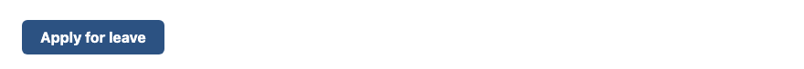

**Reached with the `Tab` key (`:focus-visible`):**


| Pseudo-class | Matches when |
|---|---|
| `:hover` | The mouse pointer is over the element |
| `:active` | It is being pressed |
| `:focus` | It has the focus — by keyboard, mouse click, or script |
| `:focus-visible` | It has the focus **and** the browser decides a ring should show (keyboard use) |

- `transition: background-color 0.2s` — when the value changes, animate it over 0.2 seconds instead of jumping.
- `transform: translateY(-2px)` — move the element up 2px **without** moving anything around it. Animate `transform` (and colours), not `margin` or `top`: they force the browser to recalculate the layout of the page on every frame.
- `prefers-reduced-motion: reduce` is true when the user has asked their operating system for less motion. Some people get dizzy or nauseous from movement on screen. Respect the setting.

**Common Error:** Styling `:hover` only. Keyboard and touch-screen users never hover. Every interactive element needs a visible `:focus-visible` style too.

---

# Part C — Accessibility pass

## 4. Colour contrast

Text must stand out from its background. Contrast is measured as a ratio, from 1 : 1 (invisible) to 21 : 1 (black on white).

```html
<p class="ink">#1b2430 on white — 15.65 : 1 — passes</p>
<p class="grey">#6b7280 on white — 4.83 : 1 — passes for body text</p>
<p class="light">#9ca3af on white — 2.54 : 1 — fails: too light to read</p>
<p class="badge">White on #dc2626 — 4.83 : 1 — passes</p>
<p><input class="weak" value="Border #d0d7de — 1.45 : 1 — fails"></p>
<p><input class="strong" value="Border #6b7280 — 4.83 : 1 — passes"></p>
```

**Output:**

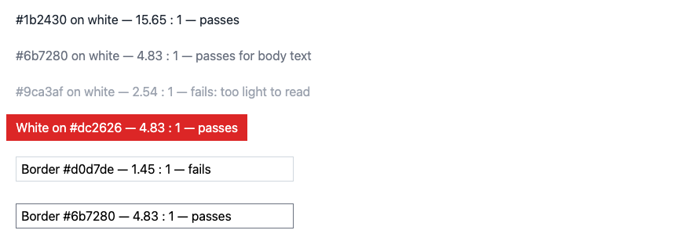

| What | Minimum ratio (WCAG 2.2, level AA) |
|---|---|
| Normal text | **4.5 : 1** |
| Large text (24px, or 18.66px bold) | **3 : 1** |
| Borders of form fields, focus rings, icons that carry meaning | **3 : 1** |

All ratios above were measured with the WCAG formula. To check your own colours, use a contrast checker such as [webaim.org/resources/contrastchecker](https://webaim.org/resources/contrastchecker/).

**Common Error:** Light grey placeholder-style text for real content, and pale borders on inputs. They look elegant on a designer's bright monitor and disappear on a cheap laptop in sunlight.

## 5. A skip link

Keyboard users press `Tab` through every header link before reaching the content — on every page. A skip link lets them jump:

```html
<a class="skip-link" href="#main">Skip to main content</a>
<header>
  ...
</header>
<main id="main">
  ...
</main>
```

```css
/* Off-screen until it receives keyboard focus */
.skip-link {
  position: absolute;
  left: 8px;
  top: -48px;
  padding: 8px 12px;
  background-color: #ffffff;
  color: #1a365d;
  font-weight: bold;
}
.skip-link:focus {
  top: 8px;
}
```

**Before pressing `Tab`:**

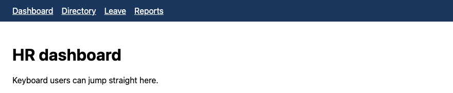

**After pressing `Tab` once:**

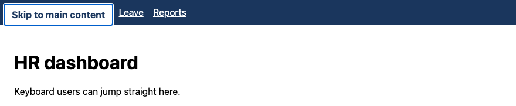

It is the **first** link on the page, hidden above the top edge (`top: -48px`) until it has the focus.

## 6. Marking the current page

```html
<nav aria-label="Main">
  <ul>
    <li><a href="dashboard.html">Dashboard</a></li>
    <li><a href="directory.html" aria-current="page">Directory</a></li>
    <li><a href="apply-leave.html">Leave</a></li>
    <li><a href="attendance.html">Reports</a></li>
  </ul>
</nav>
```

```css
nav a { border-bottom: 3px solid transparent; }
nav a[aria-current="page"] {
  border-bottom-color: #ffffff;
  font-weight: bold;
}
```

**Output:**

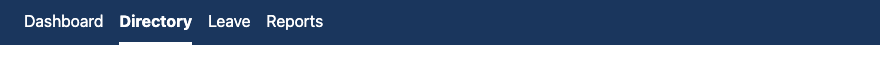

- `aria-current="page"` tells screen readers "this link is the page you are on". The CSS uses the **same attribute** for the visual style, so the two can never disagree.
- `aria-label="Main"` names the navigation. Useful when a page has more than one `nav`.
- `border-bottom: 3px solid transparent` on every link reserves the space, so the current link does not jump when the bar appears. `border-bottom-color` then changes **only the colour** of that border (`border-color` does the same for all four sides).

**Remember:** The first rule of ARIA: if a normal HTML element does the job, use it. `button`, `nav`, `label` and `th` already carry meaning. ARIA only fills gaps, like `aria-current`.

## 7. The keyboard test

Put the mouse away and use the page with these keys only:

| Key | Does |
|---|---|
| `Tab` / `Shift + Tab` | Next / previous link, button or field |
| `Enter` | Follow a link, press a button, submit a form |
| `Space` | Press a button, tick a checkbox, open a `select` |
| Arrow keys | Move between radio buttons, scroll the page |

Pass if you can reach and use **everything**, you can **always see** where the focus is, and the focus moves in a sensible order.

---

# Part D — Native interactive elements

## 8. `details` and `summary` — no JavaScript needed

```html
<h2>Leave — frequently asked questions</h2>
<details open>
  <summary>Can I cancel approved leave?</summary>
  <p>Ask your manager. You can edit or cancel a request yourself only while it is still pending.</p>
</details>
<details>
  <summary>Does unused casual leave carry forward?</summary>
  <p>No. Only earned leave can be carried forward.</p>
</details>
<details>
  <summary>Who approves my leave?</summary>
  <p>Your reporting manager, shown on your profile page.</p>
</details>
```

```css
details { border: 1px solid #d0d7de; border-radius: 8px; padding: 8px 12px; margin-bottom: 8px; }
summary { font-weight: bold; cursor: pointer; }
details p { margin: 8px 0 0; }
```

**Output:**

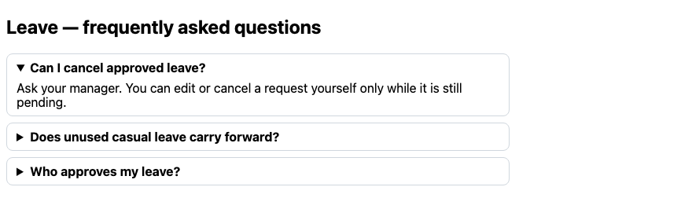

- `summary` is the clickable line; the rest of `details` shows when it is opened.
- The `open` attribute makes it start open.
- It works with mouse, keyboard (`Tab`, then `Enter` or `Space`) and screen readers — for free.

---

# Part E — The page `head`

## 9. Title, description, icon

```html
<head>
  <meta charset="UTF-8">
  <meta name="viewport" content="width=device-width, initial-scale=1.0">
  <title>Employee directory — AcmeHR</title>
  <meta name="description" content="Find colleagues at Acme by name, department and designation.">
  <meta name="robots" content="noindex">
  <link rel="icon" href="images/favicon.png" type="image/png">
</head>
```

| Line | Job |
|---|---|
| `<title>` | Tab, bookmark and search-result title. Pattern: *Page — Site*. Unique on every page. |
| `meta name="description"` | The summary search engines may show under the title |
| `meta name="robots" content="noindex"` | Asks search engines **not** to list the page. Right for AcmeHR: it is an internal tool behind a login. A public website would leave this out. |
| `link rel="icon"` | The small icon on the browser tab |

**Output** — the body only; look at the browser tab when you open the file:

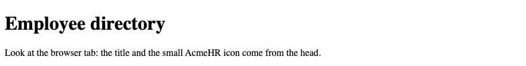

---

# Part F — The final project

## 10. The AcmeHR portal

The [final project](labs/L09_final_project/README.md) joins every lesson into one site with one stylesheet:

| Page | From |
|---|---|
| `index.html` — Home with quick links | Lessons 4, 5, 9 |
| `profile.html` — Employee profile | Lesson 3 |
| `directory.html` — Employee directory | Lesson 4 |
| `dashboard.html` — HR dashboard | Lesson 5 |
| `apply-leave.html` — Apply for leave | Lesson 6 |
| `attendance.html` — Attendance report | Lesson 7 |
| `policies/leave.html` — Leave policy with FAQ | Lessons 2, 9 |

The apply-for-leave page in the reference solution:

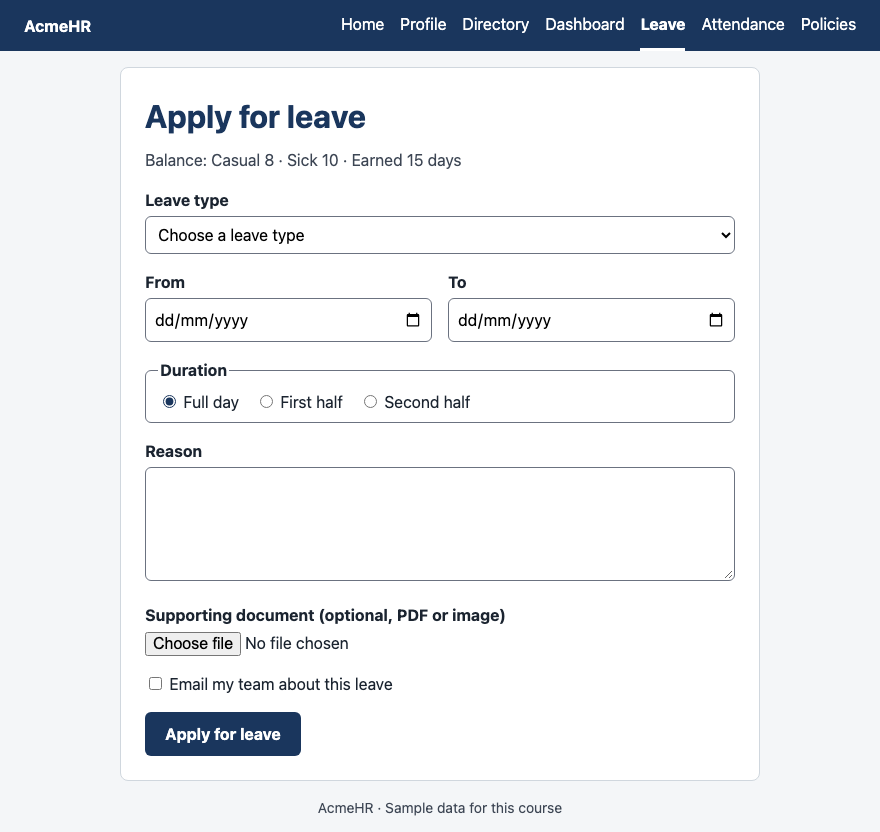

**Where used?** In the Django and Spring phases, these pages become your templates. The repeated `head`, skip link, header and footer move into one base template; each page fills in only its `main`. `acmehr.css` moves to the static folder unchanged.

---

## Try these

1. **(Easy)** Add `--color-success: #166534;` to `:root` and use it for the "On time" status text.
2. **(Easy)** Do the keyboard test (section 7) on your Lesson 6 leave form. Write down anything you could not reach or see.
3. **(Medium)** Give the directory cards a hover state: border in `--color-brand` and a 2px lift, with a transition, and no movement for reduced-motion users.
4. **(Medium)** Check three colour pairs from your own pages in a contrast checker. Fix any that fail.
5. **(Stretch)** Add a dark theme: a `.theme-dark` class on `body` that changes only the tokens (`--color-page`, `--color-surface`, `--color-ink`…). How many other rules did you need to change?

**Interview:** *"What are CSS custom properties?"* — Named values, defined like `--color-brand: #1a365d` and read with `var(--color-brand)`. They inherit and can be changed for a section of the page, which makes them the basis of design tokens and themes.

**Interview:** *"`:focus` or `:focus-visible`?"* — `:focus-visible` for the visible ring: it shows for keyboard users and usually not after a mouse click. Never remove focus styles without a replacement.

**Interview:** *"How do you check a page for accessibility?"* — Semantic HTML first, then: every image has suitable `alt`, every field a `label`, contrast at least 4.5 : 1 for text, the whole page usable with the keyboard with visible focus, and a skip link. Then test with a screen reader and an automated checker.

**Key takeaways**

- Name repeated values as custom properties in `:root`: one change updates the whole site.
- One stylesheet, organised in sections; class names describe what things are.
- Every interactive element needs `:hover` *and* `:focus-visible`; animate `transform` and colours; respect `prefers-reduced-motion`.
- Text contrast at least 4.5 : 1; field borders and focus rings at least 3 : 1.
- Skip link, `aria-current="page"`, and the keyboard test.
- `details` / `summary` give an accessible show-and-hide with no JavaScript.

---

## Final project

👉 [Lab 09 — The AcmeHR portal (final project)](labs/L09_final_project/README.md)

**Next phase:** [JavaScript, DOM & Forms](../03_JavaScript_DOM_Forms.md) — the same pages, now with behaviour.
