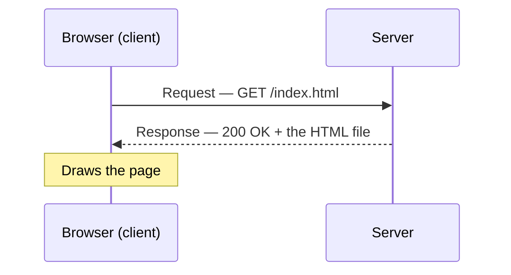
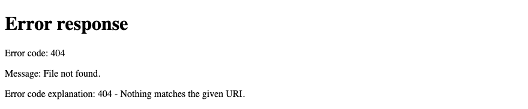
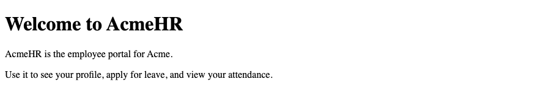
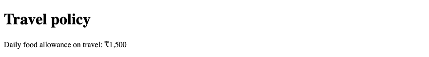
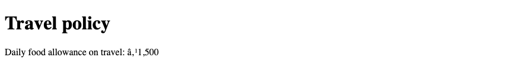
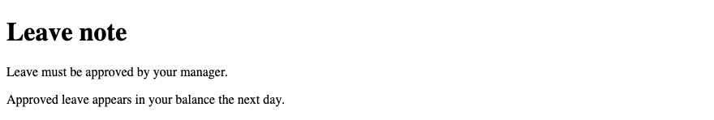
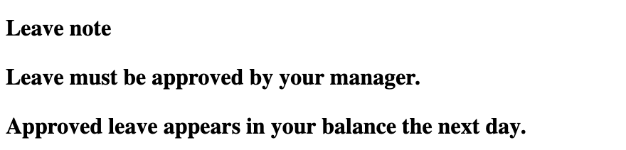
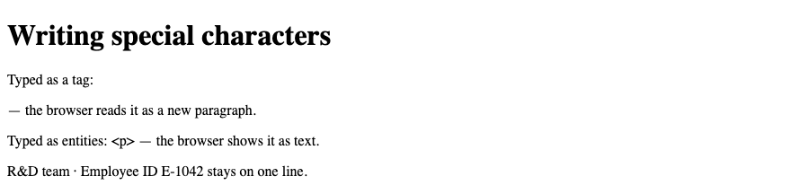
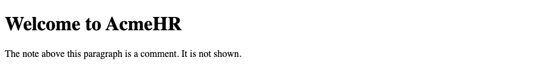

# Lesson 1 — How the Web Works & Your First Page

**Course:** HTML & CSS for Full Stack · **Session 1 of 9** · [Learning path](README.md) · **Next:** [Lesson 2 — Content & Your First CSS](Lesson_02_Content_and_Your_First_CSS.md)

**Module Outcome:** You can explain what a browser and a server do, write a correct HTML page from memory, and serve it from your own computer.

| | |
|---|---|
| **You will build** | The AcmeHR welcome page, served from your own computer |
| **New HTML** | `<!DOCTYPE>`, `html`, `head`, `meta`, `title`, `body`, `h1`, `p`, comments, entities |
| **You need** | VS Code, Google Chrome, Python 3 *or* the VS Code Live Server extension |

**Our project.** All 9 lessons build pages for **AcmeHR**, Acme's employee management system: a welcome page, a leave policy, an employee profile, a directory, a dashboard, a leave form, and an attendance report.

All example files for this lesson: [`examples/lesson01/`](examples/lesson01/). Open each one in the browser and change it.

---

## 1. Browser and server



- The **browser** (client) asks for a file.
- The **server** answers with a **status code** and the file. In this course, the server will later be your Django or Spring Boot app.

Three status codes you will see every week:

| Code | Meaning | Usual cause |
|---:|---|---|
| **200** | OK | Everything worked |
| **404** | Not found | Wrong file name or path |
| **500** | Server error | A bug in your backend code |

### Try it — run a server on your computer

Open a terminal in the folder that has your `index.html`:

```bash
python3 -m http.server 8000
```

Open `http://localhost:8000` — you see your page. Now open `http://localhost:8000/leave.html`, a page that does not exist:

**Output:**



The terminal logs both requests. This is the real output:

```text
::1 - - [05/Oct/2026 18:41:50] "GET / HTTP/1.1" 200 -
::1 - - [05/Oct/2026 18:41:50] code 404, message File not found
::1 - - [05/Oct/2026 18:41:50] "GET /leave.html HTTP/1.1" 404 -
```

In a real browser you may also see `"GET /favicon.ico" 404`. The browser asks for a small tab icon by itself. That 404 is harmless.

Press `Ctrl + C` to stop the server.

**Note:** No Python? In VS Code, install the **Live Server** extension, right-click `index.html` → *Open with Live Server*.

---

## 2. HTML, CSS and JavaScript

| Language | Job | AcmeHR example |
|---|---|---|
| **HTML** | What things *are* | "This is a heading. This is a paragraph." |
| **CSS** | How things *look* | Navy headings, a grey page background — from Lesson 2 |
| **JavaScript** | What things *do* | Check the leave form before it is sent — after this course |

This lesson is HTML only.

---

## 3. Set up your project folder

```text
acmehr/
└── index.html     ← today's page
```

**Tip:** In VS Code, create `index.html`, type `!` and press `Tab`. VS Code writes the page skeleton for you. Section 4 explains every line it wrote.

**Common Error:** File names with spaces or capitals, like `Leave Form.html`. Servers on Linux treat `Leave.html` and `leave.html` as two different files, so a page that works on your laptop gives a 404 after deployment. Use lowercase and hyphens: `leave-form.html`.

**Common Error:** On Windows, the file is saved as `index.html.txt`. Turn on *View → File name extensions* in File Explorer.

---

## 4. Your first page

```html
<!DOCTYPE html>
<html lang="en">
<head>
  <meta charset="UTF-8">
  <meta name="viewport" content="width=device-width, initial-scale=1.0">
  <title>Welcome — AcmeHR</title>
</head>
<body>
  <h1>Welcome to AcmeHR</h1>
  <p>AcmeHR is the employee portal for Acme.</p>
  <p>Use it to see your profile, apply for leave, and view your attendance.</p>
</body>
</html>
```

**Output:**



File: [`01_first_page.html`](examples/lesson01/01_first_page.html)

| Line | Job |
|---|---|
| `<!DOCTYPE html>` | "This is modern HTML." Without it, the browser uses an old layout mode. |
| `<html lang="en">` | Wraps the whole page. `lang` tells screen readers which language to speak. |
| `<head>` | Information *about* the page. Not shown on the page. |
| `<meta charset="UTF-8">` | How to read the letters in the file. Always the first line in `head`. |
| `<meta name="viewport" …>` | Makes phones use their real screen width. |
| `<title>` | The text on the browser tab. |
| `<body>` | Everything the visitor sees. |
| `<h1>` | The main heading of the page. |
| `<p>` | A paragraph. |

### Why `charset` matters

Same file, same ₹ sign. Only the `charset` line is different.

**`<meta charset="UTF-8">`:**



**`<meta charset="windows-1252">`:**



**Where used?** In Django and Spring Boot, your pages become *templates*: the server fills in real data (like the employee's name) and then sends this same kind of HTML to the browser.

---

## 5. Tags, elements and attributes

```text
<h1>Welcome to AcmeHR</h1>
^^^^  start tag
    ^^^^^^^^^^^^^^^^^  content
                     ^^^^^  end tag
```

The whole thing — start tag, content, end tag — is one **element**.

```text
<meta charset="UTF-8">
 ^^^^  tag name
      ^^^^^^^^^^^^^^^  attribute: name="value"
```

- An **attribute** adds information to a start tag: `name="value"`.
- `<meta>` has no content and no end tag. Elements like this are called **void** elements.

**Elements sit inside elements.** Close them in reverse order, like brackets:

```html
<head><title>Welcome — AcmeHR</title></head>   <!-- correct -->
<head><title>Welcome — AcmeHR</head></title>   <!-- wrong   -->
```

The page in section 4 uses correct nesting. The next section shows what happens when an end tag is missing.

---

## 6. Missing end tags — the browser does not complain

Python and Java stop with an error. HTML **never** shows an error. The browser guesses and keeps going.

**Correct:**

```html
<h1>Leave note</h1>
<p>Leave must be approved by your manager.</p>
<p>Approved leave appears in your balance the next day.</p>
```



**`</h1>` missing:**

```html
<h1>Leave note
<p>Leave must be approved by your manager.</p>
<p>Approved leave appears in your balance the next day.</p>
```



The heading never ended, so both paragraphs became part of it.

**Remember:** "It looks fine" does not mean it is correct. Check every page with the **W3C validator**: [validator.w3.org/nu](https://validator.w3.org/nu/). It lists each error with its line number.

---

## 7. Special characters

`<` and `&` start tags and entities. To *show* them as text, write an **entity**:

| To show | Write |
|---|---|
| `<` | `&lt;` |
| `>` | `&gt;` |
| `&` | `&amp;` |
| a space that never breaks the line | `&nbsp;` |

```html
<p>Typed as a tag: <p> — the browser reads it as a new paragraph.</p>
<p>Typed as entities: &lt;p&gt; — the browser shows it as text.</p>
<p>R&amp;D team · Employee&nbsp;ID&nbsp;E-1042 stays on one line.</p>
```

**Output:**



With `charset="UTF-8"`, type ₹, é or — directly. No entity needed.

---

## 8. Comments

```html
<h1>Welcome to AcmeHR</h1>
<!-- TODO: add the leave policy link in Lesson 2 -->
<p>The note above this paragraph is a comment. It is not shown.</p>
```

**Output:**



**Common Error:** Anyone can see comments with *View Source* (`Ctrl + U` / `Cmd + Option + U`). Never put passwords or employee data in a comment.

---

## Try these

1. **(Easy)** Write the page skeleton from memory, without the `!` shortcut. Compare with section 4.
2. **(Easy)** Change the `<title>` to `Home — AcmeHR`. Where does the new text appear?
3. **(Medium)** Serve your folder with `python3 -m http.server 8000`. Open a page that does not exist. Find the 404 line in the terminal.
4. **(Medium)** Delete the `</h1>` from your page. What changes on screen? Now run it through the W3C validator and read the message.
5. **(Stretch)** Change `charset` to `windows-1252` in your own page and type a ₹ sign. What do you see?

**Interview:** *"What happens when you open a web page?"* — The browser sends a request to the server. The server returns a status code (200 if it worked) and the HTML. The browser reads the HTML and draws the page. Every other file the page needs, like CSS or images, is another request.

**Interview:** *"What does `<!DOCTYPE html>` do?"* — It tells the browser to use standards mode. Without it, the browser uses quirks mode, which imitates old browsers.

**Key takeaways**

- The browser requests; the server responds with a status code and a file. 404 = wrong path, 500 = server bug.
- Every page starts with the same skeleton. `charset` is the first line in `head`.
- An element = start tag + content + end tag. Attributes go in the start tag.
- The browser never reports HTML errors — use the W3C validator.
- Use entities for `<`, `>` and `&`.

---

## Lab

👉 [Lab 01 — AcmeHR welcome page](labs/L01_welcome_page/README.md)

**Next:** [Lesson 2 — Content & Your First CSS](Lesson_02_Content_and_Your_First_CSS.md)
