# Lesson 2 — Content & Your First CSS

**Course:** HTML & CSS for Full Stack · **Session 2 of 9** · [Learning path](README.md) · **Previous:** [Lesson 1](Lesson_01_How_the_Web_Works_and_Your_First_Page.md) · **Next:** [Lesson 3 — Page Structure & the Box Model](Lesson_03_Page_Structure_and_the_Box_Model.md)

**Module Outcome:** You can mark up a text page with the right elements, link pages together, attach a stylesheet, and explain why one CSS rule beats another.

| | |
|---|---|
| **You will build** | The AcmeHR **Leave policy** page — first plain HTML, then styled |
| **New HTML** | `h2`–`h6`, `br`, `ul`, `ol`, `li`, `a`, `strong`, `em`, `link`, `style`, the `id` and `class` attributes |
| **New CSS** | Linking a stylesheet, `<style>`, selectors, `color`, `background-color`, `font-family`, `font-weight`, `line-height`, `outline`, the cascade, inheritance |
| **You need** | Your `acmehr/` folder from Lesson 1 |

**From the requirements.** In AcmeHR, employees must be able to *access policies*. The leave policy lists the leave types and the leave workflow: apply → manager approves or rejects → balance updated → employee notified.

**Where we are going.** Plain HTML at the end of Part A:

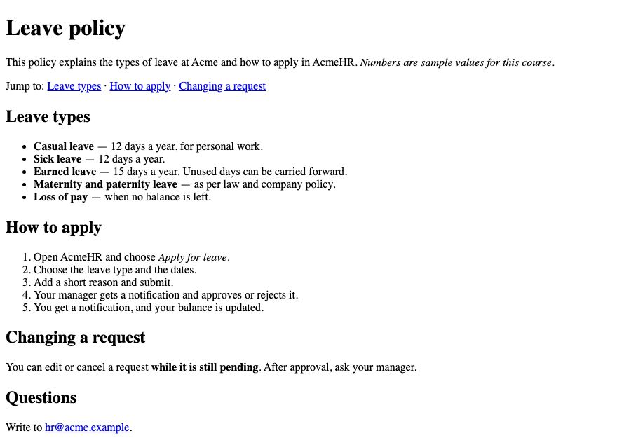

The same HTML with `policy.css` at the end of Part B:

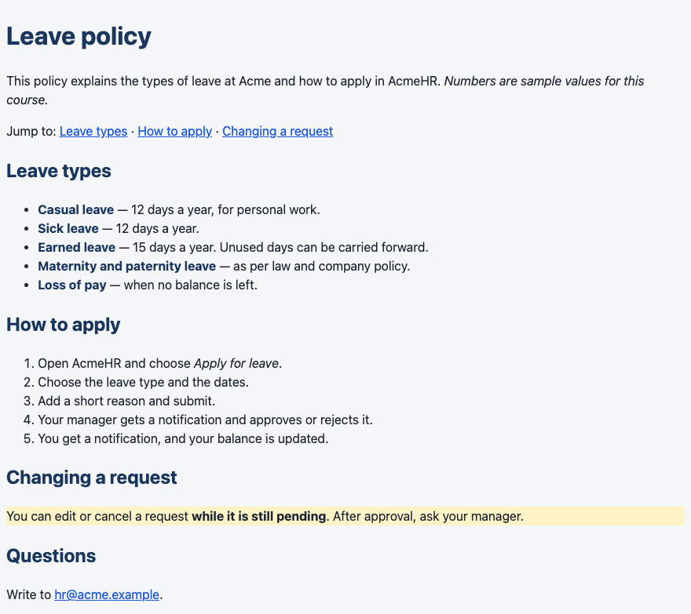

All example files: [`examples/lesson02/`](examples/lesson02/)

---

# Part A — Content

**Remember:** Choose an element for what the content **is**, never for how it looks. The look comes from CSS in Part B.

## 1. Headings

```html
<h1>Leave policy</h1>
<h2>Leave types</h2>
<h3>Casual leave</h3>
<h3>Sick leave</h3>
<h2>How to apply</h2>
<h2>Questions</h2>
```

**Output:**

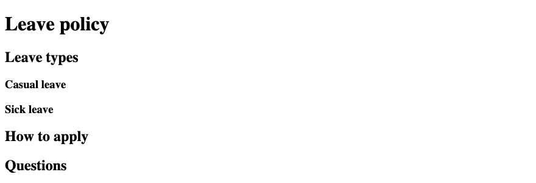

The headings form the outline of the page:

```text
h1  Leave policy
├── h2  Leave types
│   ├── h3  Casual leave
│   └── h3  Sick leave
├── h2  How to apply
└── h2  Questions
```

- **One `h1`** per page — the page topic.
- **Do not skip levels:** after `h2` comes `h3`, not `h4`.
- **Never choose a heading for its size.** Screen-reader users jump from heading to heading to scan the page; the levels are their map.

## 2. Paragraphs and line breaks

```html
<p>The HR team works from the Hyderabad office.</p>
<p>Acme HR Department<br>
Level 3, Lakshmi Towers<br>
HITEC City, Hyderabad 500081</p>
<p>Visiting hours are 10 am to 5 pm, Monday to Friday.</p>
```

**Output:**

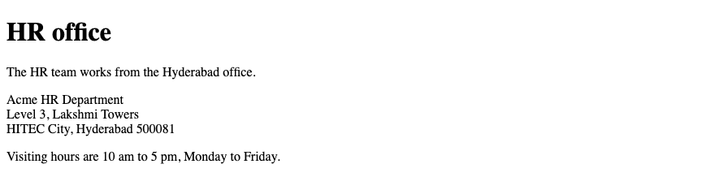

- `<p>` is one paragraph. The browser puts space between paragraphs.
- `<br>` breaks a line **inside** one paragraph, like the lines of an address. It is a void element (no end tag).

**Common Error:** `<br><br>` to make space between ideas. A new idea is a new `<p>`.

## 3. Lists

```html
<h2>Leave types</h2>
<ul>
  <li>Casual leave</li>
  <li>Sick leave</li>
  <li>Earned leave</li>
</ul>

<h2>How to apply</h2>
<ol>
  <li>Choose the leave type and the dates.</li>
  <li>Add a short reason and submit.</li>
  <li>Your manager approves or rejects the request.</li>
</ol>
```

**Output:**

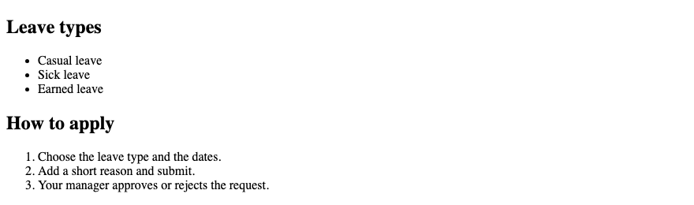

| Element | Use when |
|---|---|
| `<ul>` | Order does not matter — bullets |
| `<ol>` | Order matters — numbers |
| `<li>` | Each item, inside `ul` or `ol` |

**Common Error:** Typing "1.", "2.", "3." by hand. With `<ol>`, the numbers update by themselves when you add a step.

## 4. Links

```html
<p>Absolute: <a href="https://www.w3.org/">the W3C website</a></p>
<p>Relative: <a href="06_policy_html.html">the leave policy</a> (a file in the same folder)</p>
<p>Fragment: <a href="#questions">jump to Questions</a> (on this page)</p>
<p>Email: <a href="mailto:hr@acme.example">hr@acme.example</a></p>

<h2 id="questions">Questions</h2>
<p>Ask the HR team.</p>
```

**Output:**

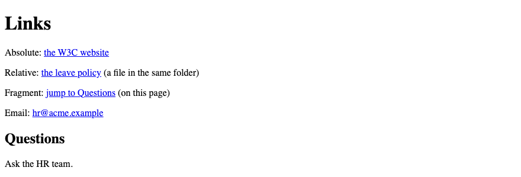

| `href` | Goes to |
|---|---|
| `https://www.w3.org/` | Another website. Always include `https://`. |
| `06_policy_html.html` | A file in the same folder as this page |
| `../index.html` | A file one folder **up** |
| `#questions` | The element with `id="questions"` on this page |
| `mailto:hr@acme.example` | The email app |

`id` gives one element a unique name on the page. A fragment link (`#questions`) jumps to it.

Relative paths start from **the file that contains the link**:

```text
acmehr/
├── index.html            → link to the policy:  policies/leave.html
└── policies/
    └── leave.html        → link back home:      ../index.html
```

**Common Error:** Link text "click here". Screen-reader users can list all links on a page; ten "click here" links tell them nothing. Write what the link does: "Read the leave policy".

## 5. Emphasis — `strong` and `em`

```html
<p>You can cancel a request <strong>while it is still pending</strong>.</p>
<p>Apply <em>before</em> you travel, not after.</p>
```

**Output:**

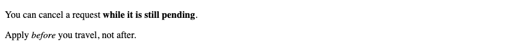

- `<strong>` = important. Shown **bold**.
- `<em>` = stressed, as you would say it aloud. Shown *italic*.

## 6. Putting it together — the policy page in HTML

[`06_policy_html.html`](examples/lesson02/06_policy_html.html) uses every element from sections 1–5:

```html
<h1>Leave policy</h1>
<p>This policy explains the types of leave at Acme and how to apply in AcmeHR. <em>Numbers are sample values for this course.</em></p>
<p>Jump to: <a href="#types">Leave types</a> · <a href="#apply">How to apply</a> · <a href="#changes">Changing a request</a></p>

<h2 id="types">Leave types</h2>
<ul>
  <li><strong>Casual leave</strong> — 12 days a year, for personal work.</li>
  <li><strong>Sick leave</strong> — 12 days a year.</li>
  <li><strong>Earned leave</strong> — 15 days a year. Unused days can be carried forward.</li>
  <li><strong>Maternity and paternity leave</strong> — as per law and company policy.</li>
  <li><strong>Loss of pay</strong> — when no balance is left.</li>
</ul>

<h2 id="apply">How to apply</h2>
<ol>
  <li>Open AcmeHR and choose <em>Apply for leave</em>.</li>
  <li>Choose the leave type and the dates.</li>
  <li>Add a short reason and submit.</li>
  <li>Your manager gets a notification and approves or rejects it.</li>
  <li>You get a notification, and your balance is updated.</li>
</ol>

<h2 id="changes">Changing a request</h2>
<p>You can edit or cancel a request <strong>while it is still pending</strong>. After approval, ask your manager.</p>

<h2>Questions</h2>
<p>Write to <a href="mailto:hr@acme.example">hr@acme.example</a>.</p>
```

**Output:**


---

# Part B — Your first CSS

## 7. Link a stylesheet

Create `first.css` next to the HTML file:

```css
body {
  font-family: system-ui, sans-serif;
  line-height: 1.5;
  color: #1b2430;
  background-color: #f4f6f8;
}

h1 {
  color: #1a365d;
}
```

Link it from the `<head>` of the policy page:

```html
<head>
  <meta charset="UTF-8">
  <meta name="viewport" content="width=device-width, initial-scale=1.0">
  <title>Leave policy — AcmeHR</title>
  <link rel="stylesheet" href="first.css">
</head>
```

**Output:**

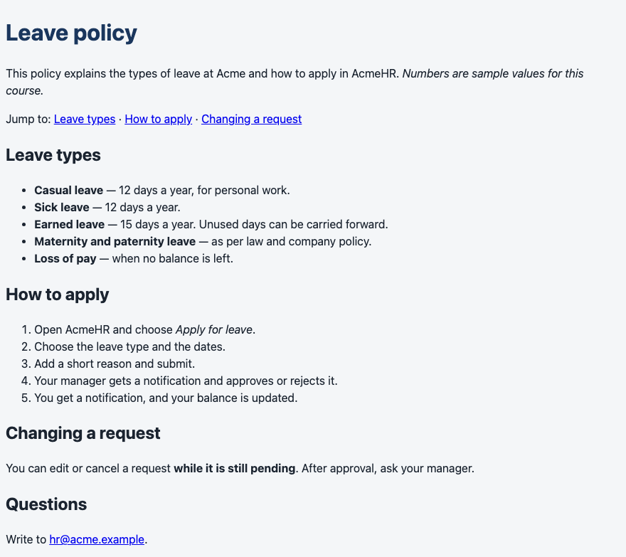

Files: [`07_first_css.html`](examples/lesson02/07_first_css.html) · [`first.css`](examples/lesson02/first.css)

The HTML body did not change. One `<link>` line in the `<head>` connected the stylesheet.

| Property | What it sets | Example value |
|---|---|---|
| `font-family` | The font. A list: the browser uses the first one it has. | `system-ui, sans-serif` |
| `line-height` | Space between lines, as a multiple of the font size | `1.5` |
| `color` | Text colour | `#1b2430` |
| `background-color` | Background colour | `#f4f6f8` |

Colours like `#1a365d` are **hex** codes: red, green and blue values. Copy them from a design or a colour picker.

## 8. Reading a CSS rule

```text
h1 { color: #1a365d; }
^^  selector: which elements
     ^^^^^  property: what to change
            ^^^^^^^  value: change it to this
     ^^^^^^^^^^^^^^^  declaration (always ends with ;)
```

**Common Error:** A missing semicolon. In `color: #1b2430 background-color: #f4f6f8;` the browser sees one broken declaration and ignores **both** properties.

### Three places to write CSS

| Where | Example | Use it? |
|---|---|---|
| **External file** | `<link rel="stylesheet" href="first.css">` | **Yes.** One file styles every page. |
| `<style>` in the `<head>` | `<style> h1 { color: navy; } </style>` | Small demos only — the next examples use it so each file is self-contained. |
| `style` attribute | `<p style="color: red">` | No. It cannot be reused and is hard to override. |

## 9. Block and inline elements

To see each element's box, this example draws an `outline` (a line around the box) on every element:

```html
<style>
  body { font-family: system-ui, sans-serif; }

  /* outline draws a line around an element's box, so you can see it */
  h2, p, ul, li { outline: 2px solid blue; }
  a, strong, em { outline: 2px dashed red; }
</style>
...
<h2>Leave types</h2>
<p>Casual leave is <strong>12 days</strong> a year. See <a href="#">the full list</a>.</p>
<ul>
  <li>Sick leave</li>
  <li>Earned leave</li>
</ul>
```

**Output:**

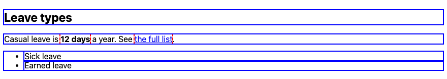

| | **Block** (blue) | **Inline** (red) |
|---|---|---|
| New line? | Yes | No — stays in the text line |
| Width | The full width available | Only as wide as its content |
| From this lesson | `h1`–`h6`, `p`, `ul`, `ol`, `li` | `a`, `strong`, `em` |

**Remember:** Inline elements go inside block elements — a link inside a paragraph. Never put a block element inside a `<p>`: the browser ends the paragraph early, like the typed `<p>` in Lesson 1.

## 10. Selectors

```css
p { color: #1b2430; }                     /* element: every p              */
.notice { background-color: #fef3c7; }    /* class: every class="notice"   */
#deadline { font-weight: bold; }          /* id: the one id="deadline"     */
li strong { color: #1a56db; }             /* descendant: strong inside li  */
h1, h2 { font-family: Georgia, serif; }   /* group: every h1 and every h2  */
```

```html
<h1>Leave policy</h1>
<p>A normal paragraph.</p>
<p class="notice">A paragraph with class="notice".</p>
<p class="notice" id="deadline">A paragraph with class="notice" and id="deadline".</p>
<h2>Leave types</h2>
<ul>
  <li><strong>Casual leave</strong> — strong inside li: blue</li>
</ul>
<p><strong>Strong inside p</strong> — not blue</p>
```

**Output:**

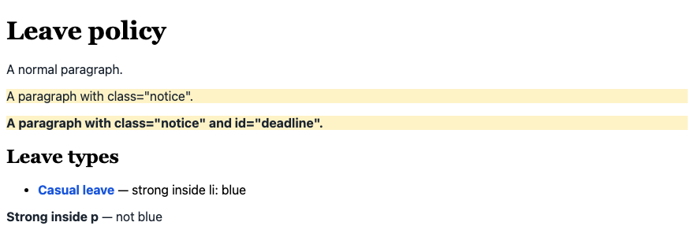

| Selector | Matches |
|---|---|
| `p` | Every `<p>` |
| `.notice` | Every element with `class="notice"` |
| `#deadline` | The one element with `id="deadline"` |
| `li strong` | A `<strong>` anywhere inside an `<li>` |
| `h1, h2` | Every `h1` and every `h2` |

- `class` names a **group**. Many elements can share a class, and one element can have several: `class="notice urgent"`.
- **Style with classes.** Keep `id` for unique things, like fragment links.
- `font-weight: bold` makes text bold.

**Common Error:** The dot and the hash are **CSS only**. HTML: `class="notice"`. CSS: `.notice`. Writing `class=".notice"` matches nothing.

## 11. When rules disagree — the cascade

Several rules can set the same property on one element. The browser decides like this:

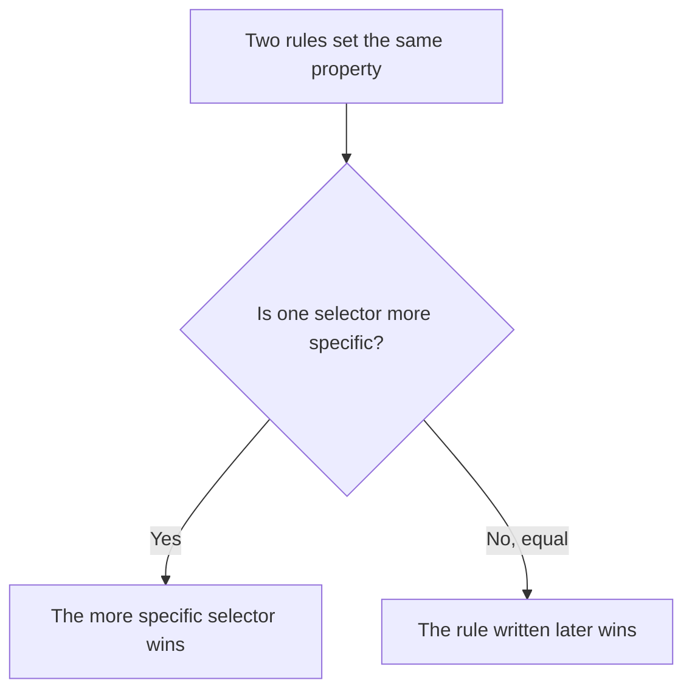

### Specificity — count (ids, classes, elements)

```css
#deadline { color: #dc2626; }   /* (1,0,0) red   */
.notice   { color: #15803d; }   /* (0,1,0) green */
p         { color: #6b7280; }   /* (0,0,1) grey  */
```

```html
<p>1. Only "p" matches → grey.</p>
<p class="notice">2. "p" and ".notice" match → green wins.</p>
<p class="notice" id="deadline">3. All three match → red wins.</p>
```

**Output:**

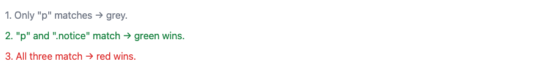

| Selector | Score |
|---|---|
| `p` | (0,0,1) |
| `li strong` | (0,0,2) |
| `.notice` | (0,1,0) |
| `#deadline` | (1,0,0) |

Compare from the left. One class beats any number of elements. One id beats any number of classes. The `#deadline` rule is written **first** and still wins.

### Order — equal specificity, the later rule wins

```css
.status { color: #15803d; }   /* green — written first */
.status { color: #b45309; }   /* amber — written later, same specificity: wins */
```

```html
<p class="status">Leave status: Pending</p>
```

**Output:**


**Remember:** `!important` after a value overrides normal rules. **Avoid it.** The next developer then needs `!important` too. If your rule loses, use a class or move the rule later.

## 12. Inheritance

```css
body {
  font-family: Georgia, serif;   /* inherited by everything inside body */
  color: #1a365d;                /* inherited by everything inside body */
}
```

```html
<h2>Leave types</h2>
<p>This paragraph has no rule of its own. It inherits the font and colour from body.</p>
<ul>
  <li>So does this list item, and <strong>this strong text</strong>.</li>
</ul>
<p><a href="#">This link keeps its own blue colour.</a></p>
```

**Output:**

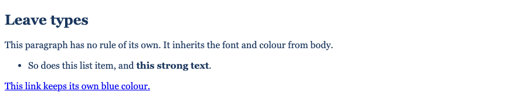

- Text properties — `color`, `font-family`, `font-weight`, `line-height` — pass down from parent to children.
- The link stays blue: the browser has its own rule for links, and a rule for the element itself always beats an inherited value. To recolour links, target them: `a { color: #1a56db; }`.
- Set the font and colour **once** on `body`. The whole page follows.

## 13. Putting it together — the styled policy page

Same HTML as section 6, plus `class="note"` on the "Changing a request" paragraph, linked to `policy.css`:

```css
/* AcmeHR — leave policy page */

body {
  font-family: system-ui, sans-serif;
  line-height: 1.5;
  color: #1b2430;
  background-color: #f4f6f8;
}

h1,
h2 {
  color: #1a365d;
}

a {
  color: #1a56db;
}

li strong {
  color: #1a365d;
}

.note {
  background-color: #fef3c7;
}
```

**Output:**


Files: [`13_policy_styled.html`](examples/lesson02/13_policy_styled.html) · [`policy.css`](examples/lesson02/policy.css)

In Lesson 3 you add spacing, borders and a white card with the **box model**.

**Common Error:** "My CSS does nothing." Check in this order:

1. Did you save the CSS file?
2. Is the path right? Serve the folder and watch the terminal: a **404** for the `.css` file means the `href` is wrong.
3. Does the selector match? Check the dot, the spelling, and the class name in the HTML.
4. Is a more specific or later rule winning?
5. Still old styles? Hard reload: `Ctrl + Shift + R` / `Cmd + Shift + R`.

**Where used?** In Django, CSS lives in a `static/` folder, and the template links it with `` and `href=""`. In Spring Boot, put it in `src/main/resources/static/css/policy.css` and link it with `th:href="@{/css/policy.css}"` in a Thymeleaf template. The CSS itself is the same.

---

## Try these

1. **(Easy)** Write the heading outline for an AcmeHR *Attendance policy* page with sections for working hours, check-in, and late arrivals.
2. **(Easy)** Add a "Back to home" link from `policies/leave.html` to `index.html` one folder up. Serve the folder and click it.
3. **(Medium)** Predict the colour of "12 days", then check in the browser:

    ```html
    <style>
      li strong { color: green; }
      .amount   { color: orange; }
      strong    { color: blue; }
    </style>
    <ul>
      <li><strong class="amount">12 days</strong> of casual leave</li>
    </ul>
    ```

4. **(Medium)** In `policy.css`, make every `h2` use the `Georgia, serif` font without changing `h1`.
5. **(Stretch)** Move the `body` rule to the **end** of `policy.css`. Does anything change? Why or why not?

**Interview:** *"How does CSS decide which rule applies?"* — If two rules set the same property, the more specific selector wins (ids beat classes, classes beat elements). If they are equally specific, the later rule wins. Properties nobody sets may be inherited from the parent — mostly text properties like colour and font.

**Interview:** *"Class or id for styling?"* — Class. It is reusable and easy to override. Ids are for unique things like fragment links.

**Key takeaways**

- Choose elements for meaning: headings make the outline, `ul`/`ol` for lists, `strong` for importance.
- Relative paths start from the file with the link. `../` goes up one folder.
- Link one external stylesheet. Style with classes.
- More specific selector wins; equal → later rule wins. Avoid `!important`.
- Text properties inherit. Set font and colour once on `body`.

---

## Lab

👉 [Lab 02 — AcmeHR leave policy page](labs/L02_leave_policy/README.md)

**Next:** [Lesson 3 — Page Structure & the Box Model](Lesson_03_Page_Structure_and_the_Box_Model.md) (the AcmeHR **Employee profile** page).
