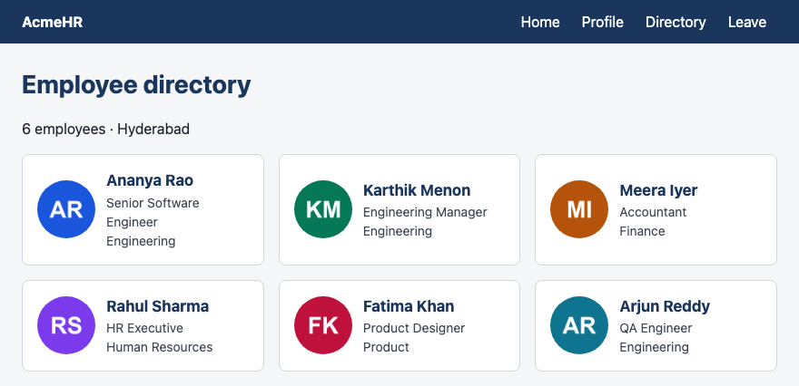
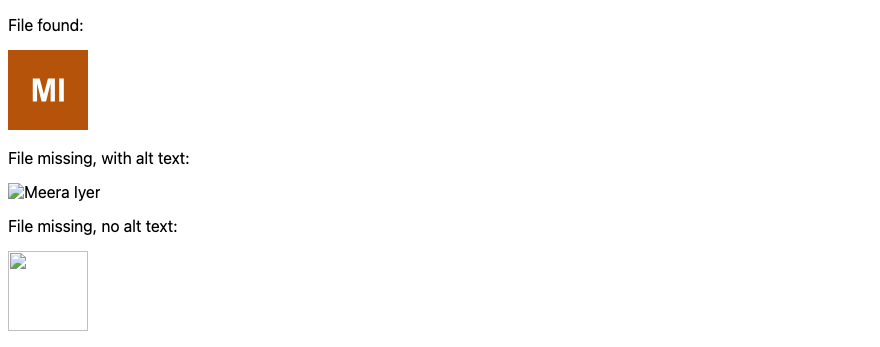
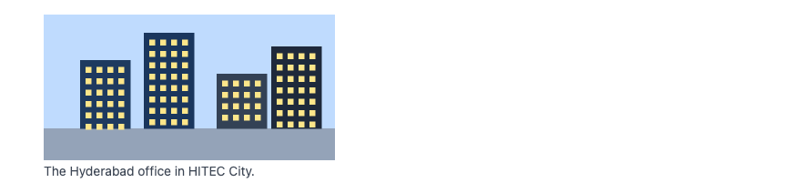
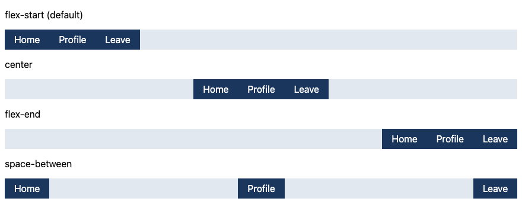
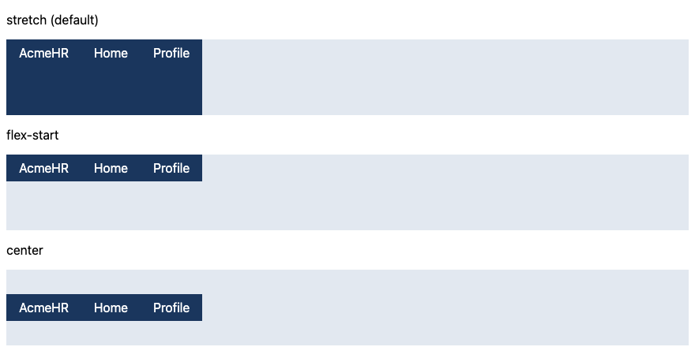
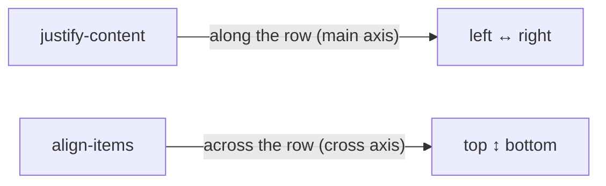
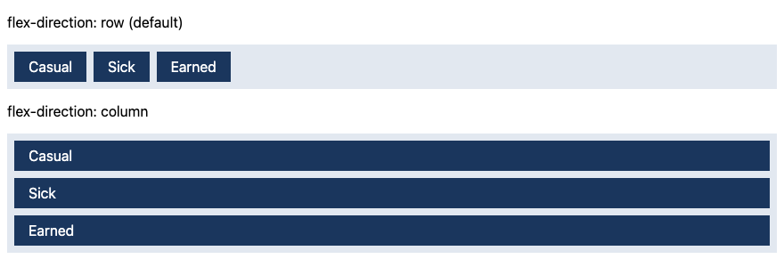
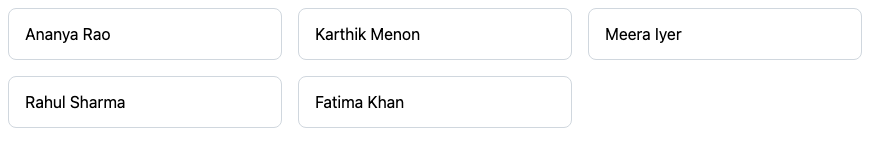
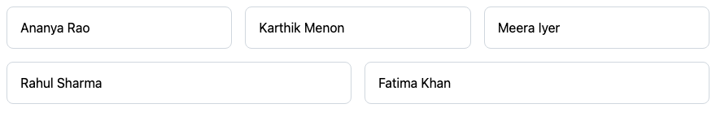
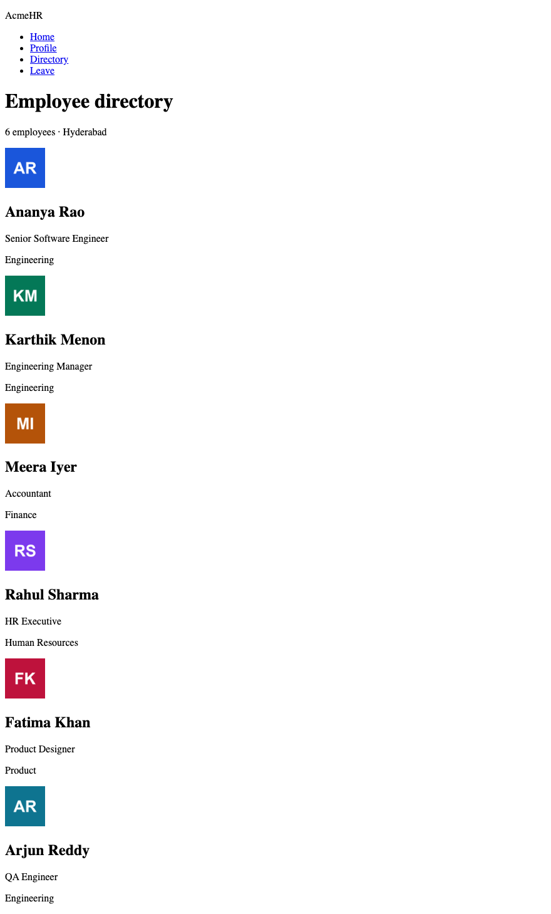

# Lesson 4 — Images, Navigation & Flexbox

**Course:** HTML & CSS for Full Stack · **Session 4 of 9** · [Learning path](README.md) · **Previous:** [Lesson 3](Lesson_03_Page_Structure_and_the_Box_Model.md) · **Next:** [Lesson 5 — Grid & Positioning](Lesson_05_Grid_and_Positioning.md)

**Module Outcome:** You can add images that are accessible and load without jumping, and use Flexbox to lay out a header, a navigation bar, and a set of cards that wrap.

| | |
|---|---|
| **You will build** | The AcmeHR **Employee directory** |
| **New HTML** | `img` (`src`, `alt`, `width`, `height`), `figure`, `figcaption`, `article` |
| **New CSS** | `display: flex`, `justify-content`, `align-items`, `flex-direction`, `flex-wrap`, `gap`, `flex`, `text-decoration` |
| **You need** | Lessons 1–3 |

**From the requirements.** AcmeHR has an employee directory that works as a contact directory. Employees browse their colleagues by name, designation and department. (Search and filters need forms — Lesson 6.)

**Where we are going:**



All example files: [`examples/lesson04/`](examples/lesson04/)

---

# Part A — Images

## 1. The `img` element

```html

<p>Ananya Rao, Senior Software Engineer</p>
```

**Output:**


| Attribute | Job |
|---|---|
| `src` | The image file. A relative path, like a link. |
| `alt` | Text that replaces the image for screen readers, and when the image fails to load. |
| `width`, `height` | The image's size in pixels. The browser reserves that space **before** the image downloads. |

`img` is a void element — no end tag.

**Why `width` and `height`:** Without them, the browser does not know the image size until it downloads. The text below jumps down when the image appears. On a slow phone, users tap the wrong link because of that jump.

## 2. `alt` text — when the image does not arrive

```html
<p>File found:</p>

<p>File missing, with alt text:</p>

<p>File missing, no alt text:</p>

```

**Output:**



How to write `alt`:

| Image | `alt` |
|---|---|
| Carries information (a photo of the employee, a chart) | Describe what it shows: `alt="Meera Iyer"` |
| Decoration, or the same information is already in the text next to it | Empty: `alt=""` — screen readers skip it |
| A link or button with only an image | What the link does: `alt="Open Meera Iyer's profile"` |

**Common Error:** Leaving `alt` out completely. Screen readers often read the **file name** instead ("meera dot png"). Always write `alt` — empty if the image is decoration.

## 3. `figure` and `figcaption`

```html
<figure>
  
  <figcaption>The Hyderabad office in HITEC City.</figcaption>
</figure>
```

**Output:**



`figure` groups an image (or chart, or code sample) with its **visible caption**. The caption is for everyone; `alt` is for people who cannot see the image.

## 4. `article` — a self-contained item

```html
<article class="card">
  
  <h2>Ananya Rao</h2>
  <p>Senior Software Engineer</p>
  <p>Engineering · Hyderabad</p>
</article>
```

**Output:**


`article` is a piece of content that makes sense on its own: one employee card, one news item, one comment. A directory is a list of articles.

The avatar has `alt=""`: the name is already written right below it, so reading it twice would be noise.

---

# Part B — Flexbox

## 5. `display: flex` — items in a row

```css
header {
  display: flex;
  background-color: #1a365d;
  color: #ffffff;
}
nav ul {
  display: flex;
  list-style: none;
  margin: 0;
  padding: 0;
}
nav a {
  display: block;
  padding: 12px;
  color: #ffffff;
  text-decoration: none;   /* no underline */
}
```

```html
<header>
  <p>AcmeHR</p>
  <nav>
    <ul>
      <li><a href="#">Home</a></li>
      <li><a href="#">Profile</a></li>
      <li><a href="#">Directory</a></li>
      <li><a href="#">Leave</a></li>
    </ul>
  </nav>
</header>
```

**Output:**


- `display: flex` makes an element a **flex container**. Its **direct children** become **flex items** and line up in a row.
- `header` is a container: its items are `p` and `nav`. `ul` is a second container: its items are the `li`s.
- Compare with Lesson 3: no `inline-block` needed.

## 6. `justify-content` — spacing along the row

```css
.row { display: flex; }
.start   { justify-content: flex-start; }
.center  { justify-content: center; }
.end     { justify-content: flex-end; }
.between { justify-content: space-between; }
```

**Output:**



`space-between` puts the first item at the start, the last item at the end, and shares the space between them. That is the classic header: logo left, links right.

## 7. `align-items` — alignment across the row

```css
.row { display: flex; height: 96px; }
.stretch { align-items: stretch; }
.start   { align-items: flex-start; }
.center  { align-items: center; }
```

**Output:**



`align-items: center` is the everyday way to **centre things vertically**.



## 8. The avatar-and-text pattern

```css
.person {
  display: flex;
  align-items: center;
  gap: 12px;
}
.person img { border-radius: 50%; }
.person h2 { margin: 0; font-size: 1.125rem; }
.person p { margin: 0; color: #3d4654; }
```

```html
<div class="person">
  
  <div>
    <h2>Karthik Menon</h2>
    <p>Engineering Manager</p>
  </div>
</div>
```

**Output:**


- `gap: 12px` puts space **between** flex items — never before the first or after the last.
- `border-radius: 50%` turns a square image into a circle.
- The `div` around the name and designation makes them **one** flex item, so they stay stacked.

You will find this pattern in every app: contact lists, chat lists, comments, notifications.

## 9. `flex-direction` — row or column

```css
.row, .column { display: flex; gap: 8px; }
.column { flex-direction: column; }
```

**Output:**



`flex-direction: column` stacks the items. `justify-content` and `align-items` then swap directions: `justify-content` works top to bottom, `align-items` left to right.

## 10. `flex-wrap` — let items move to the next line

```css
.cards {
  display: flex;
  flex-wrap: wrap;
  gap: 16px;
}
.card {
  width: 240px;
  padding: 16px;
  border: 1px solid #d0d7de;
  border-radius: 8px;
}
```

**Output:**



Without `flex-wrap: wrap`, flex items stay on one line and squeeze — or overflow the screen. With it, a card that does not fit moves to the next line.

## 11. `flex` — let items grow to fill the row

```css
.card {
  flex: 1 1 240px;   /* grow, shrink, start at 240px */
}
```

**Output:**



| Part | Value | Means |
|---|---|---|
| grow | `1` | Share leftover space in the row |
| shrink | `1` | Allowed to get smaller if needed |
| basis | `240px` | Start at 240px wide |

Compare with section 10: there is no empty gap at the end of the rows any more.

## 12. Putting it together — the directory

The HTML (one card shown; the page has six):

```html
<header>
  <p>AcmeHR</p>
  <nav>
    <ul>
      <li><a href="#">Home</a></li>
      <li><a href="#">Profile</a></li>
      <li><a href="#">Directory</a></li>
      <li><a href="#">Leave</a></li>
    </ul>
  </nav>
</header>

<main>
  <h1>Employee directory</h1>
  <p>6 employees · Hyderabad</p>

  <section class="cards">
    <article class="card">
      
      <div>
        <h2>Ananya Rao</h2>
        <p>Senior Software Engineer</p>
        <p>Engineering</p>
      </div>
    </article>
    <!-- five more cards -->
  </section>
</main>
```

**Output, HTML only:**



`directory.css`:

```css
/* AcmeHR — employee directory */

* {
  box-sizing: border-box;
}

body {
  margin: 0;
  font-family: system-ui, sans-serif;
  line-height: 1.5;
  color: #1b2430;
  background-color: #f4f6f8;
}

/* Header: logo on the left, navigation on the right */
header {
  display: flex;
  justify-content: space-between;
  align-items: center;
  padding: 0 24px;
  background-color: #1a365d;
  color: #ffffff;
}

header p {
  margin: 0;
  font-weight: bold;
}

nav ul {
  display: flex;
  list-style: none;
  margin: 0;
  padding: 0;
}

nav a {
  display: block;
  padding: 12px;
  color: #ffffff;
  text-decoration: none;
}

main {
  max-width: 960px;
  margin: 0 auto;
  padding: 24px;
}

h1 {
  margin: 0;
  font-size: 1.75rem;
  color: #1a365d;
}

/* Cards: wrap onto new rows, equal gaps */
.cards {
  display: flex;
  flex-wrap: wrap;
  gap: 16px;
}

.card {
  flex: 1 1 260px;
  display: flex;
  align-items: center;
  gap: 12px;
  padding: 16px;
  background-color: #ffffff;
  border: 1px solid #d0d7de;
  border-radius: 8px;
}

.card img {
  border-radius: 50%;
}

.card h2 {
  margin: 0;
  font-size: 1.0625rem;
  color: #1a365d;
}

.card p {
  margin: 0;
  font-size: 0.875rem;
  color: #3d4654;
}
```

**Output, styled:**


Files: [`13_directory_styled.html`](examples/lesson04/13_directory_styled.html) · [`directory.css`](examples/lesson04/directory.css)

Notice that `.card` is **both** a flex item (of `.cards`) **and** a flex container (for the avatar and the text). Nesting flex containers is normal.

**Common Error:** `display: flex` on the wrong element. Flex affects only the **direct children**. To put cards in a row, set it on the element that *contains* the cards, not on the cards.

**Where used?** In Django and Spring Boot, the server repeats one card per employee with a loop in the template (`` in Django, `th:each` in Thymeleaf). You design one card; the loop makes all of them. Uploaded photos are served from a media or uploads folder, and the template fills in `src`.

---

## Try these

1. **(Easy)** Change the header to `justify-content: center`. Then put it back to `space-between`.
2. **(Easy)** Add a seventh employee card. Does the layout still work?
3. **(Medium)** Change `.card` to `flex-direction: column` and `text-align: center`. What happens to the avatar?
4. **(Medium)** Rename one image file so it is missing. What does the card show? Is the `alt=""` still the right choice?
5. **(Stretch)** Wrap the office illustration from section 3 in a `figure` above the cards, with a caption. Centre it with Flexbox.

**Interview:** *"How do you centre an element horizontally and vertically?"* — Make the parent a flex container with `display: flex; justify-content: center; align-items: center;`.

**Interview:** *"What is the difference between `justify-content` and `align-items`?"* — `justify-content` aligns items along the main axis (the row, by default). `align-items` aligns them across it. With `flex-direction: column` the two swap.

**Interview:** *"Why give an image `width` and `height`?"* — So the browser reserves space before it loads, and the page does not jump.

**Key takeaways**

- Every `img` needs `src`, `alt` (empty if decorative), `width` and `height`.
- `display: flex` lines up the **direct children** in a row.
- `justify-content` = along the row; `align-items` = across it. `gap` = space between.
- `flex-wrap: wrap` + `flex: 1 1 260px` = cards that fill rows and wrap.
- Flex containers can be nested: the cards row, and inside each card.

---

## Lab

👉 [Lab 04 — AcmeHR employee directory](labs/L04_employee_directory/README.md)

**Next:** [Lesson 5 — Grid & Positioning](Lesson_05_Grid_and_Positioning.md)
