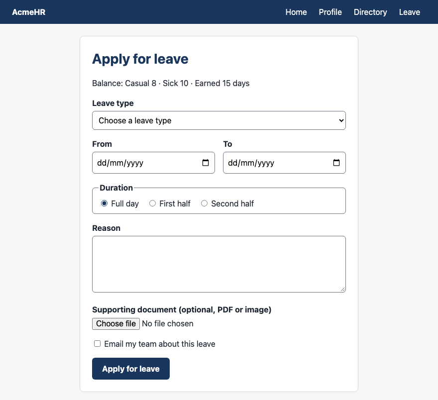
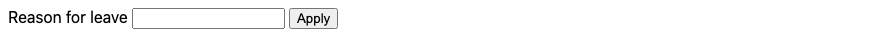
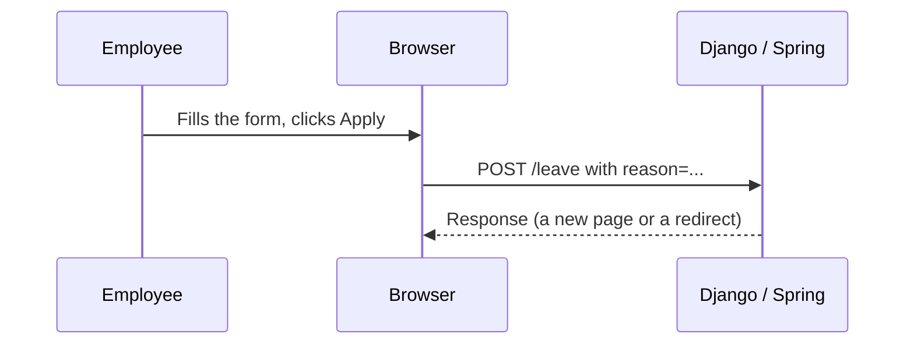
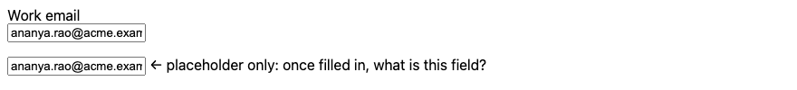
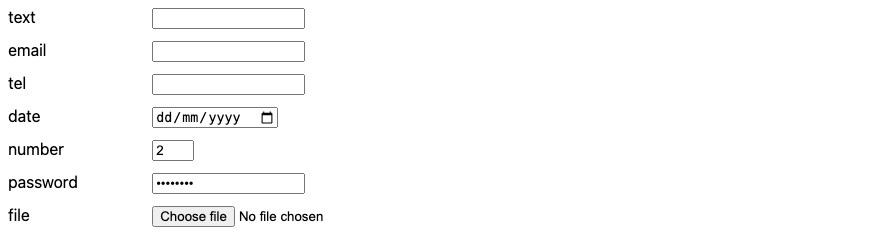
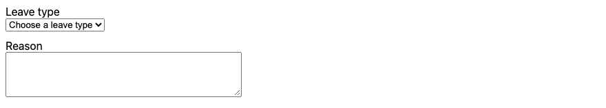
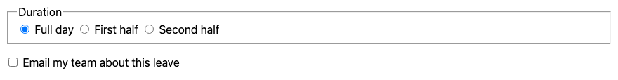
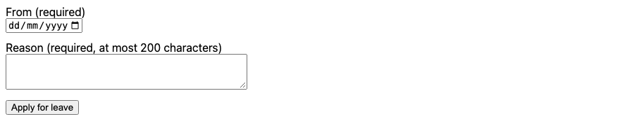
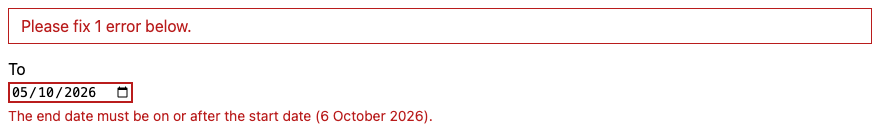
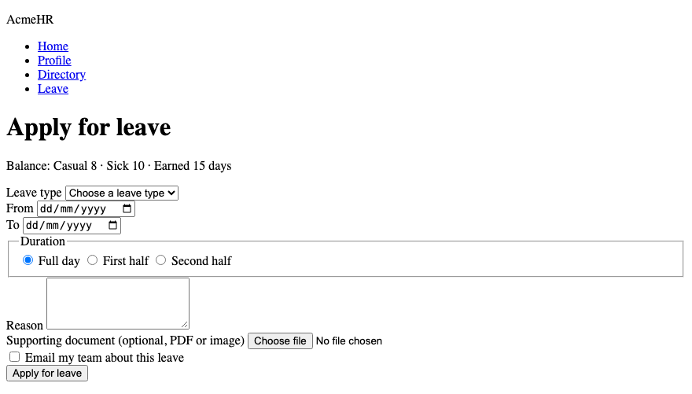

# Lesson 6 — Forms

**Course:** HTML & CSS for Full Stack · **Session 6 of 9** · [Learning path](README.md) · **Previous:** [Lesson 5](Lesson_05_Grid_and_Positioning.md) · **Next:** [Lesson 7 — Tables](Lesson_07_Tables.md)

**Module Outcome:** You can build an accessible form, explain exactly what the browser sends to the server, and style the form so it is clear and easy to use with mouse or keyboard.

| | |
|---|---|
| **You will build** | The AcmeHR **Apply for leave** form |
| **New HTML** | `form` (`action`, `method`, `enctype`), `label` (`for`), `input` (`type`, `id`, `name`, `value`), `select`, `option`, `textarea`, `button` (`type`), `fieldset`, `legend` · `required`, `min`, `max`, `maxlength`, `checked`, `accept`, `aria-invalid`, `aria-describedby` |
| **New CSS** | Attribute selectors `[type="date"]`, the `:focus-visible` pseudo-class, `font: inherit`, `accent-color`, `cursor`, `outline-offset` |
| **You need** | Lessons 1–5 |

**From the requirements.** Employees apply for leave. Leave types: Casual, Sick, Earned, Maternity, Paternity, Loss of Pay. After submitting, the manager is notified, approves or rejects, and the balance is updated.

**Why this lesson matters most for full stack:** a form is where your HTML meets your Django or Spring code. Every `name` you write becomes a value your backend reads.

**Where we are going:**



All example files: [`examples/lesson06/`](examples/lesson06/)

---

# Part A — Form HTML

## 1. Your first form

```html
<form action="/leave" method="post">
  <label for="reason">Reason for leave</label>
  <input type="text" id="reason" name="reason">
  <button type="submit">Apply</button>
</form>
```

**Output:**



| Piece | Job |
|---|---|
| `<form action="/leave">` | **Where** to send the data — a URL on your server |
| `method="post"` | **How** to send it (section 7) |
| `<label for="reason">` | The visible name of the field. `for` must match the input's `id`. |
| `id="reason"` | Connects the input to its label |
| `name="reason"` | The **key** the server receives. No `name` = the value is not sent. |
| `<button type="submit">` | Sends the form |



**Common Error:** An input with `id` but no `name`. It looks fine, but the server never receives its value.

## 2. Always use a `label` — not just a placeholder

```html
<label for="email">Work email</label><br>
<input type="email" id="email" name="email" value="ananya.rao@acme.example">

<input type="email" name="email2" placeholder="Work email" value="ananya.rao@acme.example">
```

**Output:**



A label:

- stays visible after the user types;
- is read aloud by screen readers when the field gets focus;
- makes the label text **clickable** — clicking it moves the cursor into the field (very useful for small checkboxes).

## 3. Input types

```html
<input type="text" id="t-text" name="name">
<input type="email" id="t-email" name="email">
<input type="tel" id="t-tel" name="phone">
<input type="date" id="t-date" name="from_date">
<input type="number" id="t-number" name="days" min="1" max="30" value="2">
<input type="password" id="t-password" name="password" value="secret12">
<input type="file" id="t-file" name="document">
```

**Output:**



| `type` | You get |
|---|---|
| `text` | One line of text |
| `email` | Checks for an `@`; phones show an email keyboard |
| `tel` | Phones show a number pad |
| `date` | A date picker. The display format follows the user's settings; the value sent is always `YYYY-MM-DD`. |
| `number` | Digits only, with `min` / `max` |
| `password` | Characters are hidden |
| `file` | Choose a file to upload |

`input` is a void element (no end tag). `value` sets the starting value.

**Common Error:** `type="number"` for phone numbers or employee IDs. They are not quantities: a leading zero is dropped and the scroll wheel can change them. Use `type="tel"` or `type="text"`.

## 4. `select` and `textarea`

```html
<label for="leave-type">Leave type</label><br>
<select id="leave-type" name="leave_type">
  <option value="">Choose a leave type</option>
  <option value="casual">Casual leave</option>
  <option value="sick">Sick leave</option>
  <option value="earned">Earned leave</option>
  <option value="maternity">Maternity leave</option>
  <option value="paternity">Paternity leave</option>
  <option value="lop">Loss of pay</option>
</select>

<label for="reason">Reason</label><br>
<textarea id="reason" name="reason" rows="4" cols="40"></textarea>
```

**Output:**



- The user sees the **text** of an `option`; the server receives its **`value`**: picking "Casual leave" sends `leave_type=casual`.
- The empty first option forces a real choice when the select is `required` (section 6).
- `textarea` is for several lines. It has an end tag; any text between the tags is its starting value.

## 5. Radio buttons, checkboxes, `fieldset`

```html
<fieldset>
  <legend>Duration</legend>
  <input type="radio" id="full-day" name="duration" value="full" checked>
  <label for="full-day">Full day</label>
  <input type="radio" id="first-half" name="duration" value="first_half">
  <label for="first-half">First half</label>
  <input type="radio" id="second-half" name="duration" value="second_half">
  <label for="second-half">Second half</label>
</fieldset>

<input type="checkbox" id="notify" name="notify_team" value="yes">
<label for="notify">Email my team about this leave</label>
```

**Output:**



| | Radio | Checkbox |
|---|---|---|
| Choose | **One** of a group | Each one on or off |
| Grouped by | The same `name` | — |
| Sends | The `value` of the chosen one | Its `value` if ticked — **nothing at all** if not |

- `checked` selects one at the start.
- `fieldset` groups related controls; `legend` is the group's title. Screen readers announce "Duration, Full day, radio button".

## 6. Built-in validation

```html
<form action="/leave" method="post">
  <label for="from-date">From (required)</label><br>
  <input type="date" id="from-date" name="from_date" required min="2026-10-01" max="2027-03-31">

  <label for="reason">Reason (required, at most 200 characters)</label><br>
  <textarea id="reason" name="reason" rows="3" cols="40" required maxlength="200"></textarea>

  <button type="submit">Apply for leave</button>
</form>
```

**Output:**



| Attribute | Rule |
|---|---|
| `required` | Must not be empty |
| `min`, `max` | Lowest and highest allowed value (numbers, dates) |
| `maxlength` | At most this many characters |
| `type="email"` | Must look like an email address |

Click **Apply** with an empty field and the browser stops the submission and shows a message next to the field. No data is sent.

**Remember:** Browser validation is a convenience for honest users. Anyone can remove `required` in their browser or send a request without a browser at all. **The server must check everything again.** Django forms and Spring's `@Valid` do exactly that.

## 7. What the browser sends — GET vs POST

The leave form was filled in like this: Casual leave, 12 to 13 October 2026, full day, reason "Family function in Vijayawada", and the "Email my team" box **not** ticked. Here is what Chrome actually sent to a test server.

**With `method="get"`** — the data goes in the URL:

```text
GET /leave?leave_type=casual&from_date=2026-10-12&to_date=2026-10-13&duration=full&reason=Family+function+in+Vijayawada
```

**With `method="post"`** — the data goes in the request body:

```text
POST /leave
Content-Type: application/x-www-form-urlencoded

leave_type=casual&from_date=2026-10-12&to_date=2026-10-13&duration=full&reason=Family+function+in+Vijayawada
```

Read it carefully:

- Each field is sent as `name=value`, joined with `&`.
- Spaces became `+`.
- **`notify_team` is missing** — an unticked checkbox sends nothing. Your backend must treat "missing" as "no".

| | `GET` | `POST` |
|---|---|---|
| Data goes in | The URL | The request body |
| Visible in the address bar and history | Yes | No |
| Use for | Searching and filtering — reading data | Creating or changing data — a leave request, a profile update |
| Can be bookmarked | Yes | No |

**Files need one more attribute.** To upload a file, the form must use `method="post"` **and** `enctype="multipart/form-data"`. Without it, only the file's *name* is sent, not the file.

**Where used?** This is how each backend reads those `name`s:

```python
# Django — views.py
def apply_leave(request):
    leave_type = request.POST.get("leave_type")        # "casual"
    notify = request.POST.get("notify_team") == "yes"  # False when the box is unticked
    document = request.FILES.get("document")            # the uploaded file, or None
```

```java
// Spring Boot — LeaveController.java
@PostMapping("/leave")
public String applyLeave(@RequestParam("leave_type") String leaveType,
                         @RequestParam(name = "notify_team", required = false) String notifyTeam,
                         @RequestParam(name = "document", required = false) MultipartFile document) {
    ...
}
```

Both frameworks also require a **CSRF token** in every POST form — a hidden value that proves the form came from your own site. In a Django template, put `` inside the `form`. In Thymeleaf with Spring Security, writing the form's `th:action` adds the token for you. Without it, the server answers **403 Forbidden**.

## 8. Showing errors from the server

When the server finds a problem, it sends the form back with the user's values and a message next to the field:

```html
<p class="error-summary">Please fix 1 error below.</p>
<p><label for="to-date">To</label></p>
<p><input type="date" id="to-date" name="to_date" value="2026-10-05"
          aria-invalid="true" aria-describedby="to-date-error"></p>
<p class="error" id="to-date-error">The end date must be on or after the start date (6 October 2026).</p>
```

```css
.error-summary { padding: 8px 12px; border: 1px solid #b91c1c; color: #b91c1c; margin-bottom: 16px; }
.error { color: #b91c1c; font-size: 0.875rem; }
input[aria-invalid="true"] { border: 2px solid #b91c1c; }
```

**Output:**



- `aria-invalid="true"` tells screen readers the field has an error.
- `aria-describedby="to-date-error"` points to the message's `id`, so the screen reader reads the message together with the field.
- The message says **what is wrong and how to fix it**. "Invalid input" helps nobody.
- `input[aria-invalid="true"]` is an **attribute selector**: it matches inputs that have that attribute value.

**Common Error:** Showing errors with colour only. Some users cannot see red. Always add text.

## 9. The full form in HTML

```html
<form action="/leave" method="post" enctype="multipart/form-data">
  <div class="field">
    <label for="leave-type">Leave type</label>
    <select id="leave-type" name="leave_type" required>
      <option value="">Choose a leave type</option>
      <option value="casual">Casual leave</option>
      <option value="sick">Sick leave</option>
      <option value="earned">Earned leave</option>
      <option value="maternity">Maternity leave</option>
      <option value="paternity">Paternity leave</option>
      <option value="lop">Loss of pay</option>
    </select>
  </div>

  <div class="dates">
    <div class="field">
      <label for="from-date">From</label>
      <input type="date" id="from-date" name="from_date" required>
    </div>
    <div class="field">
      <label for="to-date">To</label>
      <input type="date" id="to-date" name="to_date" required>
    </div>
  </div>

  <fieldset>
    <legend>Duration</legend>
    <input type="radio" id="full-day" name="duration" value="full" checked>
    <label for="full-day">Full day</label>
    <input type="radio" id="first-half" name="duration" value="first_half">
    <label for="first-half">First half</label>
    <input type="radio" id="second-half" name="duration" value="second_half">
    <label for="second-half">Second half</label>
  </fieldset>

  <div class="field">
    <label for="reason">Reason</label>
    <textarea id="reason" name="reason" rows="4" required maxlength="200"></textarea>
  </div>

  <div class="field">
    <label for="document">Supporting document (optional, PDF or image)</label>
    <input type="file" id="document" name="document" accept=".pdf,image/*">
  </div>

  <div class="field field-check">
    <input type="checkbox" id="notify" name="notify_team" value="yes">
    <label for="notify">Email my team about this leave</label>
  </div>

  <button type="submit">Apply for leave</button>
</form>
```

**Output, HTML only:**



- `accept=".pdf,image/*"` filters the file chooser. It is a hint, not security — the server must still check the file.
- Every `button` inside a form is a **submit** button unless you say otherwise. A button that should not submit needs `type="button"`.

---

# Part B — Styling the form

## 10. `form.css`

```css
/* One field = label above control */
.field {
  margin-bottom: 16px;
}

.field label {
  display: block;
  margin-bottom: 4px;
  font-weight: bold;
}

/* Form controls do not inherit the page font by default */
input,
select,
textarea,
button {
  font: inherit;
}

input[type="date"],
select,
textarea {
  width: 100%;
  padding: 8px;
  border: 1px solid #6b7280;
  border-radius: 6px;
}

/* From and To side by side */
.dates {
  display: grid;
  grid-template-columns: 1fr 1fr;
  gap: 16px;
}

fieldset {
  margin: 0 0 16px;
  padding: 8px 12px;
  border: 1px solid #6b7280;
  border-radius: 6px;
}

legend {
  font-weight: bold;
}

/* A label next to a radio or checkbox stays on the same line */
fieldset label,
.field-check label {
  display: inline;
  margin-right: 12px;
  font-weight: normal;
}

input[type="radio"],
input[type="checkbox"] {
  accent-color: #1a365d;
}

button {
  padding: 10px 20px;
  border: 0;
  border-radius: 6px;
  background-color: #1a365d;
  color: #ffffff;
  font-weight: bold;
  cursor: pointer;
}

/* Visible focus ring when using the keyboard */
:focus-visible {
  outline: 3px solid #ea580c;
  outline-offset: 2px;
}
```

(The header, nav and `main` card rules are the same as in Lessons 3–5.)

**Output:**


Files: [`09_leave_form_styled.html`](examples/lesson06/09_leave_form_styled.html) · [`form.css`](examples/lesson06/form.css)

| Rule | Why |
|---|---|
| `font: inherit` | Form controls use the browser's small default font, not your page font. `inherit` takes the parent's font instead. |
| `input[type="date"]` | An **attribute selector**: only date inputs — not radios and checkboxes — get full width. |
| `width: 100%` | Fields as wide as the card: easier to read and to tap on a phone. |
| `border: 1px solid #6b7280` | A clearly visible edge. Very light grey borders make fields hard to find. |
| `accent-color` | Colours the tick and the radio dot. |
| `cursor: pointer` | The hand cursor shows the button is clickable. |
| `:focus-visible` | A **pseudo-class**: it matches an element in a *state* — here, focused by the keyboard. Press `Tab` through the form to see the orange ring move. |

**Common Error:** `outline: none` to "clean up" the focus ring. Keyboard users then cannot see where they are. If you remove the default outline, always replace it with your own `:focus-visible` style.

---

## Try these

1. **(Easy)** Click each label in the styled form. Which ones move the cursor into a field?
2. **(Easy)** Press `Tab` repeatedly from the top of the page. Write down the order the focus moves in.
3. **(Medium)** Add a "Contact number while on leave" field with the right `type`, a label, and a `name`.
4. **(Medium)** Change the form to `method="get"`, serve the folder with `python3 -m http.server 8000`, fill it in and submit. Read the URL in the address bar and the request in the terminal. Which field is missing, and why?
5. **(Stretch)** Write the HTML that the server would send back if the reason was empty: an error summary, `aria-invalid` on the textarea, and a message linked with `aria-describedby`.

**Interview:** *"GET or POST for a form?"* — GET for reading or searching: the data goes in the URL and can be bookmarked. POST for creating or changing data: the data goes in the request body. Files need POST with `enctype="multipart/form-data"`.

**Interview:** *"Why validate on the server if the browser already validates?"* — Browser validation can be removed or skipped entirely. It only helps honest users. The server must validate every request.

**Interview:** *"What is the `name` attribute for?"* — It is the key the server receives for that field's value. A field without a `name` is not sent.

**Key takeaways**

- Every field needs a `label` (matching `for` / `id`) and a `name`.
- Choose the right `type`; the browser gives the right keyboard and checks for free.
- Radios share a `name`; an unticked checkbox sends nothing.
- GET puts data in the URL; POST puts it in the body. Files need `multipart/form-data`.
- Validate in the browser for convenience, on the server for safety. POST forms need a CSRF token in Django and Spring.
- Style with `font: inherit`, full-width fields, visible borders, and a clear `:focus-visible` ring.

---

## Lab

👉 [Lab 06 — AcmeHR apply for leave](labs/L06_apply_leave/README.md)

**Next:** [Lesson 7 — Tables](Lesson_07_Tables.md)
