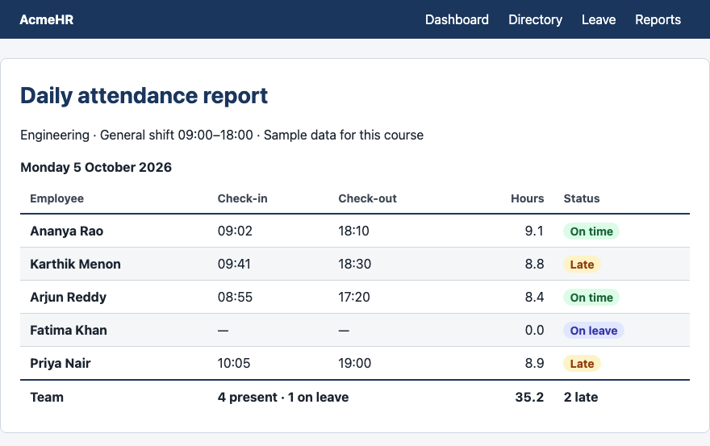
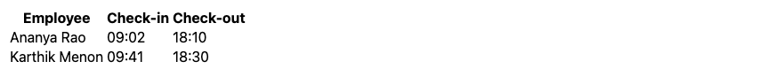
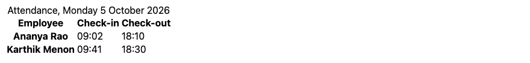
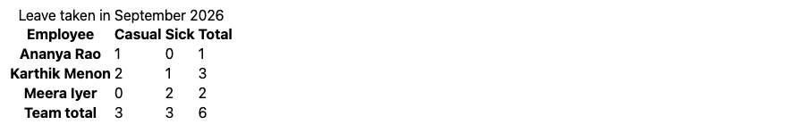
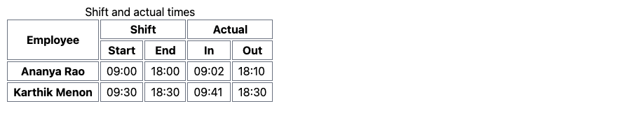
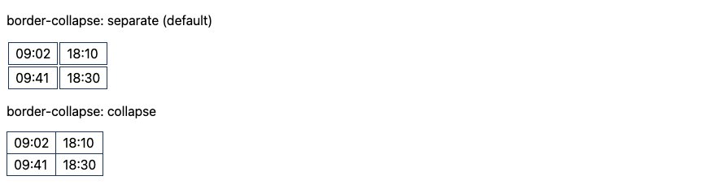
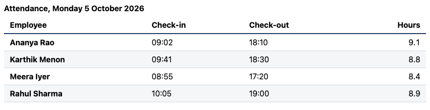
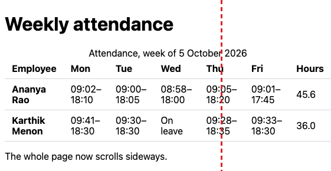
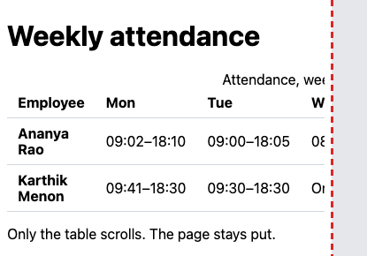
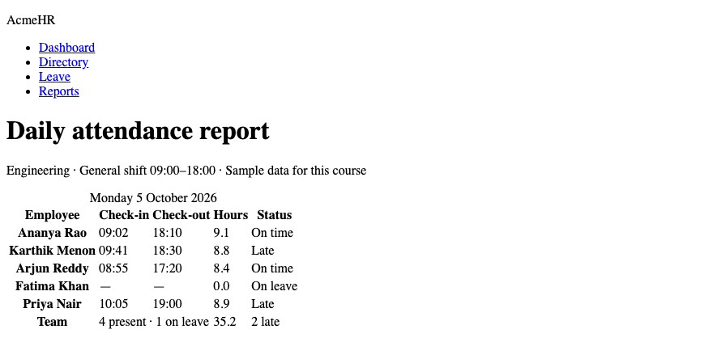

# Lesson 7 — Tables

**Course:** HTML & CSS for Full Stack · **Session 7 of 9** · [Learning path](README.md) · **Previous:** [Lesson 6](Lesson_06_Forms.md) · **Next:** [Lesson 8 — Responsive Design](Lesson_08_Responsive_Design.md)

**Module Outcome:** You can build a data table that screen readers understand, style it so numbers are easy to compare, and keep it usable on a phone.

| | |
|---|---|
| **You will build** | The AcmeHR **Daily attendance report** |
| **New HTML** | `table`, `caption`, `thead`, `tbody`, `tfoot`, `tr`, `th` (`scope`), `td`, `colspan`, `rowspan` |
| **New CSS** | `border-collapse`, `font-variant-numeric`, `white-space`, `overflow-x`, the `:nth-child()` pseudo-class |
| **You need** | Lessons 1–6 |

**From the requirements.** AcmeHR records each employee's check-in and check-out. Attendance reports are daily, monthly and exception-based, and late arrivals are reported.

**Where we are going:**



All example files: [`examples/lesson07/`](examples/lesson07/)

**Remember:** Tables are for **data** — rows and columns that belong together, like a spreadsheet. Never use a table to lay out a page; that is what Grid and Flexbox are for.

---

# Part A — Table HTML

## 1. Rows and cells

```html
<table>
  <tr>
    <th>Employee</th>
    <th>Check-in</th>
    <th>Check-out</th>
  </tr>
  <tr>
    <td>Ananya Rao</td>
    <td>09:02</td>
    <td>18:10</td>
  </tr>
  <tr>
    <td>Karthik Menon</td>
    <td>09:41</td>
    <td>18:30</td>
  </tr>
</table>
```

**Output:**



| Element | Means |
|---|---|
| `<table>` | The table |
| `<tr>` | **T**able **r**ow |
| `<th>` | **T**able **h**eader cell — a label (bold and centred by default) |
| `<td>` | **T**able **d**ata cell — a value |

## 2. Caption, sections, and `scope`

```html
<table>
  <caption>Attendance, Monday 5 October 2026</caption>
  <thead>
    <tr>
      <th scope="col">Employee</th>
      <th scope="col">Check-in</th>
      <th scope="col">Check-out</th>
    </tr>
  </thead>
  <tbody>
    <tr>
      <th scope="row">Ananya Rao</th>
      <td>09:02</td>
      <td>18:10</td>
    </tr>
    <tr>
      <th scope="row">Karthik Menon</th>
      <td>09:41</td>
      <td>18:30</td>
    </tr>
  </tbody>
</table>
```

**Output:**



- `<caption>` is the table's title. Screen readers announce it first.
- `<thead>` holds the header rows; `<tbody>` holds the data rows.
- `scope="col"` — this header labels the **column** below it. `scope="row"` — this header labels the **row** to its right.

**Why `scope` matters:** A screen reader in the cell "09:41" can say "Karthik Menon, Check-in, 09:41". Without header cells and `scope`, it only says "09:41".

## 3. A total row — `tfoot`

```html
<table>
  <caption>Leave taken in September 2026</caption>
  <thead>
    <tr>
      <th scope="col">Employee</th>
      <th scope="col">Casual</th>
      <th scope="col">Sick</th>
      <th scope="col">Total</th>
    </tr>
  </thead>
  <tbody>
    <tr><th scope="row">Ananya Rao</th><td>1</td><td>0</td><td>1</td></tr>
    <tr><th scope="row">Karthik Menon</th><td>2</td><td>1</td><td>3</td></tr>
    <tr><th scope="row">Meera Iyer</th><td>0</td><td>2</td><td>2</td></tr>
  </tbody>
  <tfoot>
    <tr><th scope="row">Team total</th><td>3</td><td>3</td><td>6</td></tr>
  </tfoot>
</table>
```

**Output:**



`<tfoot>` holds summary rows: totals, averages, counts.

## 4. Cells that span — `colspan` and `rowspan`

```html
<table>
  <caption>Shift and actual times</caption>
  <thead>
    <tr>
      <th scope="col" rowspan="2">Employee</th>
      <th scope="col" colspan="2">Shift</th>
      <th scope="col" colspan="2">Actual</th>
    </tr>
    <tr>
      <th scope="col">Start</th>
      <th scope="col">End</th>
      <th scope="col">In</th>
      <th scope="col">Out</th>
    </tr>
  </thead>
  <tbody>
    <tr><th scope="row">Ananya Rao</th><td>09:00</td><td>18:00</td><td>09:02</td><td>18:10</td></tr>
    <tr><th scope="row">Karthik Menon</th><td>09:30</td><td>18:30</td><td>09:41</td><td>18:30</td></tr>
  </tbody>
</table>
```

```css
th, td { border: 1px solid #6b7280; padding: 4px 8px; }
```

**Output:**



- `colspan="2"` — the cell is two columns wide.
- `rowspan="2"` — the cell is two rows tall.

**Common Error:** A row with the wrong number of cells. Count them: with spans included, every row must cover the same number of columns, or the cells shift sideways.

---

# Part B — Styling tables

## 5. `border-collapse`

```css
td { border: 1px solid #1a365d; padding: 4px 8px; }
.separate { border-collapse: separate; }
.collapse { border-collapse: collapse; }
```

**Output:**



By default every cell has its own border with a gap between them. `border-collapse: collapse` merges them into single lines. Almost every styled table uses it.

## 6. A readable data table

```css
table {
  border-collapse: collapse;   /* one line between cells, not two */
  width: 100%;
}
caption {
  text-align: left;
  font-weight: bold;
  padding-bottom: 8px;
}
th, td {
  padding: 8px 12px;
  border-bottom: 1px solid #d0d7de;
  text-align: left;
}
thead th {
  border-bottom: 2px solid #1a365d;
}
.num {
  text-align: right;
  font-variant-numeric: tabular-nums;   /* every digit the same width */
}
tbody tr:nth-child(even) {
  background-color: #f4f6f8;            /* zebra stripes */
}
```

**Output:**



| Rule | Why |
|---|---|
| Text left, **numbers right** | Units, tens and decimal points line up, so values are easy to compare. Right-align the number's header too. |
| `font-variant-numeric: tabular-nums` | In many fonts "1" is narrower than "8". This makes every digit the same width, so columns of numbers line up exactly. |
| Lines between rows, not around every cell | Less visual noise |
| `tr:nth-child(even)` | A **pseudo-class** that picks every 2nd row (2, 4, 6…). `odd` picks 1, 3, 5. Stripes help the eye follow long rows. |

## 7. Wide tables on a phone

A weekly table is wider than a phone screen. Without help, the **whole page** scrolls sideways:

**Output at 375px — the red dashed line is the edge of the phone screen:**



Wrap the table in a `div` that scrolls by itself:

```html
<div class="table-scroll">
  <table>
    ...
  </table>
</div>
```

```css
.table-scroll {
  overflow-x: auto;      /* only this box scrolls sideways */
}
td {
  white-space: nowrap;   /* keep each time range on one line */
}
```

**Output at 375px:**



- `overflow-x: auto` — if the content is wider than the box, the box gets its own sideways scroll.
- `white-space: nowrap` — text in the cell never breaks onto a second line.

The page stays put; only the table scrolls. Every reporting screen needs this.

## 8. Putting it together — the attendance report

The HTML:

```html
<main>
  <h1>Daily attendance report</h1>
  <p>Engineering · General shift 09:00–18:00 · Sample data for this course</p>

  <div class="table-scroll">
    <table>
      <caption>Monday 5 October 2026</caption>
      <thead>
        <tr>
          <th scope="col">Employee</th>
          <th scope="col">Check-in</th>
          <th scope="col">Check-out</th>
          <th scope="col" class="num">Hours</th>
          <th scope="col">Status</th>
        </tr>
      </thead>
      <tbody>
        <tr><th scope="row">Ananya Rao</th><td>09:02</td><td>18:10</td><td class="num">9.1</td><td><span class="status on-time">On time</span></td></tr>
        <tr><th scope="row">Karthik Menon</th><td>09:41</td><td>18:30</td><td class="num">8.8</td><td><span class="status late">Late</span></td></tr>
        <tr><th scope="row">Arjun Reddy</th><td>08:55</td><td>17:20</td><td class="num">8.4</td><td><span class="status on-time">On time</span></td></tr>
        <tr><th scope="row">Fatima Khan</th><td>—</td><td>—</td><td class="num">0.0</td><td><span class="status leave">On leave</span></td></tr>
        <tr><th scope="row">Priya Nair</th><td>10:05</td><td>19:00</td><td class="num">8.9</td><td><span class="status late">Late</span></td></tr>
      </tbody>
      <tfoot>
        <tr><th scope="row">Team</th><td colspan="2">4 present · 1 on leave</td><td class="num">35.2</td><td>2 late</td></tr>
      </tfoot>
    </table>
  </div>
</main>
```

(The page `header` and `nav` are the same as in Lessons 5 and 6.)

**Output, HTML only:**



The table part of `report.css`:

```css
/* Only the table scrolls on a narrow screen, not the page */
.table-scroll {
  overflow-x: auto;
}

table {
  width: 100%;
  border-collapse: collapse;
}

caption {
  padding-bottom: 8px;
  text-align: left;
  font-weight: bold;
}

th,
td {
  padding: 8px 12px;
  border-bottom: 1px solid #d0d7de;
  text-align: left;
  white-space: nowrap;
}

thead th {
  border-bottom: 2px solid #1a365d;
  font-size: 0.875rem;
  color: #3d4654;
}

tbody tr:nth-child(even) {
  background-color: #f4f6f8;
}

tfoot th,
tfoot td {
  border-top: 2px solid #1a365d;
  border-bottom: 0;
  font-weight: bold;
}

/* Numbers: right-aligned, every digit the same width */
.num {
  text-align: right;
  font-variant-numeric: tabular-nums;
}

/* Status: text + colour, never colour alone */
.status {
  padding: 2px 8px;
  border-radius: 999px;
  font-size: 0.875rem;
  font-weight: bold;
}

.on-time { background-color: #dcfce7; color: #166534; }
.late    { background-color: #fef3c7; color: #92400e; }
.leave   { background-color: #e0e7ff; color: #3730a3; }
```

**Output, styled:**


Files: [`10_report_styled.html`](examples/lesson07/10_report_styled.html) · [`report.css`](examples/lesson07/report.css)

- The **status** is written as a word ("Late") *and* coloured. A colour-blind manager can still read it.
- `.num` is on the header cell too, so "Hours" sits right above its numbers.
- The `tfoot` row uses `colspan="2"` for a sentence that covers two columns.

**Where used?** Report rows come from the database: the template loops over the records and writes one `tr` per employee (`` in Django, `th:each` in Thymeleaf). Reports often also offer a "Download CSV" link that returns the same data as a file.

---

## Try these

1. **(Easy)** Add a sixth employee, Rahul Sharma: 09:00–18:00, 9.0 hours, On time. Update the footer.
2. **(Easy)** Change the zebra stripes to the **odd** rows. Which looks better with the header line?
3. **(Medium)** Add a "Shift" column between Employee and Check-in. Update every row, including `tfoot`.
4. **(Medium)** Remove `white-space: nowrap` and narrow your window. What happens to the times and the status pills?
5. **(Stretch)** Build a *monthly* summary table: one row per employee, columns Present, Late, On leave, Absent (all right-aligned numbers), and a `tfoot` with team totals.

**Interview:** *"When should you use a table?"* — Only for tabular data — values with a row and a column meaning. Never for page layout.

**Interview:** *"How do you make a table accessible?"* — A `caption`, header cells with `th`, and `scope="col"` or `scope="row"` so each data cell is linked to its headers. Do not rely on colour alone for status.

**Interview:** *"How do you handle a wide table on mobile?"* — Wrap it in a container with `overflow-x: auto`, so only the table scrolls horizontally, not the whole page.

**Key takeaways**

- `table` → `caption`, `thead`, `tbody`, `tfoot` → `tr` → `th` / `td`.
- Header cells use `th` with `scope="col"` or `scope="row"`.
- `colspan` / `rowspan` merge cells — every row must still cover the same columns.
- `border-collapse: collapse`, lines between rows, numbers right-aligned with `tabular-nums`.
- Wrap wide tables in `overflow-x: auto`.
- Never show status with colour alone.

---

## Lab

👉 [Lab 07 — AcmeHR attendance report](labs/L07_attendance_report/README.md)

**Next:** [Lesson 8 — Responsive Design](Lesson_08_Responsive_Design.md)
