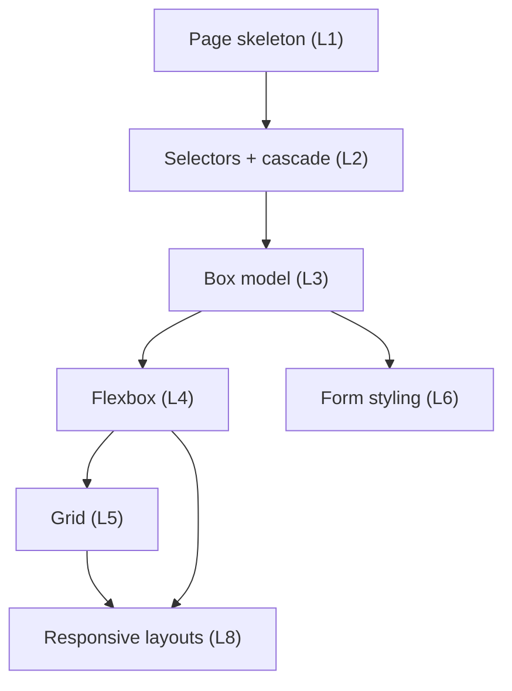
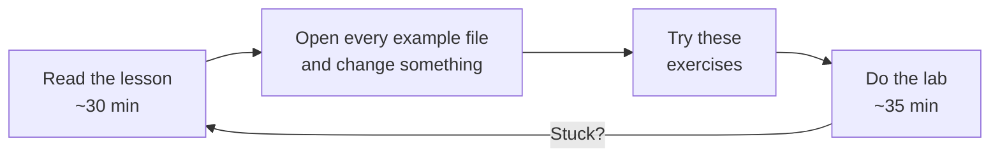

# HTML & CSS for Full Stack — Learning Path

**Kasi Yedumati · Full Stack Training**

**Shared topic** for Python Full Stack and Java Full Stack · 9 sessions · Project: **AcmeHR**

This folder teaches HTML and CSS **together**, in the order you will use them at work. Every lesson builds one real page of AcmeHR, an employee management system. By Lesson 9 you have a small, responsive, accessible portal that you will later serve from Django or Spring Boot.

---

## The path

```mermaid
flowchart LR
    L1["1 · How the web works<br/>Welcome page"] --> L2["2 · Content + first CSS<br/>Leave policy"]
    L2 --> L3["3 · Structure + box model<br/>Employee profile"]
    L3 --> L4["4 · Images + Flexbox<br/>Employee directory"]
    L4 --> L5["5 · Grid + positioning<br/>HR dashboard"]
    L5 --> L6["6 · Forms<br/>Apply for leave"]
    L6 --> L7["7 · Tables<br/>Attendance report"]
    L7 --> L8["8 · Responsive<br/>Every page on a phone"]
    L8 --> L9["9 · Polish + project<br/>AcmeHR portal"]
```



| # | Lesson | AcmeHR page you build | HTML you learn | CSS you learn | Lab |
|--:|---|---|---|---|---|
| 1 | [How the Web Works & Your First Page](01_How_the_Web_Works_and_Your_First_Page.md) | Welcome page | Browser and server, status codes, page skeleton, `h1`, `p`, entities, comments | — | [L01](labs/L01_welcome_page/README.md) |
| 2 | [Content & Your First CSS](02_Content_and_Your_First_CSS.md) | Leave policy | Headings, `br`, lists, links and paths, `strong`/`em`, `id`, `class` | Linking CSS, colours and fonts, block vs inline, selectors, cascade, specificity, inheritance | [L02](labs/L02_leave_policy/README.md) |
| 3 | [Page Structure & the Box Model](03_Page_Structure_and_the_Box_Model.md) | Employee profile | `header`, `nav`, `main`, `section`, `aside`, `footer`, `div`/`span`, `dl` | Box model, `box-sizing`, centring, margin collapse, `display`, units | [L03](labs/L03_employee_profile/README.md) |
| 4 | [Images, Navigation & Flexbox](04_Images_Navigation_and_Flexbox.md) | Employee directory | `img` and `alt`, `figure`, `article` | Flexbox: `justify-content`, `align-items`, `gap`, `flex-wrap`, `flex` | [L04](labs/L04_employee_directory/README.md) |
| 5 | [Grid & Positioning](05_Grid_and_Positioning.md) | HR dashboard | — | Grid, `fr`, `repeat`/`minmax`/`auto-fit`, template areas, `position`, `z-index`, `sticky` | [L05](labs/L05_hr_dashboard/README.md) |
| 6 | [Forms](06_Forms.md) | Apply for leave | `form`, `label`, inputs, `select`, `textarea`, `fieldset`, validation, GET vs POST, what the server receives | Form styling, attribute selectors, `:focus-visible` | [L06](labs/L06_apply_leave/README.md) |
| 7 | [Tables](07_Tables.md) | Attendance report | `table`, `caption`, `thead`/`tbody`/`tfoot`, `th scope`, `colspan`/`rowspan` | `border-collapse`, `tabular-nums`, `:nth-child`, scrolling tables | [L07](labs/L07_attendance_report/README.md) |
| 8 | [Responsive Design](08_Responsive_Design.md) | Every page, phone to desktop | Viewport, `picture` | Mobile-first media queries, `min()`, `clamp()`, `vw`, `ch`, responsive images | [L08](labs/L08_responsive_portal/README.md) |
| 9 | [Polish, Accessibility & Final Project](09_Polish_Accessibility_and_Final_Project.md) | The whole portal | `details`/`summary`, `aria-current`, page `head` | Custom properties, `:hover`/`:active`, transitions, reduced motion, contrast | [L09 — final project](labs/L09_final_project/README.md) |

The pages come from the AcmeHR Business Requirements Document (BRD): employee profile, employee directory, leave application, attendance reports, HR dashboards, and policy documents. Payroll is out of scope in Phase 1 of the BRD, so no lesson builds a payslip.

---

## Why this order

**1. A visible result in every session.** CSS starts in Lesson 2, not after weeks of plain black-and-white pages. Every session ends with a page that looks better than the last one. That is what keeps learners going.

**2. Meaning first, then look — for each feature.** Inside every lesson you first write the HTML for *what the content is*, then style it. You never learn a CSS trick before you have something real to apply it to, and you never write HTML you will not style until weeks later.

**3. Nothing appears before it is taught.** Every example uses only the tags and properties taught up to that point. Each lesson's header lists exactly what is new.

**4. Each lesson needs only what came before.**



You cannot debug a layout without the box model, and you cannot fix a CSS conflict without the cascade. So those come first.

**5. The most important topic for full stack gets its own session.** Forms (Lesson 6) are where HTML meets your Django or Spring backend: every field `name` becomes a request parameter. It comes after layout so the form can be styled properly in the same session.

**6. One project, not seventeen disconnected examples.** Every lesson adds a page to the same AcmeHR site, using the same stylesheet. In the Django and Spring phases, these exact pages become your templates.

**What is left out on purpose.** Rare elements (`sub`, `sup`, `abbr`, audio and video players, iframes) and advanced CSS (animations with `@keyframes`, nesting) are not taught in these nine lessons. Look them up in MDN when a project needs them.

---

## How to study a lesson on your own

Each lesson takes about 90 minutes of self-study. Follow the same loop every time:



Rules that make the difference:

- **Type the code. Do not copy-paste it.** Your fingers learn the syntax; your eyes only recognise it.
- **Break things on purpose.** Delete a closing tag, a semicolon, a dot. See what happens. That is how you recognise bugs later.
- **Do the lab "broken" part first.** Finding bugs in someone else's page is the fastest way to learn what correct looks like.
- **Only open a `solution/` folder after you finish.**

Every lesson has the same parts, so you always know where to look:

| Part | What it gives you |
|---|---|
| **Module Outcome** | What you can do at the end |
| **New HTML / New CSS** | Exactly which tags and properties this lesson introduces |
| **Code → Output** | Every example shows the code and a real screenshot of what it produces. Type it yourself and compare. |
| **Remember / Common Error / Where used?** | The rule, the classic mistake, and how it appears in Django or Spring |
| **Try these** | Exercises from easy to stretch |
| **Interview** | Questions you will be asked, with short answers |
| **Lab** | A ticket from the AcmeHR team: fix a broken page, build one, and prove it works |

---

## Setup (once)

- **Editor:** VS Code
- **Browser:** Google Chrome (Edge and Firefox also work)
- **Local server:** `python3 -m http.server 8000` in your project folder — or the VS Code **Live Server** extension, or `jwebserver` on JDK 18+
- **Validator:** [validator.w3.org/nu](https://validator.w3.org/nu/)

---

**Next phase:** [JavaScript, DOM & Forms](../03_JavaScript_DOM_Forms.md)

---

## For maintainers

Screenshots are generated, never drawn. After you change any file in `examples/`, run:

```bash
python3 scripts/shoot_frontend_examples.py
```

from the repository root. It drives Chrome through its DevTools protocol (`pip install websockets` once), renders every example — at phone widths, scrolled, hovered or after pressing `Tab` where a lesson needs it — and saves the result in `screens/`. The final-project pages shown in Lesson 9 are rendered too.

One screenshot is not generated by the script: `screens/lesson01_server_404.png` is Chrome showing `http://localhost:8000/leave.html` (a missing page) while `python3 -m http.server 8000` runs.

Before publishing changes, run:

```bash
python3 scripts/check_frontend_lessons.py
```

It fails if any example, lab file or lesson code block uses an HTML tag or CSS property **before the lesson that teaches it**, or if any link is broken. When a lesson starts teaching something new, add it to that lesson's list at the top of the script.
