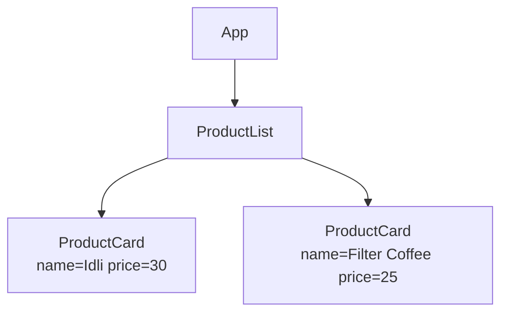

# Module: React Fundamentals — Components, State & Forms

**Phase:** Frontend — React  

**Shared topic** (Python FS + Java FS).

**Previous (Python FS):** [APIs / DRF](../../PYTHON/09_APIs_REST/01_APIs_JSON_Postman_DRF.md)  
**Previous (Java FS):** [REST DTOs and Postman](../../JAVA/09_Spring_Boot/04_REST_DTOs_Postman.md)  
**Next:** [React Hooks, Routing, API](02_React_Hooks_Routing_API_Deploy.md)

---

**Module Outcome:**

- Think in components: one ProductCard, many products
- Hold form/list state and re-render when it changes
- Build a list + form you could later point at a real API

## Prerequisites

- Node.js **20 LTS** (or 22 LTS) and npm — see the program [Python toolchain](../../PYTHON/Tested_Toolchain.md) or [Java toolchain](../../JAVA/Tested_Toolchain.md)
- HTML/CSS/JS and JSON/REST from prior modules

---

### What is React?

React is a **JavaScript library** for building user interfaces from reusable pieces called **components**. It is not a full backend framework like Django — you usually add routing and API calls yourself (next module).

### Why React?

Product UIs and many admin dashboards use React (or similar) because:

- **Components:** Reuse UI pieces (`<ProductCard />` everywhere)
- **State:** When data changes, UI updates automatically
- **Pairs with Django:** Django/DRF backend + React frontend is a common junior stack

**Where used?**
- CampusCart / **Swiggy** — `<ProductCard />` list and cart count
- **Employee Management Portal** — leave request form with `useState`
- **Apollo Hospitals** — appointment status list (`scheduled` / `completed` / `cancelled`)
- **HDFC Bank** — transfer amount field + confirmation

CampusCart stays the default demo skin (college Swiggy).

**Note:**
- Comparing React to Django MVC literally causes confusion — React is the view layer only.

### SPA (Single Page Application)

**Definition:** The browser loads the app once; JavaScript swaps views without full page reloads.  
**Purpose:** Feels faster after first load — important on mobile networks.

Traditional sites reload full HTML on each click.

### Vite — what / why

**Definition:** A fast modern build tool for React.  
**Purpose:** Quicker local feedback than older Create React App starters.

```bash
npm create vite@latest product-ui -- --template react
cd product-ui
npm install
npm run dev
```

Open URL shown (usually `http://localhost:5173`).

---

## Concepts

### 1. Functional component — what / why, then syntax

**Definition:** A JavaScript function that returns UI (JSX).  
**Purpose:** Small, reusable screen pieces instead of one giant HTML file.

```jsx
function Welcome() { return <h1>Hello, KSR Batch!</h1>; }
export default Welcome;
```

**Note:**
- Import path wrong on Linux deploy — module not found; match case exactly (`ProductCard.jsx`).

**Try these (2 programs):**

**Program 1 — Hello component**

```jsx
function Hello() {
  return <h1>Namaste from CampusCart</h1>;
}

export default Hello;
```

**Program 2 — App renders Hello**

```jsx
import Hello from "./Hello";

export default function App() {
  return (
    <main>
      <Hello />
      <p>Hyderabad Swiggy / CampusCart UI</p>
    </main>
  );
}
```

### 2. JSX rules — what / why

**Definition:** HTML-like syntax inside JavaScript.  
**Purpose:** Keep markup next to the component logic.

Return **one parent** (or fragment); use `className`; JS in `{ }`; self-close tags.

**Note:**
- `class` instead of `className` — console warning; use `className` in JSX.

**Try these (2 programs):**

**Program 1 — One parent**

```jsx
function Card() {
  return (
    <div>
      <h2>Veg Thali</h2>
      <p>₹90</p>
    </div>
  );
}
```

**Program 2 — className not class**

```jsx
function Badge() {
  return <span className="badge">In stock</span>;
}
```

### 3. Props — what / why, then syntax

**Definition:** Read-only inputs passed from parent to child.  
**Purpose:** One `ProductCard` design, many products.

```jsx
function ProductCard({ name, price }) {
  return <div className="card"><h3>{name}</h3><p>₹{price}</p></div>;
}
```

**Visual — parent passes props down (data flows one way):**



Props are **read-only**. To change data, lift state up (next section).

**Try these (2 programs):**

**Program 1 — Swiggy ProductCard props**

```jsx
function ProductCard({ name, price }) {
  return (
    <article>
      <h3>{name}</h3>
      <p>₹{price}</p>
    </article>
  );
}

export default function App() {
  return <ProductCard name="Filter Coffee" price={25} />;
}
```

**Program 2 — Default city prop**

```jsx
function StoreBanner({ city = "Hyderabad" }) {
  return <p>Delivering in {city}</p>;
}
```

### 4. State with `useState` — what / why

**Definition:** Data that belongs to a component and can change over time.  
**Purpose:** Clicks and typing must re-render the UI without rewriting the page.

```jsx
const [count, setCount] = useState(0);
return <button onClick={() => setCount(count + 1)}>Count: {count}</button>;
```

**Note:**
- Mutating state directly — UI does not update; use the setter: `setProducts([...products, newItem])`.

**Try these (2 programs):**

**Program 1 — Swiggy cart counter**

```jsx
import { useState } from "react";

export default function CartButton() {
  const [count, setCount] = useState(0);
  return (
    <button onClick={() => setCount(count + 1)}>
      Cart ({count})
    </button>
  );
}
```

**Program 2 — Swiggy toggle sold out**

```jsx
import { useState } from "react";

export default function StockToggle() {
  const [inStock, setInStock] = useState(true);
  return (
    <button onClick={() => setInStock(!inStock)}>
      {inStock ? "In stock" : "Sold out"}
    </button>
  );
}
```

### 5. Lists and keys — what / why

**Definition:** Render many items with `.map()`; each needs a stable `key`.  
**Purpose:** React must track which row changed when the list updates.

```jsx
{products.map(p => <ProductCard key={p.id} name={p.name} price={p.price} />)}
```

Use stable unique `key` (prefer id over index when list changes).

**Note:**
- Missing `key` in `.map()` — console warning; add unique `key={item.id}`.
- Index as `key` when reordering — wrong row updates; prefer a stable id.

**Try these (2 programs):**

**Program 1 — Swiggy map products**

```jsx
const products = [
  { id: 1, name: "Dosa", price: 60 },
  { id: 2, name: "Idli", price: 40 },
];

export default function Menu() {
  return (
    <ul>
      {products.map((p) => (
        <li key={p.id}>
          {p.name} — ₹{p.price}
        </li>
      ))}
    </ul>
  );
}
```

**Program 2 — Empty state**

```jsx
function ProductList({ items }) {
  if (items.length === 0) return <p>No products yet.</p>;
  return (
    <ul>
      {items.map((p) => (
        <li key={p.id}>{p.name}</li>
      ))}
    </ul>
  );
}
```

### 6. Controlled form — what / why

**Definition:** Input `value` + `onChange` tied to React state.  
**Purpose:** One source of truth for validation and submit (same idea as Django forms, in the browser).

Input `value` + `onChange` tied to state — single source of truth.

**Note:**
- Forgot `e.preventDefault()` on form — page reloads; call it in the submit handler.
- Uncontrolled + controlled mix — cursor jump bugs; always set `value` + `onChange`.

**Try these (2 programs):**

**Program 1 — Name input**

```jsx
import { useState } from "react";

export default function NameForm() {
  const [name, setName] = useState("");
  return (
    <form
      onSubmit={(e) => {
        e.preventDefault();
        console.log("Hello", name);
      }}
    >
      <input value={name} onChange={(e) => setName(e.target.value)} />
      <button type="submit">Save</button>
    </form>
  );
}
```

**Program 2 — Swiggy price field**

```jsx
import { useState } from "react";

export default function PriceForm() {
  const [price, setPrice] = useState("");
  return (
    <label>
      Price (₹)
      <input
        type="number"
        value={price}
        onChange={(e) => setPrice(e.target.value)}
      />
    </label>
  );
}
```

## Step-by-Step Annotated Code

### Project structure (after Vite)

```
product-ui/
  src/
    App.jsx
    App.css
    components/
      ProductCard.jsx
      ProductForm.jsx
      ProductList.jsx
    main.jsx
  package.json
```

### Step 1 — App.jsx with sample data

```jsx
import { useState } from 'react';
import ProductList from './components/ProductList';
import ProductForm from './components/ProductForm';
import './App.css';

const INITIAL = [
  { id: 1, name: 'Wireless Mouse', price: 899 },
  { id: 2, name: 'USB Hub', price: 1299 },
];

function App() {
  const [products, setProducts] = useState(INITIAL);

  function handleAdd(product) {
    setProducts(prev => [
      ...prev,
      { ...product, id: Date.now() },  // simple id for demo
    ]);
  }

  return (
    <div className="app">
      <header>
        <h1>Product Catalog</h1>
        <p>KSR React Lab — local state only</p>
      </header>
      <ProductForm onAdd={handleAdd} />
      <ProductList products={products} />
    </div>
  );
}

export default App;
```

### Step 2 — ProductCard.jsx and ProductList.jsx

`ProductCard` receives `name`, `price`, `inStock` props and renders a card with ₹ formatting.  
`ProductList` maps `products` with `key={p.id}` and shows empty-state message when list is empty.

```jsx
import { useState } from 'react';

function ProductForm({ onAdd }) {
  const [name, setName] = useState('');
  const [price, setPrice] = useState('');
  const [error, setError] = useState('');

  function handleSubmit(e) {
    e.preventDefault();                    // stop full page reload
    const priceNum = Number(price);
    if (!name.trim()) {
      setError('Name is required');
      return;
    }
    if (!priceNum || priceNum <= 0) {
      setError('Enter valid price');
      return;
    }
    onAdd({ name: name.trim(), price: priceNum, inStock: true });
    setName('');
    setPrice('');
    setError('');
  }

  return (
    <form className="product-form" onSubmit={handleSubmit}>
      <input
        type="text"
        placeholder="Product name"
        value={name}
        onChange={e => setName(e.target.value)}
      />
      <input
        type="number"
        placeholder="Price"
        value={price}
        onChange={e => setPrice(e.target.value)}
      />
      <button type="submit">Add Product</button>
      {error && <p className="error">{error}</p>}
    </form>
  );
}

export default ProductForm;
```

### Step 4 — Simple styling (App.css excerpt)

```css
.app { max-width: 900px; margin: 0 auto; padding: 1rem; }
.grid { display: grid; grid-template-columns: repeat(auto-fill, minmax(200px, 1fr)); gap: 1rem; }
.card { border: 1px solid #ddd; border-radius: 8px; padding: 1rem; }
.price { font-weight: bold; color: #0a7c42; }
.product-form { display: flex; flex-wrap: wrap; gap: 0.5rem; }
.error { color: #c0392b; width: 100%; }
```

---

## Practice Exercises

### Basic

1. Add `Footer` component with batch name and year.
   **Model answer:**

```jsx
function Footer() {
  return <footer>KSR Python Full Stack — 2026</footer>;
}
// render <Footer /> inside App
```

2. Button toggles dark/light class on `app` div (useState boolean).
   **Model answer:**

```jsx
const [dark, setDark] = useState(false);
return (
  <div className={dark ? "app dark" : "app"}>
    <button onClick={() => setDark((d) => !d)}>Toggle theme</button>
  </div>
);
```

3. Display product count above grid.
   **Model answer:**

```jsx
<p>{products.length} products</p>
<div className="grid">{/* cards */}</div>
```

### Intermediate

1. Add delete button on each card (filter state by id).
   **Model answer:**

```jsx
function remove(id) {
  setProducts((prev) => prev.filter((p) => p.id !== id));
}
// <button onClick={() => remove(product.id)}>Delete</button>
```

2. Search box filters list by name (case-insensitive).
   **Model answer:**

```jsx
const [q, setQ] = useState("");
const visible = products.filter((p) =>
  p.name.toLowerCase().includes(q.toLowerCase())
);
```

3. Show average price of all products.
   **Model answer:**

```jsx
const avg =
  products.length === 0
    ? 0
    : products.reduce((sum, p) => sum + p.price, 0) / products.length;
return <p>Average ₹{avg.toFixed(2)}</p>;
```

### Interview-style

1. What is JSX?
   **Model answer:**
   JSX is a syntax extension that looks like HTML inside JavaScript. Tools compile it to `React.createElement` (or equivalent) calls that describe the UI tree.

2. Props vs state — difference?
   **Model answer:**
   Props are inputs passed from parent to child (read-only for the child). State is data owned by a component that can change over time and trigger re-renders.

3. Why must we not mutate state directly in React?
   **Model answer:**
   Direct mutation (e.g. `arr.push`) may not trigger a re-render and breaks React’s change detection. Always create a new value with `setState` / updater functions.

## Mini-Project (Assignment): Local Product Catalog UI

**Lab kit (build here):** [labs/05_react_product_list/](labs/05_react_product_list/)

### What to build

- Minimum 3 components in separate files
- Add form + list with delete
- Empty state message
- Basic responsive grid CSS
- README with `npm run dev` steps

**No API yet** — next module connects to Django.

### Stretch

- Filter products by name substring.
- Show total cart count in the header.

### Done when

- [ ] Lab kit product cards ticket completed
- [ ] Add + delete works with local state
- [ ] Empty state shows when list is empty
- [ ] README documents `npm run dev`

## Interview Q&A

Shared with students after concepts and the mini-project. Use for review and interview prep — questions and model answers are included.

1. Why might a company keep Django templates for admin but React for customer app?
2. Is React a language? What is it really?
3. how is a component like a reusable PowerPoint slide layout?
4. When is plain JavaScript enough without React?
5. Why Indian salaries for "React + Python" roles are common in job portals?

**Q1. What is React?**  
**A:** JavaScript library for building UI with reusable components and efficient updates via virtual DOM diffing.

**Q2. Functional vs class components?**  
**A:** Course focuses on functions + hooks; classes older style; industry prefers functions now.

**Q3. What is useState?**  
**A:** Hook returning state value and setter; updating state triggers re-render.

**Q4. What is SPA?**  
**A:** Single page app loading once; client-side routing swaps views without full server HTML reload.

**Q5. How does React relate to Django?**  
**A:** Django/DRF serves JSON API; React consumes API and renders UI — separation of frontend and backend.

---

