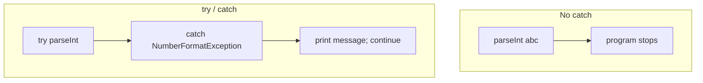
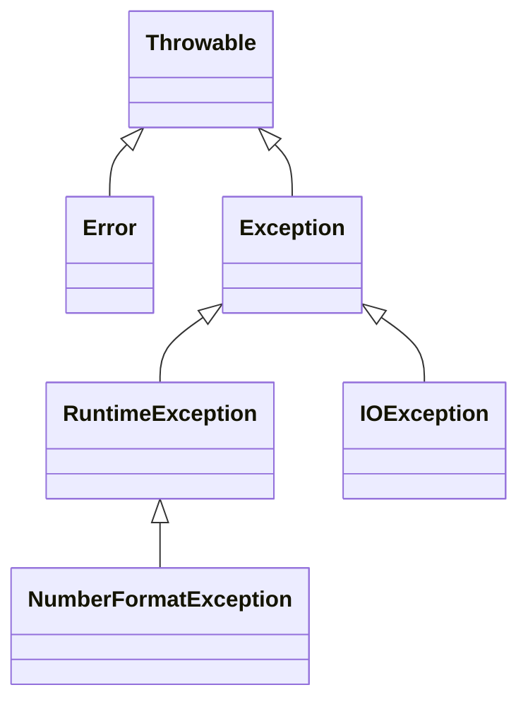

# Module 04b — Exception Handling

**Phase:** Collections, Exceptions, I/O

**Previous module:** [Collections](01_Collections.md)  
**Next module:** [File Handling](03_File_Handling.md)

**Lab kit:** [15_Lab_Assets/13_safe_input_exceptions/](../15_Lab_Assets/13_safe_input_exceptions/)

---

**Teach order today:** crash pain → `try` / `catch` → several catch blocks → `finally` → `throw` → `throws` + checked vs unchecked → custom exceptions → try-with-resources (`Scanner`) → Safe Age push.

---

## Motivation — Feel the pain of a crash

`Integer.parseInt("abc")` does not return a cute `-1`. It **throws** `NumberFormatException`. If nobody catches it, `main` stops and the learner sees a stack dump.

```java
public class CrashPain {
    public static void main(String[] args) {
        int age = Integer.parseInt("abc");
        System.out.println("Welcome, age " + age);
    }
}
```

That program never prints `Welcome`. The JVM prints a traceback and exits.

An ATM must not explode on a mistyped PIN. It should say “PIN must be digits” and let the user retry.

**Visual — uncaught vs caught:**



**Key takeaways:**

- An **exception** is an object that means “this step failed”
- Uncaught → the method **aborts** (often the whole program)
- `catch` is how you **recover**
- `throw` is how **your** code reports a domain failure (bad age, overdraft)

**Icons:** Bank · UPI · Order · Hospital · Payroll

**Where used?**
- **SecureBank** / UPI — wrong PIN, insufficient funds, invalid amount
- Forms & CLI — bad age, non-numeric marks, missing fields
- Collections — `parseInt` on menu input; unboxing `null` from `Map.get`
- **TechMart** / **MedCare** — order capacity, appointment slot out of range
- **Later — Files / JDBC:** missing file, closed connection (try-with-resources)

---

## Important Concepts

### 1. `try` / `catch` — recover instead of crashing

**Definition:** Put risky code in **`try`**. If that type of failure happens, run the matching **`catch`** instead of aborting.  
**Purpose:** User input fails often (`"abc"` is not an `int`). A CLI that dies on the first typo is not shippable.

```java
public class CatchParse {
    public static void main(String[] args) {
        try {
            int age = Integer.parseInt("abc");
            System.out.println("age " + age);
        } catch (NumberFormatException e) {
            System.out.println("Please enter a valid integer.");
        }
        System.out.println("still running");
    }
}
```

**Expected Output:**

```
Please enter a valid integer.
still running
```

`e.getMessage()` is the short reason. `e.printStackTrace()` is for **you** in the debugger — do not print a stack to a canteen user.

**Note:**
- Wrong: `catch (Exception e) { }` empty — swallows bugs.
- Wrong: `catch (Exception e)` as the **only** handler — too broad; you cannot tell `NumberFormatException` from a programming bug.
- Prefer: catch the **specific** type you expect.

**Remember:** `try` is the attempt; `catch` is the recovery. Code after the whole try/catch still runs if you handled it.

**Interview:** What is an exception? An object the JVM (or your `throw`) uses to signal failure. Unchecked ones (`RuntimeException` family) need no `throws` on the method.

**Common Error:** Catching `Exception` and returning `-1` so the caller thinks `-1` is a real age. Throw or print — do not invent a magic number.

**Try these (2 programs):**

**Program 1 — SecureBank UPI PIN with retry**

```java
public class PinRetry {
    public static void main(String[] args) {
        String[] attempts = {"ab12", "1234"};
        for (String attempt : attempts) {
            try {
                int pin = Integer.parseInt(attempt);
                System.out.println("PIN accepted: " + pin);
                break;
            } catch (NumberFormatException e) {
                System.out.println("PIN must be digits only");
            }
        }
    }
}
```

**Expected Output:**

```
PIN must be digits only
PIN accepted: 1234
```

**Program 2 — TechMart split bill safely**

```java
public class SplitBill {
    public static void main(String[] args) {
        int bill = 500;
        int[] friends = {4, 0};
        for (int n : friends) {
            try {
                System.out.println("Each pays ₹" + (bill / n));
            } catch (ArithmeticException e) {
                System.out.println("Cannot split among 0 friends");
            }
        }
    }
}
```

**Expected Output:**

```
Each pays ₹125
Cannot split among 0 friends
```

Integer `/` by zero throws `ArithmeticException`. (`double` `/ 0.0` is `Infinity` — not this exception.)

---

### 2. Several `catch` blocks and multi-catch

**Definition:** You may stack `catch` clauses. Java 7+ **multi-catch** uses `|` when the recovery is the same.  
**Purpose:** One message for “bad number or divide by zero” without duplicating the handler.

```java
public class MultiCatchDemo {
    public static void main(String[] args) {
        String[] raw = {"4", "0", "x"};
        int bill = 500;
        for (String s : raw) {
            try {
                int n = Integer.parseInt(s);
                System.out.println("Each ₹" + (bill / n));
            } catch (NumberFormatException | ArithmeticException e) {
                System.out.println("Cannot split: " + e.getClass().getSimpleName());
            }
        }
    }
}
```

**Expected Output:**

```
Each ₹125
Cannot split: ArithmeticException
Cannot split: NumberFormatException
```

Order matters if you use **separate** catches: a parent type (`Exception`) must come **after** a child. `catch (Exception e)` before `catch (NumberFormatException e)` does not compile — the second is unreachable.

**Note:**
- Wrong: `catch (Exception e)` first “just in case”.
- Prefer: narrow types, or `A | B` when the message is shared.
- Wrong: catching `NullPointerException` as your inventory strategy — fix `containsKey` instead (Collections week). Catch NPE only as a last-ditch log, not as business logic.

**Try these (2 programs):**

**Program 1 — two separate catches**

```java
public class TwoCatches {
    public static void main(String[] args) {
        try {
            System.out.println(10 / Integer.parseInt("0"));
        } catch (NumberFormatException e) {
            System.out.println("not a number");
        } catch (ArithmeticException e) {
            System.out.println("divide by zero");
        }
    }
}
```

**Expected Output:**

```
divide by zero
```

**Program 2 — missing map key is not an exception**

```java
import java.util.HashMap;
import java.util.Map;

public class MapMissingIsNull {
    public static void main(String[] args) {
        Map<String, Integer> prices = new HashMap<>();
        prices.put("P101", 40);
        Integer p = prices.get("P999");
        if (p == null) {
            System.out.println("not found");
        }
    }
}
```

**Expected Output:**

```
not found
```

`Map.get` missing → `null`, not a thrown exception. `int x = prices.get("P999")` **does** throw `NullPointerException` (unbox). Guard with `containsKey` / `getOrDefault` — do not “catch NPE and continue” as the design.

---

### 3. `finally` — cleanup that always runs

**Definition:** A **`finally`** block runs after `try` / `catch`, whether you succeeded, caught, or even `return`ed.  
**Purpose:** Print “attempt finished”, close a resource, reset a flag. Java has **no** `else` on `try` (Python does). Put the happy path at the **end of `try`**.

```java
public class FinallyAlways {
    public static void main(String[] args) {
        String[] raw = {"abc", "20"};
        for (String s : raw) {
            try {
                int age = Integer.parseInt(s);
                System.out.println("Welcome to the form, age " + age);
            } catch (NumberFormatException e) {
                System.out.println("Invalid age: " + s);
            } finally {
                System.out.println("Attempt finished");
            }
        }
    }
}
```

**Expected Output:**

```
Invalid age: abc
Attempt finished
Welcome to the form, age 20
Attempt finished
```

**Remember:** `finally` always runs (cleanup). There is no `try/else` in Java.

**Interview:** `return` inside `try` still runs `finally` **before** the method actually returns.

**Common Error:** Doing real business work in `finally` (or `return` from `finally`) — that can hide the original exception. Keep `finally` for cleanup.

**Note:**
- Wrong: relying on `finally` to “fix” a bad catch.
- Prefer: try-with-resources (next) when the cleanup is `close()`.

**Try these (2 programs):**

**Program 1 — `finally` after success and failure**

```java
public class FinallyTwoAttempts {
    public static void main(String[] args) {
        for (String s : new String[] {"x", "7"}) {
            try {
                System.out.println(Integer.parseInt(s));
            } catch (NumberFormatException e) {
                System.out.println("skip");
            } finally {
                System.out.println("done");
            }
        }
    }
}
```

**Expected Output:**

```
skip
done
7
done
```

**Program 2 — `finally` still runs before `return`**

```java
public class FinallyBeforeReturn {
    public static void main(String[] args) {
        System.out.println("Result: " + demo());
    }

    static String demo() {
        try {
            System.out.println("In try — about to return");
            return "success";
        } finally {
            System.out.println("finally still runs before the return completes");
        }
    }
}
```

**Expected Output:**

```
In try — about to return
finally still runs before the return completes
Result: success
```

---

### 4. `throw` — fail on purpose

**Definition:** **`throw new SomeException(...)`** creates a failure on purpose when input or state is invalid.  
**Purpose:** Stop with a **clear type + message** instead of continuing with a bad discount or a silent `print` + `return` that callers ignore.

Until this week, `withdraw` printed `"insufficient funds"` and returned. Callers could miss that. `throw` makes the caller **deal with it** or the program stops.

```java
public class ThrowDiscount {
    public static void main(String[] args) {
        int[] percents = {120, -5, 15};
        for (int p : percents) {
            try {
                setDiscount(p);
            } catch (IllegalArgumentException e) {
                System.out.println("Error: " + e.getMessage());
            }
        }
    }

    static void setDiscount(int percent) {
        if (percent < 0 || percent > 100) {
            throw new IllegalArgumentException("Discount must be 0–100, got " + percent);
        }
        System.out.println("Discount set to " + percent + "%");
    }
}
```

**Expected Output:**

```
Error: Discount must be 0–100, got 120
Error: Discount must be 0–100, got -5
Discount set to 15%
```

`IllegalArgumentException` is **unchecked** (a `RuntimeException`). No `throws` on `setDiscount`.

**Note:**
- Wrong: `throw new Exception("bad")` from every setter — that forces every caller to declare `throws Exception`.
- Prefer: `IllegalArgumentException` / `IllegalStateException` for “you passed garbage”; **custom** types when callers must distinguish domain failures.

**Try these (2 programs):**

**Program 1 — MedCare book appointment slots**

```java
public class ThrowSeats {
    public static void main(String[] args) {
        try {
            bookSeat(5, 2);
            bookSeat(3, 5);
        } catch (IllegalArgumentException e) {
            System.out.println("Booking failed: " + e.getMessage());
        }
    }

    static void bookSeat(int available, int requested) {
        if (requested > available) {
            throw new IllegalArgumentException("Not enough seats");
        }
        System.out.println("Booked " + requested + " seat(s). Left: " + (available - requested));
    }
}
```

**Expected Output:**

```
Booked 2 seat(s). Left: 3
Booking failed: Not enough seats
```

**Program 2 — SecureBank amount must be positive**

```java
public class ThrowAmount {
    public static void main(String[] args) {
        try {
            requirePositive(-10);
        } catch (IllegalArgumentException e) {
            System.out.println(e.getMessage());
        }
    }

    static void requirePositive(int amount) {
        if (amount <= 0) {
            throw new IllegalArgumentException("amount must be positive");
        }
    }
}
```

**Expected Output:**

```
amount must be positive
```

---

### 5. `throws` — checked vs unchecked

**Definition:**
- **Unchecked:** `RuntimeException` and its children (`NumberFormatException`, `IllegalArgumentException`, `NullPointerException`, `ArithmeticException`, `IndexOutOfBoundsException`). You **may** catch them. You **need not** write `throws` on the method.
- **Checked:** other `Exception` subclasses (classic example: `IOException`). The compiler **forces** `catch` or `throws` on the method.

**Purpose:** Checked exceptions make you **acknowledge** failures the caller can reasonably recover from. Unchecked exceptions are usually “you passed bad data” or a programming bug.

```java
public class ThrowsCheckedDemo {
    public static void main(String[] args) {
        try {
            mustBeAdult(16);
        } catch (UnderAgeChecked e) {
            System.out.println("denied: " + e.getMessage());
        }
    }

    static void mustBeAdult(int age) throws UnderAgeChecked {
        if (age < 18) {
            throw new UnderAgeChecked("age " + age);
        }
        System.out.println("ok");
    }
}

class UnderAgeChecked extends Exception {
    UnderAgeChecked(String message) {
        super(message);
    }
}
```

**Expected Output:**

```
denied: age 16
```

Remove `throws UnderAgeChecked` from `mustBeAdult` and **it will not compile** — that is the point of a checked type.

**Visual — two families:**



**Key takeaways:**

- `Error` (e.g. `OutOfMemoryError`) — do not catch in class work
- `RuntimeException` = unchecked = no `throws` required
- Other `Exception` = checked = `catch` or `throws`
- **Later — Files:** `IOException` is checked; try-with-resources + `catch (IOException e)`

**Interview:** Why does Java have checked exceptions? So you cannot silently ignore “this file / this network call might fail.” Python has no equivalent — every exception is unchecked.

**Common Error:** `throws Exception` on every method. That dumps the problem on `main` and teaches nothing. Throw a **narrow** type.

**Note:**
- Wrong: wrapping everything in `throws Exception`.
- Prefer: `throws InvalidAgeException` (your type) or catch at the menu.

**Try these (2 programs):**

**Program 1 — unchecked needs no `throws`**

```java
public class UncheckedNoThrows {
    public static void main(String[] args) {
        try {
            boom();
        } catch (IllegalArgumentException e) {
            System.out.println(e.getMessage());
        }
    }

    static void boom() {
        throw new IllegalArgumentException("unchecked");
    }
}
```

**Expected Output:**

```
unchecked
```

**Program 2 — checked needs `throws` or `catch`**

```java
public class CheckedMustDeclare {
    public static void main(String[] args) {
        try {
            go();
        } catch (DomainChecked e) {
            System.out.println(e.getClass().getSimpleName() + ": " + e.getMessage());
        }
    }

    static void go() throws DomainChecked {
        throw new DomainChecked("checked");
    }
}

class DomainChecked extends Exception {
    DomainChecked(String message) {
        super(message);
    }
}
```

**Expected Output:**

```
DomainChecked: checked
```

If `main` declared `throws DomainChecked` and did **not** catch, you would get a traceback instead. The lab kit **catches** in `main`.

---

### 6. Custom exceptions — name the domain failure

**Definition:** A **custom exception** is a class that `extends Exception` (checked) or `extends RuntimeException` (unchecked). Call `super(message)` so `getMessage()` works.  
**Purpose:** Callers catch `InvalidAgeException` without treating every `Exception` the same. `"0"` is a number — it is still a **bad age**.

```java
public class CustomUnderAge {
    public static void main(String[] args) {
        int[] ages = {16, 21};
        for (int age : ages) {
            try {
                registerVoter(age);
            } catch (UnderAgeError e) {
                System.out.println("Registration denied — " + e.getMessage());
            }
        }
    }

    static void registerVoter(int age) throws UnderAgeError {
        if (age < 18) {
            throw new UnderAgeError("age " + age + " is under 18");
        }
        System.out.println("Voter registered (age " + age + ")");
    }
}

class UnderAgeError extends Exception {
    UnderAgeError(String message) {
        super(message);
    }
}
```

**Expected Output:**

```
Registration denied — age 16 is under 18
Voter registered (age 21)
```

**Note:**
- Wrong: `class InvalidAgeException extends Throwable` or a class that does **not** extend `Exception` / `RuntimeException` — `catch` will not see it the way you expect.
- Prefer: `extends Exception` when the compiler should force `throws` (lab kit). `extends RuntimeException` when you want BankAccount-style methods without `throws` on every signature.

**Interview:** Custom exceptions name **business** failures (`InsufficientFundsException`, `InvalidAgeException`) so a menu can show the right line.

**Try these (2 programs):**

**Program 1 — `InvalidRollException` with the roll in the message**

```java
import java.util.HashMap;
import java.util.Map;

public class CustomInvalidRoll {
    public static void main(String[] args) {
        Map<Integer, String> db = new HashMap<>();
        db.put(101, "Anita");
        db.put(102, "Ravi");
        for (int roll : new int[] {101, 999}) {
            try {
                System.out.println(findStudent(roll, db));
            } catch (InvalidRollException e) {
                System.out.println("Error: " + e.getMessage());
            }
        }
    }

    static String findStudent(int roll, Map<Integer, String> db) throws InvalidRollException {
        if (!db.containsKey(roll)) {
            throw new InvalidRollException("Roll not found: " + roll);
        }
        return db.get(roll);
    }
}

class InvalidRollException extends Exception {
    InvalidRollException(String message) {
        super(message);
    }
}
```

**Expected Output:**

```
Anita
Error: Roll not found: 999
```

**Program 2 — SecureBank `InsufficientFundsException` (unchecked)**

```java
public class CustomFunds {
    public static void main(String[] args) {
        try {
            withdraw(500, 800);
        } catch (InsufficientFundsException e) {
            System.out.println("Transaction failed: " + e.getMessage());
        }
    }

    static int withdraw(int balance, int amount) {
        if (amount > balance) {
            throw new InsufficientFundsException("Requested ₹" + amount + ", available ₹" + balance);
        }
        return balance - amount;
    }
}

class InsufficientFundsException extends RuntimeException {
    InsufficientFundsException(String message) {
        super(message);
    }
}
```

**Expected Output:**

```
Transaction failed: Requested ₹800, available ₹500
```

Unchecked custom type: `withdraw` has **no** `throws` clause. Catch is still a good idea in `main`.

---

### 7. Try-with-resources — `Scanner` that closes itself

**Definition:** `try (Type name = new Type(...)) { ... }` works when `Type` implements **`AutoCloseable`**. Java calls `close()` for you — success or failure.  
**Purpose:** You cannot forget `close()`. This week the resource is **`Scanner`**. **Later — Files / JDBC:** the same shape wraps files and connections.

```java
import java.util.Scanner;

public class TwrScannerString {
    public static void main(String[] args) {
        try (Scanner sc = new Scanner("21")) {
            int age = Integer.parseInt(sc.nextLine().trim());
            System.out.println("age " + age);
        } catch (NumberFormatException e) {
            System.out.println("not an int");
        }
    }
}
```

**Expected Output:**

```
age 21
```

`new Scanner("21")` reads from a **String** — good for demos and tests. `new Scanner(System.in)` reads the keyboard. **Note:** closing a `Scanner` on `System.in` also closes **standard input**. For a short `main` that is OK; do not close `System.in` in a helper you will call again later.

**Remember:** try-with-resources = `try (resource) { }` — `finally`/`close()` is generated for you.

**Interview:** Why not `sc.close()` in a `finally` you wrote by hand? Easy to skip; try-with-resources is the modern form (Java 7+; we use JDK 17).

**Common Error:** Opening `Scanner` on `System.in`, closing it, then creating a second `Scanner(System.in)` — the second one may fail or see EOF. One scanner for the whole `main` is enough.

**Note:**
- Wrong: teaching try-with-resources only with files **this week** — files are next.
- Prefer: `try (Scanner sc = new Scanner(sample))` in the lab; `System.in` in the mini-project menu.
- **Later — Files:** `try (BufferedReader br = Files.newBufferedReader(path))`.

**Try these (2 programs):**

**Program 1 — try-with-resources + bad token**

```java
import java.util.Scanner;

public class TwrBadToken {
    public static void main(String[] args) {
        try (Scanner sc = new Scanner("abc")) {
            System.out.println(Integer.parseInt(sc.nextLine().trim()));
        } catch (NumberFormatException e) {
            System.out.println("not an int");
        }
    }
}
```

**Expected Output:**

```
not an int
```

**Program 2 — two lines from one String scanner**

```java
import java.util.Scanner;

public class TwrTwoLines {
    public static void main(String[] args) {
        try (Scanner sc = new Scanner("40\n10")) {
            int a = Integer.parseInt(sc.nextLine().trim());
            int b = Integer.parseInt(sc.nextLine().trim());
            System.out.println(a + b);
        }
    }
}
```

**Expected Output:**

```
50
```

---

### 8. Names you will see in the traceback

**Definition:** The **type** in `catch (ThatType e)` must match (or be a parent of) what was thrown.  
**Purpose:** Read a stack dump: the **first line** is the type + message; the next lines are where it happened.

| Type | Typical cause | Checked? |
|------|----------------|----------|
| `NumberFormatException` | `Integer.parseInt("abc")` | Unchecked |
| `ArithmeticException` | `int` divide by zero | Unchecked |
| `NullPointerException` | `.` on `null`; unbox `null` `Integer` | Unchecked |
| `IndexOutOfBoundsException` | `list.get(99)` / `arr[i]` off the end | Unchecked |
| `IllegalArgumentException` | You `throw` it for a bad argument | Unchecked |
| `InvalidAgeException` (yours) | Age not in 1–120 | Checked if `extends Exception` |
| `IOException` | Missing file, read error | Checked — **Later — Files** |

**Try these (2 programs):**

**Program 1 — name that error**

```java
public class NameThatError {
    public static void main(String[] args) {
        try {
            Integer.parseInt("hello");
        } catch (Exception e) {
            System.out.println(e.getClass().getSimpleName());
        }
        try {
            System.out.println(1 / 0);
        } catch (Exception e) {
            System.out.println(e.getClass().getSimpleName());
        }
    }
}
```

**Expected Output:**

```
NumberFormatException
ArithmeticException
```

(Quiz only — production code still prefers specific `catch` types.)

**Program 2 — index off the list**

```java
import java.util.ArrayList;
import java.util.List;

public class ListIndexCatch {
    public static void main(String[] args) {
        List<String> cart = new ArrayList<>();
        cart.add("Tea");
        try {
            System.out.println(cart.get(3));
        } catch (IndexOutOfBoundsException e) {
            System.out.println("no such index");
        }
    }
}
```

**Expected Output:**

```
no such index
```

---

## Step-by-Step Annotated Java Code

### Step 1: Safe parse loop (no `Scanner` on `System.in`)

```java
public class SafeParseLoop {
    public static void main(String[] args) {
        String[] raw = {"21", "abc", "18"};
        for (String s : raw) {
            try {
                int age = Integer.parseInt(s.trim());
                System.out.println("Valid age: " + age);
            } catch (NumberFormatException e) {
                System.out.println("Invalid input: " + s + ". Try again.");
            }
        }
    }
}
```

**Expected Output:**

```
Valid age: 21
Invalid input: abc. Try again.
Valid age: 18
```

**Try these (2 programs):**

**Program 1 — trim then parse**

```java
public class TrimThenParse {
    public static void main(String[] args) {
        try {
            System.out.println(Integer.parseInt("  22  ".trim()));
        } catch (NumberFormatException e) {
            System.out.println("bad");
        }
    }
}
```

**Expected Output:**

```
22
```

**Program 2 — `Double.parseDouble` catch**

```java
public class ParseDoubleCatch {
    public static void main(String[] args) {
        try {
            System.out.println(Double.parseDouble("78.5"));
            System.out.println(Double.parseDouble("x"));
        } catch (NumberFormatException e) {
            System.out.println("not a decimal");
        }
    }
}
```

**Expected Output:**

```
78.5
not a decimal
```

---

### Step 2: Range is a **different** failure than parse

`"0"` parses. It is still not a legal age. That is why the lab kit has **two** types.

```java
public class AgeRangeThrow {
    public static void main(String[] args) {
        String[] samples = {"21", "abc", "0", "200"};
        for (String sample : samples) {
            try {
                System.out.println(sample + " -> " + readAge(sample));
            } catch (NumberFormatException e) {
                System.out.println(sample + " NumberFormatException " + e.getMessage());
            } catch (InvalidAgeException e) {
                System.out.println(sample + " InvalidAgeException " + e.getMessage());
            }
        }
    }

    static int readAge(String raw) throws InvalidAgeException {
        int age;
        try {
            age = Integer.parseInt(raw.trim());
        } catch (NumberFormatException e) {
            throw new NumberFormatException("age must be an integer");
        }
        if (age < 1 || age > 120) {
            throw new InvalidAgeException("age out of range: " + age);
        }
        return age;
    }
}

class InvalidAgeException extends Exception {
    InvalidAgeException(String message) {
        super(message);
    }
}
```

**Expected Output:**

```
21 -> 21
abc NumberFormatException age must be an integer
0 InvalidAgeException age out of range: 0
200 InvalidAgeException age out of range: 200
```

Lab kit: [15_Lab_Assets/13_safe_input_exceptions/](../15_Lab_Assets/13_safe_input_exceptions/).

**Try these (2 programs):**

**Program 1 — only range (already an int)**

```java
public class RangeOnly {
    public static void main(String[] args) {
        try {
            int age = 0;
            if (age < 1 || age > 120) {
                throw new InvalidAgeException("age out of range: " + age);
            }
        } catch (InvalidAgeException e) {
            System.out.println(e.getMessage());
        }
    }
}

class InvalidAgeException extends Exception {
    InvalidAgeException(String message) {
        super(message);
    }
}
```

**Expected Output:**

```
age out of range: 0
```

**Program 2 — parse only**

```java
public class ParseOnly {
    public static void main(String[] args) {
        try {
            Integer.parseInt("abc");
        } catch (NumberFormatException e) {
            System.out.println("age must be an integer");
        }
    }
}
```

**Expected Output:**

```
age must be an integer
```

---

### Step 3: BankAccount — `throw` instead of print + return

OOP week printed `"insufficient funds"` and returned. Callers could ignore it. Exceptions week **throws**.

```java
public class BankThrowWithdraw {
    public static void main(String[] args) {
        BankAccount a = new BankAccount("Anita", 500);
        try {
            a.withdraw(800);
        } catch (InsufficientFundsException e) {
            System.out.println("Transaction failed: " + e.getMessage());
        }
        System.out.println(a.getHolder() + " ₹" + (int) a.getBalance());
    }
}

class InsufficientFundsException extends RuntimeException {
    InsufficientFundsException(String message) {
        super(message);
    }
}

class BankAccount {
    private String holder;
    private double balance;

    BankAccount(String holder, double opening) {
        this.holder = holder;
        this.balance = opening;
    }

    void withdraw(double amount) {
        if (amount <= 0) {
            throw new IllegalArgumentException("amount must be positive");
        }
        if (amount > balance) {
            throw new InsufficientFundsException(
                    "Requested ₹" + (int) amount + ", available ₹" + (int) balance);
        }
        balance -= amount;
    }

    double getBalance() {
        return balance;
    }

    String getHolder() {
        return holder;
    }
}
```

**Expected Output:**

```
Transaction failed: Requested ₹800, available ₹500
Anita ₹500
```

Balance is unchanged. That is the same rule as print + return — now the **caller cannot miss it**.

**Try these (2 programs):**

**Program 1 — SecureBank catch illegal amount**

```java
public class BankBadAmount {
    public static void main(String[] args) {
        try {
            if (-5 <= 0) {
                throw new IllegalArgumentException("amount must be positive");
            }
        } catch (IllegalArgumentException e) {
            System.out.println(e.getMessage());
        }
    }
}
```

**Expected Output:**

```
amount must be positive
```

**Program 2 — SecureBank successful withdraw after catch demo**

```java
public class BankOkWithdraw {
    public static void main(String[] args) {
        int balance = 500;
        int amount = 100;
        if (amount > balance) {
            throw new IllegalStateException("should not happen in this demo");
        }
        balance -= amount;
        System.out.println(balance);
    }
}
```

**Expected Output:**

```
400
```

---

### Step 4: Menu sketch — catch in the loop (keyboard)

Use **one** `Scanner` on `System.in` for the whole `main`. Catch parse errors; do not crash the menu. Bad typed age retries.

```java
import java.util.Scanner;

public class SafeAgeMenuSketch {
    public static void main(String[] args) {
        try (Scanner sc = new Scanner(System.in)) {
            while (true) {
                System.out.print("Age (or q to quit): ");
                String raw = sc.nextLine().trim();
                if (raw.equals("q")) {
                    System.out.println("Bye");
                    break;
                }
                try {
                    int age = readAge(raw);
                    System.out.println("OK: " + age);
                    break;
                } catch (NumberFormatException e) {
                    System.out.println(e.getMessage());
                } catch (InvalidAgeException e) {
                    System.out.println(e.getMessage());
                }
            }
        }
    }

    static int readAge(String raw) throws InvalidAgeException {
        int age;
        try {
            age = Integer.parseInt(raw.trim());
        } catch (NumberFormatException e) {
            throw new NumberFormatException("age must be an integer");
        }
        if (age < 1 || age > 120) {
            throw new InvalidAgeException("age out of range: " + age);
        }
        return age;
    }
}

class InvalidAgeException extends Exception {
    InvalidAgeException(String message) {
        super(message);
    }
}
```

`javac SafeAgeMenuSketch.java` then `java SafeAgeMenuSketch`. Compile-only in automated checks (it waits for the keyboard).

**Try these (2 programs):**

**Program 1 — empty line after trim**

```java
public class EmptyLineParse {
    public static void main(String[] args) {
        try {
            Integer.parseInt("".trim());
        } catch (NumberFormatException e) {
            System.out.println("age must be an integer");
        }
    }
}
```

**Expected Output:**

```
age must be an integer
```

**Program 2 — `q` is not an age**

```java
public class QuitIsNotAge {
    public static void main(String[] args) {
        String raw = "q";
        if (raw.equals("q")) {
            System.out.println("Bye");
        }
    }
}
```

**Expected Output:**

```
Bye
```

---

## Practice Exercises

*(Each Practice item includes a filled **Model answer** and **Expected Output** where the demo prints.)*

### Basic

1. Catch `ArithmeticException` when dividing 10 by 0.

   **Model answer:**

```java
public class CatchDivideZero {
    public static void main(String[] args) {
        try {
            System.out.println(10 / 0);
        } catch (ArithmeticException e) {
            System.out.println("Cannot divide by zero");
        }
    }
}
```

   **Expected Output:**

```
Cannot divide by zero
```

2. Catch `NumberFormatException` when parsing `"x"` as a `double`.

   **Model answer:**

```java
public class CatchParseDouble {
    public static void main(String[] args) {
        try {
            System.out.println(Double.parseDouble("x"));
        } catch (NumberFormatException e) {
            System.out.println("Not a valid number");
        }
    }
}
```

   **Expected Output:**

```
Not a valid number
```

3. Prefer `containsKey` over catching `NullPointerException` for a missing map price.

   **Model answer:**

```java
import java.util.HashMap;
import java.util.Map;

public class PreferContainsKey {
    public static void main(String[] args) {
        Map<String, Integer> prices = new HashMap<>();
        prices.put("Tea", 15);
        if (prices.containsKey("Coffee")) {
            System.out.println(prices.get("Coffee"));
        } else {
            System.out.println("not found");
        }
    }
}
```

   **Expected Output:**

```
not found
```

### Intermediate

1. `safeDivide(int a, int b)` — return a printed message on divide-by-zero instead of crashing. Use `try` / `catch`.

   **Model answer:**

```java
public class SafeDividePractice {
    public static void main(String[] args) {
        System.out.println(safeDivide(10, 2));
        System.out.println(safeDivide(10, 0));
    }

    static String safeDivide(int a, int b) {
        try {
            return String.valueOf(a / b);
        } catch (ArithmeticException e) {
            return "undefined";
        }
    }
}
```

   **Expected Output:**

```
5
undefined
```

2. Create `InvalidEmailException extends Exception` and a validator that requires `@`.

   **Model answer:**

```java
public class EmailValidatorPractice {
    public static void main(String[] args) {
        try {
            System.out.println(validateEmail("priya@college.in"));
            validateEmail("priya");
        } catch (InvalidEmailException e) {
            System.out.println(e.getMessage());
        }
    }

    static String validateEmail(String email) throws InvalidEmailException {
        if (email == null || !email.contains("@")) {
            throw new InvalidEmailException("Invalid email: " + email);
        }
        return email;
    }
}

class InvalidEmailException extends Exception {
    InvalidEmailException(String message) {
        super(message);
    }
}
```

   **Expected Output:**

```
priya@college.in
Invalid email: priya
```

3. Why is `catch (Exception e) { return -1; }` a bad `readAge`? Three to four sentences, no code.

   **Model answer:** The caller cannot tell “not an integer” from “out of range” from a real bug. `-1` looks like an age. A bare parent catch also hides `NullPointerException` you should fix. Catch `NumberFormatException` and `InvalidAgeException` separately (or rethrow with a clear type).

4. Add `finally` that prints `done` after a successful parse of `"18"`.

   **Model answer:**

```java
public class FinallyDone {
    public static void main(String[] args) {
        try {
            System.out.println(Integer.parseInt("18"));
        } finally {
            System.out.println("done");
        }
    }
}
```

   **Expected Output:**

```
18
done
```

### Interview-Oriented

1. `except Exception` vs bare `except` in Python — what is the Java cousin of “too broad”?

   **Model answer:** `catch (Exception e)` (or worse `catch (Throwable e)`). Catch specific types. `Error` is not for student `catch`.

2. When do you write a custom exception?

   **Model answer:** When callers must distinguish a **domain** failure (`InvalidAgeException`) from `NumberFormatException` / generic `Exception`.

3. What happens if `finally` itself throws?

   **Model answer:** It can hide the original exception from `try`. Keep `finally` (and try-with-resources close) boring.

4. Checked vs unchecked in one sentence.

   **Model answer:** Unchecked (`RuntimeException` family) need no `throws`; checked `Exception` subclasses force `catch` or `throws`.

5. Does Java have `try/else`?

   **Model answer:** No. Put the success path at the end of `try`. `finally` is cleanup, not “else”.

---

## Mini-Project (Assignment): MedCare Safe Age Input CLI

**Lab kit:** [15_Lab_Assets/13_safe_input_exceptions/](../15_Lab_Assets/13_safe_input_exceptions/)

Collections and OOP CLIs died on `Integer.parseInt(sc.nextLine())` when the user typed `"abc"`. This assignment is the **portfolio push**: specific catches, a checked custom exception, try-with-resources `Scanner`, and a short README.

### What to build

| Piece | Detail |
|-------|--------|
| `InvalidAgeException` | `extends Exception`; constructor `super(message)` |
| `readAge(String raw)` | `throws InvalidAgeException`; parse with `Integer.parseInt(raw.trim())`; wrap NFE as `NumberFormatException("age must be an integer")`; range 1–120 → custom exception |
| Demo loop | Samples `"21"`, `"abc"`, `"0"`, `"200"` — no traceback for those expected cases |
| Messages | Print type name + `getMessage()` (see sample) |
| Menu (take-home) | try-with-resources `Scanner(System.in)`; retry until valid or `q` |
| No files | **Later — File Handling** |

**Sample (lab-kit main):**

```
21 -> 21
abc NumberFormatException age must be an integer
0 InvalidAgeException age out of range: 0
200 InvalidAgeException age out of range: 200
```

`javac SafeInput.java` then `java SafeInput`.

### Stretch

- `readPositiveAmount` for INR (`double`, must be `> 0`).
- Upgrade Campus Wallet / BankAccount `withdraw` to `throw InsufficientFundsException` (unchecked) and catch in the menu.
- **Later — Files week:** read ages from a `.txt` with try-with-resources on a reader (not this ticket).

### Done when

- [ ] Lab kit Safe Input ticket passes for the four samples
- [ ] `InvalidAgeException` is checked; `readAge` declares `throws InvalidAgeException`
- [ ] Non-numeric input is `NumberFormatException` (caught; no crash)
- [ ] Out-of-range is `InvalidAgeException` (caught; no crash)
- [ ] No bare `catch (Exception e)` that returns a magic number
- [ ] No files / JDBC / Spring / Lombok
- [ ] Repo pushed with a short README of the sample lines (see [Standard Project Deliverables](../Standard_Project_Deliverables.md) — `pom.xml` is optional for javac-only)

---

## Interview Q&A

Shared with students after concepts and the mini-project. Use for review and interview prep — questions and model answers are included.

**Q1. What is an exception?**  
**A:** An object that signals a failed step. If nothing catches it, the method aborts (often the program prints a stack trace).

**Q2. `try` / `catch` / `finally` order?**  
**A:** Run `try`. On a matching failure, run that `catch` (skip the rest of `try`). `finally` always runs — success, catch, or `return` from `try`.

**Q3. Does Java have `else` on `try`?**  
**A:** No. That is a Python feature. Put the happy path at the end of `try`.

**Q4. Checked vs unchecked?**  
**A:** Unchecked = `RuntimeException` and children — no `throws` required. Checked = other `Exception` types — `catch` or `throws`. `Error` is not for normal `catch`.

**Q5. `throw` vs `throws`?**  
**A:** `throw` actually fires an exception object. `throws` on the method **declares** a checked type the caller must handle.

**Q6. When create a custom exception?**  
**A:** When the domain needs its own type (`InvalidAgeException`, `InsufficientFundsException`) so a menu can catch it separately from `NumberFormatException`.

**Q7. Why not `catch (Exception e) { return -1; }`?**  
**A:** It hides the type, invents a fake age, and can swallow NPEs you should fix.

**Q8. What is try-with-resources?**  
**A:** `try (Scanner sc = new Scanner(...)) { }` — `close()` runs automatically because `Scanner` is `AutoCloseable`. Same shape later for files and JDBC.

**Q9. Should you catch `NullPointerException` for a missing map key?**  
**A:** No. `get` returns `null`. Use `containsKey` / `getOrDefault`. Catching NPE treats a programming miss as “business as usual”.

**Q10. `printStackTrace` vs `getMessage`?**  
**A:** Stack traces help **you** debug. Users get a short `getMessage()` (or a fixed sentence). Do not dump traces in a campus CLI.

---

## Next

Finish the [Safe Input lab kit](../15_Lab_Assets/13_safe_input_exceptions/) and push the CLI. Continue with **[File Handling](03_File_Handling.md)** (`java.nio`, CSV/text, try-with-resources on files) and kit [14_expense_files](../15_Lab_Assets/14_expense_files/). Git/GitHub follows files.
