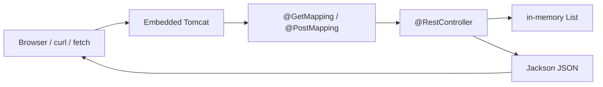

# Module 09 — Spring Web REST

**Phase:** Backend (JSON API)

**Previous module:** [Maven and Spring Boot Setup](01_Maven_and_Spring_Boot_Setup.md)  
**Next module:** [Spring Data JPA and Validation](03_Spring_Data_JPA_Validation.md)

**Lab kit:** [15_Lab_Assets/17_spring_hello_rest/](../15_Lab_Assets/17_spring_hello_rest/)

---

**Teach order today:** HTTP verb + path → JSON `List` (in-memory GET list) → 200 / 201 / 404 lite → `@PathVariable` GET by id → `@RequestBody` POST → optional Thymeleaf one-pager.

---

## Prerequisites

- **Campus Hello Boot** from [Maven and Spring Boot Setup](01_Maven_and_Spring_Boot_Setup.md) — `mvn spring-boot:run`, `@RestController`, `application.yml`. JDK 17 + Maven 3.9+ ([Tested Toolchain](../Tested_Toolchain.md)).
- Shared frontend `fetch` overview in [JavaScript, DOM, and Forms](../../FRONTEND/03_JavaScript_DOM_Forms.md) — do not redo HTML / CSS / JS here.

---

## Definition / Purpose

**Definition:** **REST** (Representational State Transfer) here means: the browser or `fetch` sends an **HTTP request** (method + URL + optional JSON body); your **`@RestController`** method returns an object; **Jackson** writes **JSON** as the response body.

**Definition:** A **mapping** is the pair **HTTP method + path** (`GET /canteen/items`). **`@PathVariable`** reads a segment of that path (`/canteen/items/2`). **`@RequestBody`** reads the JSON body on **POST**.

**Purpose:** Hello JSON is one `Map`. CampusCart / the canteen stall needs a **list** of items, one item **by id**, and a way to **add** a snack. JDBC already stores rows in MySQL — **this module does not open a `Connection`**. An **`ArrayList` in the controller** is enough to practise HTTP. Restart wipes the list; **Later —** JPA will persist it.

**Icons:** Bank · Order · Laptop · Employee · UPI

**Where used?**
- CampusCart / **TechMart** — catalog JSON before a database
- Canteen / mess — stall menu as a JSON array (college skin of TechMart)
- **SecureBank** / UPI — a list of recent pings (still no money movement)
- **MedCare** token display — GET list of counters
- **AcmeHR** — a stub list of payslip ids (**Later —** JPA)

**Visual — request to JSON:**



**Key takeaways:**

- **`@RestController`** = JSON body (module 01). Today you add **paths**, a **list**, and **status codes**
- **GET** reads; **POST** creates; **200** / **201** / **404** are the lite set
- **`@PathVariable`** is the URL; **`@RequestBody`** is the JSON body
- Core path is **in-memory `List`** — no JPA, no MySQL pool

---

## Motivation — Feel the pain of Hello-only JSON

Priya’s CampusCart screen cannot show three snacks from `/hello`. Ravi’s `fetch` needs an **array**. Workbench is the wrong tool this week — you are practising **HTTP**, not SQL.

```java
public class HelloOnlyPain {
    public static void main(String[] args) {
        System.out.println("GET /hello -> one message Map");
        System.out.println("Canteen screen needs a JSON array of snacks");
        System.out.println("In-memory List this week — MySQL stays for Later JPA");
    }
}
```

**Expected Output:**

```
GET /hello -> one message Map
Canteen screen needs a JSON array of snacks
In-memory List this week — MySQL stays for Later JPA
```

**Remember:** JDBC is still how Java talks to MySQL. This module talks to **HTTP clients**.

**Interview:** “REST vs JDBC?” — REST is HTTP JSON for apps. JDBC is SQL for the database. Full stack uses **both** (JPA later sits on JDBC).

---

## Important Concepts

### 1. Mappings — verbs, paths, GET list

**Definition:** **`@GetMapping("/canteen/items")`** handles **GET** that URL. **`@PostMapping`** handles **POST**. You can put a shared prefix on the **class** with **`@RequestMapping("/canteen/items")`** so methods stay short.

**Purpose:** Without a mapping, Tomcat is up and the URL is **404**. One method per operation keeps the canteen list readable.

Copy-paste valid (same package as `@SpringBootApplication` — Maven tree, not lone `javac`):

```java
package in.ksr.campushello;

import java.util.ArrayList;
import java.util.List;
import org.springframework.web.bind.annotation.GetMapping;
import org.springframework.web.bind.annotation.RequestMapping;
import org.springframework.web.bind.annotation.RestController;

@RestController
@RequestMapping("/canteen/items")
public class CanteenListController {

    private final List<String> names = new ArrayList<>();

    public CanteenListController() {
        names.add("Idli");
        names.add("Filter coffee");
        names.add("Masala dosa");
    }

    @GetMapping
    public List<String> list() {
        return names;
    }
}
```

Restart `mvn spring-boot:run`. Then:

```bash
curl http://localhost:8080/canteen/items
```

**Expected Output:** (JSON array; spacing may differ)

```
["Idli","Filter coffee","Masala dosa"]
```

Keep **GET `/hello`** and **GET `/health`** from module 01 — the lab kit still needs those two JSON endpoints **plus** this list.

**Note:**
- Wrong: `@GetMapping("/Canteen/Items")` while `curl` uses `/canteen/items` — paths are **case-sensitive**.
- Wrong: two methods with the **same** verb + path — Boot fails at start (ambiguous mapping).
- Browser address bar is **GET** only. POST needs `curl`, `fetch`, or a form (**Later —** not a Thymeleaf CRUD track).

**Remember:** Class-level `@RequestMapping` + method `@GetMapping` join into one URL.

**Interview:** GET vs POST? GET **reads** (safe to refresh). POST **creates** (body + 201). Do not create rows with GET.

**Try these (2 programs):**

**Program 1 — Verb and path**

```java
public class RestVerbPathPrint {
    public static void main(String[] args) {
        System.out.println("GET  /hello");
        System.out.println("GET  /health");
        System.out.println("GET  /canteen/items");
        System.out.println("POST /canteen/items");
    }
}
```

**Expected Output:**

```
GET  /hello
GET  /health
GET  /canteen/items
POST /canteen/items
```

**Program 2 — Class prefix plus method**

```java
public class MappingJoinPrint {
    public static void main(String[] args) {
        System.out.println("@RequestMapping(\"/canteen/items\")");
        System.out.println("@GetMapping  -> GET /canteen/items");
        System.out.println("@GetMapping(\"/{id}\") -> GET /canteen/items/2");
    }
}
```

**Expected Output:**

```
@RequestMapping("/canteen/items")
@GetMapping  -> GET /canteen/items
@GetMapping("/{id}") -> GET /canteen/items/2
```

---

### 2. JSON from `Map` and `List` (Jackson)

**Definition:** **Jackson** (inside `spring-boot-starter-web`) turns a Java **`Map`**, **`List`**, or a class with **getters** into JSON. A `List` becomes a **JSON array** `[...]`. A `Map` becomes a **JSON object** `{...}`.

**Purpose:** Hand-building JSON strings with `+` is fragile (quotes, commas). Return Java types; Jackson writes the body and sets **`Content-Type: application/json`**.

Module 01 already returned `Map.of("message", ...)`. A catalog is a **`List`**. A snack with id and price is a **small class** (getters / setters — OOP Part 1). That class is **not** a DTO layer (**Later —** module 04).

```java
package in.ksr.campushello;

public class CanteenItem {

    private int id;
    private String name;
    private int priceInr;

    public CanteenItem() {
    }

    public CanteenItem(int id, String name, int priceInr) {
        this.id = id;
        this.name = name;
        this.priceInr = priceInr;
    }

    public int getId() {
        return id;
    }

    public void setId(int id) {
        this.id = id;
    }

    public String getName() {
        return name;
    }

    public void setName(String name) {
        this.name = name;
    }

    public int getPriceInr() {
        return priceInr;
    }

    public void setPriceInr(int priceInr) {
        this.priceInr = priceInr;
    }
}
```

**No-arg constructor + setters** let Jackson fill a POST body. **Getters** let Jackson write JSON on GET.

In-memory store (field on the controller — one JVM, lost on restart):

```java
private final List<CanteenItem> items = new ArrayList<>();
private int nextId = 1;
```

Seed in the constructor: Idli ₹40, Filter coffee ₹25, Masala dosa ₹60.

**Note:**
- Wrong: returning `items.toString()` — that is **Java text**, not a JSON array.
- Wrong: `List.of(...)` as the only store when POST must **add** — `List.of` is **unmodifiable**. Use **`ArrayList`**.
- Lombok `@Getter` is **Stretch only** — not in Done when. Prefer explicit getters.

**Common Error:** Missing getters → Jackson may serialise `{}` or fail. Public getters match field names (`getPriceInr` → `priceInr`).

**Remember:** Restart `spring-boot:run` → empty seed again. That is expected without a database.

**Try these (2 programs):**

**Program 1 — Array vs object (print)**

```java
public class JsonArrayVsObject {
    public static void main(String[] args) {
        System.out.println("List -> JSON array  [ ... ]");
        System.out.println("Map  -> JSON object { ... }");
        System.out.println("CanteenItem getters -> {\"id\":1,\"name\":\"Idli\",...}");
    }
}
```

**Expected Output:**

```
List -> JSON array  [ ... ]
Map  -> JSON object { ... }
CanteenItem getters -> {"id":1,"name":"Idli",...}
```

**Program 2 — TechMart seed three snacks**

```java
public class CanteenSeedPrint {
    public static void main(String[] args) {
        System.out.println("1 Idli 40");
        System.out.println("2 Filter coffee 25");
        System.out.println("3 Masala dosa 60");
        System.out.println("Store: ArrayList in the controller");
    }
}
```

**Expected Output:**

```
1 Idli 40
2 Filter coffee 25
3 Masala dosa 60
Store: ArrayList in the controller
```

---

### 3. Status codes — 200 / 201 / 404 lite

**Definition:** The **status code** is the HTTP number next to the body. **200 OK** = success read. **201 Created** = success create. **404 Not Found** = that id is not in the list. **`HttpStatus`** is the Spring enum. **`@ResponseStatus`** stamps a method (or an exception). **`ResponseEntity`** lets one method choose **200 or 404**.

**Purpose:** A GET that returns `null` with **200** looks like success to `fetch` (`response.ok` is true). CampusCart should see **404** when snack `99` is missing. POST should not pretend to be a normal read (**201**).

| Code | Meaning | Typical mapping |
|------|---------|-----------------|
| 200 | OK | GET list, GET by id when found |
| 201 | Created | POST after you append to the `List` |
| 404 | Not Found | GET by id when the loop finds nothing |

Lite only. **400** / **409** / **500** and error JSON bodies are **Later —** module 04. Do not build a Postman collection as required.

GET by id (copy-paste valid in the Maven tree):

```java
package in.ksr.campushello;

import java.util.Map;
import org.springframework.http.HttpStatus;
import org.springframework.http.ResponseEntity;
import org.springframework.web.bind.annotation.GetMapping;
import org.springframework.web.bind.annotation.PathVariable;
import org.springframework.web.bind.annotation.RequestMapping;
import org.springframework.web.bind.annotation.RestController;

@RestController
@RequestMapping("/canteen/items")
public class CanteenStatusDemoController {

    @GetMapping("/{id}")
    public ResponseEntity<?> byId(@PathVariable int id) {
        if (id == 1) {
            return ResponseEntity.ok(Map.of("id", 1, "name", "Idli"));
        }
        return ResponseEntity.status(HttpStatus.NOT_FOUND)
                .body(Map.of("error", "No item " + id));
    }
}
```

POST created stamp:

```java
import org.springframework.http.HttpStatus;
import org.springframework.web.bind.annotation.ResponseStatus;
```

```java
@PostMapping
@ResponseStatus(HttpStatus.CREATED)
public CanteenItem add(@RequestBody CanteenItem incoming) {
    // assign id, add to ArrayList, return the saved item
    return incoming;
}
```

Default GET return → **200** without extra annotations.

**Note:**
- Wrong: POST that returns 200 — interviews expect **201** for create.
- Wrong: missing id returning `null` with 200 — use **404**.
- `ResponseEntity<?>` is lite (body type varies). A DTO union type is **Later —**.

**Common Error:** `fetch` only checks `response.ok` (true for 200–299). **201** is ok. **404** is not — handle it.

**Interview:** Why not always 200? Clients and API gateways branch on the code. 201 vs 200 is a frequent junior question.

**Try these (2 programs):**

**Program 1 — Three codes**

```java
public class ThreeStatusCodes {
    public static void main(String[] args) {
        System.out.println("200 OK         GET list / GET found");
        System.out.println("201 Created    POST add");
        System.out.println("404 Not Found  GET missing id");
    }
}
```

**Expected Output:**

```
200 OK         GET list / GET found
201 Created    POST add
404 Not Found  GET missing id
```

**Program 2 — `response.ok` band**

```java
public class FetchOkBand {
    public static void main(String[] args) {
        System.out.println("response.ok true for 200 and 201");
        System.out.println("response.ok false for 404");
    }
}
```

**Expected Output:**

```
response.ok true for 200 and 201
response.ok false for 404
```

---

### 4. `@PathVariable` — GET by id

**Definition:** **`@PathVariable int id`** binds the `{id}` segment in `@GetMapping("/{id}")`. Spring converts the text `"2"` to **`int`**.

**Purpose:** `GET /canteen/items?id=2` as a query string works, but REST lists use **`/canteen/items/2`**. Path variables match CampusCart / GitHub-style URLs.

The name in the path and the parameter should match (`{id}` and `int id`). If they differ, name it: `@PathVariable("itemId") int id`.

Loop the in-memory list (Collections week). No JPA `findById`.

```java
@GetMapping("/{id}")
public ResponseEntity<?> getById(@PathVariable int id) {
    for (CanteenItem item : items) {
        if (item.getId() == id) {
            return ResponseEntity.ok(item);
        }
    }
    return ResponseEntity.status(HttpStatus.NOT_FOUND)
            .body(Map.of("error", "No item " + id));
}
```

```bash
curl http://localhost:8080/canteen/items/1
curl http://localhost:8080/canteen/items/99
```

First: **200** + Idli JSON. Second: **404** + error JSON.

**Note:**
- Wrong: `@GetMapping("/{itemId}")` with `@PathVariable int id` — names **do not match** → start-up or 500. Align names or use `@PathVariable("itemId")`.
- Wrong: `GET /canteen/items/Priya` when the type is `int` — conversion error (lite: know it exists; pretty error bodies **Later —**).
- `{id}` is not `@RequestBody`. The id is in the **URL**.

**Remember:** PUT / DELETE by id are **Later —** (or Stretch). Core path is GET by id + POST.

**Try these (2 programs):**

**Program 1 — URL vs variable**

```java
public class PathVariableBindPrint {
    public static void main(String[] args) {
        System.out.println("URL  GET /canteen/items/2");
        System.out.println("Code @GetMapping(\"/{id}\") @PathVariable int id");
        System.out.println("id is 2");
    }
}
```

**Expected Output:**

```
URL  GET /canteen/items/2
Code @GetMapping("/{id}") @PathVariable int id
id is 2
```

**Program 2 — TechMart missing snack**

```java
public class MissingSnackPrint {
    public static void main(String[] args) {
        int id = 99;
        boolean found = false;
        if (!found) {
            System.out.println("404 No item " + id);
        }
    }
}
```

**Expected Output:**

```
404 No item 99
```

---

### 5. `@RequestBody` — POST create

**Definition:** **`@RequestBody`** tells Spring to **read the HTTP body** as JSON and fill a Java object (or a `Map`). **`Content-Type: application/json`** must be set. **POST** is the create verb.

**Purpose:** Query strings are clumsy for `{ "name": "Pani puri", "priceInr": 30 }`. The body carries the snack. You **assign `id`** from `nextId++` — the client should not pick ids (lite rule).

Copy-paste valid (same controller as the list):

```java
@PostMapping
@ResponseStatus(HttpStatus.CREATED)
public CanteenItem add(@RequestBody CanteenItem incoming) {
    incoming.setId(nextId);
    nextId++;
    items.add(incoming);
    return incoming;
}
```

```bash
curl -X POST http://localhost:8080/canteen/items \
  -H "Content-Type: application/json" \
  -d '{"name":"Pani puri","priceInr":30}'
```

**Expected Output:** (id depends on seed; **201**)

```
{"id":4,"name":"Pani puri","priceInr":30}
```

Then `GET /canteen/items` includes the new row **until restart**.

JS already knows `fetch` ([FRONTEND/03](../../FRONTEND/03_JavaScript_DOM_Forms.md)). Browser console (API running):

```javascript
fetch("http://localhost:8080/canteen/items")
  .then((res) => res.json())
  .then((data) => console.log(data));
```

That is a **console check** — do not rewrite the JS chapter. **Later —** CORS when Vite `:5173` calls `:8080`. **Later —** `@Valid`, DTO mapping, Postman collection (module 04).

**Note:**
- Wrong: omitting `@RequestBody` — fields stay **0 / null**; you “add” an empty snack.
- Wrong: POST from the address bar — browsers **GET** that URL.
- Wrong: `@Valid` / Bean Validation this module — **Later —**. Empty name is a Stretch if check, not required.
- Do **not** add `starter-validation` to pass.

**Common Error:** `curl` without `-H "Content-Type: application/json"` → 415 or an empty body bind. Always set the header for POST JSON.

**Interview:** `@RequestBody` vs `@PathVariable` vs `@RequestParam`? Body JSON vs URL segment vs `?key=` query. This module: path + body. Query params are optional Stretch.

**Try these (2 programs):**

**Program 1 — POST pieces**

```java
public class PostPiecesPrint {
    public static void main(String[] args) {
        System.out.println("POST /canteen/items");
        System.out.println("@RequestBody CanteenItem");
        System.out.println("Content-Type: application/json");
        System.out.println("201 Created");
    }
}
```

**Expected Output:**

```
POST /canteen/items
@RequestBody CanteenItem
Content-Type: application/json
201 Created
```

**Program 2 — Server assigns id**

```java
public class ServerAssignsId {
    public static void main(String[] args) {
        int nextId = 4;
        System.out.println("Client sent name + priceInr");
        System.out.println("Server set id " + nextId);
    }
}
```

**Expected Output:**

```
Client sent name + priceInr
Server set id 4
```

---

### 6. Thymeleaf — overview only (one page)

**Definition:** **Thymeleaf** is a **server-side HTML template** engine. An **`@Controller`** method returns a **view name** (`"canteen"`), not JSON. Boot looks up **`src/main/resources/templates/canteen.html`**. **`th:text`** fills a placeholder.

**Purpose:** Interviews still ask “REST vs MVC views.” HTML / CSS week already built pages as **static files**. Thymeleaf is **HTML plus server values** (stall name from Java). This course is **REST-first**. One page is enough. **Not** a canteen CRUD UI.

**Optional demo only** — add this starter **if you try the page**. Do **not** add it to pass the lab kit.

```xml
<dependency>
    <groupId>org.springframework.boot</groupId>
    <artifactId>spring-boot-starter-thymeleaf</artifactId>
</dependency>
```

```java
package in.ksr.campushello;

import org.springframework.stereotype.Controller;
import org.springframework.ui.Model;
import org.springframework.web.bind.annotation.GetMapping;

@Controller
public class CanteenPageController {

    @GetMapping("/canteen/page")
    public String page(Model model) {
        model.addAttribute("stall", "South Indian");
        model.addAttribute("item", "Idli");
        return "canteen";
    }
}
```

`src/main/resources/templates/canteen.html`:

```html
<!DOCTYPE html>
<html xmlns:th="http://www.thymeleaf.org" lang="en">
<head>
    <meta charset="UTF-8"/>
    <title>Canteen</title>
</head>
<body>
    <h1 th:text="${stall}">stall</h1>
    <p th:text="${item}">item</p>
</body>
</html>
```

Browser `http://localhost:8080/canteen/page` shows **South Indian** and **Idli**. The words inside the tags are fallbacks if Thymeleaf is off.

**`@RestController` vs `@Controller`:** REST writes the **return value as the body**. `@Controller` treats a `String` return as a **template name**. Using `@Controller` on a JSON method without `@ResponseBody` → view resolver error / Whitelabel — not JSON.

**Note:**
- Wrong: putting Thymeleaf on the **core path** / Done when — kit 17 stays **JSON**.
- Wrong: building list / POST forms in HTML this module — that is a CRUD UI track we **do not** run.
- `xmlns:th` is the Thymeleaf namespace. Static HTML from FRONTEND week does not need it.

**Remember:** One overview page. Catalog work stays **JSON**. **Later —** React storefront consumes the same API.

**Interview:** Why REST-first? Mobile apps and React need JSON. Thymeleaf is useful for admin pages in some offices — mention it; do not make it the product.

**Try these (2 programs):**

**Program 1 — JSON vs view name**

```java
public class RestVsViewPrint {
    public static void main(String[] args) {
        System.out.println("@RestController return Map  -> JSON body");
        System.out.println("@Controller return \"canteen\" -> templates/canteen.html");
    }
}
```

**Expected Output:**

```
@RestController return Map  -> JSON body
@Controller return "canteen" -> templates/canteen.html
```

**Program 2 — Optional dependency**

```java
public class ThymeleafOptionalPrint {
    public static void main(String[] args) {
        System.out.println("Core path: starter-web only");
        System.out.println("Optional demo: starter-thymeleaf + one html file");
        System.out.println("Not required for kit 17");
    }
}
```

**Expected Output:**

```
Core path: starter-web only
Optional demo: starter-thymeleaf + one html file
Not required for kit 17
```

---

## Step-by-Step Annotated Java Code

Work in lab kit **[17_spring_hello_rest](../15_Lab_Assets/17_spring_hello_rest/)** (`starter/`) **or** keep extending `campus-hello` from module 01. JDK 17. **`spring-boot-starter-web` only** on the core path. Open the folder that contains `pom.xml`.

### Step 1: Prove Hello + health still run

```bash
cd starter
mvn spring-boot:run
```

Second terminal:

```bash
curl http://localhost:8080/hello
curl http://localhost:8080/health
```

Complete TODOs so both return JSON (kit ticket: **two JSON endpoints**).

**Try these (2 programs):**

**Program 1 — Two required GET paths**

```java
public class TwoJsonEndpointsPrint {
    public static void main(String[] args) {
        System.out.println("GET /hello");
        System.out.println("GET /health");
    }
}
```

**Expected Output:**

```
GET /hello
GET /health
```

**Program 2 — Open the pom folder**

```java
public class OpenPomFolder {
    public static void main(String[] args) {
        System.out.println("cd into the folder that contains pom.xml");
        System.out.println("mvn spring-boot:run");
    }
}
```

**Expected Output:**

```
cd into the folder that contains pom.xml
mvn spring-boot:run
```

---

### Step 2: In-memory GET list

Add `CanteenItem` + `GET /canteen/items` returning the **`ArrayList`**. Seed three campus snacks. Confirm a **JSON array**.

**Try these (2 programs):**

**Program 1 — List URL**

```java
public class CanteenListUrl {
    public static void main(String[] args) {
        System.out.println("GET http://localhost:8080/canteen/items");
        System.out.println("JSON array of objects");
    }
}
```

**Expected Output:**

```
GET http://localhost:8080/canteen/items
JSON array of objects
```

**Program 2 — Mutable store**

```java
public class ArrayListNotListOf {
    public static void main(String[] args) {
        System.out.println("ArrayList: POST can add");
        System.out.println("List.of: add throws");
    }
}
```

**Expected Output:**

```
ArrayList: POST can add
List.of: add throws
```

---

### Step 3: GET by id + 404

`GET /canteen/items/{id}` with `@PathVariable`. Found → **200**. Missing → **404** and a small error `Map`.

**Try these (2 programs):**

**Program 1 — Curl found vs missing**

```java
public class CurlByIdPrint {
    public static void main(String[] args) {
        System.out.println("curl http://localhost:8080/canteen/items/1");
        System.out.println("curl http://localhost:8080/canteen/items/99");
    }
}
```

**Expected Output:**

```
curl http://localhost:8080/canteen/items/1
curl http://localhost:8080/canteen/items/99
```

**Program 2 — Loop is enough**

```java
public class LoopFindIdPrint {
    public static void main(String[] args) {
        System.out.println("for each CanteenItem");
        System.out.println("if getId() == id return 200");
        System.out.println("after loop return 404");
    }
}
```

**Expected Output:**

```
for each CanteenItem
if getId() == id return 200
after loop return 404
```

---

### Step 4: POST + 201

`POST /canteen/items` with `@RequestBody`, `@ResponseStatus(HttpStatus.CREATED)`, server-assigned id.

**Try these (2 programs):**

**Program 1 — curl POST**

```java
public class CurlPostPrint {
    public static void main(String[] args) {
        System.out.println("curl -X POST .../canteen/items");
        System.out.println("-H Content-Type: application/json");
        System.out.println("-d {\"name\":\"Pani puri\",\"priceInr\":30}");
    }
}
```

**Expected Output:**

```
curl -X POST .../canteen/items
-H Content-Type: application/json
-d {"name":"Pani puri","priceInr":30}
```

**Program 2 — Restart clears POST**

```java
public class RestartClearsMemory {
    public static void main(String[] args) {
        System.out.println("POST then GET sees Pani puri");
        System.out.println("Ctrl+C and run again -> seed only");
        System.out.println("Later — JPA keeps rows in MySQL");
    }
}
```

**Expected Output:**

```
POST then GET sees Pani puri
Ctrl+C and run again -> seed only
Later — JPA keeps rows in MySQL
```

---

### Step 5: `fetch` check (do not rewrite JS)

Use the browser console or a tiny page you already know how to write from FRONTEND week. Point `fetch` at `http://localhost:8080/canteen/items`.

**Try these (2 programs):**

**Program 1 — Same JSON URL**

```java
public class FetchUrlPrint {
    public static void main(String[] args) {
        System.out.println("fetch(\"http://localhost:8080/canteen/items\")");
        System.out.println("then res.json()");
    }
}
```

**Expected Output:**

```
fetch("http://localhost:8080/canteen/items")
then res.json()
```

**Program 2 — CORS is Later**

```java
public class CorsLaterPrint {
    public static void main(String[] args) {
        System.out.println("Same origin or curl: OK this week");
        System.out.println("Vite :5173 -> :8080 needs CORS Later");
    }
}
```

**Expected Output:**

```
Same origin or curl: OK this week
Vite :5173 -> :8080 needs CORS Later
```

---

### Step 6: Git hygiene; Thymeleaf stays optional

`git status` must **not** list `target/` or `.env`. README: JDK 17, Boot 3, `mvn spring-boot:run`, curl for hello / health / list / by-id / POST. See [Standard Project Deliverables](../Standard_Project_Deliverables.md).

Do **not** add Thymeleaf or JPA to pass.

**Try these (2 programs):**

**Program 1 — Ignore list reminder**

```java
public class RestGitignorePrint {
    public static void main(String[] args) {
        System.out.println("ignore: target/");
        System.out.println("ignore: .env");
        System.out.println("keep: pom.xml src/ .env.example");
    }
}
```

**Expected Output:**

```
ignore: target/
ignore: .env
keep: pom.xml src/ .env.example
```

**Program 2 — Optional page is not the ticket**

```java
public class KitJsonNotHtml {
    public static void main(String[] args) {
        System.out.println("Kit 17: JSON endpoints + in-memory list");
        System.out.println("Thymeleaf one-pager: Stretch / overview only");
    }
}
```

**Expected Output:**

```
Kit 17: JSON endpoints + in-memory list
Thymeleaf one-pager: Stretch / overview only
```

---

## Practice Exercises

*(Each Practice item includes a filled **Model answer:** and **Expected Output:** where the demo prints.)*

### Basic

1. Print the HTTP lines this module must expose (hello, health, list).

   **Model answer:**

```java
public class RequiredRestPaths {
    public static void main(String[] args) {
        System.out.println("GET /hello");
        System.out.println("GET /health");
        System.out.println("GET /canteen/items");
    }
}
```

   **Expected Output:**

```
GET /hello
GET /health
GET /canteen/items
```

2. Print 200 vs 201 vs 404 in one line each.

   **Model answer:**

```java
public class StatusOneLiners {
    public static void main(String[] args) {
        System.out.println("200 read OK");
        System.out.println("201 created");
        System.out.println("404 missing id");
    }
}
```

   **Expected Output:**

```
200 read OK
201 created
404 missing id
```

3. Print why the store is `ArrayList`, not `List.of`.

   **Model answer:**

```java
public class WhyArrayListStore {
    public static void main(String[] args) {
        System.out.println("POST must call add");
        System.out.println("List.of cannot add");
    }
}
```

   **Expected Output:**

```
POST must call add
List.of cannot add
```

### Intermediate

1. Sketch GET by id: URL, annotation, miss path.

   **Model answer:**

```java
public class GetByIdSketch {
    public static void main(String[] args) {
        System.out.println("GET /canteen/items/{id}");
        System.out.println("@PathVariable int id");
        System.out.println("not found -> 404");
    }
}
```

   **Expected Output:**

```
GET /canteen/items/{id}
@PathVariable int id
not found -> 404
```

2. Sketch POST JSON: header, annotation, status.

   **Model answer:**

```java
public class PostJsonSketch {
    public static void main(String[] args) {
        System.out.println("Content-Type: application/json");
        System.out.println("@RequestBody CanteenItem");
        System.out.println("@ResponseStatus CREATED 201");
    }
}
```

   **Expected Output:**

```
Content-Type: application/json
@RequestBody CanteenItem
@ResponseStatus CREATED 201
```

3. Why would GET `/canteen/items` 404 after Tomcat started?

   **Model answer:**

```java
public class List404Causes {
    public static void main(String[] args) {
        System.out.println("Missing @GetMapping or wrong path");
        System.out.println("Controller outside component scan");
        System.out.println("@Controller without @ResponseBody looking for a view");
    }
}
```

   **Expected Output:**

```
Missing @GetMapping or wrong path
Controller outside component scan
@Controller without @ResponseBody looking for a view
```

### Interview-Oriented

1. `@RestController` vs `@Controller`?

   **Model answer:** `@RestController` writes the method return value as the HTTP body (JSON with Jackson). `@Controller` typically returns a **view name** for a template (Thymeleaf). JSON APIs use `@RestController`.

2. What does Jackson do here?

   **Model answer:** It serialises `Map` / `List` / getters to JSON on the way out, and deserialises JSON into `@RequestBody` types on the way in. It comes with `starter-web`.

3. Why in-memory `List` instead of JDBC this module?

   **Model answer:** Teaching order: HTTP mappings first. JDBC is already taught, but wiring MySQL here pulls a pool / JPA. Restart-clears-data is the trade-off. **Later —** Spring Data JPA.

4. `@PathVariable` vs `@RequestBody`?

   **Model answer:** Path variable = URL segment (`/items/2`). Request body = JSON payload on POST/PUT. Do not put the snack name only in the URL for create.

5. Why 201 on POST?

   **Model answer:** 201 means a **new resource** was created. 200 means generic success (typical for GET). Clients and interviewers distinguish them.

6. Is Thymeleaf required to pass?

   **Model answer:** No. Overview only — one optional HTML page. The assignment is JSON endpoints + in-memory list. React will consume JSON later.

---

## Mini-Project (Assignment): TechMart Hello REST (In-Memory Catalog)

**Lab kit:** [15_Lab_Assets/17_spring_hello_rest/](../15_Lab_Assets/17_spring_hello_rest/)

Module 01 proved Hello JSON. This assignment is the **portfolio REST spike**: two JSON pings **plus** a canteen **GET list**, **GET by id**, and **POST**, all from an **`ArrayList`**. Push a public repo. No secrets in git.

Do **not** add JPA, Security, Thymeleaf (except optional Stretch page), Lombok, `starter-jdbc`, or a DataSource to pass.

### What to build

| Piece | Detail |
|-------|--------|
| `pom.xml` | Parent **Spring Boot 3.x**, `<java.version>17</java.version>`, **`spring-boot-starter-web` only**, `spring-boot-maven-plugin` |
| Application class | `@SpringBootApplication` + `SpringApplication.run` |
| Hello JSON | **GET `/hello`** and **GET `/health`** (`status` = `UP`) |
| `CanteenItem` | `id`, `name`, `priceInr` — explicit getters / setters, no-arg constructor |
| GET list | **GET `/canteen/items`** → JSON **array** from in-memory `ArrayList` (seed ≥ 2 snacks) |
| GET by id | **GET `/canteen/items/{id}`** — `@PathVariable`; **200** or **404** |
| POST | **POST `/canteen/items`** — `@RequestBody`; **201**; server assigns `id` |
| `application.yml` | `spring.application.name`, `server.port` (placeholder OK) |
| `.env.example` | Dummy `SERVER_PORT` — **no** MySQL password required |
| `.gitignore` | `target/`, `.env`, `*.class`, `.idea/` |
| README | JDK 17, Boot 3, `mvn spring-boot:run`, curl for hello / health / list / by-id / POST |

**Sample curl (after seed of three items, then POST):**

```
{"message":"Hello, CampusCart"}
```

```
{"status":"UP","app":"campus-hello-rest"}
```

```
[{"id":1,"name":"Idli","priceInr":40},{"id":2,"name":"Filter coffee","priceInr":25},{"id":3,"name":"Masala dosa","priceInr":60}]
```

```
{"id":4,"name":"Pani puri","priceInr":30}
```

Work from `starter/` (TODOs) or `broken/` (debug). Compare `solution/` only after you finish (or when told in class). `solution/` is trainer-only in the student pack.

### Stretch

- Query `GET /canteen/items?maxPrice=40` with `@RequestParam` (optional).
- Reject blank `name` with a print / 400 lite — **not** `@Valid` (that is **Later —** module 04).
- Optional **Thymeleaf one-pager** (`/canteen/page`) — overview only; not required.
- Lombok `@Getter` / `@Setter` — **optional**, not in Done when.
- **Later —** JPA + MySQL so POST survives restart. **Later —** DTOs, Postman collection, Security.

### Done when

- [ ] `mvn spring-boot:run` starts (Tomcat log on the configured port)
- [ ] GET `/hello` returns JSON with a message
- [ ] GET `/health` returns JSON with `status` UP
- [ ] GET `/canteen/items` returns a JSON **array** from an in-memory `List`
- [ ] GET `/canteen/items/{id}` uses `@PathVariable` — 200 when found, **404** when missing
- [ ] POST `/canteen/items` uses `@RequestBody` and returns **201**
- [ ] No JPA / `@Entity` / Spring Data / Security / JWT
- [ ] No `DataSource` / Hikari / MySQL on the core path
- [ ] No Lombok required to pass; Thymeleaf not required to pass
- [ ] `target/` untracked; short README with run + curl ([Standard Project Deliverables](../Standard_Project_Deliverables.md))

---

## Interview Q&A

Shared with students after concepts and the mini-project. Use for review and interview prep — questions and model answers are included.

**Q1. What is a REST controller in Spring?**  
**A:** A class annotated `@RestController`. Methods map HTTP URLs to Java and return data that Jackson writes as JSON (not a Thymeleaf view name).

**Q2. `@GetMapping` vs `@PostMapping`?**  
**A:** GET reads (list / by id). POST creates (JSON body, typically 201). The same path can have both verbs with different methods.

**Q3. What is Jackson doing?**  
**A:** JSON serialisation / deserialisation. `List` → array, object with getters → `{...}`, `@RequestBody` JSON → Java fields via setters or a no-arg constructor plus setters.

**Q4. Why an in-memory `List`?**  
**A:** To practise HTTP without opening JDBC or JPA this module. Data vanishes on restart. Next module persists with Spring Data JPA.

**Q5. What is `@PathVariable`?**  
**A:** It binds a `{name}` segment in the URL to a method parameter. `GET /canteen/items/2` (CampusCart / **TechMart**) → `id == 2`. Names in the path and the parameter must match (or you pass the name explicitly).

**Q6. What is `@RequestBody`?**  
**A:** It binds the HTTP **body** (JSON) to a parameter. Used on POST (and later PUT). Requires `Content-Type: application/json`.

**Q7. 200 vs 201 vs 404?**  
**A:** 200 = success read (or generic success). 201 = created. 404 = that resource id is not in the list. `fetch` `response.ok` is true for 200 and 201, false for 404.

**Q8. `HttpStatus` vs `@ResponseStatus` vs `ResponseEntity`?**  
**A:** `HttpStatus` is the enum. `@ResponseStatus` stamps a method (e.g. CREATED) or an exception. `ResponseEntity` lets one method return 200 **or** 404 with a body.

**Q9. Why did JSON become a view error?**  
**A:** `@Controller` without `@ResponseBody` looks up a template. Use `@RestController` for JSON.

**Q10. `@RestController` vs `@Controller` + Thymeleaf?**  
**A:** REST = JSON APIs (this course’s default). Thymeleaf = server-rendered HTML. Overview: one optional page. Not the canteen assignment.

**Q11. Do we need DTOs and `@Valid` this module?**  
**A:** No. A small `CanteenItem` with getters is enough. DTO mapping, Bean Validation, and Postman collections are **Later —** module 04.

**Q12. Why not JDBC / Hikari here?**  
**A:** You already can talk to MySQL from JDBC week. Wiring `DataSource` now hides HTTP practice and pulls a pool. JPA is the next persistence step.

**Q13. Why `jakarta.*` still?**  
**A:** Boot 3. You rarely import servlet types for these mappings. If you do, `jakarta.servlet` — not `javax.servlet`.

**Q14. Will POST data survive restart?**  
**A:** Not with an `ArrayList`. That is the demo limit. **Later —** JPA + MySQL.

**Q15. How does this connect to `fetch`?**  
**A:** `fetch(url).then(r => r.json())` needs a JSON URL. `/canteen/items` is that URL on localhost. CORS for a separate React origin is **Later —**.

---

## Next

Push **Campus Hello REST** (kit 17 — no secrets, `target/` ignored). Continue with **[Spring Data JPA and Validation](03_Spring_Data_JPA_Validation.md)** — `@Entity`, repositories, MySQL persistence. DTOs / `@Valid` / Postman stay in module 04. Security stays after that.
