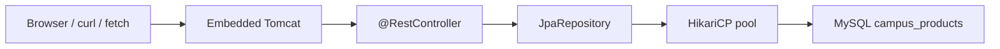

# Module 09 — Spring Data JPA and Validation

**Phase:** Backend (persist JSON API)

**Previous module:** [Spring Web REST](02_Spring_Web_REST.md)  
**Next module:** [REST, DTOs, and Postman](04_REST_DTOs_Postman.md)

**Lab kit:** [15_Lab_Assets/18_jpa_product_crud/](../15_Lab_Assets/18_jpa_product_crud/)

---

**Teach order today:** in-memory pain → JDBC vs JPA → `@Entity` Product → `JpaRepository` → pom starters + driver → `application.yml` + env + Hikari name + lab `ddl-auto` → REST list / get / create against the DB → lite `@Valid` peek.

---

## Prerequisites

- **Campus Hello REST** from [Spring Web REST](02_Spring_Web_REST.md) — `@RestController`, GET list / GET by id / POST, 200 / 201 / 404, in-memory `List`. JDK 17 + Maven 3.9+ + Spring Boot 3.x ([Tested Toolchain](../Tested_Toolchain.md)).
- **MySQL 8+** and **JDBC CRUD** — [`MYSQL/`](../../MYSQL/) `training_db`, [FS bridge](../06_Database_MySQL/01_MySQL_for_Full_Stack_Developers.md) CampusCart `products` idea, [JDBC CRUD](../07_JDBC/01_JDBC_CRUD.md) secrets habit (env / `.env.example`).

---

## Definition / Purpose

**Definition:** **JPA** (Jakarta Persistence API) is the **Java standard for mapping classes to tables**. An **`@Entity`** is a class whose fields are columns. **`@Id`** marks the primary key. **Hibernate** (inside `starter-data-jpa`) implements JPA and writes the SQL.

**Definition:** **Spring Data JPA** gives you a **`JpaRepository`**. You declare an interface; Boot supplies `save`, `findAll`, `findById`, `deleteById`. You do **not** write `SELECT *` by hand for those four calls.

**Purpose:** Priya’s CampusCart catalog cannot live in an `ArrayList`. Restart wiped Idli. JDBC already saves rows — but every INSERT is a string of SQL. JPA lets the same `Product` object that Jackson JSON uses **become a row**. Interviews still ask you to contrast JDBC and JPA. **Later —** DTOs so the JSON shape is not the table shape.

**Icons:** Bank · Order · Laptop · Employee · UPI

**Where used?**
- CampusCart / **TechMart** — catalog JSON that **survives restart**
- Canteen / mess — snacks in MySQL, not in the JVM
- **SecureBank** / UPI — account rows behind a JSON list (**no money movement here**)
- **MedCare** — medicine / token catalog
- **AcmeHR** — employee master (**Later —** relations)

**Visual — REST to MySQL:**



**Key takeaways:**

- **JDBC** = you write SQL. **JPA** = you map a class; Hibernate writes SQL
- Core path: **`@Entity` + `JpaRepository` + MySQL`**, same GET/POST as module 02
- Secrets stay in **env**; **Hikari** is auto-configured (name it, do not tune it)
- **`ddl-auto=update` is lab-only**

---

## Motivation — Feel the pain of restart

Ravi POSTed Pani puri. The canteen screen showed it. He restarted `mvn spring-boot:run`. The snack was gone. Workbench still had yesterday’s MYSQL homework — the Boot app never used it.

```java
public class RestartWipesList {
    public static void main(String[] args) {
        System.out.println("POST /canteen/items -> Pani puri in ArrayList");
        System.out.println("Restart Tomcat -> seed snacks only");
        System.out.println("Need MySQL rows that survive Ctrl+C");
    }
}
```

**Expected Output:**

```
POST /canteen/items -> Pani puri in ArrayList
Restart Tomcat -> seed snacks only
Need MySQL rows that survive Ctrl+C
```

**Remember:** Module 02 practised HTTP. This module practises **persistence**. Same mappings; different store.

**Interview:** “Why not keep the `ArrayList`?” — Demos and tests. Production catalogs are shared and durable. That is a database.

---

## Important Concepts

### 1. JDBC vs JPA — same MySQL, different Java

**Definition:** **JDBC** is the **low-level API**: `Connection`, `PreparedStatement`, `ResultSet`. You already listed library books that way. **JPA** is an **ORM** (object–relational mapping): a `Product` instance ↔ a row.

**Purpose:** Without the contrast, juniors think JPA “replaces MySQL.” It does not. Hibernate opens a JDBC connection from **HikariCP** and still sends SQL. You skip typing `INSERT INTO` for the happy path.

| | JDBC (already taught) | JPA (this module) |
|--|------------------------|-------------------|
| You write | SQL + `?` | Entity + repository method |
| Driver | Connector/J on `-cp` | `mysql-connector-j` in `pom.xml` |
| Pool | None (one `Connection` per CLI) | **HikariCP** auto-configured |
| Config | env / `.env` | `application.yml` + env |
| Restart | Rows stay in MySQL | Rows stay in MySQL |

Point at tables you already know — do **not** redo DDL textbooks:

- [`MYSQL/`](../../MYSQL/) — `CREATE TABLE`, PK, DML
- [FS bridge](../06_Database_MySQL/01_MySQL_for_Full_Stack_Developers.md) — CampusCart `products` (`product_id`, `name`, `price`)
- Lab table here is **`campus_products`** so we do **not** smash MYSQL homework `products`

```java
public class JdbcVsJpaPrint {
    public static void main(String[] args) {
        System.out.println("JDBC: PreparedStatement INSERT INTO books ...");
        System.out.println("JPA:  products.save(new Product(\"Idli\", 40))");
        System.out.println("Both: MySQL 8 + Connector/J + no password in git");
    }
}
```

**Expected Output:**

```
JDBC: PreparedStatement INSERT INTO books ...
JPA:  products.save(new Product("Idli", 40))
Both: MySQL 8 + Connector/J + no password in git
```

**Note:**
- Wrong: “JPA means we can forget SQL.” Interviews still ask JOIN and `PreparedStatement`.
- Wrong: mixing `javax.persistence` on Boot 3 — use **`jakarta.persistence`**.
- Prefer: JDBC for “I can write the SQL”; JPA for “the catalog API.”

**Common Error:** Opening `DriverManager.getConnection` inside a `@RestController` “because JDBC week did that.” Boot already has a **DataSource**. Use the repository.

**Remember:** JPA sits **on** JDBC. It is not a second database.

**Interview:** ORM? Object–relational mapping — Java object to table row.

**Try these (2 programs):**

**Program 1 — Who writes the SQL?**

```java
public class WhoWritesSql {
    public static void main(String[] args) {
        System.out.println("JDBC week: you wrote INSERT / SELECT");
        System.out.println("JPA week: Hibernate writes INSERT / SELECT");
        System.out.println("You still read the SQL in the log (show-sql)");
    }
}
```

**Expected Output:**

```
JDBC week: you wrote INSERT / SELECT
JPA week: Hibernate writes INSERT / SELECT
You still read the SQL in the log (show-sql)
```

**Program 2 — Same secrets habit**

```java
public class SameSecretsHabit {
    public static void main(String[] args) {
        System.out.println("JDBC: MYSQL_PASSWORD from env / .env");
        System.out.println("JPA:  spring.datasource.password: ${MYSQL_PASSWORD}");
        System.out.println("git:  .env.example YES, .env NO");
    }
}
```

**Expected Output:**

```
JDBC: MYSQL_PASSWORD from env / .env
JPA:  spring.datasource.password: ${MYSQL_PASSWORD}
git:  .env.example YES, .env NO
```

---

### 2. Entity — `@Entity` / `@Id` / `@GeneratedValue`

**Definition:** An **entity** is a **plain Java class** annotated **`@Entity`**. **`@Table(name = "campus_products")`** names the MySQL table. **`@Id`** is the primary key. **`@GeneratedValue(strategy = GenerationType.IDENTITY)`** matches MySQL **`AUTO_INCREMENT`** (you already used that in MYSQL / JDBC).

**Purpose:** Without `@Entity`, Hibernate has nothing to map. Without `@Id`, JPA cannot tell rows apart. Without IDENTITY, you would assign ids in Java like module 02’s `nextId++` — the **database** should own the catalog id.

Copy-paste valid (same package as `@SpringBootApplication` — Maven tree):

```java
package in.ksr.campuscatalog;

import jakarta.persistence.Column;
import jakarta.persistence.Entity;
import jakarta.persistence.GeneratedValue;
import jakarta.persistence.GenerationType;
import jakarta.persistence.Id;
import jakarta.persistence.Table;

@Entity
@Table(name = "campus_products")
public class Product {

    @Id
    @GeneratedValue(strategy = GenerationType.IDENTITY)
    private Long id;

    private String name;

    @Column(name = "price_inr")
    private int priceInr;

    public Product() {
    }

    public Product(String name, int priceInr) {
        this.name = name;
        this.priceInr = priceInr;
    }

    public Long getId() {
        return id;
    }

    public void setId(Long id) {
        this.id = id;
    }

    public String getName() {
        return name;
    }

    public void setName(String name) {
        this.name = name;
    }

    public int getPriceInr() {
        return priceInr;
    }

    public void setPriceInr(int priceInr) {
        this.priceInr = priceInr;
    }
}
```

**No-arg constructor** is required (JPA and Jackson). **Getters / setters** stay explicit — no Lombok on the core path. **`Long id`** is null until `save` — then MySQL fills it.

This is the **same snack idea** as module 02’s `CanteenItem` and the FS bridge `products` table. Lab kit uses **`campus_products`** so your MYSQL `products` homework stays untouched.

**Note:**
- Wrong: `import javax.persistence.Entity` — Boot 3 is **`jakarta.persistence`**.
- Wrong: primitive `long id` with IDENTITY — `0` looks like a real id. Use **`Long`** so “not saved yet” is `null`.
- `@Column` is optional when the name already matches; **`price_inr`** is explicit so the SQL log is readable.

**Common Error:** Forgetting the no-arg constructor after you add an all-args constructor — Hibernate cannot instantiate the row.

**Remember:** `@Entity` is a **row type**, not a Spring bean by itself. The **repository** is the Spring bean.

**Interview:** `@GeneratedValue` IDENTITY vs SEQUENCE? IDENTITY = MySQL auto-increment. SEQUENCE is common on Oracle / PostgreSQL. This course uses IDENTITY.

**Try these (2 programs):**

**Program 1 — Annotation checklist**

```java
public class EntityAnnotationPrint {
    public static void main(String[] args) {
        System.out.println("@Entity");
        System.out.println("@Table(name = \"campus_products\")");
        System.out.println("@Id");
        System.out.println("@GeneratedValue IDENTITY");
    }
}
```

**Expected Output:**

```
@Entity
@Table(name = "campus_products")
@Id
@GeneratedValue IDENTITY
```

**Program 2 — jakarta not javax**

```java
public class JakartaNotJavax {
    public static void main(String[] args) {
        System.out.println("Boot 3: jakarta.persistence.Entity");
        System.out.println("Old:    javax.persistence.Entity");
        System.out.println("javax will not compile on this pom");
    }
}
```

**Expected Output:**

```
Boot 3: jakarta.persistence.Entity
Old:    javax.persistence.Entity
javax will not compile on this pom
```

---

### 3. `JpaRepository` — save / findAll / findById / deleteById

**Definition:** **`JpaRepository<Product, Long>`** is a Spring Data **interface**. The first type is the entity. The second is the **id type**. Boot creates the implementation at startup.

**Purpose:** Without a repository, you would write JDBC again (or an `EntityManager` by hand). Four methods cover the catalog: **create / list / get / delete**.

Copy-paste valid:

```java
package in.ksr.campuscatalog;

import org.springframework.data.jpa.repository.JpaRepository;

public interface ProductRepository extends JpaRepository<Product, Long> {
}
```

Empty body is **correct**. You inherit:

| Method | SQL idea (Hibernate writes it) |
|--------|--------------------------------|
| `save(product)` | INSERT (id null) or UPDATE (id set) |
| `findAll()` | SELECT all rows |
| `findById(id)` | SELECT by PK → `Optional` |
| `deleteById(id)` | DELETE by PK |

`findById` returns **`Optional<Product>`**. Module 02 looped an `ArrayList`. Here:

```java
Product found = products.findById(id).orElse(null);
if (found == null) {
    // 404 — same status idea as module 02
}
```

You do **not** write `findByName` query methods this module (**Later —** if the batch needs search).

**Note:**
- Wrong: `JpaRepository<Product, Integer>` while `id` is `Long` — id types must match.
- Wrong: calling `save` and expecting a row without a running MySQL — Boot fails at start if the DataSource is wrong.
- Prefer: constructor injection of `ProductRepository` into the controller (next topic). No `new ProductRepository()`.

**Common Error:** `products.get(0)` like an `ArrayList`. A repository is not a `List`. Use `findAll()` / `findById`.

**Remember:** `save` on a **new** entity (id `null`) INSERTs. `save` on an entity **with** an id UPDATEs that row.

**Interview:** Why an interface? Spring Data builds a proxy. You declare *what*; Boot supplies *how*.

**Try these (2 programs):**

**Program 1 — Four methods**

```java
public class RepoFourMethods {
    public static void main(String[] args) {
        System.out.println("save(product)");
        System.out.println("findAll()");
        System.out.println("findById(id)");
        System.out.println("deleteById(id)");
    }
}
```

**Expected Output:**

```
save(product)
findAll()
findById(id)
deleteById(id)
```

**Program 2 — Generics reminder**

```java
public class RepoGenericsPrint {
    public static void main(String[] args) {
        System.out.println("JpaRepository<Product, Long>");
        System.out.println("Product = entity class");
        System.out.println("Long    = type of @Id");
    }
}
```

**Expected Output:**

```
JpaRepository<Product, Long>
Product = entity class
Long    = type of @Id
```

---

### 4. Maven — `starter-data-jpa` + `mysql-connector-j`

**Definition:** **`spring-boot-starter-data-jpa`** pulls Hibernate, Spring Data, and **`starter-jdbc`** (which brings **HikariCP**). **`mysql-connector-j`** is the MySQL 8 driver (same family as JDBC week’s JAR). Keep **`spring-boot-starter-web`**.

**Purpose:** Without the JPA starter, `@Entity` / `JpaRepository` will not compile. Without the driver, Boot starts then fails to talk to MySQL. Maven versions stay on the Boot **3.x** parent (course pin **3.5.16**, JDK **17**).

```xml
<dependencies>
    <dependency>
        <groupId>org.springframework.boot</groupId>
        <artifactId>spring-boot-starter-web</artifactId>
    </dependency>
    <dependency>
        <groupId>org.springframework.boot</groupId>
        <artifactId>spring-boot-starter-data-jpa</artifactId>
    </dependency>
    <dependency>
        <groupId>com.mysql</groupId>
        <artifactId>mysql-connector-j</artifactId>
        <scope>runtime</scope>
    </dependency>
</dependencies>
```

Do **not** add `starter-jdbc` yourself — JPA already pulls it. Do **not** add Security, Thymeleaf, or Lombok to pass.

Optional lite validation (topic 7) adds **`spring-boot-starter-validation`** — **not** required for the kit Done when.

**Note:**
- Wrong: start.spring.io **4.x** parent — stay on **3.5.x** + Java 17 ([Tested Toolchain](../Tested_Toolchain.md)).
- Wrong: `mysql-connector-java` old artifact name — Boot 3 uses **`mysql-connector-j`**.
- Prefer: `<scope>runtime</scope>` on the driver (you do not import driver classes).

**Remember:** Parent POM still pins versions. You rarely type a Hibernate version.

**Try these (2 programs):**

**Program 1 — Three artifacts**

```java
public class JpaPomArtifacts {
    public static void main(String[] args) {
        System.out.println("spring-boot-starter-web");
        System.out.println("spring-boot-starter-data-jpa");
        System.out.println("mysql-connector-j");
    }
}
```

**Expected Output:**

```
spring-boot-starter-web
spring-boot-starter-data-jpa
mysql-connector-j
```

**Program 2 — What JPA starter pulls**

```java
public class JpaStarterPulls {
    public static void main(String[] args) {
        System.out.println("Hibernate (JPA provider)");
        System.out.println("Spring Data JPA");
        System.out.println("HikariCP via starter-jdbc");
    }
}
```

**Expected Output:**

```
Hibernate (JPA provider)
Spring Data JPA
HikariCP via starter-jdbc
```

---

### 5. `application.yml` — datasource, env, Hikari, lab `ddl-auto`

**Definition:** **`spring.datasource.url` / `username` / `password`** tell Boot how to reach MySQL. Placeholders **`${MYSQL_PASSWORD}`** read the **environment** (same secret habit as JDBC). **HikariCP** is the connection **pool** Boot auto-configures — a small set of reusable JDBC connections.

**Definition:** **`spring.jpa.hibernate.ddl-auto`** controls schema from entities. **`update`** means: create missing tables / columns to match `@Entity`. That is **lab-only**. Production schema (Flyway / Liquibase / DBA DDL) is **Later —**.

**Purpose:** Hard-coding `root` / `root123` in yml and pushing to GitHub is the JDBC-week failure mode again. Env keeps the password off GitHub. Naming Hikari answers the interview; **do not** set `maximum-pool-size` this module.

```yaml
spring:
  application:
    name: campus-jpa-catalog
  datasource:
    url: jdbc:mysql://${MYSQL_HOST:localhost}:${MYSQL_PORT:3306}/${MYSQL_DATABASE:training_db}?allowPublicKeyRetrieval=true&useSSL=false&serverTimezone=Asia/Kolkata
    username: ${MYSQL_USER:root}
    password: ${MYSQL_PASSWORD}
  jpa:
    hibernate:
      ddl-auto: update
    show-sql: true
    properties:
      hibernate:
        format_sql: true

server:
  port: ${SERVER_PORT:8080}
```

`allowPublicKeyRetrieval=true` and `useSSL=false` are the **same lab URL flags** as [JDBC CRUD](../07_JDBC/01_JDBC_CRUD.md). `useSSL=false` is **lab-only**.

`.env.example` (commit this):

```
# Copy keys into your shell or IDE env. Boot does not load this file by itself.
# Do not commit a real .env.
SERVER_PORT=8080
MYSQL_HOST=localhost
MYSQL_PORT=3306
MYSQL_USER=root
MYSQL_PASSWORD=change_me
MYSQL_DATABASE=training_db
```

Export then run (macOS / Linux):

```bash
export MYSQL_PASSWORD='your_lab_password'
export MYSQL_USER=root
mvn spring-boot:run
```

Windows PowerShell: `$env:MYSQL_PASSWORD='your_lab_password'` then `mvn spring-boot:run`.

Boot **does not** read `.env` automatically — export or IDE Run Configuration env. JDBC kit could parse `.env` in `main`; Boot does not.

**Note:**
- Wrong: `password: root123` in yml on GitHub.
- Wrong: `ddl-auto: create-drop` for a catalog you care about — **drop** wipes tables on shutdown.
- Wrong: `ddl-auto: create` on every restart in a shared `training_db` — it can smash tables. **`update` is the lab setting.**
- Prefer: `show-sql: true` in class so you **see** Hibernate’s INSERT next to JDBC memories.

**Common Error:** `Public Key Retrieval is not allowed` — same JDBC lab fix on the URL. Do not paste the password into git while debugging.

**Remember:** Hikari = pool. You name it. You do **not** tune it here.

**Interview:** Why a pool? Opening a TCP connection per HTTP request is slow. Hikari reuses connections. Tuning is **Later —** / ops.

**Try these (2 programs):**

**Program 1 — Yml keys**

```java
public class DatasourceYmlKeys {
    public static void main(String[] args) {
        System.out.println("spring.datasource.url");
        System.out.println("spring.datasource.username");
        System.out.println("spring.datasource.password=${MYSQL_PASSWORD}");
        System.out.println("spring.jpa.hibernate.ddl-auto=update");
    }
}
```

**Expected Output:**

```
spring.datasource.url
spring.datasource.username
spring.datasource.password=${MYSQL_PASSWORD}
spring.jpa.hibernate.ddl-auto=update
```

**Program 2 — Lab vs production schema**

```java
public class DdlAutoLabOnly {
    public static void main(String[] args) {
        System.out.println("Lab: ddl-auto=update");
        System.out.println("Not lab: create-drop wipes data");
        System.out.println("Production schema: Later — not this module");
    }
}
```

**Expected Output:**

```
Lab: ddl-auto=update
Not lab: create-drop wipes data
Production schema: Later — not this module
```

---

### 6. REST against the DB — same mappings, `JpaRepository` store

**Definition:** The controller from module 02 still uses **`@GetMapping`**, **`@PostMapping`**, **`@PathVariable`**, **`@RequestBody`**, **200 / 201 / 404**. The field is no longer `List<CanteenItem>`. It is a **`ProductRepository`**. Spring **constructor-injects** it (one constructor — no `@Autowired` required).

**Purpose:** Learners already know HTTP. Today GET list is `findAll()`. GET by id is `findById`. POST is `save` with id `null` so MySQL IDENTITY assigns the key.

Copy-paste valid:

```java
package in.ksr.campuscatalog;

import java.util.List;
import java.util.Map;
import org.springframework.http.HttpStatus;
import org.springframework.http.ResponseEntity;
import org.springframework.web.bind.annotation.GetMapping;
import org.springframework.web.bind.annotation.PathVariable;
import org.springframework.web.bind.annotation.PostMapping;
import org.springframework.web.bind.annotation.RequestBody;
import org.springframework.web.bind.annotation.RequestMapping;
import org.springframework.web.bind.annotation.ResponseStatus;
import org.springframework.web.bind.annotation.RestController;

@RestController
@RequestMapping("/products")
public class ProductController {

    private final ProductRepository products;

    public ProductController(ProductRepository products) {
        this.products = products;
    }

    @GetMapping
    public List<Product> list() {
        return products.findAll();
    }

    @GetMapping("/{id}")
    public ResponseEntity<?> getById(@PathVariable Long id) {
        Product found = products.findById(id).orElse(null);
        if (found != null) {
            return ResponseEntity.ok(found);
        }
        return ResponseEntity.status(HttpStatus.NOT_FOUND)
                .body(Map.of("error", "No product " + id));
    }

    @PostMapping
    @ResponseStatus(HttpStatus.CREATED)
    public Product add(@RequestBody Product incoming) {
        incoming.setId(null);
        return products.save(incoming);
    }
}
```

`incoming.setId(null)` stops a client from forcing an UPDATE by sending `"id": 1`. POST **creates**.

`deleteById` is in-window on the **repository**. A **DELETE** HTTP mapping is optional Stretch — core ticket is list / get / create.

Prove persistence:

```bash
curl http://localhost:8080/products
curl -X POST http://localhost:8080/products \
  -H "Content-Type: application/json" \
  -d '{"name":"Pani puri","priceInr":30}'
# Ctrl+C the server, mvn spring-boot:run again, then:
curl http://localhost:8080/products
```

Pani puri must still be there. That is the whole point.

**Note:**
- Wrong: keeping `new ArrayList<>()` in the controller “and also” a repository — two stores, confusing GET.
- Wrong: returning `products.toString()` — Jackson needs the `List<Product>`.
- Paths here are **`/products`**. Module 02 used `/canteen/items`. Same HTTP ideas; CampusCart catalog name.

**Common Error:** POST without `setId(null)` and a body that includes `"id": 5` — Hibernate may try to UPDATE a missing row. Clear the id on create.

**Remember:** Constructor injection = Spring passes the repository. You never `new` it.

**Interview:** `Optional` from `findById`? Empty means no row. Map that to **404**, not `null` with **200**.

**Try these (2 programs):**

**Program 1 — HTTP to repository**

```java
public class HttpToRepoPrint {
    public static void main(String[] args) {
        System.out.println("GET  /products      -> findAll");
        System.out.println("GET  /products/{id} -> findById");
        System.out.println("POST /products      -> save (id null) -> 201");
    }
}
```

**Expected Output:**

```
GET  /products      -> findAll
GET  /products/{id} -> findById
POST /products      -> save (id null) -> 201
```

**Program 2 — Restart keeps the row**

```java
public class RestartKeepsRow {
    public static void main(String[] args) {
        System.out.println("POST Pani puri -> MySQL campus_products");
        System.out.println("Restart Tomcat -> GET still shows Pani puri");
        System.out.println("That failed with ArrayList in module 02");
    }
}
```

**Expected Output:**

```
POST Pani puri -> MySQL campus_products
Restart Tomcat -> GET still shows Pani puri
That failed with ArrayList in module 02
```

---

### 7. Lite validation on the entity (short — not module 04)

**Definition:** **Bean Validation** annotations on fields (`@NotBlank`, `@NotNull`) describe **what is allowed**. **`@Valid`** on **`@RequestBody`** tells Spring to **run** those checks before the method body.

**Purpose:** POST `{"name":"","priceInr":30}` should not become a catalog row. A **one-line** guard on the entity is enough to *name* `@Valid`. **DTO mapping**, **Postman collections**, and **error JSON bodies** are **Later —** [module 04](04_REST_DTOs_Postman.md) (calendar homework for `@Valid` on POST sits there).

Optional dependency (Stretch / peek — **not** kit Done when):

```xml
<dependency>
    <groupId>org.springframework.boot</groupId>
    <artifactId>spring-boot-starter-validation</artifactId>
</dependency>
```

On the entity (imports `jakarta.validation.constraints`):

```java
@NotBlank
private String name;

@NotNull
private Integer priceInr;
```

Use **`Integer`** (wrapper) if you want `@NotNull` — a primitive `int` is never null, so `@NotNull` would not catch a missing JSON field the way you think.

On POST (peek):

```java
@PostMapping
@ResponseStatus(HttpStatus.CREATED)
public Product add(@Valid @RequestBody Product incoming) {
    incoming.setId(null);
    return products.save(incoming);
}
```

Default 400 body from Boot is **ugly JSON**. Designing that body is **Later —** module 04. Core path may skip `@Valid` entirely.

**Note:**
- Wrong: treating this peek as a DTO layer — the JSON **is** still the entity.
- Wrong: `@Valid` without `starter-validation` — annotations will not run (or will not compile).
- Prefer: kit **Done when** without `@Valid`; add it only as Stretch.

**Remember:** Filename includes Validation. Depth of `@Valid` + error bodies is the **next** module.

**Try these (2 programs):**

**Program 1 — What lite checks**

```java
public class LiteValidPrint {
    public static void main(String[] args) {
        System.out.println("@NotBlank on name");
        System.out.println("@NotNull on price wrapper");
        System.out.println("@Valid on POST body");
    }
}
```

**Expected Output:**

```
@NotBlank on name
@NotNull on price wrapper
@Valid on POST body
```

**Program 2 — What stays Later**

```java
public class ValidLaterPrint {
    public static void main(String[] args) {
        System.out.println("Later: DTO mapping");
        System.out.println("Later: Postman collection");
        System.out.println("Later: designed error JSON body");
    }
}
```

**Expected Output:**

```
Later: DTO mapping
Later: Postman collection
Later: designed error JSON body
```

---

## Step-by-Step Annotated Java Code

Work in lab kit **[18_jpa_product_crud](../15_Lab_Assets/18_jpa_product_crud/)** (`starter/`). JDK 17. Open the folder that contains **`pom.xml`**. MySQL 8+ must be running. Copy [`.env.example`](../15_Lab_Assets/18_jpa_product_crud/.env.example) values into your **shell or IDE env** (Boot does not load `.env` by itself).

### Step 1: Prove MySQL and the pom

Confirm MySQL (same habit as JDBC week):

```bash
mysql -u root -p -e "SHOW DATABASES;"
```

Create `training_db` if needed (`CREATE DATABASE IF NOT EXISTS training_db;` — [MYSQL/00](../../MYSQL/00_MySQL_Setup_and_Connection.md)). Optional: run kit **`seed/campus_products.sql`** after the first Boot start, or let **`ddl-auto=update`** create `campus_products` from the entity.

Open `starter/pom.xml`. You need **`starter-web`**, **`starter-data-jpa`**, and **`mysql-connector-j`**.

**Try these (2 programs):**

**Program 1 — Database name**

```java
public class TrainingDbName {
    public static void main(String[] args) {
        System.out.println("training_db");
        System.out.println("table: campus_products");
        System.out.println("do not drop MYSQL products homework");
    }
}
```

**Expected Output:**

```
training_db
table: campus_products
do not drop MYSQL products homework
```

**Program 2 — Three dependencies**

```java
public class StarterPomCheck {
    public static void main(String[] args) {
        System.out.println("starter-web");
        System.out.println("starter-data-jpa");
        System.out.println("mysql-connector-j");
    }
}
```

**Expected Output:**

```
starter-web
starter-data-jpa
mysql-connector-j
```

---

### Step 2: `application.yml` + env (no password in git)

Complete datasource keys. **`password: ${MYSQL_PASSWORD}`** with **no** literal. `.gitignore` already has `.env` and `target/` (Git kit).

```bash
export MYSQL_PASSWORD='your_lab_password'
cd starter
mvn spring-boot:run
```

If MySQL is down or the password is wrong, Boot **fails at start** — fix env, do not paste the password into yml.

**Try these (2 programs):**

**Program 1 — Export reminder**

```java
public class ExportMysqlPassword {
    public static void main(String[] args) {
        System.out.println("export MYSQL_PASSWORD=...");
        System.out.println("mvn spring-boot:run");
        System.out.println("Boot does not read .env by itself");
    }
}
```

**Expected Output:**

```
export MYSQL_PASSWORD=...
mvn spring-boot:run
Boot does not read .env by itself
```

**Program 2 — Hikari name only**

```java
public class HikariNameOnly {
    public static void main(String[] args) {
        System.out.println("Pool name: HikariCP");
        System.out.println("Auto-configured by Boot");
        System.out.println("Do not set maximum-pool-size this module");
    }
}
```

**Expected Output:**

```
Pool name: HikariCP
Auto-configured by Boot
Do not set maximum-pool-size this module
```

---

### Step 3: `Product` entity

Annotate `Product` with `@Entity`, `@Table(name = "campus_products")`, `@Id`, `@GeneratedValue(IDENTITY)`, `@Column(name = "price_inr")`. No-arg constructor + getters / setters. **`jakarta.persistence`**.

**Try these (2 programs):**

**Program 1 — Field list**

```java
public class ProductFieldsPrint {
    public static void main(String[] args) {
        System.out.println("id Long IDENTITY");
        System.out.println("name String");
        System.out.println("priceInr -> column price_inr");
    }
}
```

**Expected Output:**

```
id Long IDENTITY
name String
priceInr -> column price_inr
```

**Program 2 — Constructors**

```java
public class EntityConstructorsPrint {
    public static void main(String[] args) {
        System.out.println("no-arg: JPA + Jackson");
        System.out.println("name + priceInr: handy for demos");
        System.out.println("id assigned by MySQL on save");
    }
}
```

**Expected Output:**

```
no-arg: JPA + Jackson
name + priceInr: handy for demos
id assigned by MySQL on save
```

---

### Step 4: `ProductRepository`

Empty interface `extends JpaRepository<Product, Long>`. Same package as the entity so component scan finds it (`@SpringBootApplication` already scans `in.ksr.campuscatalog`).

**Try these (2 programs):**

**Program 1 — Interface is enough**

```java
public class EmptyRepoOk {
    public static void main(String[] args) {
        System.out.println("public interface ProductRepository");
        System.out.println("extends JpaRepository<Product, Long> { }");
        System.out.println("no method body required");
    }
}
```

**Expected Output:**

```
public interface ProductRepository
extends JpaRepository<Product, Long> { }
no method body required
```

**Program 2 — Scan package**

```java
public class SamePackageScan {
    public static void main(String[] args) {
        System.out.println("Application: in.ksr.campuscatalog");
        System.out.println("Entity + repo + controller: same package");
        System.out.println("Wrong package -> bean not found");
    }
}
```

**Expected Output:**

```
Application: in.ksr.campuscatalog
Entity + repo + controller: same package
Wrong package -> bean not found
```

---

### Step 5: Controller + curl (list / get / create)

Replace any leftover `ArrayList` with constructor injection of `ProductRepository`. Complete GET list, GET by id (404), POST 201. Then:

```bash
curl http://localhost:8080/products
curl http://localhost:8080/products/1
curl http://localhost:8080/products/99
curl -X POST http://localhost:8080/products \
  -H "Content-Type: application/json" \
  -d '{"name":"Pani puri","priceInr":30}'
```

Watch the terminal: **`show-sql: true`** prints Hibernate SQL. That is your JDBC week in the log.

**Try these (2 programs):**

**Program 1 — Curl list**

```java
public class CurlListPrint {
    public static void main(String[] args) {
        System.out.println("curl http://localhost:8080/products");
        System.out.println("JSON array from findAll");
    }
}
```

**Expected Output:**

```
curl http://localhost:8080/products
JSON array from findAll
```

**Program 2 — Curl POST**

```java
public class CurlPostPrint {
    public static void main(String[] args) {
        System.out.println("POST JSON name + priceInr");
        System.out.println("201 and id from AUTO_INCREMENT");
    }
}
```

**Expected Output:**

```
POST JSON name + priceInr
201 and id from AUTO_INCREMENT
```

---

### Step 6: Restart proof + git hygiene

Stop the app. Start it again. GET `/products` must still include Pani puri. `git status` must **not** list `.env` or `target/`. README: JDK 17, Boot 3, env vars, `mvn spring-boot:run`, curl.

Do **not** add Security, DTOs, Postman, or Lombok to pass. `@Valid` is Stretch only.

**Try these (2 programs):**

**Program 1 — Ignore list reminder**

```java
public class JpaGitignorePrint {
    public static void main(String[] args) {
        System.out.println("ignore: target/");
        System.out.println("ignore: .env");
        System.out.println("keep: pom.xml src/ .env.example");
    }
}
```

**Expected Output:**

```
ignore: target/
ignore: .env
keep: pom.xml src/ .env.example
```

**Program 2 — Core ticket**

```java
public class Kit18CoreTicket {
    public static void main(String[] args) {
        System.out.println("Product entity + ProductRepository");
        System.out.println("GET list / GET by id / POST create");
        System.out.println("MySQL — not ArrayList");
    }
}
```

**Expected Output:**

```
Product entity + ProductRepository
GET list / GET by id / POST create
MySQL — not ArrayList
```

---

## Practice Exercises

*(Each Practice item includes a filled **Model answer:** and **Expected Output:** where the demo prints.)*

### Basic

1. Print JDBC vs JPA in two lines.

   **Model answer:**

```java
public class JdbcJpaTwoLines {
    public static void main(String[] args) {
        System.out.println("JDBC: you write PreparedStatement SQL");
        System.out.println("JPA:  Hibernate writes SQL from @Entity");
    }
}
```

   **Expected Output:**

```
JDBC: you write PreparedStatement SQL
JPA:  Hibernate writes SQL from @Entity
```

2. Print the three entity annotations that must appear on `Product`.

   **Model answer:**

```java
public class ThreeEntityAnnotations {
    public static void main(String[] args) {
        System.out.println("@Entity");
        System.out.println("@Id");
        System.out.println("@GeneratedValue");
    }
}
```

   **Expected Output:**

```
@Entity
@Id
@GeneratedValue
```

3. Print the repository type line.

   **Model answer:**

```java
public class RepoTypeLine {
    public static void main(String[] args) {
        System.out.println("interface ProductRepository extends JpaRepository<Product, Long>");
    }
}
```

   **Expected Output:**

```
interface ProductRepository extends JpaRepository<Product, Long>
```

### Intermediate

1. Sketch yml password: placeholder vs literal.

   **Model answer:**

```java
public class PasswordPlaceholderSketch {
    public static void main(String[] args) {
        System.out.println("OK:   password: ${MYSQL_PASSWORD}");
        System.out.println("NO:   password: root123");
    }
}
```

   **Expected Output:**

```
OK:   password: ${MYSQL_PASSWORD}
NO:   password: root123
```

2. Sketch GET by id with JPA: method, miss path.

   **Model answer:**

```java
public class JpaGetByIdSketch {
    public static void main(String[] args) {
        System.out.println("findById(id).orElse(null)");
        System.out.println("null -> 404");
        System.out.println("found -> 200 JSON");
    }
}
```

   **Expected Output:**

```
findById(id).orElse(null)
null -> 404
found -> 200 JSON
```

3. Why `setId(null)` on POST?

   **Model answer:**

```java
public class PostClearId {
    public static void main(String[] args) {
        System.out.println("POST must INSERT");
        System.out.println("null id -> IDENTITY");
        System.out.println("client id would look like UPDATE");
    }
}
```

   **Expected Output:**

```
POST must INSERT
null id -> IDENTITY
client id would look like UPDATE
```

4. Why is `ddl-auto=update` labelled lab-only?

   **Model answer:**

```java
public class WhyUpdateLabOnly {
    public static void main(String[] args) {
        System.out.println("update changes tables from Java");
        System.out.println("production needs a planned schema");
        System.out.println("Later — migrations / DBA DDL");
    }
}
```

   **Expected Output:**

```
update changes tables from Java
production needs a planned schema
Later — migrations / DBA DDL
```

### Interview-Oriented

1. JDBC vs JPA — one sentence each?

   **Model answer:** JDBC is explicit SQL through `PreparedStatement`. JPA maps entities; Hibernate generates SQL and still uses JDBC (plus a pool).

2. Why `jakarta.persistence`?

   **Model answer:** Spring Boot 3 moved from Java EE `javax.*` to Jakarta. Entity annotations live in `jakarta.persistence`. `javax.persistence` will not compile on this parent.

3. What is HikariCP here?

   **Model answer:** The JDBC connection pool Boot auto-configures when a DataSource is present. Name it in interviews. Do not tune pool size in this module.

4. `save` vs `findAll` vs `findById`?

   **Model answer:** `save` persists (INSERT or UPDATE). `findAll` returns every row as a `List`. `findById` returns `Optional` for one primary key.

5. Does JPA mean we skip MYSQL week?

   **Model answer:** No. You still design tables, PKs, and joins in SQL. JPA is how this Boot API talks to those tables. Point at [`MYSQL/`](../../MYSQL/) — do not rewrite it.

6. Is `@Valid` required to pass this assignment?

   **Model answer:** No. Lite `@NotBlank` / `@Valid` is a short peek. Kit Done when is entity + repository + list / get / create on MySQL. Error bodies and DTOs are **Later —** module 04.

---

## Mini-Project (Assignment): TechMart / CampusCart JPA Product Catalog

**Lab kit:** [15_Lab_Assets/18_jpa_product_crud/](../15_Lab_Assets/18_jpa_product_crud/)

Module 02 proved HTTP on an `ArrayList`. This assignment is the **portfolio JPA spike**: a **`Product` entity**, a **`JpaRepository`**, and **GET list / GET by id / POST** that **survive restart** in MySQL. Push a public repo. No secrets in git.

Do **not** add Security, DTO classes, Postman collections, or Lombok to pass. `@Valid` is Stretch only.

### What to build

| Piece | Detail |
|-------|--------|
| `pom.xml` | Parent **Spring Boot 3.x**, `<java.version>17</java.version>`, **`starter-web`**, **`starter-data-jpa`**, **`mysql-connector-j`** |
| Application class | `@SpringBootApplication` + `SpringApplication.run` |
| `Product` | `@Entity`, `@Table(name = "campus_products")`, `@Id`, `@GeneratedValue(IDENTITY)`, `name`, `priceInr` — explicit getters / setters, no-arg constructor, **`jakarta.persistence`** |
| `ProductRepository` | `extends JpaRepository<Product, Long>` |
| GET list | **GET `/products`** → JSON **array** from **`findAll()`** |
| GET by id | **GET `/products/{id}`** — `@PathVariable`; **200** or **404** via **`findById`** |
| POST | **POST `/products`** — `@RequestBody`; **201**; **`save`** after `setId(null)` |
| `application.yml` | `spring.datasource.*` from **`${MYSQL_*}`**; **`ddl-auto: update`**; `show-sql` OK |
| `.env.example` | Dummy `MYSQL_PASSWORD` / host / database — **no** real password |
| `.gitignore` | `target/`, `.env`, `*.class`, `.idea/` |
| README | JDK 17, Boot 3, export env, `mvn spring-boot:run`, curl list / by-id / POST, restart proof |

SQL depth stays in [`MYSQL/`](../../MYSQL/). Kit **`seed/campus_products.sql`** is optional insert help after the table exists — not a second SQL course.

**Sample curl (after at least one POST):**

```
[{"id":1,"name":"Idli","priceInr":40},{"id":2,"name":"Filter coffee","priceInr":25}]
```

```
{"id":1,"name":"Idli","priceInr":40}
```

```
{"id":3,"name":"Pani puri","priceInr":30}
```

Work from `starter/` (TODOs) or `broken/` (debug). Compare `solution/` only after you finish (or when told in class). `solution/` is trainer-only in the student pack.

### Stretch

- Lite **`@Valid`** + `@NotBlank` / `@NotNull` (`starter-validation`) — **not** Done when.
- Extra field (e.g. `category`) on entity + column — **not** Done when.
- HTTP **DELETE** `/products/{id}` calling `deleteById` — optional.
- Lombok getters — optional, not in Done when.
- **Later —** DTOs, Postman collection, error bodies (module 04). **Later —** Security.

### Done when

- [ ] `mvn spring-boot:run` starts (Tomcat + DataSource; MySQL reachable)
- [ ] `Product` is an `@Entity` with `@Id` + `@GeneratedValue` (`jakarta.persistence`)
- [ ] `ProductRepository` extends `JpaRepository<Product, Long>`
- [ ] GET `/products` returns a JSON **array** from the **database** (`findAll`)
- [ ] GET `/products/{id}` uses `@PathVariable` + `findById` — 200 or **404**
- [ ] POST `/products` uses `@RequestBody` + `save` and returns **201**
- [ ] Restart the app; POST data is **still** in GET list
- [ ] Password is **not** a literal in yml or source; `.env` not committed
- [ ] No Spring Security / JWT, no DTO layer, no Postman collection required
- [ ] No Lombok required to pass; `@Valid` not required to pass
- [ ] `target/` untracked; short README with run + curl ([Standard Project Deliverables](../Standard_Project_Deliverables.md))

---

## Interview Q&A

Shared with students after concepts and the mini-project. Use for review and interview prep — questions and model answers are included.

**Q1. What is JPA?**  
**A:** Jakarta Persistence API — the standard for mapping Java classes to relational tables (`@Entity`, `@Id`). Hibernate is the implementation Boot uses.

**Q2. JDBC vs JPA?**  
**A:** JDBC: you write SQL with `PreparedStatement`. JPA: you map objects; Hibernate generates SQL and still uses JDBC. This course taught JDBC first on purpose.

**Q3. What is an entity?**  
**A:** A class annotated `@Entity` whose instances correspond to rows. Fields map to columns. It needs a primary key (`@Id`).

**Q4. Why `@GeneratedValue(IDENTITY)`?**  
**A:** It matches MySQL `AUTO_INCREMENT`. The database assigns the id on INSERT. Leave id `null` on create.

**Q5. `javax.persistence` vs `jakarta.persistence`?**  
**A:** Boot 3 / Jakarta EE 9+ uses `jakarta.*`. Old tutorials show `javax.persistence` — that does not compile on this pom.

**Q6. What is `JpaRepository`?**  
**A:** A Spring Data interface. `JpaRepository<Product, Long>` gives `save`, `findAll`, `findById`, `deleteById` without you writing those methods.

**Q7. What does `save` do?**  
**A:** If the id is null, INSERT. If the id exists, UPDATE that row. POST should null the id so it stays a create.

**Q8. What is HikariCP?**  
**A:** Boot’s default JDBC connection pool (via `starter-jdbc` inside `starter-data-jpa`). It reuses connections. Do not tune pool settings in this module.

**Q9. Why `application.yml` for the URL but env for the password?**  
**A:** Non-secret defaults (host, port, database name) can live in yml with placeholders. The password is a secret — `${MYSQL_PASSWORD}` from the environment. Commit `.env.example` only.

**Q10. Why is `ddl-auto=update` lab-only?**  
**A:** It lets Hibernate change tables from entity fields. Production teams version schema separately (migrations / DBA). `create-drop` wipes data. This course uses `update` in class only.

**Q11. Does Boot load `.env` automatically?**  
**A:** No. It reads environment variables (and yml). Export keys or set them in the IDE. Same story as module 01.

**Q12. Why not `DriverManager` in the controller?**  
**A:** Boot already configured a DataSource (Hikari). The repository uses it. Mixing raw JDBC in the controller skips that and leaks connections easily.

**Q13. In-memory `List` vs JPA?**  
**A:** List dies on restart and is one JVM. JPA + MySQL is shared durable catalog. Module 02 used List to learn HTTP first.

**Q14. Do we need DTOs this module?**  
**A:** No. Returning the entity as JSON is acceptable for this spike. DTO mapping and Postman are **Later —** module 04.

**Q15. Is `@Valid` required?**  
**A:** Not on the core path. A short entity-level `@NotBlank` / `@Valid` peek is optional. Designed 400 bodies are the next module.

**Q16. Will POST survive restart?**  
**A:** Yes — that is the acceptance test. Rows live in `campus_products` in `training_db`.

**Q17. How does this connect to CampusCart?**  
**A:** Capstone catalog (list / detail) is this shape: `Product` entity + REST + MySQL. Auth and orders come later.

---

## Next

Push **CampusCart JPA Product Catalog** (kit 18 — no secrets, `target/` ignored). Continue with **[REST, DTOs, and Postman](04_REST_DTOs_Postman.md)** — DTO mapping, `@Valid` in depth, Postman collection, error bodies. Security stays after that.
