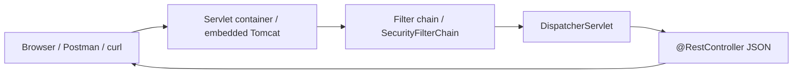

# Module 09 — Servlet vs Spring Interview Map

**Phase:** Backend (interview map — one session)

**Previous module:** [Lab: Deploy + Capstone Debug](07_Lab_Deploy_Capstone_Debug.md)  
**Next module:** [REST, DTOs, and Postman](04_REST_DTOs_Postman.md) (CORS + API recap — **point, do not rewrite** that file)

**Lab kit:** [15_Lab_Assets/19_spring_auth_tasks/](../15_Lab_Assets/19_spring_auth_tasks/) (what you **already shipped** — **do not** start kit 20)

---

**Teach order today:** what the map *is* → why interviews still say Servlet → oral request path → five contrasts → `jakarta.*` + JAR (module 01 mapped, not flipped).

---

## Prerequisites

- **Frozen kit 19 API** from [Lab: CRUD + Auth Consolidation](06_Lab_CRUD_Auth_Consolidation.md) and [Lab: Deploy + Capstone Debug](07_Lab_Deploy_Capstone_Debug.md) — JWT lite + catalog DTOs + Actuator health. JDK 17 + Maven 3.9+ + Spring Boot 3.x / `jakarta.*` ([Tested Toolchain](../Tested_Toolchain.md)).
- You can already run **`mvn spring-boot:run`** / **`java -jar`** and hit JSON with Postman. Today you **name the path**, not ship a new endpoint.

---

## Definition / Purpose

**Definition:** This **interview map** is a **one-session oral + written note**. It names how a Spring Boot request rides the **Servlet API** even when you never type `extends HttpServlet`. It is not a second framework track and not a new kit.

**Definition:** A **servlet** is a Java class the **servlet container** (here **embedded Tomcat** from `starter-web`) calls for HTTP. Spring MVC’s front controller is **`DispatcherServlet`** — itself a servlet. Filters (including Spring Security’s chain) run **before** that controller.

**Definition:** **Spring** (for this map) is the stack you already used: Boot auto-config, **`@RestController`** JSON, JPA, JWT lite. **Spring won** the junior hiring market because teams ship **one JAR**, **annotations**, and **starters** instead of a `web.xml` + JSP office app.

**Purpose:** Priya’s kit 19 demo is green. The interviewer asks “Have you done Servlets?” Ravi starts a blank `HttpServlet` project and misses the job. This session exists so you can say: **I ship Spring Boot REST on a servlet container; here is the path; here are five contrasts** — without rewriting Labs 06–07.

**Icons:** Bank · Order · Laptop · Employee · UPI

**Where used?**
- CampusCart / **TechMart** — JSON catalog you already shipped; interviews still ask “Servlet vs Spring”
- **SecureBank** — seniors say “filter chain” meaning the same Servlet filters under Boot
- **AcmeHR** — staff APIs on JAR + embedded Tomcat, not a WAR dropped into office Tomcat
- **MedCare** — public doctor list GET still hits `DispatcherServlet` after security filters
- Service-company JDs — copy “Servlets/JSP” from old syllabi while the desk work is Boot REST

**Visual — interview map (not a new app):**



**Key takeaways:**

- The map **names** the path — it does not start a Servlet/JSP course
- **`DispatcherServlet`** is a servlet; Boot registers it from `starter-web`
- Kit 19 **is** the proof — no new API this session
- This course stays **JAR + embedded Tomcat** and **`jakarta.*`**

---

## Motivation — Feel the pain of “Did you do Servlets?”

Ravi hears “Servlet” and opens a 2009 tutorial: `web.xml`, `javax.servlet`, a WAR for an external Tomcat. Priya already has CampusCart JSON, JWT POST, and `/actuator/health` on a Boot **JAR**. The interviewer wanted the **path**, not a second product.

```java
public class ServletJdPain {
    public static void main(String[] args) {
        System.out.println("JD says Servlet  —  desk work is Spring Boot REST");
        System.out.println("Do not start a web.xml homework app");
        System.out.println("Map kit 19: container -> filters -> DispatcherServlet -> JSON");
    }
}
```

**Expected Output:**

```
JD says Servlet  —  desk work is Spring Boot REST
Do not start a web.xml homework app
Map kit 19: container -> filters -> DispatcherServlet -> JSON
```

**Remember:** You already shipped the API. Today you **explain the floor it stands on**.

**Interview:** “Have you used Servlets?” → “I do not write `HttpServlet` in this course. Boot’s embedded Tomcat is a servlet container; `DispatcherServlet` is the front controller; Security filters run first.”

---

## Important Concepts

### 1. Why interviews still say Servlet

**Definition:** **Servlet** is the **Jakarta** (once Java EE) **HTTP contract**: request, response, filters, a container. Job descriptions and campus seniors grew up on that word. The **job** in this market is usually **Spring Boot** on that same contract.

**Purpose:** Without this sentence, you either freeze (“we skipped Servlets”) or you waste a week on JSP. Both miss hiring: **explain the floor, show the Boot API.**

| They say | They usually mean on this course |
|----------|----------------------------------|
| Servlet | Container + `DispatcherServlet` + filters |
| JSP | Old HTML-from-server track — we ship **JSON** (Thymeleaf was **overview only** in module 02) |
| Spring | Boot + MVC + (here) JPA + Security lite |
| Tomcat | Embedded inside the **JAR** (module 01), not a second install |

**Why Spring won (say this in one breath):** less `web.xml` / XML, **starters** instead of hand-picked JARs, **embedded Tomcat** so one artefact runs, REST JSON that React/`fetch` can consume (**Later —** CORS recap in module 04). The Servlet model did not disappear — Boot **sits on it**.

**Note:**
- Wrong: “We don’t use Servlets, so I cannot answer.”
- Wrong: starting Struts / JSF / a `web.xml` app to “cover the JD.”
- Prefer: “Servlet API is the container contract. I write `@RestController` on Boot 3.”

**Common Error:** Treating “Servlet interview” as a new GitHub repo. The map is **oral + five bullets**.

**Remember:** Buzzword ≠ extra lab. Kit 19 is the evidence.

**Try these (2 programs):**

**Program 1 — JD vs desk**

```java
public class JdVsDesk {
    public static void main(String[] args) {
        System.out.println("JD buzzword: Servlet / JSP");
        System.out.println("Desk work: Spring Boot REST on Tomcat");
        System.out.println("Proof: kit 19 JSON + JWT");
    }
}
```

**Expected Output:**

```
JD buzzword: Servlet / JSP
Desk work: Spring Boot REST on Tomcat
Proof: kit 19 JSON + JWT
```

**Program 2 — Not a second track**

```java
public class NotAServletCourse {
    public static void main(String[] args) {
        System.out.println("This session: interview map");
        System.out.println("Not: HttpServlet homework");
        System.out.println("Not: JSP / Struts / JSF");
    }
}
```

**Expected Output:**

```
This session: interview map
Not: HttpServlet homework
Not: JSP / Struts / JSF
```

---

### 2. Request path — oral map (not a servlet project)

**Definition:** The **request path** is the ordered ride of one HTTP call. For this course: **client** → **servlet container** (embedded Tomcat) → **filter chain** (`SecurityFilterChain` from module 05) → **`DispatcherServlet`** → your **`@RestController`** method → JSON back.

**Purpose:** Seniors ask “what happens after the browser hits `:8080`?” Listing annotations only is thin. Naming **container → filters → front controller → handler** proves you know Boot is not magic.

Copy-paste valid (sketch only — **do not** add this URL as Done when; kit 19 already has real mappings from [Spring Web REST](02_Spring_Web_REST.md)):

```java
package in.ksr.campusauth;

import jakarta.servlet.http.HttpServletRequest;
import java.util.Map;
import org.springframework.web.bind.annotation.GetMapping;
import org.springframework.web.bind.annotation.RestController;

@RestController
public class RequestPathSketch {

    @GetMapping("/interview/who")
    public Map<String, String> who(HttpServletRequest request) {
        return Map.of(
                "method", request.getMethod(),
                "uri", request.getRequestURI());
    }
}
```

You did **not** write `extends HttpServlet`. You still received **`jakarta.servlet.http.HttpServletRequest`** — the Servlet API under Boot 3. `DispatcherServlet` is **auto-configured** by `spring-boot-starter-web`; you do not declare it in `web.xml`.

Filter order (already taught — **do not rewrite** [Spring Security Lite](05_Spring_Security_Lite.md)): Security filters run **before** the MVC handler. Kit 19’s **`JwtAuthFilter`** uses `addFilterBefore(..., UsernamePasswordAuthenticationFilter.class)`. POST `/products` without Bearer dies as **401** on the chain; GET `/products` is `permitAll` and still goes through the container + `DispatcherServlet`.

**Note:**
- Wrong: “Spring replaces Tomcat” — Boot **embeds** Tomcat (module 01).
- Wrong: drawing CORS or React `fetch` on this map — that recap is **Later —** module 04.
- Prefer: same words every time: client → container → filters → `DispatcherServlet` → `@RestController`.

**Common Error:** Calling `DispatcherServlet` a `@RestController`. It is the **front controller servlet** that **finds** your controller method.

**Remember:** Oral map first. Code sketch is optional proof that `HttpServletRequest` is `jakarta.*`.

**Interview:** Where is `DispatcherServlet` in your project? You typically **do not** write the class. Boot’s web starter registers it on the embedded container.

**Try these (2 programs):**

**Program 1 — Say the path**

```java
public class OralPathPrint {
    public static void main(String[] args) {
        System.out.println("client");
        System.out.println("servlet container");
        System.out.println("filter chain");
        System.out.println("DispatcherServlet");
        System.out.println("@RestController");
    }
}
```

**Expected Output:**

```
client
servlet container
filter chain
DispatcherServlet
@RestController
```

**Program 2 — Front controller is a servlet**

```java
public class DispatcherIsAServlet {
    public static void main(String[] args) {
        System.out.println("DispatcherServlet extends HttpServlet");
        System.out.println("You write @GetMapping methods");
        System.out.println("Boot registers the front controller");
    }
}
```

**Expected Output:**

```
DispatcherServlet extends HttpServlet
You write @GetMapping methods
Boot registers the front controller
```

---

### 3. Five junior-realistic contrasts (homework contract)

**Definition:** The **five contrasts** are the written note this session asks for. Each line is **old Java web** vs **this course**. They are interview sentences, not a new product.

**Purpose:** Without a fixed five, learners ramble (“Spring is better”) or dump Wikipedia. Recruiters want **concrete** pairs you can defend from kit 19.

| # | Old / JD shape | This course |
|---|----------------|-------------|
| 1 | Servlet/JSP app (HTML pages, `doGet` / `.jsp`) | Spring Boot **REST** (`@RestController` JSON — module 02) |
| 2 | `web.xml` / XML bean files | **Annotations** + Boot **auto-config** (module 01 starters) |
| 3 | **External Tomcat** + **WAR** drop | **JAR** + **embedded Tomcat** (`java -jar` — module 01; Lab 07 host) |
| 4 | **`javax.*`** (Boot 2 / old Java EE) | **`jakarta.*`** (Boot 3 — module 01) |
| 5 | “I must write `HttpServlet`” | You **stand on** the Servlet API (`DispatcherServlet`, filters, `HttpServletRequest`) **without** writing `HttpServlet` in class |

**Kinds:** Contrast **1** is the **app shape** (HTML vs JSON API). Contrast **2** is **how you wire** URLs. Contrast **3** is **how you run** the artefact. Contrast **4** is **package names** on the same ideas. Contrast **5** is the **trap**: skipping Servlets in the timetable does **not** mean the API vanished.

**Note:**
- Wrong: a sixth bullet that starts CORS, OAuth2, or Docker — out of window.
- Wrong: flipping Done when to “build a WAR for office Tomcat.”
- Prefer: five short sentences you can read aloud in under a minute.

**Common Error:** Writing “Spring does not use Servlets.” Contrast 5 exists to stop that.

**Remember:** Homework is **five bullets**, oral + written. No new endpoint.

**Where used?** Same five lines work for CampusCart, TechMart catalog, AcmeHR staff API, MedCare list, SecureBank ping — the **path** does not change.

**Try these (2 programs):**

**Program 1 — Five labels**

```java
public class FiveContrastLabels {
    public static void main(String[] args) {
        System.out.println("1 Servlet-JSP vs Boot REST");
        System.out.println("2 web.xml vs annotations plus auto-config");
        System.out.println("3 WAR plus external Tomcat vs JAR plus embedded");
        System.out.println("4 javax vs jakarta");
        System.out.println("5 still Servlet API without HttpServlet class");
    }
}
```

**Expected Output:**

```
1 Servlet-JSP vs Boot REST
2 web.xml vs annotations plus auto-config
3 WAR plus external Tomcat vs JAR plus embedded
4 javax vs jakarta
5 still Servlet API without HttpServlet class
```

**Program 2 — XML vs annotations one-liners**

```java
public class WebXmlVsAnnotations {
    public static void main(String[] args) {
        System.out.println("Old: servlet-mapping in web.xml");
        System.out.println("Now: @GetMapping on @RestController");
        System.out.println("Boot auto-config from starter-web");
    }
}
```

**Expected Output:**

```
Old: servlet-mapping in web.xml
Now: @GetMapping on @RestController
Boot auto-config from starter-web
```

---

### 4. `jakarta.*` and JAR — map module 01 (do not flip to WAR)

**Definition:** **`jakarta.*`** is the Boot 3 package family for servlet types (`jakarta.servlet`). **`javax.servlet`** is Boot 2 / old Java EE — it **will not compile** on this parent. **JAR + embedded Tomcat** is how this course **runs** the API (`mvn spring-boot:run` / `java -jar`). **WAR + external Tomcat** is interview trivia for older hosts.

**Purpose:** Module 01 already taught both facts. This map **reuses** them as two of the five contrasts. Lab 07 deployed the **same JAR**. Flipping the batch to WAR would undo Setup and Deploy.

Point back — **do not rewrite:** [Maven and Spring Boot Setup](01_Maven_and_Spring_Boot_Setup.md) (`jakarta.servlet` vs `javax.servlet`, JAR vs WAR lite). Lab 07: JAR is Done when; WAR is not.

**Note:**
- Wrong: `import javax.servlet.http.HttpServletRequest` on Boot 3.
- Wrong: “Done when we have a WAR.” This course **ships JAR**.
- Prefer: mention WAR in the **oral** contrast, keep homework on the JAR you already built.

**Common Error:** Copy-pasting a Boot 2 Security filter sample with `javax.servlet.Filter`. Kit 19 is `jakarta.*`.

**Remember:** Package rename ≠ new lab. Same request objects, new package.

**Interview:** Did you deploy a WAR? **No** — `java -jar` with embedded Tomcat. I can **explain** WAR if an office still uses external Tomcat.

**Try these (2 programs):**

**Program 1 — Package names**

```java
public class JakartaNotJavaxMap {
    public static void main(String[] args) {
        System.out.println("Boot 2 / Java EE: javax.servlet");
        System.out.println("Boot 3 / Jakarta:  jakarta.servlet");
        System.out.println("Wrong import = cannot find symbol");
    }
}
```

**Expected Output:**

```
Boot 2 / Java EE: javax.servlet
Boot 3 / Jakarta:  jakarta.servlet
Wrong import = cannot find symbol
```

**Program 2 — This course ships JAR**

```java
public class CourseShipsJar {
    public static void main(String[] args) {
        System.out.println("JAR: java -jar app.jar (embedded Tomcat)");
        System.out.println("WAR: copy into external Tomcat (older host)");
        System.out.println("This course: JAR — do not flip Done when");
    }
}
```

**Expected Output:**

```
JAR: java -jar app.jar (embedded Tomcat)
WAR: copy into external Tomcat (older host)
This course: JAR — do not flip Done when
```

---

## Step-by-Step Annotated Java Code

No new Boot app in git. Open **[kit 19](../15_Lab_Assets/19_spring_auth_tasks/)** only to **point** at mappings you already froze. JDK 17. Plain `main` demos below compile with `javac`. Spring sketches above are copy-paste valid on the **existing** Boot 3 tree — do not require a new Initializr project.

### Step 1: Trace a public GET on the oral map

**Definition:** `GET /products` on kit 19 is **permitAll** (module 05). It still enters **Tomcat**, still passes the **filter chain**, still hits **`DispatcherServlet`**, still lands on a **`@GetMapping`** that returns a DTO list (modules 02–04).

**Purpose:** Learners think “public means no Servlet.” Public means **no JWT required** — not “skip the container.”

```java
public class TracePublicGet {
    public static void main(String[] args) {
        System.out.println("GET /products");
        System.out.println("container yes");
        System.out.println("filters yes (permitAll)");
        System.out.println("DispatcherServlet yes");
        System.out.println("JSON list 200");
    }
}
```

**Expected Output:**

```
GET /products
container yes
filters yes (permitAll)
DispatcherServlet yes
JSON list 200
```

**Note:**
- Wrong: “GET skips `DispatcherServlet`.”
- Prefer: same path as POST; AuthZ result differs.

**Try these (2 programs):**

**Program 1 — GET still uses the path**

```java
public class GetStillUsesPath {
    public static void main(String[] args) {
        System.out.println("Public GET is not a JSP page");
        System.out.println("Public GET is Boot REST JSON");
    }
}
```

**Expected Output:**

```
Public GET is not a JSP page
Public GET is Boot REST JSON
```

**Program 2 — Point at module 02**

```java
public class PointAtRestNotes {
    public static void main(String[] args) {
        System.out.println("@GetMapping already taught");
        System.out.println("Do not rewrite Spring Web REST");
    }
}
```

**Expected Output:**

```
@GetMapping already taught
Do not rewrite Spring Web REST
```

---

### Step 2: Trace a protected POST (filters then controller)

**Definition:** `POST /products` needs **`Authorization: Bearer …`**. Module 05’s **`SecurityFilterChain`** + kit 19’s **`JwtAuthFilter`** run **before** the controller. Fail → **401**. Pass → `DispatcherServlet` → `@PostMapping` → **201** DTO.

**Purpose:** This is the best live proof that “Servlet filters” are not a history chapter. You already watched 401 vs 201 in Lab 06.

Do **not** paste a second `SecurityFilterChain` here — copy from [Spring Security Lite](05_Spring_Security_Lite.md) if you need the bean. Today you only **order** the boxes.

```java
public class TraceProtectedPost {
    public static void main(String[] args) {
        System.out.println("POST /products");
        System.out.println("JwtAuthFilter then UsernamePasswordAuthenticationFilter");
        System.out.println("no Bearer -> 401");
        System.out.println("Bearer ok -> DispatcherServlet -> 201");
    }
}
```

**Expected Output:**

```
POST /products
JwtAuthFilter then UsernamePasswordAuthenticationFilter
no Bearer -> 401
Bearer ok -> DispatcherServlet -> 201
```

**Note:**
- Wrong: reteaching BCrypt / JWT parse in this file.
- Wrong: adding CORS headers on the chain today.
- Prefer: “filters first, then `DispatcherServlet`.”

**Interview:** Is Spring Security a servlet? The **filters** are servlet filters. The **DSL** is `SecurityFilterChain` (Boot 3). You already configured it.

**Try these (2 programs):**

**Program 1 — Filter then MVC**

```java
public class FilterThenMvc {
    public static void main(String[] args) {
        System.out.println("SecurityFilterChain first");
        System.out.println("DispatcherServlet second");
        System.out.println("@RestController third");
    }
}
```

**Expected Output:**

```
SecurityFilterChain first
DispatcherServlet second
@RestController third
```

**Program 2 — What you already shipped**

```java
public class AlreadyShippedKit19 {
    public static void main(String[] args) {
        System.out.println("kit 19: GET list public");
        System.out.println("kit 19: POST needs JWT");
        System.out.println("kit 19: JAR plus health in Lab 07");
    }
}
```

**Expected Output:**

```
kit 19: GET list public
kit 19: POST needs JWT
kit 19: JAR plus health in Lab 07
```

---

### Step 3: Draft the five bullets (homework preview)

**Definition:** The take-home is a **written note** you can read aloud. No new mapping, no kit 20, no `web.xml` file.

**Purpose:** Class time is the oral map. Homework is the **same five contrasts** in your words, with kit 19 as the example.

```java
public class FiveBulletsDraft {
    public static void main(String[] args) {
        System.out.println("Servlet-JSP HTML vs Boot REST JSON");
        System.out.println("web.xml XML vs annotations plus auto-config");
        System.out.println("external Tomcat WAR vs JAR embedded Tomcat");
        System.out.println("javax vs jakarta");
        System.out.println("still Servlet API without writing HttpServlet");
    }
}
```

**Expected Output:**

```
Servlet-JSP HTML vs Boot REST JSON
web.xml XML vs annotations plus auto-config
external Tomcat WAR vs JAR embedded Tomcat
javax vs jakarta
still Servlet API without writing HttpServlet
```

**Note:**
- Wrong: submitting a new GitHub Boot app “for the Servlet map.”
- Prefer: a `.txt` / README section / notebook with **five lines** plus “I pointed at kit 19.”

**Try these (2 programs):**

**Program 1 — Out of this session**

```java
public class OutOfServletMap {
    public static void main(String[] args) {
        System.out.println("No CORS rewrite");
        System.out.println("No capstone M1 M2 M3");
        System.out.println("No kit 20 / no Servlet lab folder");
    }
}
```

**Expected Output:**

```
No CORS rewrite
No capstone M1 M2 M3
No kit 20 / no Servlet lab folder
```

**Program 2 — Why Spring won (one breath)**

```java
public class WhySpringWon {
    public static void main(String[] args) {
        System.out.println("annotations and starters beat web.xml");
        System.out.println("one JAR with embedded Tomcat");
        System.out.println("REST JSON for modern clients");
        System.out.println("still the Servlet container underneath");
    }
}
```

**Expected Output:**

```
annotations and starters beat web.xml
one JAR with embedded Tomcat
REST JSON for modern clients
still the Servlet container underneath
```

---

## Practice Exercises

*(Each Practice item includes a filled **Model answer:** and **Expected Output:** where the demo prints.)*

### Basic

1. Print the five boxes of the oral path in order.

   **Model answer:**

```java
public class PracticeOralPath {
    public static void main(String[] args) {
        System.out.println("client");
        System.out.println("servlet container");
        System.out.println("filter chain");
        System.out.println("DispatcherServlet");
        System.out.println("@RestController");
    }
}
```

   **Expected Output:**

```
client
servlet container
filter chain
DispatcherServlet
@RestController
```

2. Print this course’s artefact (JAR vs WAR).

   **Model answer:**

```java
public class PracticeCourseJar {
    public static void main(String[] args) {
        System.out.println("This course ships JAR");
        System.out.println("embedded Tomcat");
        System.out.println("not WAR homework");
    }
}
```

   **Expected Output:**

```
This course ships JAR
embedded Tomcat
not WAR homework
```

3. Print Boot 3 servlet package vs old package.

   **Model answer:**

```java
public class PracticeJakartaLine {
    public static void main(String[] args) {
        System.out.println("jakarta.servlet");
        System.out.println("not javax.servlet");
    }
}
```

   **Expected Output:**

```
jakarta.servlet
not javax.servlet
```

4. Name the kit you point at (no new API).

   **Model answer:**

```java
public class PracticePointKit19 {
    public static void main(String[] args) {
        System.out.println("kit 19 already shipped");
        System.out.println("no kit 20 this session");
    }
}
```

   **Expected Output:**

```
kit 19 already shipped
no kit 20 this session
```

### Intermediate

1. GET `/products` vs POST `/products` on the **same** path map.

   **Model answer:** Both enter the container, filters, and `DispatcherServlet`. GET is `permitAll` → 200 JSON list. POST without Bearer → 401 on the filter chain; with Bearer → 201 DTO. Do not rewrite Security notes.

2. Why is `DispatcherServlet` not in your `web.xml`?

   **Model answer:** This course has **no** `web.xml`. `spring-boot-starter-web` **auto-configures** the front controller on embedded Tomcat (module 01).

3. Write contrast 5 in one sentence.

   **Model answer:**

```java
public class PracticeContrastFive {
    public static void main(String[] args) {
        System.out.println("I stand on the Servlet API without writing HttpServlet");
    }
}
```

   **Expected Output:**

```
I stand on the Servlet API without writing HttpServlet
```

4. What is out of this session?

   **Model answer:**

```java
public class PracticeOutOfWindow {
    public static void main(String[] args) {
        System.out.println("CORS React fetch");
        System.out.println("capstone M1-M3");
        System.out.println("Struts JSF OAuth2 Docker");
    }
}
```

   **Expected Output:**

```
CORS React fetch
capstone M1-M3
Struts JSF OAuth2 Docker
```

### Interview-Oriented

1. Why do interviews still say Servlet?

   **Model answer:** Servlet is the container **contract** (request, response, filters). JDs and seniors keep the word. The desk job here is Spring Boot REST on that contract.

2. What is `DispatcherServlet`?

   **Model answer:** Spring MVC’s **front controller servlet**. It maps the URL to a handler (`@RestController` method). Boot registers it; you do not write the class in this course.

3. Does Spring replace the Servlet API?

   **Model answer:** No. Boot **embeds** a servlet container and uses `DispatcherServlet` plus filters. You rarely extend `HttpServlet` yourself.

4. `javax.*` vs `jakarta.*`?

   **Model answer:** Boot 3 / Jakarta uses `jakarta.servlet`. Boot 2 used `javax.*`. Wrong import does not compile. Already taught in module 01.

5. JAR or WAR?

   **Model answer:** **JAR** + embedded Tomcat. WAR + external Tomcat is an older host story — mention it, do not change Done when.

6. Why did Spring win (junior-realistic)?

   **Model answer:** Annotations + auto-config instead of heavy `web.xml` / XML; one **JAR**; starters (web, data-jpa, security, actuator); REST JSON for modern clients — still on a servlet container.

---

## Mini-Project (Assignment): Five Servlet vs Spring Comparison Bullets

**Lab kit:** [15_Lab_Assets/19_spring_auth_tasks/](../15_Lab_Assets/19_spring_auth_tasks/) — **point only**. Do **not** add endpoints. Do **not** create kit 20. Do **not** add a folder under `15_Lab_Assets/` for Servlets.

This assignment is the **interview note**, not a product build. CampusCart / TechMart JSON you already shipped is the example. Write five bullets. Say the oral path. No new API.

### What to build

| Piece | Detail |
|-------|--------|
| Oral map | Client → servlet container (embedded Tomcat) → filter chain / `SecurityFilterChain` → `DispatcherServlet` → `@RestController` |
| Bullet 1 | Servlet/JSP app vs Spring Boot REST JSON (modules 02 + kit 19) |
| Bullet 2 | `web.xml` / XML vs annotations + Boot auto-config (module 01) |
| Bullet 3 | External Tomcat + WAR vs **JAR + embedded Tomcat** (module 01; Lab 07 JAR — **do not flip** to WAR) |
| Bullet 4 | `javax.*` vs **`jakarta.*`** (Boot 3) |
| Bullet 5 | You still stand on the Servlet API even when you never write `HttpServlet` in class |
| Proof | Name kit 19 (GET public, POST JWT, JAR / health) as “what I already shipped” |
| Format | Short written note (README section, `.txt`, or notebook). **No** new Boot app in git |

### Stretch

- Record a **60-second** oral (phone is enough) of the path + why Spring won.
- Add one sentence: Thymeleaf was **overview only** (module 02) — not a JSP track.
- Draw the mermaid path from memory on paper.
- **Later —** CORS recap in [REST, DTOs, and Postman](04_REST_DTOs_Postman.md). **Later —** capstone M1–M3. **Later —** kit 20 is JUnit week.

### Done when

- [ ] Oral: you can say the request path without notes
- [ ] Written: **five comparison bullets** matching the table above (your words, same facts)
- [ ] You name **kit 19** as the shipped API — no new mapping, no new kit
- [ ] JAR + embedded Tomcat; `jakarta.*`; WAR / `web.xml` mentioned only as contrast
- [ ] No `HttpServlet` homework class, no JSP/Struts/JSF, no CORS rewrite, no M1–M3, no Docker/K8s
- [ ] No Lombok required; no OAuth2 / refresh tokens / admin-role matrix

---

## Interview Q&A

Shared with students after concepts and the mini-project. Use for review and interview prep — questions and model answers are included.

**Q1. What is this session for?**  
**A:** An **interview map**: why JDs say Servlet, the request path, five contrasts. Not a Servlets/JSP course and not a third Boot lab.

**Q2. Have you used Servlets?**  
**A:** I do not write `extends HttpServlet` here. Spring Boot runs on a **servlet container** (embedded Tomcat). `DispatcherServlet` is a servlet. Security uses **servlet filters**. I stand on that API.

**Q3. What is a servlet container?**  
**A:** The process that accepts HTTP and calls servlets/filters. In this course it is **embedded Tomcat** inside the Boot **JAR** (module 01).

**Q4. What is `DispatcherServlet`?**  
**A:** Spring MVC’s **front controller**. It dispatches to `@RestController` methods. Boot’s `starter-web` registers it. I do not put it in `web.xml`.

**Q5. Walk through `GET /products`.**  
**A:** Client → embedded Tomcat → filter chain (`permitAll`) → `DispatcherServlet` → `@GetMapping` → JSON 200 (kit 19).

**Q6. Walk through `POST /products` without a token.**  
**A:** Same container. `SecurityFilterChain` / `JwtAuthFilter` reject anonymous POST → **401** before a successful create. Taught in module 05 / Lab 06.

**Q7. Servlet/JSP vs Spring Boot REST?**  
**A:** Old shape: `HttpServlet` / JSP pages, often HTML. This course: `@RestController` JSON for CampusCart / TechMart. Thymeleaf was one overview page, not the backbone.

**Q8. `web.xml` vs Boot?**  
**A:** Old apps listed servlets and filters in `web.xml` (plus XML beans). We use **annotations** and **auto-configuration** from starters. No `web.xml` homework.

**Q9. JAR vs WAR?**  
**A:** **JAR** + embedded Tomcat (`java -jar`). WAR is for an **external** Tomcat. This course **ships JAR**. Do not flip Done when.

**Q10. `javax.*` vs `jakarta.*`?**  
**A:** Boot 3 uses Jakarta (`jakarta.servlet…`). Boot 2 used `javax.*`. Copy-paste the old import → cannot find symbol (module 01).

**Q11. Why did Spring win?**  
**A:** Less XML, starters, one runnable JAR, REST JSON hiring — still on the Servlet model so it was an evolution, not a different internet.

**Q12. Did you build a Servlet project?**  
**A:** No. Proof is kit 19 + the five-bullet note. A `web.xml` app would be the wrong twin of this map.

**Q13. Is `SecurityFilterChain` a servlet?**  
**A:** It **configures servlet filters**. Filter **order** is module 05. Today we only place that box **before** `DispatcherServlet`.

**Q14. Where are JPA and REST notes?**  
**A:** In `09_Spring_Boot/` modules 02–04. [`10_JPA_and_REST/`](../10_JPA_and_REST/README.md) is a **pointer**, not a second copy.

**Q15. What comes next?**  
**A:** CORS + API recap in [REST, DTOs, and Postman](04_REST_DTOs_Postman.md) (existing file — do not treat it as a new CORS textbook). Capstone M1–M3 and React stay **Later —**.

---

## Next

Keep kit 19 as the API. Homework is the **five comparison bullets** (oral + written). Continue with **[REST, DTOs, and Postman](04_REST_DTOs_Postman.md)** for the **CORS + API recap** — **point at that file; do not rewrite it**. Capstone M1–M3, kit 20, React / FRONTEND rewrites, and a Servlet lab stay **Later —**.
