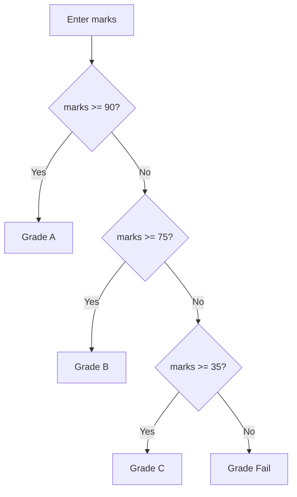

# Module: Flow Control

**Duration:** See [Session Calendar](../00_Course_Guide/11_Session_Calendar_100.md) — live classes are **1h 15m** each (+ homework). | **Phase:** Core Python  

**Previous module:** Variables Datatypes Operators IO
**Next module:** Strings

---

## Learning Outcomes

By the end of this module, learners will be able to:

- Write conditional logic using `if`, `elif`, and `else`
- Implement `for` and `while` loops with `range()`
- Use `break` and `continue` to control loop flow
- Build nested menu-driven CLI apps (ATM, student portal, task manager)
- Choose the right loop type for a given problem
- Avoid infinite loops and indentation errors
- Trace program flow with simple diagrams

---

## Classroom Ticket

Open the lab kit **before** long notes. Read the ticket → code in `starter/` or fix `broken/`.

- **[Mini ATM menu that must not crash/exit wrongly](../15_Lab_Assets/08_atm_menu/)**

Finish the ticket in class; compare with the official solution only when your trainer says so.

### Why flow control?

Programs rarely run in one straight line. A **student portal** must check login, an **ATM** repeats until user exits, and a **task manager** loops through tasks.

**Flow control** lets you:

- **Decide** — run code only when a condition is true (`if`)
- **Repeat** — run code many times (`for`, `while`)
- **Jump** — leave early (`break`) or skip one round (`continue`)

### if / elif / else

```python
marks = int(input("Enter marks: "))

if marks >= 90:
    grade = "A"
elif marks >= 75:
    grade = "B"
elif marks >= 35:
    grade = "C"
else:
    grade = "Fail"

print(f"Grade: {grade}")
```

**Rules:**

- Colon `:` after condition
- Indented block (usually 4 spaces) — **indentation is syntax in Python**
- `elif` = else if; `else` catches everything not matched above

**Visual — how Python chooses a branch (student grades):**



Only **one** box on the right runs — the first `True` condition wins; `else` is the last safety net.

### for loop

Use when you know **how many times** or want to visit **each item**.

```python
for i in range(1, 6):      # 1, 2, 3, 4, 5
    print(f"Task {i}: pending")
```

### while loop

Use when repetition depends on a **condition** staying true.

```python
pin = ""
while pin != "1234":
    pin = input("Enter PIN: ")
print("Access granted")
```

### range()

```python
range(5)        # 0, 1, 2, 3, 4
range(2, 8)     # 2, 3, 4, 5, 6, 7  — stop excluded
range(0, 10, 2) # 0, 2, 4, 6, 8
```

### break and continue

```python
for n in range(1, 11):
    if n == 5:
        continue    # skip printing 5
    if n == 8:
        break       # stop loop entirely
    print(n)
# prints 1 2 3 4 6 7
```

### Menu pattern (ATM / portals)

Most CLI apps in training use:

```
while True:
    show menu
    read choice
    if choice == 1: do action
    elif choice == 2: do action
    elif choice == 0: break
    else: invalid
```

This is the skeleton for ATM, expense tracker, and task manager projects.

---

## Important Concepts and Definitions

| Term               | Definition                                    |
| ------------------ | --------------------------------------------- |
| **Condition**      | Boolean expression controlling branch or loop |
| **Branch**         | One path of if/elif/else                      |
| **Iteration**      | One execution of loop body                    |
| **Infinite loop**  | Loop condition never becomes false            |
| **Sentinel value** | Special input meaning "stop" (e.g. 0 to exit) |
| **Nested loop**    | Loop inside another loop                      |
| **Control flow**   | Order in which statements execute             |
| **Block**          | Indented group of statements                  |
| **Loop variable**  | Variable receiving each value in for-loop     |

**Flowchart symbols (text):**

```
Decision:  <condition?> ----yes----> [action]
              |
             no
              |
           [other action]
```

---

## Step-by-Step Notes (With Annotated Code)

### Step 1: Pass/fail — student management

```python
# pass_fail.py

marks = float(input("Enter final marks (out of 100): "))

if marks < 0 or marks > 100:
    print("Invalid marks entered.")
elif marks >= 35:
    print(f"Pass — scored {marks}")
else:
    print(f"Fail — scored {marks}. Minimum is 35.")
```

Note: `or` combines invalid range checks.

**Note:**
- Wrong: Missing colon (`if x > 5`), inconsistent indentation, or putting `elif` after `else`.
- Prefer: `if x > 5:` with 4 spaces; order is if → elif → else (else last).
- Wrong: Leaving an empty block under `if`/`else`.
- Prefer: Use `pass` as a placeholder when needed.


**Try these (2 programs):**

**Program 1 — Pass / Fail with range check**

```python
marks = 72
if marks < 0 or marks > 100:
    print("Invalid marks")
elif marks >= 35:
    print("Pass")
else:
    print("Fail")
```

**Program 2 — Minor / Adult / Senior**

```python
age = 62
if age < 18:
    print("Minor")
elif age < 60:
    print("Adult")
else:
    print("Senior")
```

### Step 2: Employee login (simplified)

```python
# login_demo.py — hard-coded credentials for lab only

VALID_USER = "admin"
VALID_PASS = "secret123"

username = input("Username: ")
password = input("Password: ")

if username == VALID_USER and password == VALID_PASS:
    print("Welcome to Employee Portal")
else:
    print("Invalid credentials. Contact HR.")
```

**Note:**
- Wrong: Using `=` when you meant to compare — logic always wrong or SyntaxError.
- Prefer: `==` to compare, `=` to assign.


**Try these (2 programs):**

**Program 1 — Simple login check**

```python
username = "priya"
password = "ksr123"
entered_user = "priya"
entered_pass = "ksr123"
if entered_user == username and entered_pass == password:
    print("Welcome")
else:
    print("Invalid")
```

**Program 2 — Separate username and PIN checks**

```python
username = "priya"
pin = "4321"
entered_user = "priya"
entered_pin = "0000"
if entered_user != username:
    print("Username failed")
elif entered_pin != pin:
    print("PIN failed")
else:
    print("Welcome")
```

### Step 3: for loop — multiplication table

```python
n = int(input("Table for which number? "))
print(f"--- Multiplication table of {n} ---")

for i in range(1, 11):
    print(f"{n} x {i} = {n * i}")
```

**Note:**
- Wrong: Off-by-one with `range` (loop one short or one long).
- Prefer: Remember the stop value is exclusive (`range(1, 11)` → 1…10).


**Try these (2 programs):**

**Program 1 — Table of 7**

```python
for i in range(1, 11):
    print(f"7 x {i} = {7 * i}")
```

**Program 2 — Even numbers 2 to 20**

```python
for n in range(2, 21, 2):
    print(n, end=" ")
print()
```

### Step 4: while loop — PIN retries (max 3)

```python
CORRECT_PIN = "4321"
attempts = 0
max_attempts = 3

while attempts < max_attempts:
    pin = input("Enter ATM PIN: ")
    if pin == CORRECT_PIN:
        print("PIN accepted.")
        break
    else:
        attempts += 1
        remaining = max_attempts - attempts
        print(f"Wrong PIN. {remaining} attempt(s) left.")
else:
    # while-else: runs if loop ended without break
    print("Card blocked. Visit branch.")
```

**Note:**
- Wrong: Infinite `while` — the condition never moves toward exit.
- Prefer: Ensure a variable in the condition changes (counter, flag, or `break`).


**Try these (2 programs):**

**Program 1 — PIN retries with while-else**

```python
CORRECT_PIN = "2580"
attempts = ["1111", "2222", "2580"]  # demo tries
i = 0
while i < 3:
    pin = attempts[i]
    i += 1
    if pin == CORRECT_PIN:
        print("Access granted")
        break
else:
    print("Card blocked")
```

**Program 2 — Accept positive amount**

```python
amounts = [-50, 0, 250]  # demo inputs until positive
for amount in amounts:
    if amount > 0:
        print(f"Accepted: ₹{amount}")
        break
```

### Step 5: continue — skip invalid expenses

```python
total = 0
for _ in range(3):   # _ means "I don't need loop variable name"
    amt_str = input("Expense amount: ")
    if not amt_str.replace(".", "", 1).isdigit():
        print("Skipped invalid entry.")
        continue
    total += float(amt_str)

print(f"Valid expense total: ₹{total:.2f}")
```

**Try these (2 programs):**

**Program 1 — Sum valid expenses with continue**

```python
raw = ["120", "abc", "85.5", "xx", "40"]
total = 0.0
for item in raw:
    # String check now; try/except comes in Exceptions week
    if not item.replace(".", "", 1).isdigit():
        continue
    total += float(item)
print(f"Sum of valid amounts: ₹{total}")
```

**Program 2 — Skip multiples of 3**

```python
for n in range(1, 16):
    if n % 3 == 0:
        continue
    print(n, end=" ")
print()
```

### Step 6: Nested if — task priority

```python
priority = int(input("Priority (1=high, 3=low): "))
hours = float(input("Estimated hours: "))

if priority == 1:
    if hours > 8:
        print("Split high-priority task across days.")
    else:
        print("Schedule today.")
elif priority == 2:
    print("Schedule this week.")
else:
    print("Backlog.")
```

**Try these (2 programs):**

**Program 1 — Nested Distinction / Pass / Fail**

```python
marks = 82
if marks >= 35:
    if marks >= 75:
        print("Distinction")
    else:
        print("Pass")
else:
    print("Fail")
```

**Program 2 — Nested withdraw check**

```python
balance = 5000
amount = 1200
if amount > 0:
    if amount <= balance:
        print("Withdrawal allowed")
    else:
        print("Insufficient funds")
else:
    print("Invalid amount")
```

### Step 7: ATM menu skeleton (full pattern)

```python
# atm_menu.py — simplified balance demo

balance = 5000.0

while True:
    print("\n===== ATM MENU =====")
    print("1. Check Balance")
    print("2. Deposit")
    print("3. Withdraw")
    print("0. Exit")
    choice = input("Choose option: ")

    if choice == "1":
        print(f"Balance: ₹{balance:.2f}")

    elif choice == "2":
        amount = float(input("Deposit amount: "))
        if amount > 0:
            balance += amount
            print("Deposit successful.")
        else:
            print("Amount must be positive.")

    elif choice == "3":
        amount = float(input("Withdraw amount: "))
        if amount <= 0:
            print("Invalid amount.")
        elif amount > balance:
            print("Insufficient balance.")
        else:
            balance -= amount
            print(f"Withdrawn ₹{amount:.2f}. New balance: ₹{balance:.2f}")

    elif choice == "0":
        print("Thank you. Remove card.")
        break

    else:
        print("Invalid choice. Try again.")
```

**Note:**
- Wrong: Comparing menu `input()` to an int (`choice == 1`) when choice is still a string.
- Prefer: Compare strings (`choice == "1"`) or convert deliberately with `int(choice)`.


**Try these (2 programs):**

**Program 1 — ATM deposit / withdraw demo**

```python
balance = 5000
balance += 1000
print(f"After deposit: ₹{balance}")
withdraw = 2000
if withdraw <= balance:
    balance -= withdraw
    print(f"After withdraw: ₹{balance}")
overdraft = 10000
if overdraft > balance:
    print("Overdraft blocked")
print(f"Final balance: ₹{balance}")
```

**Program 2 — Track last action**

```python
balance = 5000
last_action = "None"
balance += 500
last_action = "Deposited ₹500"
balance -= 200
last_action = "Withdrew ₹200"
print(f"Balance: ₹{balance}")
print(f"Last action: {last_action}")
```

### Step 8: Task manager menu (add + list)

```python
# task_manager_v1.py

tasks = []   # list comes in detail later — accept for now

while True:
    print("\n--- Task Manager ---")
    print("1. Add task")
    print("2. List tasks")
    print("0. Exit")
    choice = input("Option: ")

    if choice == "1":
        title = input("Task title: ")
        if title.strip():          # strip() preview — strings module
            tasks.append(title)
            print("Task added.")
        else:
            print("Title cannot be empty.")

    elif choice == "2":
        if not tasks:
            print("No tasks yet.")
        else:
            print("Your tasks:")
            for index, task in enumerate(tasks, start=1):
                print(f"  {index}. {task}")

    elif choice == "0":
        break

    else:
        print("Invalid option.")
```

**Try these (2 programs):**

**Program 1 — Delete last task with pop**

```python
tasks = ["Login page", "API", "Deploy"]
if tasks:
    cancelled = tasks.pop()
    print(f"Deleted: {cancelled}")
print("Remaining:", tasks)
```

**Program 2 — Mini student portal (demo actions)**

```python
names = []
actions = [("1", "Priya"), ("1", ""), ("1", "Ravi"), ("2", None), ("0", None)]
for choice, value in actions:
    if choice == "1":
        if value and value.strip():
            names.append(value.strip())
            print(f"Added: {value.strip()}")
        else:
            print("Blank name rejected")
    elif choice == "2":
        print("Names:", names)
    elif choice == "0":
        print("Exit")
        break
```

---

## Practice Exercises

### Basic

1. Print whether a number is even or odd (`n % 2 == 0`).

   **Model answer:**

   ```python
   n = int(input("Number: "))
   if n % 2 == 0:
       print("Even")
   else:
       print("Odd")
   ```

2. Print numbers 1 to 20 using `for` and `range`.

   **Model answer:**

   ```python
   for i in range(1, 21):
       print(i)
   ```

3. Sum numbers 1 to 100 using a loop.

   **Model answer:**

   ```python
   total = 0
   for i in range(1, 101):
       total += i
   print(total)  # 5050
   ```

4. Ask age; print "Minor" if `< 18` else "Adult".

   **Model answer:**

   ```python
   age = int(input("Age: "))
   if age < 18:
       print("Minor")
   else:
       print("Adult")
   ```

### Intermediate

1. Grade calculator: marks → A/B/C/Fail with `elif` chain.

   **Model answer:**

   ```python
   marks = int(input("Marks (0-100): "))
   if marks >= 90:
       print("Grade: A")
   elif marks >= 75:
       print("Grade: B")
   elif marks >= 50:
       print("Grade: C")
   else:
       print("Fail")
   ```

2. Number guessing: hard-code secret; 5 attempts with while; hints higher/lower.

   **Model answer:**

   ```python
   secret = 7
   attempts = 0
   while attempts < 5:
       guess = int(input("Guess (1-10): "))
       attempts += 1
       if guess == secret:
           print("Correct!")
           break
       elif guess < secret:
           print("Higher")
       else:
           print("Lower")
   else:
       print("Out of attempts. Secret was", secret)
   ```

3. Expense menu: add expense, show total, exit — use while True.

   **Model answer:**

   ```python
   total = 0.0
   while True:
       print("1 Add expense  2 Show total  3 Exit")
       choice = input("Choice: ")
       if choice == "1":
           amount = float(input("Amount ₹: "))
           total += amount
           print("Added.")
       elif choice == "2":
           print(f"Total: ₹{total:.2f}")
       elif choice == "3":
           print("Bye")
           break
       else:
           print("Invalid choice")
   ```

4. Print multiplication table only for even multipliers 2–10.

   **Model answer:**

   ```python
   n = int(input("Table for: "))
   for m in range(2, 11, 2):
       print(f"{n} x {m} = {n * m}")
   ```

### Interview-Oriented

1. When use `for` vs `while`?

   **Model answer:** Use **`for`** when you know the sequence or count upfront (`range`, list items, string chars). Use **`while`** when you loop until a condition changes — menus, retries, “keep going until user exits,” reading until sentinel. Prefer `for` when either works cleanly; use `while` for open-ended control.

2. What does `break` do inside nested loops? (Only innermost loop unless labeled — Python has no goto.)

   **Model answer:** `break` exits only the **innermost** loop that contains it. Outer loops keep running. Python has no labeled break like some languages; to exit multiple levels, use a flag, `return` (once you know functions), or restructure.

3. Write pseudocode for ATM withdraw with insufficient funds check.

   **Model answer:**

   ```
   balance = 10000
   read amount
   IF amount <= 0:
     show "Invalid amount"
   ELSE IF amount > balance:
     show "Insufficient funds"
   ELSE:
     balance = balance - amount
     show "Withdrawn", amount, "New balance", balance
   ```

4. Explain while-else construct with PIN example.

   **Model answer:** A `while` loop’s `else` runs when the loop ends **normally** (condition becomes false) — **not** when you `break` out. PIN example: loop up to 3 attempts; on correct PIN `break`; if all attempts fail without break, `else` prints “Card blocked.”

   ```python
   pin = "1234"
   attempts = 0
   while attempts < 3:
       entered = input("PIN: ")
       attempts += 1
       if entered == pin:
           print("Access granted")
           break
   else:
       print("Card blocked")
   ```

---

## Mini-Project: ATM Simulator (Console)

**Title:** Console ATM with balance + mini statement  
**Lab kit (build here):** [15_Lab_Assets/08_atm_menu/](../15_Lab_Assets/08_atm_menu/)

### What to build

1. Starting balance ₹10,000 (float)  
2. Menu: balance, deposit, withdraw, mini statement (last 3 transactions as strings), exit  
3. Validate: no negative deposit/withdraw; no overdraft  
4. Use `while True` + `break` on exit  
5. Use list `transactions = []` to append strings like `"Deposited ₹500"`  

**Sample transaction log line:**

```
[31-07-2026] Withdrawn ₹2000 | Balance ₹8000.00
```

### Stretch

- Cap daily withdraw total at ₹20,000.  
- Require PIN (`1234`) once before the menu loop.  

### Done when

- [ ] Lab kit ATM ticket passes (menu does not crash / exit wrongly)  
- [ ] Deposit and withdraw update balance correctly with validation  
- [ ] Mini statement shows up to last 3 transactions  

---

## Revision Map — Memorize / Understand / Practise / Build

| Topic        | Memorize                        | Understand                | Practise         | Build                 |
| ------------ | ------------------------------- | ------------------------- | ---------------- | --------------------- |
| if/elif/else | Syntax + indentation            | Decision branches         | Grade, pass/fail | Login validation      |
| for loop     | `for x in sequence`             | Iteration over range/list | Tables, sums     | Batch processing      |
| while loop   | Condition-driven repeat         | Sentinel / menu loops     | Guess game       | ATM menu              |
| range()      | `range(n)`, `start, stop, step` | Exclusive stop            | Number patterns  | ID ranges             |
| break        | Exit loop early                 | Search until found        | Exit menu        | Quit option           |
| continue     | Skip to next iteration          | Filter in loop            | Skip invalid     | Input validation loop |
| Nested logic | if inside if / loop             | Menu inside while         | ATM sub-menus    | Task manager CLI      |
| Menu pattern | while True + if/elif            | Standard CLI structure    | 3 menu apps      | ATM simulator         |

## Interview & Discussion Q&A

### Discuss in class

1. Why is menu-driven design still used in training if real apps have GUIs?
2. Could you use `for` instead of `while` for ATM menu? What would be awkward?
3. How does nested if map to HR approval workflows (employee → manager → HR)?
4. What real-world system might run an infinite loop intentionally?
5. How would you add "confirm before withdraw" using flow control only?

*No memorized script — push for plain-English answers, then continue to interview Qs below.*

### Interview answers

**Q1. Explain if/elif/else execution order.**  
**A:** Python tests top to bottom; first true branch runs; rest skipped; else runs if none true.

**Q2. Difference between break and continue?**  
**A:** break exits loop; continue skips to next iteration of same loop.

**Q3. What is range(2, 10, 3)?**  
**A:** 2, 5, 8 — start 2, stop before 10, step 3.

**Q4. How implement retry logic for login?**  
**A:** while attempts < max: prompt; if valid break; else increment attempts.

**Q5. Nested loops use case?**  
**A:** Multiplication table (outer number, inner multiplier); grid rows/cols; batch processing per department.

---

