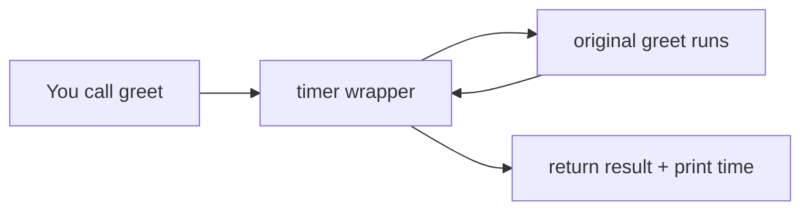

# Module 01 — Functions, Decorators & Generators

**Phase:** Advanced Python

**Duration:** See [Session Calendar](../00_Course_Guide/11_Session_Calendar_100.md) (1h 15m live sessions).

**Previous module:** Data Structures Overview
**Next module:** Modules and Packages

---

## Learning Outcomes

By the end of this session, learners will be able to:

1. Define and call functions with parameters, default values, and return values.
2. Explain variable scope (local, global, LEGB rule) and use `*args` / `**kwargs`.
3. Write one-line functions using `lambda` where appropriate.
4. Use `map`, `filter`, and `functools.reduce` (and know when a comprehension is clearer).
5. Build and apply simple decorators (timing, login check).
6. Write generator functions with `yield`, use `next()`, and explain exhaustion vs lists.
7. Write generator expressions and stream in-memory rows one at a time (CSV files come in Files week).
8. Refactor repetitive scripts into reusable utility functions.

---


## Classroom Ticket

Open the lab kit **before** long notes. Read the ticket → code in `starter/` or fix `broken/`.

- **[Refactor ATM into functions](../15_Lab_Assets/13_function_refactor/)** (S28)
- **[Login-gate decorator](../15_Lab_Assets/14_decorator_login_gate/)** (S30)
- **[Ship](../15_Lab_Assets/30_ksr_utils_toolkit/)** `ksr_utils` **[toolkit](../15_Lab_Assets/30_ksr_utils_toolkit/)** (homework — **no generators**)
- **[Stream CSV with yield](../15_Lab_Assets/15_generator_csv_stream/)** (S31 — after functions homework)

Finish the ticket in class; compare with the official solution only when your trainer says so.

### What is a function?

If a group of statements is needed again and again, do **not** copy-paste them. Bundle those statements into **one named unit**, then **call** that unit whenever you need it. That unit is a **function**.

Kitchen analogy: instead of rewriting “boil water → noodles → masala” every time, you write the recipe once (`def make_maggi(...)`) and call it when hungry.

In other languages the same idea may be called a *method*, *procedure*, or *subroutine*. In Python we mostly say **function** (and later **method** when it lives on a class).

### Why do we need functions?


| Without functions                        | With functions                               |
| ---------------------------------------- | -------------------------------------------- |
| Same validation copied in 5 places       | One `is_valid_email()` reused everywhere     |
| Bug fixed in one place, missed in others | Fix once — every call benefits               |
| 400-line script hard to read             | Named steps: `load()`, `process()`, `save()` |


**Main advantage: code reusability** — write once, call many times. Secondary wins: clearer names, easier testing, and smaller pieces you can put in modules later.

### Two kinds of functions in Python

1. **Built-in (predefined)** — already available with Python: `print()`, `len()`, `type()`, `input()`, `int()`, `sum()`, …
2. **User-defined** — you write them for your project: `calculate_bill()`, `wish()`, `withdraw()`.

You already *use* built-ins. This module teaches you to *create* user-defined ones, then stretch into decorators and generators.

### Parameter vs argument (words interviewers mix up)

- **Parameter** — placeholder name in the definition: `def wish(name):`
- **Argument** — real value you pass when calling: `wish("Priya")`

Recipe placeholders vs the ingredients you actually put in the bowl.

### Scope, decorators, generators (big picture first)

- **Scope** — a variable created inside one “room” (function) is not automatically visible in another. Rooms = local / enclosing / global / built-in (LEGB).
- `map` **/** `filter` **/** `reduce` — apply a function across a list (transform, keep matches, or fold to one value); often paired with `lambda`.
- **Decorator** — wrap an existing function (security guard outside a shop) without rewriting the shop’s interior.
- **Generator** — hand out values **one at a time** (waiter brings dishes) instead of loading a giant list into memory (whole buffet on the table).

---


## Important Concepts


### 1. Creating a user-defined function (`def` and `return`)

**What:** A named block that runs when called.  
**Why:** So you can reuse logic and give that logic a clear name.

Two keywords matter:

1. `def` — **mandatory** — starts the definition
2. `return` — **optional** — sends a result back to the caller (if omitted, Python returns `None`)

```python
def wish():
    """Print a greeting. No inputs, no return value."""
    print("Hello Good Morning")

wish()
wish()  # call as many times as you need — no rewrite
```

With an input (parameter) and a returned result:

```python
def greet(name):          # name is a parameter
    message = f"Hello, {name}!"
    return message        # sends value back to caller

result = greet("Priya")   # "Priya" is the argument
print(result)             # Hello, Priya!
```

**Rules people often forget:**

- `return` exits the function immediately (code after it does not run).
- No `return` → the call evaluates to `None` (easy to miss when you `print(f())`).
- Python can return **multiple values** as a tuple: `return sum, diff` then `x, y = sum_sub(10, 5)`.

**Try these (2 programs):**

**Program 1 — Celsius to Fahrenheit**

```python
def celsius_to_fahrenheit(c):
    return c * 9 / 5 + 32

for temp in (0, 37, 100):
    print(f"{temp}°C → {celsius_to_fahrenheit(temp)}°F")
```

**Program 2 — Even or Odd**

```python
def even_odd(n):
    return "Even" if n % 2 == 0 else "Odd"

print(even_odd(10))  # Even
print(even_odd(15))  # Odd
```


### 2. Types of arguments (what / why, then syntax)

When you write `def sub(a, b):` and call `sub(100, 200)`, `a`/`b` are **formal** parameters and `100`/`200` are **actual** arguments.

Python allows four common ways to pass arguments. Understand **why** each exists before memorizing the table.

#### 2a. Positional arguments

**What:** Values match parameters **by order**.  
**Why:** Simple and short for small APIs.  
**Caution:** Swap order → wrong result (`sub(100, 200)` ≠ `sub(200, 100)`). Count must match.

```python
def sub(a, b):
    return a - b

print(sub(100, 200))  # -100
print(sub(200, 100))  # 100
```


#### 2b. Keyword arguments

**What:** Pass by **parameter name**: `wish(name="Ravi", msg="Hi")`.  
**Why:** Order no longer matters; calls stay readable when there are many options.  
**Rule:** After a keyword argument, you cannot put a bare positional one.

```python
def wish(name, msg):
    print(f"Hello {name}, {msg}")

wish(name="Ravi", msg="Good Morning")
wish(msg="Good Morning", name="Ravi")  # same result
# wish(name="Ravi", "Good Morning")  # SyntaxError
```


#### 2c. Default arguments

**What:** A parameter already has a value if the caller skips it.  
**Why:** Optional behaviour without writing two functions (`wish("Ravi")` and `wish()`).  
**Rule:** Non-default parameters must come **before** defaults (`def wish(name="Guest", msg):` is invalid).

```python
def wish(name="Guest"):
    print(f"Hello {name}, Good Morning")

wish("Ravi")
wish()  # uses "Guest"
```


#### 2d. Variable-length arguments (`*args`, `**kwargs`)

**What:** Accept **any number** of positional (`*args` → tuple) or keyword (`**kwargs` → dict) values.  
**Why:** Helpers like `sum_all(...)`, flexible loggers, wrappers, and Django/DRF-style call forwarding.  
**Rule (definition order):** required positional → `*args` → keyword-only → `**kwargs`.

```python
def sum_all(*numbers):
    total = 0
    for n in numbers:
        total += n
    return total

print(sum_all())           # 0
print(sum_all(10, 20, 30)) # 60

def build_profile(name, *skills, **meta):
    return {"name": name, "skills": list(skills), **meta}

print(build_profile("Arjun", "Python", "SQL", city="Hyderabad"))
```

**Quick reference (after you understand the why):**


| Type       | Syntax            | Use when                           |
| ---------- | ----------------- | ---------------------------------- |
| Positional | `f(a, b)`         | Few args; order is obvious         |
| Keyword    | `f(b=5, a=2)`     | Clarity / optional skip of order   |
| Default    | `def f(a, b=10)`  | Sensible optional value            |
| `*args`    | `def f(*args)`    | Unknown count of positional values |
| `**kwargs` | `def f(**kwargs)` | Unknown named options              |


**Try these (2 programs):**

**Program 1 — Default + keyword arguments**

```python
def greet(name, msg="Good Morning"):
    print(f"Hello {name}, {msg}")

greet("Priya")
greet(name="Ravi", msg="Good Evening")
```

**Program 2 —** `*args` **with tax**

```python
def total(*amounts, tax_rate=0.05):
    subtotal = sum(amounts)
    return round(subtotal * (1 + tax_rate), 2)

print(total(100, 200, 50))  # 367.5
```


### 3. Scope — local vs global (and LEGB)

**What:** Where a name is visible.  
**Why:** Without scope rules, every variable would collide; with them, functions stay self-contained.

- **Global** — declared outside functions; readable from functions in that module.
- **Local** — declared inside a function; invisible outside.

Python looks up names in this order (**LEGB**): **L**ocal → **E**nclosing (nested `def`) → **G**lobal → **B**uilt-in (`len`, `print`, …).

```python
tax_rate = 0.18  # global

def calculate_total(amount):
    tax = amount * tax_rate   # read global OK
    return amount + tax
```

Use `global x` only when you must **reassign** a global name. Prefer passing values in and returning results — globals make bugs hard to find in real projects.

**Try these (2 programs):**

**Program 1 — Fix counter with return (prefer this over** `global`**)**

```python
count = 0

def bump(n):
    return n + 1

count = bump(count)
print(count)  # 1
```

**Program 2 — Closure counter (no globals)**

```python
def make_counter():
    n = 0

    def next_count():
        nonlocal n
        n += 1
        return n

    return next_count

c = make_counter()
print(c())  # 1
print(c())  # 2
```


### 4. Lambda (anonymous) functions

**What:** A tiny function **without a** `def` **name**, written as `lambda args: expression`.  
**Why:** Instant one-off use — especially as the `key=` for `sorted`, or with `map`/`filter`.  
**When not to:** Multi-step logic, docstrings, or anything you will reuse and test — use `def`.

```python
square = lambda n: n * n
print(square(5))  # 25

names = ["Meera", "Ravi", "An"]
print(sorted(names, key=lambda x: len(x)))
```

Lambda **returns** the expression result automatically — no `return` keyword.

**Try these (2 programs):**

**Program 1 — Sort names by length**

```python
names = ["Meera", "Ravi", "An"]
print(sorted(names, key=lambda x: len(x)))  # ['An', 'Ravi', 'Meera']
```

**Program 2 — Sort marks descending**

```python
marks = [("A", 88), ("B", 95), ("C", 70)]
print(sorted(marks, key=lambda row: row[1], reverse=True))
# [('B', 95), ('A', 88), ('C', 70)]
```


### 5. `map`, `filter`, and `reduce`

**What:** Built-in helpers that apply a function across an iterable.  
**Why:** Short pipelines for “transform every item”, “keep matching items”, or “fold many values into one” — often with `lambda` or a small `def`.


| Tool                        | Idea                          | Campus example           |
| --------------------------- | ----------------------------- | ------------------------ |
| `map(fn, data)`             | Transform each item           | Prices → prices with GST |
| `filter(fn, data)`          | Keep items where `fn` is true | Marks ≥ 75 only          |
| `reduce(fn, data[, start])` | Combine into one value        | Sum / max of expenses    |


`map` and `filter` return **lazy iterators** in Python 3 — wrap with `list(...)` when you need a list. Prefer a **list comprehension** when it reads clearer; still learn these for interviews and older codebases.

```python
from functools import reduce

prices = [100, 250, 80]
with_gst = list(map(lambda p: round(p * 1.05, 2), prices))
print(with_gst)  # [105.0, 262.5, 84.0]

marks = [45, 78, 92, 61, 88]
passed = list(filter(lambda m: m >= 75, marks))
print(passed)  # [78, 92, 88]

total = reduce(lambda acc, x: acc + x, prices, 0)
print(total)  # 430
```

**Same ideas with comprehensions (often clearer):**

```python
with_gst = [round(p * 1.05, 2) for p in prices]
passed = [m for m in marks if m >= 75]
```

**Rules:**

- `map`/`filter` need a **function** (named or `lambda`) that takes one item (or more if you pass several iterables to `map`).
- `reduce` lives in `functools` (not a built-in). The function takes **(accumulator, next_item)**.
- Do not force `reduce` for a simple sum — `sum(prices)` is better. Use `reduce` when the fold is custom (e.g. merge dicts, running max with a twist).

**Try these (2 programs):**

**Program 1 —** `map` **+** `filter` **on canteen prices**

```python
prices = [40, 25, 60, 15, 120]
with_gst = list(map(lambda p: round(p * 1.05, 2), prices))
big = list(filter(lambda p: p >= 50, with_gst))
print(with_gst)
print(big)
```

**Program 2 —** `reduce` **for bill total (and contrast with** `sum`**)**

```python
from functools import reduce

bill = [40, 25, 60]
total = reduce(lambda acc, x: acc + x, bill, 0)
print(total)       # 125
print(sum(bill))   # same — prefer sum for plain addition
```


### 6. Decorators

**What:** A function that takes another function and returns a **wrapped** version (extra behaviour before/after).  
**Why:** Cross-cutting concerns — timing, login checks, retries — without copy-pasting into every function.

**Visual —** `@timer` **wraps your function like gift wrap:**




```python
def timer(func):
    def wrapper(*args, **kwargs):
        # before logic
        result = func(*args, **kwargs)
        # after logic
        return result
    return wrapper

@timer
def slow_task():
    ...
```

`@timer` above `def slow_task` means: `slow_task = timer(slow_task)`.

**Try these (2 programs):**

**Program 1 —** `@shout` **decorator**

```python
def shout(func):
    def wrapper(*args, **kwargs):
        return func(*args, **kwargs).upper()
    return wrapper

@shout
def greet(name):
    return f"hello, {name}"

print(greet("Priya"))  # HELLO, PRIYA
```

**Program 2 —** `@require_login` **gate**

```python
current_user = None

def require_login(func):
    def wrapper(*args, **kwargs):
        if current_user is None:
            print("Access denied — please log in")
            return None
        return func(*args, **kwargs)
    return wrapper

@require_login
def view_dashboard():
    return f"Welcome, {current_user}"

print(view_dashboard())   # Access denied
current_user = "Ravi"
print(view_dashboard())   # Welcome, Ravi
```


### 7. Generators vs lists

**What:** A generator produces values lazily with `yield` (or a generator expression).  
**Why:** A list of 10 million rows needs huge RAM; a generator holds **one** value at a time — ideal for files, streams, and large reports.


|          | List                      | Generator                            |
| -------- | ------------------------- | ------------------------------------ |
| Memory   | Stores all items          | One item at a time                   |
| Syntax   | `[x*2 for x in range(n)]` | `(x*2 for x in range(n))` or `yield` |
| Reusable | Yes                       | Exhausted after one full pass        |
| Best for | Small/medium data         | Large files, streams                 |


**Try these (2 programs):**

**Program 1 — Countdown generator**

```python
def countdown(n):
    while n >= 1:
        yield n
        n -= 1

for value in countdown(5):
    print(value, end=" ")  # 5 4 3 2 1
print()
```

**Program 2 — Even number stream**

```python
def even_stream(limit):
    n = 0
    while n <= limit:
        yield n
        n += 2

print(list(even_stream(10)))  # [0, 2, 4, 6, 8, 10]
```

---


## Step-by-Step Annotated Python 3 Code


### Example 1 — Basic function with default and return

```python
# file: utils_math.py

def calculate_bill(units, rate_per_unit=8.5, fixed_charge=50):
    """
    Calculate electricity bill.
    units: int — consumption
    rate_per_unit: float — default 8.5 INR
    fixed_charge: flat fee added every month
    """
    if units < 0:
        return None  # invalid input guard
    variable_cost = units * rate_per_unit
    total = variable_cost + fixed_charge
    return round(total, 2)

# Call with positional args
print(calculate_bill(120))           # uses default rate

# Call with keyword args (order flexible)
print(calculate_bill(units=200, rate_per_unit=10))
```


### Example 2 — *args and **kwargs

```python
def build_profile(name, *skills, **meta):
    """
    name: required positional
    *skills: tuple of extra positional args (Java, Python, ...)
    **meta: dict of keyword extras (city=..., experience=...)
    """
    profile = {"name": name, "skills": list(skills)}
    profile.update(meta)
    return profile

p = build_profile("Arjun", "Python", "SQL", city="Hyderabad", experience=2)
print(p)
# {'name': 'Arjun', 'skills': ['Python', 'SQL'], 'city': 'Hyderabad', 'experience': 2}
```


### Example 3 — Scope demonstration

```python
counter = 0  # global

def increment():
    global counter   # needed because we ASSIGN to counter
    counter += 1
    return counter

print(increment())  # 1
print(increment())  # 2
```


### Example 4 — Lambda with sorted

```python
students = [
    {"name": "Meera", "score": 78},
    {"name": "Ravi", "score": 92},
    {"name": "Anita", "score": 85},
]

# Sort by score descending
ranked = sorted(students, key=lambda s: s["score"], reverse=True)
for s in ranked:
    print(s["name"], s["score"])
```


### Example 5 — `map` / `filter` / `reduce`

```python
from functools import reduce

marks = [55, 72, 91, 40, 88]
graded = list(map(lambda m: "Pass" if m >= 35 else "Fail", marks))
toppers = list(filter(lambda m: m >= 90, marks))
highest = reduce(lambda a, b: a if a > b else b, marks)
print(graded)
print(toppers)   # [91]
print(highest)   # 91
```


### Example 6 — Timing decorator

```python
import time

def timing_decorator(func):
    def wrapper(*args, **kwargs):
        start = time.perf_counter()
        result = func(*args, **kwargs)
        print(f"[TIMER] {func.__name__}: {time.perf_counter()-start:.4f}s")
        return result
    return wrapper

@timing_decorator
def fetch_data():
    time.sleep(0.5)
    return ["row1", "row2"]
```


### Example 7 — Login decorator

```python
logged_in_user = None

def require_login(func):
    def wrapper(*args, **kwargs):
        if logged_in_user is None:
            print("Access denied. Please login first.")
            return None
        return func(*args, **kwargs)
    return wrapper

@require_login
def view_salary():
    print(f"Salary slip for {logged_in_user}")
```


### Example 8 — Generator vs list

```python
def squares_gen(n):
    for x in range(n):
        yield x * x   # one value at a time — memory friendly

for val in squares_gen(5):
    print(val, end=" ")   # 0 1 4 9 16
```

---


## Common Mistakes


| Mistake                           | Problem                          | Fix                                  |
| --------------------------------- | -------------------------------- | ------------------------------------ |
| Mutable default arg `def f(x=[])` | Same list reused across calls    | Use `None` and create list inside    |
| Forgetting `return`               | Function returns `None` silently | Always return explicit value         |
| Using `global` everywhere         | Hard-to-debug shared state       | Pass values as parameters            |
| Overusing lambda                  | Unreadable code                  | Use `def` for multi-step logic       |
| Forcing `reduce` for simple sum   | Harder to read than `sum(x)`     | Prefer `sum` / `max` / comprehension |
| Forgetting `list(map(...))`       | Surprised by a map object        | Convert when you need a list         |
| Calling generator like list       | `gen[0]` fails                   | Use `next(gen)` or loop              |
| Decorator without `@wraps`        | Lost function name in debugging  | `from functools import wraps`        |
| `*args` before required param     | SyntaxError                      | Required params come first           |


**Classic mutable default bug:**

```python
# BAD
def add_item(item, bucket=[]):
    bucket.append(item)
    return bucket

# GOOD
def add_item(item, bucket=None):
    if bucket is None:
        bucket = []
    bucket.append(item)
    return bucket
```

---


## Practice Exercises


### Basic

1. Write `celsius_to_fahrenheit(c)` returning `F = C * 9/5 + 32`.
  **Model answer:**
2. Write `full_name(first, last, middle="")` returning formatted name.
  **Model answer:**
3. Write `sum_all(*numbers)` returning sum of any count of numbers.
  **Model answer:**
4. Predict output of scope quiz (trainer provides 3 snippets).
  **Model answer:**
   Use LEGB: a name resolves Local → Enclosing → Global → Built-in. Assigning inside a function creates a local unless you use `global`/`nonlocal`. Typical quiz: reading a global works; assigning without `global` raises `UnboundLocalError` if the name is also assigned later in the same function.
5. Use `map` to add 5% GST to `[100, 200, 50]` and `filter` to keep totals ≥ 150.
  **Model answer:**


### Intermediate

1. Refactor ATM menu into functions: `show_menu()`, `deposit()`, `withdraw()`.
  **Model answer:**
2. Create `@log_calls` decorator printing function name and arguments.
  **Model answer:**
3. Write generator `fibonacci(n)` yielding first `n` Fibonacci numbers.
  **Model answer:**
4. Use `functools.reduce` to find the longest name in `["Ravi", "Ananya", "Om"]`.
  **Model answer:**


### Interview-style

1. Write decorator that retries a function up to 3 times on exception.
  **Model answer:**
2. When choose generator over list for 10 million records?
  **Model answer:**
   Prefer a generator when you process records one at a time and do not need random access or the full collection in memory. A list of 10 million rows can exhaust RAM; `yield` streams values lazily and keeps peak memory low.
3. `map`/`filter` vs list comprehension — when prefer each?
  **Model answer:**
   Prefer a comprehension when the transform/condition is short and readability matters (most campus code). Prefer `map`/`filter` when you already have a named function to reuse, or when matching interview/library style. Always know both.


## Mini-Project: Reusable Utility Library

**Title:** `ksr_utils` — Personal Python Toolkit  
**Lab kit (build here):** [15_Lab_Assets/30_ksr_utils_toolkit/](../15_Lab_Assets/30_ksr_utils_toolkit/)  
**Also use:** [14_decorator_login_gate](../15_Lab_Assets/14_decorator_login_gate/), [16_venv_package_bootstrap](../15_Lab_Assets/16_venv_package_bootstrap/)  
**Generators (S31+ only):** [15_generator_csv_stream](../15_Lab_Assets/15_generator_csv_stream/) — not part of this homework

**Homework scope:** functions + lambda/`map`/`filter` + decorators. **No** `yield` **/ generators.**

### What to build


| File            | Functions                                     | Notes                                                           |
| --------------- | --------------------------------------------- | --------------------------------------------------------------- |
| `validators.py` | `is_email`, `is_phone_in`, `is_positive`      | Pure functions; no `print`                                      |
| `formatters.py` | `format_inr`, `format_date(day, month, year)` | ₹ formatting; zero-padded DD-MM-YYYY (no `datetime` module yet) |
| `transforms.py` | `with_gst`, `keep_high`                       | Use `map` and `filter` (wrap with `list(...)`)                  |
| `decorators.py` | `timing`, `require_token`                     | Wrapper functions; `*args` / `**kwargs`                         |
| `__init__.py`   | re-exports                                    | Clean imports: `from ksr_utils import format_inr`               |
| `demo.py`       | smoke test                                    | Prints + one timed call + GST/filter demo                       |


### Stretch

- Add `is_strong_password(s)` (length ≥ 8, has digit).  
- Add `@retry(times=3)` decorator for flaky calls.  
- **After S31:** finish `generators.py` (`read_rows` must `yield`).  
- **Later (Files week):** `yield` rows from a CSV with `csv.DictReader`.  
- Add `README.md` with install/run and 3 import examples.


### Done when

- [ ] Starter kit `demo.py` passes (**without** generators)  
- [ ] `with_gst` / `keep_high` use `map` / `filter`  
- [ ] Package pushed to GitHub  
- [ ] README shows how a teammate imports your helpers  

---


## Revision Map — Memorize / Understand / Practise / Build


| Topic             | Memorize                               | Understand                                    | Practise                   | Build                            |
| ----------------- | -------------------------------------- | --------------------------------------------- | -------------------------- | -------------------------------- |
| Function basics   | `def`, `return`, parameter vs argument | Why functions reduce duplication              | Write 5 utility functions  | String/date helper module        |
| Parameters        | Default args, `*args`, `**kwargs`      | Positional vs keyword binding                 | Variadic function drills   | Flexible logger wrapper          |
| Scope             | `global`, LEGB                         | Why globals are risky                         | Scope prediction exercises | Refactor global-heavy script     |
| Lambda            | Syntax `lambda x: x*2`                 | When **not** to use lambda                    | Sort with `key=`           | Mini map/filter demos            |
| map/filter/reduce | `map`, `filter`, `functools.reduce`    | Lazy iterators; when comprehension is clearer | GST map + pass filter      | Bill fold with reduce            |
| Decorators        | `@decorator` syntax                    | Wrapper + closure idea                        | Timing + auth decorators   | Login-gated CLI menu             |
| Generators (S31+) | `yield`, `next()`                      | Lazy evaluation vs eager list                 | File line reader           | Optional `generators.py` stretch |


**Label legend:** **Memorize** = recall in interviews · **Understand** = explain in English · **Practise** = daily labs · **Build** = portfolio artefacts

---


## Interview & Discussion Q&A


### Discuss in class

1. Why are functions the building blocks of clean Python code?
2. Can a function return multiple values? How?
3. What happens when you call a generator function?
4. When would you use `map`/`filter` instead of a list comprehension?
5. Why might a login decorator be useful in Django views?
6. How does `@timing_decorator` relate to production monitoring?

*No memorized script — push for plain-English answers, then continue to interview Qs below.*

### Interview answers

**Q1. What is the difference between** `*args` **and** `**kwargs`**?**  
**A:** `*args` collects extra positional arguments into a tuple; `**kwargs` collects extra keyword arguments into a dictionary. They make functions flexible when the number of inputs varies.

**Q2. Explain decorators in simple terms.**  
**A:** A decorator wraps a function to extend its behavior (logging, timing, auth) without modifying the original function body. Syntax `@dec` applies `func = dec(func)`.

**Q3. Generator vs list comprehension?**  
**A:** List comprehension builds the entire list in memory immediately. A generator produces items lazily on demand, which saves memory for large or infinite sequences.

**Q4. What is a lambda function? When not to use it?**  
**A:** Lambda is an anonymous single-expression function. Avoid it for complex logic, multiple statements, or when readability suffers — use `def` instead.

**Q5. What are** `map`**,** `filter`**, and** `reduce`**?**  
**A:** `map` applies a function to every item; `filter` keeps items where the function is true; `reduce` (from `functools`) folds items into one value. In Python 3, `map`/`filter` are lazy — use `list(...)` when you need a concrete list. Prefer comprehensions/`sum` when clearer.

**Q6. What is variable scope? Explain LEGB.**  
**A:** Scope determines where a name is visible. Python searches Local → Enclosing (nested functions) → Global (module) → Built-in (len, print, etc.).

---

