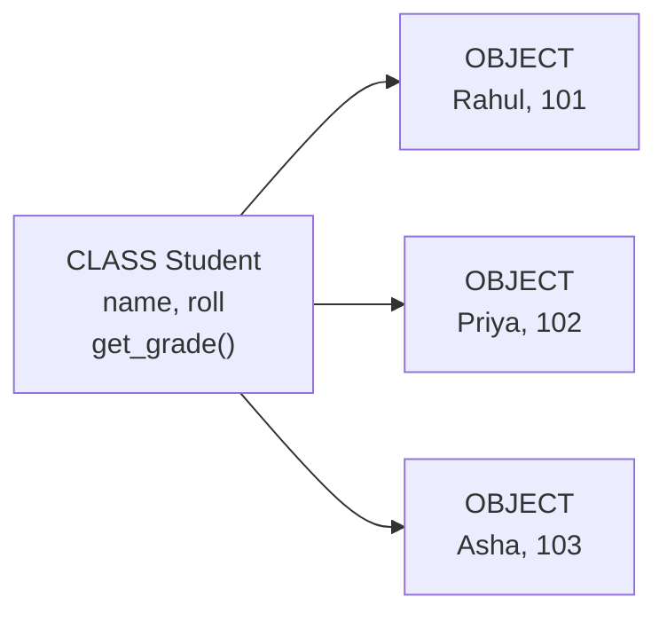
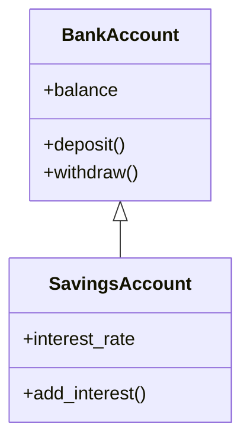

# Module 03 — Object-Oriented Programming (OOP)

**Phase:** Advanced Python

**Duration:** See [Session Calendar](../00_Course_Guide/11_Session_Calendar_100.md) (1h 15m live sessions).

**Previous module:** Modules and Packages
**Next module:** Exception Handling

---

## Learning Outcomes

By the end of this session, learners will be able to:

1. Define classes and create objects with attributes and methods.
2. Use `__init__` constructor to initialize object state.
3. Explain encapsulation, inheritance, and polymorphism with Python examples.
4. Differentiate class variables vs instance variables.
5. Use `super()` to extend parent class behavior.
6. Model real entities (Employee, Student, BankAccount) for Django models later.

---

## Classroom Ticket

Open the lab kit **before** long notes. Read the ticket → code in `starter/` or fix `broken/`.

- **[BankAccount with protected balance](../15_Lab_Assets/17_bank_account_oop/)**

Finish the ticket in class; compare with the official solution only when your trainer says so.

**Object-Oriented Programming (OOP)** models software around **things** (objects) in the real world — a `Student`, a `BankAccount`, an `Order`.

- A **class** is the blueprint (like an Aadhaar form template).
- An **object** is one filled form — a specific student with name "Rahul" and roll 101.

**Visual — one blueprint, many filled forms:**



Each object stores **data** (attributes) and **behaviors** (methods). Instead of passing a student dict everywhere, you pass one `Student` object: `student.get_grade()`.

**Encapsulation** means bundling data + methods and controlling access (don't let anyone set balance to -5000 directly).

**Inheritance** lets a new class reuse an existing class — `SavingsAccount` extends `BankAccount`.

**Visual — IS-A inheritance (child gets parent features):**



**Polymorphism** means "many forms" — calling `withdraw()` works on different account types but each may calculate fees differently.

This is the same thinking Django uses for **Models** (each model class = database table).

---

## Important Concepts

### 1. Class, object, `__init__` — what / why, then syntax

**What:** A **class** is the blueprint; an **object** is one concrete instance. `__init__` runs when you create an object and sets its starting data.  
**Why:** Real systems (Student, Order, BankAccount) are easier as objects than as loose dicts passed everywhere — and Django Models follow the same idea.

```python
class Student:
    def __init__(self, roll, name):   # constructor
        self.roll = roll              # instance attribute
        self.name = name

    def display(self):                # instance method
        print(f"{self.roll}: {self.name}")

s1 = Student(101, "Anita")            # object creation
s1.display()
```

- `self` refers to the **current** object (like `this` in Java).
- `__init__` runs automatically after object creation — you rarely call it by name.

**Try these (2 programs):**

**Program 1 — `Book` with `info()`**

```python
class Book:
    def __init__(self, title, author, price):
        self.title = title
        self.author = author
        self.price = price

    def info(self):
        print(f"{self.title} by {self.author} — ₹{self.price}")

b1 = Book("Atomic Habits", "James Clear", 499)
b2 = Book("Wings of Fire", "A.P.J. Abdul Kalam", 350)
b1.info()  # Atomic Habits by James Clear — ₹499
b2.info()
```

**Program 2 — `Student.is_pass`**

```python
class Student:
    def __init__(self, roll, name):
        self.roll = roll
        self.name = name

    def is_pass(self, marks):
        return marks >= 40

s = Student(101, "Anita")
print(s.is_pass(35))  # False
print(s.is_pass(72))  # True
```

### 2. Class vs instance attributes

**What:** Class attributes are shared by all objects; instance attributes belong to one object.  
**Why:** Company name can be shared; employee id must not be.

```python
class Employee:
    company = "KSR Datavizon"   # class attribute — shared

    def __init__(self, emp_id, name):
        self.emp_id = emp_id    # instance attribute — unique per object
        self.name = name
```

**Try these (2 programs):**

**Program 1 — Instance vs class attribute shadowing**

```python
class Employee:
    company = "KSR Datavizon"

    def __init__(self, emp_id, name):
        self.emp_id = emp_id
        self.name = name

e1 = Employee(1, "Ravi")
e2 = Employee(2, "Meera")
e1.company = "Acme"  # creates instance attribute on e1 only

print(e1.company)         # Acme
print(e2.company)         # KSR Datavizon
print(Employee.company)   # KSR Datavizon
# e1 got its own company; e2 still reads the class attribute
```

**Program 2 — Shared class attribute on `Student`**

```python
class Student:
    college = "KSR College"

    def __init__(self, roll, name):
        self.roll = roll
        self.name = name

s1 = Student(1, "Anita")
s2 = Student(2, "Vikram")
print(s1.college, s2.college)  # KSR College KSR College

Student.college = "KSR Institute of Technology"
print(s1.college, s2.college)  # both reflect the new class value
```

### 3. Encapsulation conventions

**What:** Naming that signals “please don’t touch this from outside.”  
**Why:** Protect balances, passwords, and internal state from accidental misuse.

| Syntax | Meaning | Access |
|--------|---------|--------|
| `name` | public | Normal use |
| `_name` | protected (convention) | Internal use |
| `__name` | name mangled | Harder accidental access |

Use `@property` for controlled read access (stretch).

**Try these (2 programs):**

**Program 1 — `UPIWallet` with private balance**

```python
class UPIWallet:
    def __init__(self, balance=0):
        self.__balance = balance

    def credit(self, amount):
        if amount <= 0:
            print("Invalid credit amount")
            return
        self.__balance += amount

    def debit(self, amount):
        if amount <= 0:
            print("Invalid debit amount")
            return
        if amount > self.__balance:
            print("Insufficient balance")
            return
        self.__balance -= amount

    def get_balance(self):
        return self.__balance

wallet = UPIWallet(500)
wallet.credit(200)
wallet.debit(100)
wallet.debit(1000)  # rejected
print("Balance:", wallet.get_balance())  # 600
```

**Program 2 — Name mangling demo**

```python
class UPIWallet:
    def __init__(self, balance=0):
        self.__balance = balance

    def get_balance(self):
        return self.__balance

wallet = UPIWallet(500)
print("Has __balance attr?", hasattr(wallet, "__balance"))  # False — name mangled
print("Via getter:", wallet.get_balance())  # 500
# Advanced peek (not recommended): wallet._UPIWallet__balance
# Later (Exceptions week): catching AttributeError if you force-access wrongly
```

### 4. Inheritance and `super()`

**What:** A child class reuses and extends a parent (`SavingsAccount` **is a** `BankAccount`).  
**Why:** Share common behaviour once; override only what differs.

```python
class Person:
    def __init__(self, name):
        self.name = name

class Employee(Person):
    def __init__(self, name, emp_id):
        super().__init__(name)   # call parent constructor
        self.emp_id = emp_id
```

**Try these (2 programs):**

**Program 1 — `SavingsAccount` with interest**

```python
class BankAccount:
    def __init__(self, holder, balance=0):
        self.holder = holder
        self._balance = balance

    def deposit(self, amount):
        self._balance += amount

    def get_balance(self):
        return self._balance

class SavingsAccount(BankAccount):
    def __init__(self, holder, balance=0, interest_rate=0.04):
        super().__init__(holder, balance)
        self.interest_rate = interest_rate

    def apply_interest(self):
        interest = self._balance * self.interest_rate
        self.deposit(interest)
        print(f"Interest ₹{interest:.2f} added. Balance: ₹{self.get_balance():.2f}")

acct = SavingsAccount("Priya", 10000, 0.05)
acct.apply_interest()  # Interest ₹500.00 added. Balance: ₹10500.00
```

**Program 2 — `TeachingAssistant` with `super()`**

```python
class Person:
    def __init__(self, name):
        self.name = name

class TeachingAssistant(Person):
    def __init__(self, name, subject):
        super().__init__(name)
        self.subject = subject

    def label(self):
        return f"{self.name} — {self.subject} lab TA"

ta = TeachingAssistant("Anita", "DSA")
print(ta.label())  # Anita — DSA lab TA
```

### 5. Polymorphism (duck typing)

**What:** Same call works on different types if they share the needed behaviour (`speak()`).  
**Why:** Write one helper that works for many objects without giant `if type == ...` chains.

```python
class Dog:
    def speak(self):
        return "Woof"

class Cat:
    def speak(self):
        return "Meow"

def animal_sound(animal):
    print(animal.speak())   # works for any object with speak()

animal_sound(Dog())
animal_sound(Cat())
```

Python doesn't require a shared parent interface — if it has the method, it works.

**Try these (2 programs):**

**Program 1 — Payment polymorphism**

```python
class UPI:
    def pay(self, amount):
        print(f"Paid ₹{amount} via UPI")

class Card:
    def pay(self, amount):
        print(f"Paid ₹{amount} via Card")

class Cash:
    def pay(self, amount):
        print(f"Paid ₹{amount} in Cash")

def checkout(method, amount):
    method.pay(amount)

checkout(UPI(), 250)
checkout(Card(), 999)
checkout(Cash(), 50)
```

**Program 2 — Shape areas without `isinstance`**

```python
import math

class Circle:
    def __init__(self, r):
        self.r = r

    def area(self):
        return math.pi * self.r ** 2

class Square:
    def __init__(self, side):
        self.side = side

    def area(self):
        return self.side ** 2

shapes = [Circle(3), Square(4), Circle(1)]
for shape in shapes:
    print(f"{shape.__class__.__name__} area: {shape.area():.2f}")
```

---

## Step-by-Step Annotated Python 3 Code

### Example 1 — BankAccount with encapsulation

```python
class BankAccount:
    def __init__(self, holder, balance=0):
        self.holder = holder
        self.__balance = balance   # "private" by convention

    def deposit(self, amount):
        if amount <= 0:
            print("Invalid deposit amount")
            return
        self.__balance += amount
        print(f"Deposited ₹{amount}. New balance: ₹{self.__balance}")

    def withdraw(self, amount):
        if amount > self.__balance:
            print("Insufficient funds")
            return
        self.__balance -= amount
        print(f"Withdrew ₹{amount}. New balance: ₹{self.__balance}")

    def get_balance(self):
        return self.__balance

acct = BankAccount("Priya", 1000)
acct.deposit(500)
acct.withdraw(200)
print("Balance:", acct.get_balance())
# acct.__balance  # AttributeError — name mangling
```

### Example 2 — Class vs instance attribute trap

```python
class Batch:
    institute = "KSR"           # shared

    def __init__(self, name):
        self.name = name
        self.students = []      # MUST be instance list

b1 = Batch("Python FS Morning")
b2 = Batch("Python FS Evening")

b1.students.append("Arjun")
print(b2.students)   # [] — correct (each batch has own list)

# WRONG pattern (class-level mutable):
# students = []  at class level → all batches share same list!
```

### Example 3 — Inheritance hierarchy

```python
class Vehicle:
    def __init__(self, brand, year):
        self.brand = brand
        self.year = year

    def info(self):
        return f"{self.brand} ({self.year})"

class Car(Vehicle):
    def __init__(self, brand, year, doors):
        super().__init__(brand, year)
        self.doors = doors

    def info(self):   # override (polymorphism)
        base = super().info()
        return f"Car: {base}, doors={self.doors}"

class Bike(Vehicle):
    def info(self):
        return f"Bike: {super().info()}"

vehicles = [Car("Hyundai", 2022, 4), Bike("Royal Enfield", 2021)]
for v in vehicles:
    print(v.info())
```

### Example 4 — Employee management

```python
class Employee:
    tax_rate = 0.10
    def __init__(self, emp_id, name, basic_salary):
        self.emp_id, self.name, self.basic_salary = emp_id, name, basic_salary
    def net_salary(self):
        return self.basic_salary * (1 - Employee.tax_rate)

class Manager(Employee):
    def __init__(self, emp_id, name, basic_salary, bonus=5000):
        super().__init__(emp_id, name, basic_salary)
        self.bonus = bonus
    def net_salary(self):
        return super().net_salary() + self.bonus
```

### Example 5 — Static and class methods (preview)

```python
class Order:
    order_count = 0
    def __init__(self, product, qty):
        self.product, self.qty = product, qty
        Order.order_count += 1
    @classmethod
    def get_count(cls):
        return cls.order_count
```

---

## Common Mistakes

| Mistake | Problem | Fix |
|---------|---------|-----|
| Forgetting `self` in methods | TypeError on call | First param must be `self` |
| Mutable class attribute | Shared state across objects | Initialize lists in `__init__` |
| Not calling `super().__init__` | Parent attributes missing | Always init parent in child |
| Confusing class vs instance | Wrong shared data | Access class attr via `ClassName.attr` |
| Over-engineering OOP | 5 classes for hello world | Use functions until complexity grows |
| `__private` as true security | Still accessible via mangling | Use encapsulation for clarity, not security |

---

## Practice Exercises

### Basic

1. Create `Book` class with `title`, `author`, `price`, method `display()`.
   **Model answer:**
   ```python
   class Book:
       def __init__(self, title, author, price):
           self.title = title
           self.author = author
           self.price = price

       def display(self):
           print(f"{self.title} by {self.author} — ₹{self.price}")
   ```

2. Create two `Book` objects and print details.
   **Model answer:**
   ```python
   b1 = Book("Clean Code", "Robert Martin", 499)
   b2 = Book("Fluent Python", "Luciano Ramalho", 899)
   b1.display()
   b2.display()
   ```

3. Add method `apply_discount(percent)` returning new price.
   **Model answer:**
   ```python
   class Book:
       def __init__(self, title, author, price):
           self.title, self.author, self.price = title, author, price

       def apply_discount(self, percent):
           return self.price * (1 - percent / 100)

   print(Book("X", "Y", 1000).apply_discount(10))  # 900.0
   ```

### Intermediate

1. `Rectangle` class with `area()` and `perimeter()`; `Square` inherits from `Rectangle`.
   **Model answer:**
   ```python
   class Rectangle:
       def __init__(self, w, h):
           self.w, self.h = w, h

       def area(self):
           return self.w * self.h

       def perimeter(self):
           return 2 * (self.w + self.h)

   class Square(Rectangle):
       def __init__(self, side):
           super().__init__(side, side)
   ```

2. `Student` class with list of marks; methods `average()` and `grade()`.
   **Model answer:**
   ```python
   class Student:
       def __init__(self, name, marks):
           self.name, self.marks = name, marks

       def average(self):
           return sum(self.marks) / len(self.marks)

       def grade(self):
           avg = self.average()
           if avg >= 85:
               return "A"
           if avg >= 70:
               return "B"
           if avg >= 50:
               return "C"
           return "Fail"
   ```

3. Demonstrate polymorphism with `Shape` base and `Circle`, `Rectangle` subclasses.
   **Model answer:**
   ```python
   import math

   class Shape:
       def area(self):
           raise NotImplementedError

   class Circle(Shape):
       def __init__(self, r):
           self.r = r
       def area(self):
           return math.pi * self.r ** 2

   class Rectangle(Shape):
       def __init__(self, w, h):
           self.w, self.h = w, h
       def area(self):
           return self.w * self.h

   for shape in [Circle(2), Rectangle(3, 4)]:
       print(shape.area())
   ```

### Interview-style

1. Difference between `@staticmethod` and `@classmethod`?
   **Model answer:**
   `@staticmethod` is a plain function living on the class; it gets no automatic first argument. `@classmethod` receives the class as `cls` and is used for alternate constructors or class-level helpers that must know which class was called.

2. Is Python fully object-oriented? Discuss.
   **Model answer:**
   Nearly everything is an object (ints, functions, classes), and OOP features (classes, inheritance, polymorphism) are first-class. It is multi-paradigm: you can also write procedural or functional style without forcing classes everywhere.

3. How does OOP relate to Django models?
   **Model answer:**
   Each Django model is a class inheriting `models.Model`; fields are class attributes and the ORM maps instances to table rows. Inheritance, methods, and encapsulation on models mirror the OOP you use in plain Python.

## Mini-Project: BankAccount OOP CLI

**Title:** Encapsulated savings account demo  
**Lab kit (build here):** [15_Lab_Assets/17_bank_account_oop/](../15_Lab_Assets/17_bank_account_oop/)

### What to build

| Piece | Detail |
|-------|--------|
| `BankAccount` | `__balance` (or `_balance` + property); `deposit`, `withdraw`, `get_balance` |
| Rules | Reject amount ≤ 0; reject withdraw over balance |
| CLI menu | 1 Deposit · 2 Withdraw · 3 Balance · 4 Exit |

**Starter idea:**

```python
class BankAccount:
    def __init__(self, owner, opening=0.0):
        self.owner = owner
        self.__balance = float(opening)

    def deposit(self, amount):
        if amount <= 0:
            print("amount must be positive")
            return
        self.__balance += amount

    def withdraw(self, amount):
        if amount <= 0:
            print("amount must be positive")
            return
        if amount > self.__balance:
            print("insufficient funds")
            return
        self.__balance -= amount

    def get_balance(self):
        return self.__balance
```

### Stretch

- Add `SavingsAccount(BankAccount)` with `apply_interest(rate)`.  
- Log each successful deposit/withdraw as a list of tuples `(action, amount, balance)`.  
- **Later (Exceptions week):** switch validation to `raise ValueError` and catch it in the menu loop.

### Done when

- [ ] Lab kit BankAccount ticket passes  
- [ ] Menu options 1–3 work; 4 exits  
- [ ] Balance is not casually overwritten from outside (`account.__balance` fails / mangled)  
- [ ] Repo pushed with a short README of a sample session  

---

## Revision Map — Memorize / Understand / Practise / Build

| Topic | Memorize | Understand | Practise | Build |
|-------|----------|------------|----------|-------|
| Class & object | `class`, `self`, `__init__` | Blueprint vs instance | Create 3 simple classes | Entity models |
| Attributes | Instance vs class attrs | Shared vs per-object data | Spot class attr bugs | Config + instance mix |
| Methods | Instance method signature | `self` is the object | Method calling drills | Service class methods |
| Encapsulation | `_protected`, `__private` convention | Public interface idea | Property getters | Validated attributes |
| Inheritance | `class Child(Parent)` | IS-A relationship | 2-level hierarchy | Vehicle / Employee tree |
| Polymorphism | Same method, different behavior | Duck typing in Python | Override methods | Payment processors |
| super() | `super().__init__(...)` | Cooperative inheritance | Parent + child init | Extended Employee class |

## Interview & Discussion Q&A

### Discuss in class

1. Why does Python pass `self` explicitly unlike Java's implicit `this`?
2. When should you use inheritance vs composition ("has-a" vs "is-a")?
3. How will `Student` class map to a MySQL table in Django ORM?
4. Is `__balance` truly private in Python?
5. Why might a class variable for `tax_rate` be useful?

*No memorized script — push for plain-English answers, then continue to interview Qs below.*

### Interview answers

**Q1. What is OOP? Pillars?**  
**A:** Programming paradigm based on objects. Pillars: encapsulation (bundle + hide), inheritance (reuse via IS-A), polymorphism (same interface, different behavior), abstraction (show essentials).

**Q2. `self` in Python?**  
**A:** Reference to the current instance. Must be first parameter of instance methods; passed implicitly on call `obj.method()`.

**Q3. Difference class method vs static method?**  
**A:** Class method receives `cls`, can access/modify class state; static method no implicit first arg, utility function namespaced in class.

**Q4. Multiple inheritance in Python?**  
**A:** Supported (`class C(A, B)`); MRO (Method Resolution Order) determines lookup. Prefer composition when possible.

**Q5. How OOP helps Django?**  
**A:** Each model is a class mapping to DB table; instances are rows; methods add business logic; inheritance for abstract base models.

---

